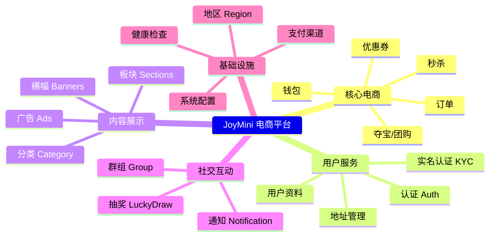
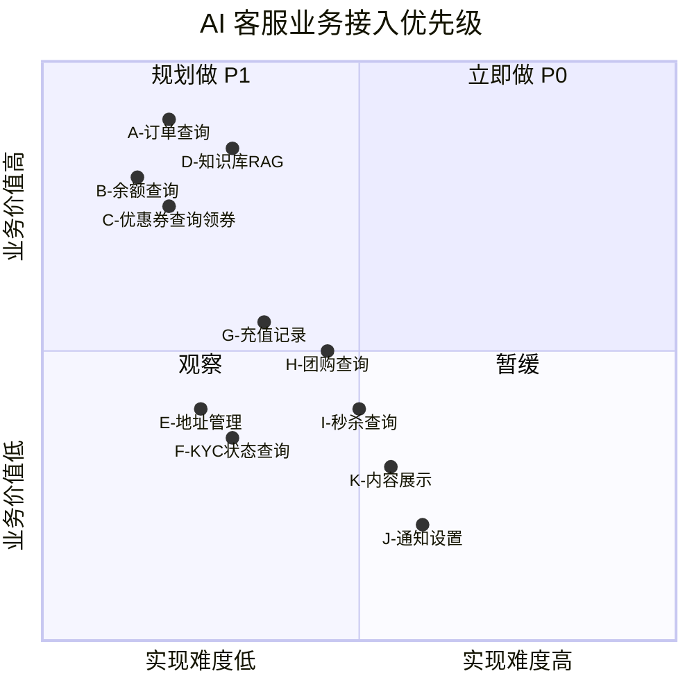

# JoyMini 全业务模块分析 — AI 客服结合可能性与优缺点

> 分析 JoyMini 所有 Client 业务模块，评估 AI 客服可结合的能力、实现方式、优缺点

---

## 一、业务全景



---

## 二、每个业务模块的详细分析

### 1. 订单模块 (Orders)

**业务本质：** 用户购买商品的核心流程

| 子功能 | 当前实现 | AI 可能性 | 风险 |
|--------|---------|-----------|------|
| 下单 checkout | `POST /orders/checkout` | ❌ 不能 | ⛔ 支付高危 |
| 订单列表 | `POST /orders/list` | ✅ 查我的订单 | 低 |
| 订单详情 | `POST /orders/detail` | ✅ 查某个订单详情 | 低 |
| 申请退款 | `POST /orders/refund/apply` | ⚠️ AI 辅助填写 | 中（需用户确认） |

**AI 结合优缺点：**
- ✅ **优点：** 订单查询是客服最高频场景，AI 可减轻 70% 人工咨询
- ✅ **优点：** 数据明确（订单号、状态、金额），LLM 容易理解
- ❌ **缺点：** 涉及真实资金，AI 不能直接操作支付/退款
- ❌ **缺点：** 订单状态字段复杂（多状态组合），需要精确 prompt 设计

### 2. 钱包模块 (Wallet)

**业务本质：** 用户的资金账户，含充值、消费、提现

| 子功能 | 当前实现 | AI 可能性 | 风险 |
|--------|---------|-----------|------|
| 余额查询 | `WalletService.balance()` | ✅ 查余额 | 低 |
| 充值记录 | `ClientWalletService.getRechargeHistory()` | ✅ 查记录 | 低 |
| 提现记录 | `ClientWalletService.getWithdrawalHistory()` | ✅ 查记录 | 低 |
| 充值 creditCash | `WalletService.creditCash()` | ❌ 不能 | ⛔ 资金操作 |
| 扣款 debitCash | `WalletService.debitCash()` | ❌ 不能 | ⛔ 资金操作 |

**AI 结合优缺点：**
- ✅ **优点：** 余额查询是高频场景，且数据安全
- ✅ **优点：** 充值/提现进度查询可减少客服压力
- ❌ **缺点：** 用户问"我要充值"时，AI 只能引导不能执行
- ❌ **缺点：** 余额敏感信息，需确认用户身份

### 3. 优惠券模块 (Coupon)

**业务本质：** 营销工具，发券/领券/核销

| 子功能 | 当前实现 | AI 可能性 | 风险 |
|--------|---------|-----------|------|
| 我的优惠券 | `ClientCouponService.getMyCoupons()` | ✅ 查券 | 低 |
| 可领券列表 | `ClientCouponService.getClaimableCoupons()` | ✅ 推荐可领券 | 低 |
| 领券 | `ClientCouponService.claimCoupon()` | ✅ AI 可帮领 | 低 |
| 兑换码 | `ClientCouponService.redeemCode()` | ✅ AI 可帮兑 | 低 |

**AI 结合优缺点：**
- ✅ **优点：** 最适合 AI 的模块！查询 + 操作都安全
- ✅ **优点：** 可做智能推荐（根据订单金额推荐最优券）
- ❌ **缺点：** 存在刷券风险，需加频率限制
- ❌ **缺点：** 券逻辑复杂（满减/折扣/有效期），需精确解释

### 4. 实名认证模块 (KYC)

**业务本质：** 用户身份验证

| 子功能 | 当前实现 | AI 可能性 | 风险 |
|--------|---------|-----------|------|
| 查询认证状态 | ✅ 可查 | ✅ | 低 |
| 查询支持证件类型 | ✅ 可查 | ✅ | 低 |
| 提交认证 | ❌ 不能 | ❌ | ⛔ 敏感信息 |

**AI 结合优缺点：**
- ✅ **优点：** 可回答"为什么认证失败"、"需要什么材料"
- ✅ **优点：** 可引导用户完成认证流程
- ❌ **缺点：** 涉及身份证等敏感信息，AI 不能接触原始数据
- ❌ **缺点：** OCR 识别错误需要人工处理

### 5. 地址模块 (Address)

**业务本质：** 用户的收货地址管理

| 子功能 | 当前实现 | AI 可能性 | 风险 |
|--------|---------|-----------|------|
| 查地址列表 | ✅ 可查 | ✅ | 低 |
| 新增地址 | ✅ 可操作 | ⚠️ 辅助 | 低 |
| 修改地址 | ✅ 可操作 | ⚠️ 辅助 | 低 |
| 删除地址 | ✅ 可操作 | ⚠️ 辅助 | 低 |

**AI 结合优缺点：**
- ✅ **优点：** 简单 CRUD，AI 可轻松处理
- ✅ **优点：** 可以帮用户格式化地址
- ❌ **缺点：** 用户可能更习惯自己操作
- ❌ **缺点：** AI 改错地址会导致收货问题

### 6. 夺宝/团购模块 (Treasure)

**业务本质：** 多人拼团/夺宝购买商品

| 子功能 | 当前实现 | AI 可能性 | 风险 |
|--------|---------|-----------|------|
| 商品详情 | `TreasureService` | ✅ 可查 | 低 |
| 团购进度 | 查询 | ✅ 可查 | 低 |
| 参团下单 | checkout 关联 | ❌ 不能 | ⛔ 支付 |

**AI 结合优缺点：**
- ✅ **优点：** 可解释团购规则、进度、剩余时间
- ✅ **优点：** 可推荐热门团购商品
- ❌ **缺点：** 团购逻辑复杂（成团条件、自动退款等）
- ❌ **缺点：** AI 不能替用户参团

### 7. 秒杀模块 (Flash Sale)

**业务本质：** 限时低价抢购

| 子功能 | 当前实现 | AI 可能性 | 风险 |
|--------|---------|-----------|------|
| 查询活动 | `GET flash-sale/:id` | ✅ | 低 |
| 参与秒杀 | checkout 关联 | ❌ 不能 | ⛔ 高并发 + 支付 |

**AI 结合优缺点：**
- ✅ **优点：** 可通知用户秒杀时间、预告
- ✅ **优点：** 可解答秒杀规则
- ❌ **缺点：** 秒杀对时效性要求极高，AI 响应延迟不适用
- ❌ **缺点：** 不能替用户抢购

### 8. 抽奖模块 (Lucky Draw)

**业务本质：** 营销抽奖活动

| 子功能 | 当前实现 | AI 可能性 | 风险 |
|--------|---------|-----------|------|
| 查询抽奖记录 | `LuckyDrawService` | ✅ 可查 | 低 |
| 参与抽奖 | `POST` | ❌ 不能 | ⛔ |

**AI 结合优缺点：**
- ✅ **优点：** 可查抽奖结果、解释规则
- ❌ **缺点：** 抽奖本身是娱乐行为，AI 参与无意义
- ❌ **缺点：** 需要确保公平性

### 9. 通知模块 (Notification)

**业务本质：** 推送通知给用户

| 子功能 | 当前实现 | AI 可能性 | 风险 |
|--------|---------|-----------|------|
| 注册设备 | `POST` | ❌ | 低 |
| 推送设置 | 查询+修改 | ⚠️ | 低 |

**AI 结合优缺点：**
- ✅ **优点：** 可帮用户查看/修改推送偏好
- ❌ **缺点：** 价值不大，用户自己就能操作
- ❌ **缺点：** 推送权限控制严格

### 10. 内容展示模块（Banners / Ads / Sections / Category）

**业务本质：** 首页/分类页的内容展示

| 子功能 | 当前实现 | AI 可能性 | 风险 |
|--------|---------|-----------|------|
| 查看首页 | 公开接口 | ✅ 可查 | 低 |
| 查看分类 | 公开接口 | ✅ 可查 | 低 |
| 查看广告 | 公开接口 | ✅ 可查 | 低 |

**AI 结合优缺点：**
- ✅ **优点：** AI 可以做商品推荐、分类导购
- ✅ **优点：** 可解释"有什么新品"、"什么在打折"
- ❌ **缺点：** 内容展示本身就是 UI 的事，AI 查了还要跳转

### 11. 用户模块 (Users)

**业务本质：** 用户个人信息

| 子功能 | 当前实现 | AI 可能性 | 风险 |
|--------|---------|-----------|------|
| 个人资料 | `UsersService` | ✅ 可查 | 低 |
| 修改资料 | `UsersService` | ⚠️ 辅助 | 低 |
| 注销账号 | - | ❌ 不能 | ⛔ |

**AI 结合优缺点：**
- ✅ **优点：** 可查 VIP 等级、注册信息
- ❌ **缺点：** 修改个人资料用户自己操作更安全

### 12. Auth 认证模块

**业务本质：** 登录注册

| 子功能 | 当前实现 | AI 可能性 | 风险 |
|--------|---------|-----------|------|
| 登录 | `POST /auth/login` | ❌ 不能 | ⛔ |
| 注册 | `POST /auth/register` | ❌ 不能 | ⛔ |
| OAuth | 第三方登录 | ❌ 不能 | ⛔ |

**AI 结合优缺点：**
- ✅ **优点：** 可解答"怎么登录"、"忘记密码怎么办"
- ❌ **缺点：** 绝对不能碰认证流程

---

## 三、AI 结合优先级矩阵

按 **业务价值 × 实现难度** 排序：



### P0（立即做 — Phase 1）

| 业务 | 原因 | 实现方式 |
|------|------|---------|
| **订单查询** | 最高频客服场景 | `OrderService` DI |
| **余额查询** | 第二高频 | `WalletService` DI |
| **优惠券查询** | 用户常问"有什么券" | `ClientCouponService` DI |
| **领券** | 可替用户操作 | `ClientCouponService.claimCoupon()` |
| **RAG 知识库** | 退换货政策、常见问题 | pgvector 新建 |

### P1（规划做 — Phase 2）

| 业务 | 原因 | 实现方式 |
|------|------|---------|
| 充值记录查询 | 用户问"我充过多少钱" | `ClientWalletService` DI |
| 提现记录查询 | 用户问"提现到哪了" | `ClientWalletService` DI |
| 兑换码兑换 | 用户懒得自己输 | `ClientCouponService.redeemCode()` |
| 地址管理 | 帮用户改地址 | `AddressService` DI |
| 退款申请 | AI 辅助填写 | `OrderService.applyRefund()` |

### P2（观察 — 未来）

| 业务 | 原因 |
|------|------|
| KYC 状态查询 | 低频但有价值 |
| 团购进度查询 | 有一定价值但复杂度高 |
| 秒杀活动查询 | 时效性要求高 |
| 抽奖结果查询 | 价值有限 |

### 不做

| 业务 | 原因 |
|------|------|
| 下单 | 支付安全 |
| 充值/提现 | 资金操作 |
| 登录/注册 | 认证安全 |
| 提交 KYC | 敏感信息 |
| 参与秒杀 | 公平性问题 |

---

## 四、从 study 项目借鉴的实现方案

| 我们的业务 | 可借鉴的项目 | 具体参考点 |
|-----------|------------|-----------|
| AI 客服整体架构 | [`journey-ai`](study/LLM/journey-ai) | NestJS + LangGraph + ToolNode |
| AI 客服 StateGraph | [`langchain`](study/LLM/langchain) | 10 种工作流模式 |
| 订单/余额工具 | [`jisu-ai-customer`](study/LLM/jisu-ai-customer) | ReAct Agent + Zod schema |
| RAG 知识库 | [`jisu-ai-customer`](study/LLM/jisu-ai-customer) | pgvector + 检索链 |
| 知识库管理界面 | [`ai-ops-platform`](study/LLM/ai-ops-platform) | 文档分块 + 命中率热力图 |
| Token/费用监控 | [`ai-ops-platform`](study/LLM/ai-ops-platform) | Token 统计看板 |

---

## 五、风险与对策总表

| 风险 | 场景 | 对策 |
|------|------|------|
| **资金安全** | AI 被诱导下单/转账 | 所有资金操作不暴露为工具 |
| **数据泄露** | AI 返回他人订单 | 每个工具调用都验证 `userId` 所有权 |
| **Prompt 注入** | 用户诱导 AI 执行违规操作 | 工具只暴露查询和低风险操作 |
| **刷券** | AI 领券被自动化利用 | 领券工具加频率限制 + 人机验证 |
| **幻觉** | AI 编造订单状态 | 工具返回结构化数据，LLM 只做格式化输出 |
| **隐私** | AI 读取敏感信息 | 返回数据时过滤敏感字段 |
| **过时数据** | AI 缓存了旧的订单状态 | 所有工具实时查询，不用缓存 |

---

## 六、总结

```
Phase 1 (P0):
  ✅ 订单查询 + 余额查询 + 优惠券 + RAG 知识库
  → 覆盖 80% 客服高频问题
  → 8 个工具 + 5 节点 StateGraph
  → 无资金安全风险

Phase 2 (P1):
  ⚠️ 记录查询 + 地址管理 + 退款辅助
  → 扩展业务覆盖
  → 需加入安全确认机制

未来 (P2):
  👀 KYC + 团购 + 秒杀
  → 视需求决定
```

