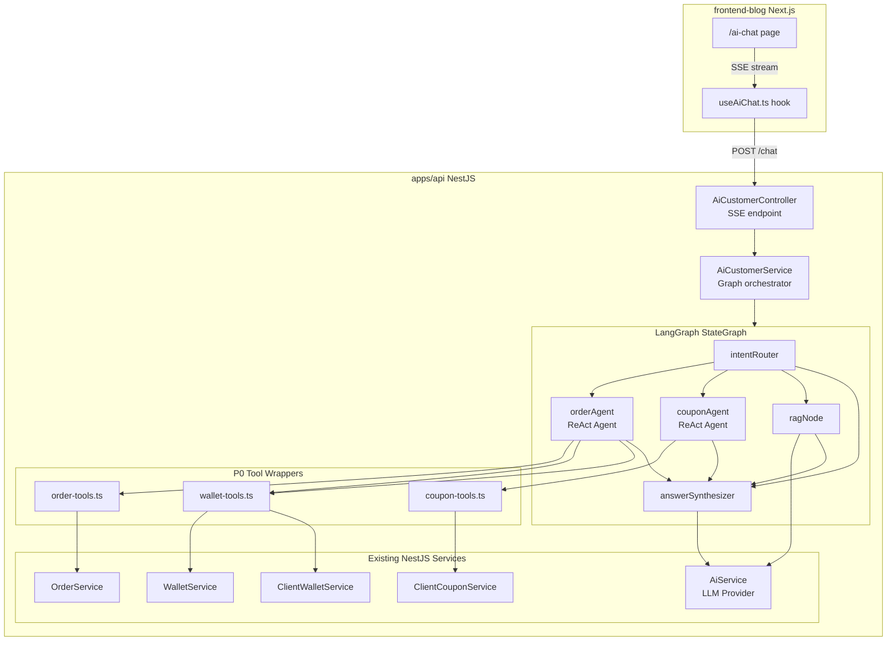
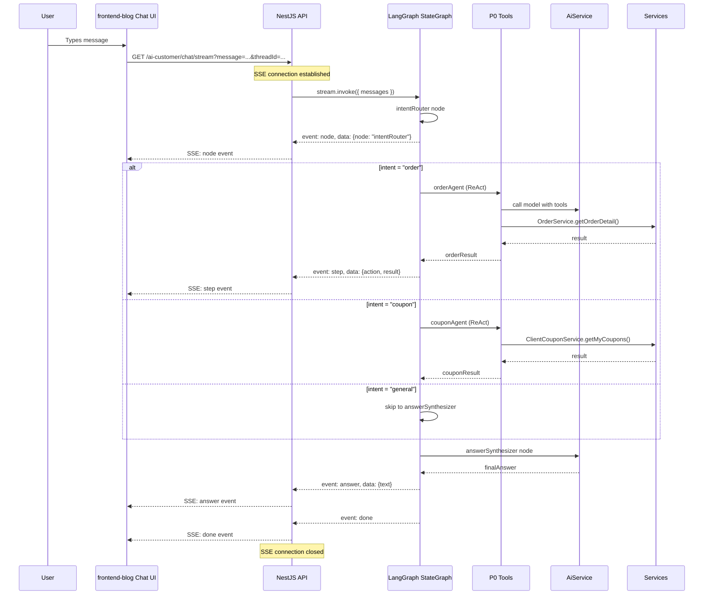

# Phase 1: AI Customer Service Assistant — Implementation Plan

## Overview

Integrate a LangGraph-based AI customer service assistant into the JoyMini NestJS monorepo. The AI assistant is **client-facing** (not admin), accessible from the `frontend-blog` Next.js app. It uses the existing NestJS business services via **direct DI injection** (NO HTTP calls), and reuses the existing multi-provider [`AiService`](apps/api/src/common/ai/ai.service.ts) for LLM calls.

## Architecture Decision

| Aspect | Choice | Rationale |
|--------|--------|-----------|
| Architecture | **Option A**: DI injection | Direct NestJS DI into business services, consistent with enterprise NestJS patterns |
| LLM Framework | **LangGraph** (v1.2.x) | 5-node StateGraph from jisu-ai-customer, proven in langchain study project |
| LLM Provider | Reuse existing [`AiService`](apps/api/src/common/ai/ai.service.ts) | Circuit breaker, rate limiting, multi-provider already built |
| Streaming | **SSE** (NestJS `@Sse()`) | Consistent with jisu-ai-customer pattern, supports 4 event types |
| Memory | **LangGraph MemorySaver** | In-memory for Phase 1, PostgreSQL checkpointer for Phase 2 |
| RAG Knowledge | **pgvector** (setup in Phase 1, seed in Phase 2) | Needs Prisma migration for `@@map("knowledge_chunks")` |
| Frontend | **Next.js App Router** (frontend-blog) | New `/ai-chat` route with SSE consumption |

## Files to Create vs Modify

### Create (11 new files)
```
apps/api/src/client/ai-customer/
├── ai-customer.module.ts
├── ai-customer.controller.ts
├── ai-customer.service.ts
├── ai-customer.gateway.ts              (optional WebSocket fallback)
├── graph/
│   ├── state.ts                        (LangGraph State definition)
│   ├── customer.graph.ts               (Graph builder)
│   ├── nodes/
│   │   ├── intent-router.node.ts       (Intent classification)
│   │   ├── order-agent.node.ts         (ReAct Agent for orders)
│   │   ├── rag.node.ts                 (Knowledge base retrieval)
│   │   └── answer-synthesizer.node.ts  (Final answer composition)
│   └── tools/
│       ├── order-tools.ts              (OrderService wrappers)
│       ├── wallet-tools.ts             (WalletService wrappers)
│       └── coupon-tools.ts             (ClientCouponService wrappers)
```

### Modify (3 existing files)
| File | Change |
|------|--------|
| [`apps/api/src/client/orders/order.module.ts`](apps/api/src/client/orders/order.module.ts:14) | `exports: [OrderService]` — currently `exports: []` |
| [`apps/api/src/client/coupon/coupon.module.ts`](apps/api/src/client/coupon/coupon.module.ts:10) | `exports: [ClientCouponService]` — currently `exports: []` |
| [`apps/api/src/client/client.module.ts`](apps/api/src/client/client.module.ts:25) | Add `AiCustomerModule` to imports |
| [`apps/api/package.json`](apps/api/package.json) | Add `@langchain/langgraph`, `@langchain/core` dependencies |

### Frontend Files (Phase 1b — frontend-blog)
```
apps/frontend-blog/src/
├── app/[locale]/ai-chat/
│   ├── page.tsx
│   └── page.client.tsx
├── components/ai-chat/
│   ├── ChatMessage.tsx
│   ├── ChatInput.tsx
│   └── ChatContainer.tsx
├── lib/hooks/useAiChat.ts
└── lib/api/aiChatApi.ts
```

## Step-by-Step TODO List

### Step 1: Install LangGraph Dependencies
- Add to [`apps/api/package.json`](apps/api/package.json):
  - `@langchain/core` (for tool(), createReactAgent, RunnableSequence)
  - `@langchain/langgraph` (for StateGraph, MemorySaver, Annotation)
  - `@langchain/community` (if using chat models via LangChain)
- Run `yarn install` from monorepo root

### Step 2: Fix Module Exports for DI
- [`orders/order.module.ts`](apps/api/src/client/orders/order.module.ts:14): Change `exports: []` → `exports: [OrderService]`
- [`coupon/coupon.module.ts`](apps/api/src/client/coupon/coupon.module.ts:10): Change `exports: []` → `exports: [ClientCouponService]`
- No changes needed for [`wallet/wallet.module.ts`](apps/api/src/client/wallet/wallet.module.ts:11) — already exports `WalletService` and `ClientWalletService`

### Step 3: Create Graph State Definition
File: [`apps/api/src/client/ai-customer/graph/state.ts`](apps/api/src/client/ai-customer/graph/state.ts)

```typescript
// LangGraph Annotation-based state (Pattern: from langchain study project)
import { Annotation, MessagesAnnotation } from '@langchain/langgraph';

export const AiCustomerState = Annotation.Root({
  ...MessagesAnnotation.spec,          // messages[] for conversation
  userInput: Annotation<string>,
  intent: Annotation<string>,           // 'order' | 'wallet' | 'coupon' | 'knowledge' | 'general'
  orderResult: Annotation<string>,      // JSON string of order query result
  walletResult: Annotation<string>,     // JSON string of wallet query result
  couponResult: Annotation<string>,     // JSON string of coupon query result
  ragResult: Annotation<string>,        // JSON string of RAG search result
  finalAnswer: Annotation<string>,      // Final synthesized answer
  steps: Annotation<Array<{action: string, result: string}>>,  // Tool call trace
});
```

### Step 4: Create P0 Tools (8 tools, each wrapping existing service)

**Pattern**: Each tool wraps a NestJS service method via Zod schema (from jisu-ai-customer)

**order-tools.ts** — 3 tools:
1. `getOrderDetail` → calls [`OrderService.getOrderDetail()`](apps/api/src/client/orders/order.service.ts:609)
2. `listOrders` → calls [`OrderService.listOrders()`](apps/api/src/client/orders/order.service.ts:532)
3. `getOrderStatus` → filtered status query

**wallet-tools.ts** — 2 tools:
4. `getBalance` → calls [`WalletService.balance()`](apps/api/src/client/wallet/wallet.service.ts:75)
5. `getRechargeHistory` → calls [`ClientWalletService.getRechargeHistory()`](apps/api/src/client/wallet/client-wallet.service.ts:580)

**coupon-tools.ts** — 3 tools:
6. `getMyCoupons` → calls [`ClientCouponService.getMyCoupons()`](apps/api/src/client/coupon/coupon.service.ts:13)
7. `getClaimableCoupons` → calls [`ClientCouponService.getClaimableCoupons()`](apps/api/src/client/coupon/coupon.service.ts:173)
8. `claimCoupon` → calls [`ClientCouponService.claimCoupon()`](apps/api/src/client/coupon/coupon.service.ts:71)

**Critical Rule**: Tools are READ-ONLY in Phase 1. `claimCoupon` is the only write operation, and it's a safe, user-visible coupon claim (not financial transfer).

### Step 5: Create Graph Nodes (5 nodes)

**Pattern**: From [`jisu-ai-customer StateGraph`](study/LLM/jisu-ai-customer/server/src/graphs/customer-graph.js:10)

1. **intent-router.node.ts** — Intent classification using AiService.generateText()
   - Intents: `order`, `wallet`, `coupon`, `knowledge`, `general`
   - Returns: `state.intent` via conditional edges

2. **order-agent.node.ts** — ReAct Agent with 3 order/wallet tools
   - Uses `createReactAgent` from `@langchain/langgraph`
   - Tools injected via constructor DI → passed to agent

3. **rag.node.ts** — Knowledge base retrieval (stub for Phase 1)
   - Returns static response "knowledge base in development"
   - Phase 2: Replace with pgvector similarity search

4. **coupon-agent.node.ts** — ReAct Agent with 3 coupon tools
   - Similar pattern to order-agent

5. **answer-synthesizer.node.ts** — Final response composition
   - Merges all intermediate results
   - Generates natural language answer

### Step 6: Build Graph

```typescript
// Pattern: from jisu-ai-customer customer-graph.js
const builder = new StateGraph(AiCustomerState)
  .addNode('intentRouter', intentRouterNode)
  .addNode('orderAgent', orderAgentNode)
  .addNode('ragNode', ragNode)
  .addNode('couponAgent', couponAgentNode)
  .addNode('answerSynthesizer', answerSynthesizerNode)
  .addEdge(START, 'intentRouter')
  .addConditionalEdges('intentRouter', routeByIntent, {
    order: 'orderAgent',
    wallet: 'orderAgent',     // Reuse same agent for wallet queries
    coupon: 'couponAgent',
    knowledge: 'ragNode',
    general: 'answerSynthesizer',  // Skip tools, go directly to answer
  })
  .addEdge('orderAgent', 'answerSynthesizer')
  .addEdge('ragNode', 'answerSynthesizer')
  .addEdge('couponAgent', 'answerSynthesizer')
  .addEdge('answerSynthesizer', END);
```

### Step 7: Create AiCustomerService

```typescript
@Injectable()
export class AiCustomerService {
  constructor(
    private aiService: AiService,
    private orderService: OrderService,
    private walletService: WalletService,
    private clientWalletService: ClientWalletService,
    private clientCouponService: ClientCouponService,
  ) {
    this.graph = buildCustomerGraph(orderService, walletService, clientWalletService, clientCouponService, aiService);
    this.memory = new MemorySaver();  // Or checkpointer for persistence
  }

  async chat(userId: string, message: string, threadId: string) {
    const result = await this.graph.invoke(
      { messages: [{ role: 'user', content: message }], userInput: message },
      { configurable: { thread_id: threadId } }
    );
    return result.finalAnswer || '...';
  }

  async *chatStream(userId: string, message: string, threadId: string) {
    const stream = await this.graph.stream(
      { messages: [{ role: 'user', content: message }], userInput: message },
      { configurable: { thread_id: threadId } }
    );
    for await (const event of stream) {
      yield event;
    }
  }
}
```

### Step 8: Create SSE Controller

```typescript
@Controller('ai-customer')
@UseGuards(JwtAuthGuard)
export class AiCustomerController {
  constructor(private aiCustomerService: AiCustomerService) {}

  @Post('chat')
  async chat(
    @Body() dto: { message: string; threadId?: string },
    @CurrentUserId() userId: string,
  ) {
    return this.aiCustomerService.chat(userId, dto.message, dto.threadId || userId);
  }

  @Sse('chat/stream')
  chatStream(
    @Query('message') message: string,
    @Query('threadId') threadId: string,
    @CurrentUserId() userId: string,
  ) {
    return this.aiCustomerService.chatStream(userId, message, threadId || userId);
  }
}
```

### Step 9: Register Module

```typescript
@Module({
  imports: [PrismaModule, OrderModule, WalletModule, ClientCouponModule, AiModule],
  controllers: [AiCustomerController],
  providers: [AiCustomerService],
})
export class AiCustomerModule {}
```

Add to [`client.module.ts`](apps/api/src/client/client.module.ts:26): `imports: [..., AiCustomerModule]`

### Step 10: Frontend Chat UI (frontend-blog)

**Implementation Notes**:
- New route `/ai-chat` under `[locale]` directory (i18n-compliant)
- SSE consumption using `EventSource` or `fetch` with streaming
- Mobile-responsive design (matches existing blog patterns)
- Reuse existing auth from `frontend-blog` (JWT token from cookie)

Key files:
- `app/[locale]/ai-chat/page.tsx` — Server component (SEO + metadata)
- `app/[locale]/ai-chat/page.client.tsx` — Client component (chat interaction)
- `components/ai-chat/ChatContainer.tsx` — Message list + input box
- `lib/hooks/useAiChat.ts` — SSE stream consumption hook
- `lib/api/aiChatApi.ts` — API client

API call pattern (from existing [`frontend-blog/src/lib/api/frontendBlogApi.ts`](apps/frontend-blog/src/lib/api/frontendBlogApi.ts)):
```
POST /api/client/v1/ai-customer/chat
GET  /api/client/v1/ai-customer/chat/stream?message=...&threadId=...
```

### Step 11: Conversation Persistence

**Phase 1 approach**: Use LangGraph's [`MemorySaver`](study/LLM/langchain/langgraph-backend/src/langgraph/langgraph.service.ts:72) for in-memory conversation history per session. This is sufficient for initial release.

**Phase 2 upgrade**: Replace with PostgreSQL checkpointer using Prisma (or raw SQL) for persistent history.

### Step 12: Error Handling & Safety

| Safety Concern | Countermeasure |
|---------------|----------------|
| **Read-only guarantee** | All P0 tools are read-only except `claimCoupon` (safe operation) |
| **Rate limiting** | Reuse existing `@nestjs/throttler` or AiService internal rate limiter |
| **Hallucination** | Answer synthesizer node includes "I'm an AI assistant" disclaimer |
| **Data privacy** | All queries are scoped to `userId` from JWT token |
| **Timeout** | SSE stream timeout after 60s, return partial results |

## Dependencies to Install

```bash
# In apps/api directory:
yarn add @langchain/core @langchain/langgraph

# For Phase 2 (not now):
# yarn add @langchain/community pgvector
```

## Mermaid: Overall Architecture



## Mermaid: SSE Event Flow



## Risk Assessment

| Risk | Impact | Likelihood | Mitigation |
|------|--------|------------|------------|
| Module circular dependency | High | Low | Use `forwardRef()` if needed, already handled by WalletModule |
| LangGraph version conflict | Medium | Low | Pin to v1.2.x (matches langchain study project) |
| SSE connection limits | Medium | Medium | Use existing NestJS SSE with compression |
| OrderService transaction in read context | Medium | Low | OrderService methods already support `tx?` parameter |
| Frontend i18n for AI responses | Low | High | AI responses are in user's language via AiService config |

## Acceptance Criteria

1. User can send a message and receive AI response in real-time via SSE
2. AI can correctly retrieve order details from the user's account
3. AI can show order history with proper pagination
4. AI can display wallet balance
5. AI can list user's coupons and claimable coupons
6. AI can claim a coupon on behalf of the user
7. Intent routing correctly classifies: orders vs wallet vs coupons vs general
8. All responses are scoped to the authenticated user only
9. Error messages are user-friendly and don't leak internal details
10. Mobile-responsive chat UI in frontend-blog
