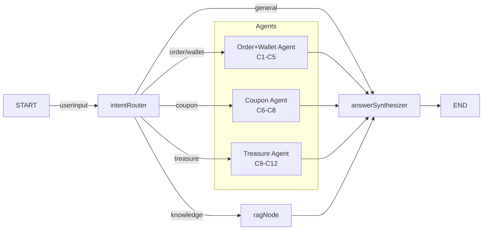

# Phase 1 AI Customer Service — Structured Implementation Breakdown

> **Document Reconciliation Summary** (3 sources)
> - `phase1-implementation-plan.md` — client-facing, 8 tools, 5 nodes, SSE, MemorySaver
> - `ai-customer-service-sdd.md` — admin-facing, 5 endpoints, ChatService persistence
> - `joymini-ai-feature-terminology-map.md` — 12 tools C1-C12 + 5 system capabilities D1-D5
>
> **Key Decisions** (reconciling conflicts):
> 1. **Client-facing deployment** (under `apps/api/src/client/ai-customer/`) — per phase1-plan, all tools operate on user's own data
> 2. **12 tools** — expand from 8 to include C9-C12 (treasure/product tools) per terminology map
> 3. **6 nodes** — expand from 5: add `treasureAgent` for C9-C12
> 4. **2 SSE endpoints** (POST `/chat`, GET `/chat/stream`) — simpler approach
> 5. **Dual memory** — MemorySaver for in-session context + ChatService for cross-session persistence

---

## Subtask 1: Install Dependencies

**Mode**: `💻 Code` (code)

**Files to modify**:
| File | Action | Details |
|------|--------|---------|
| [`apps/api/package.json`](apps/api/package.json) | Modify | Add `@langchain/core` and `@langchain/langgraph` to dependencies |

**Key details**:
- Add versions matching the langchain study project (v1.2.x for langgraph)
- After modifying, run `yarn install` from monorepo root
- `zod` is already a dependency (v3.23.0) — no need to add

---

## Subtask 2: Fix Module Exports for DI

**Mode**: `💻 Code` (code)

**Files to modify** (3 existing files):

| File | Change | Current | Target |
|------|--------|---------|--------|
| [`apps/api/src/client/orders/order.module.ts`](apps/api/src/client/orders/order.module.ts:14) | Add `exports` | `exports: []` | `exports: [OrderService]` |
| [`apps/api/src/client/coupon/coupon.module.ts`](apps/api/src/client/coupon/coupon.module.ts:10) | Add `exports` | `exports: []` | `exports: [ClientCouponService]` |
| [`apps/api/src/client/treasure/treasure.module.ts`](apps/api/src/client/treasure/treasure.module.ts:12) | Add `exports` | missing `exports` key | `exports: [TreasureService]` |

**No changes needed**:
- [`wallet/wallet.module.ts`](apps/api/src/client/wallet/wallet.module.ts:11) — already exports `WalletService` and `ClientWalletService`

**Key details**:
- These exports are required so `AiCustomerModule` can inject the services via DI
- Each module already provides the service; we just need to make it available to importing modules
- No circular dependency risk since `AiCustomerModule` is a leaf module

---

## Subtask 3: Create Graph State Definition

**Mode**: `💻 Code` (code)

**Files to create**:
| File | Action |
|------|--------|
| `apps/api/src/client/ai-customer/graph/state.ts` | Create |

**Key details**:
- Use LangGraph `Annotation.Root` pattern (from [`study/LLM/jisu-ai-customer`](study/LLM/jisu-ai-customer/server/src/graphs/customer-graph.js:10))
- State shape:

```typescript
export const AiCustomerState = Annotation.Root({
  ...MessagesAnnotation.spec,       // messages[] for full conversation
  userInput: Annotation<string>,    // raw user input
  intent: Annotation<string>,       // 'order' | 'wallet' | 'coupon' | 'treasure' | 'knowledge' | 'general'
  orderResult: Annotation<string>,  // JSON string of order query result
  walletResult: Annotation<string>, // JSON string of wallet query result
  couponResult: Annotation<string>, // JSON string of coupon query result
  treasureResult: Annotation<string>, // JSON string of treasure query result
  ragResult: Annotation<string>,    // JSON string of RAG search result
  finalAnswer: Annotation<string>,  // Final synthesized answer
  steps: Annotation<Array<{action: string, result: string}>>,  // Tool call trace
});
```

- 5 result fields (orderResult, walletResult, couponResult, treasureResult, ragResult) map to the 4 agent types + RAG
- All result fields are `string` (JSON-serialized) to keep state serializable for checkpointer

---

## Subtask 4: Create Business Tool Wrappers (12 tools)

**Mode**: `💻 Code` (code)

**Files to create** (4 files, 12 tools):

### 4a. [`order-tools.ts`](apps/api/src/client/ai-customer/graph/tools/order-tools.ts) — 4 tools (C1-C3 + wallet C4-C5)

Injects: `OrderService`, `WalletService`, `ClientWalletService`
Wraps these methods via Zod schemas (`z.object()`):

| # | Tool Name | Service Method | Zod Input Schema | Read-only? |
|---|-----------|----------------|------------------|------------|
| C1 | `getOrderDetail` | [`OrderService.getOrderDetail(userId, orderId)`](apps/api/src/client/orders/order.service.ts:609) | `{ orderId: z.string() }` | ✅ Yes |
| C2 | `listOrders` | [`OrderService.listOrders(userId, q)`](apps/api/src/client/orders/order.service.ts:532) | `{ status?, page?, pageSize? }` | ✅ Yes |
| C3 | `applyRefund` | [`OrderService.applyRefund(userId, dto)`](apps/api/src/client/orders/order.service.ts:484) | `{ orderId: z.string(), reason: z.string() }` | ❌ Write (safe — user scoped) |
| C4 | `getBalance` | [`WalletService.balance(userId)`](apps/api/src/client/wallet/wallet.service.ts:75) | `{}` | ✅ Yes |
| C5 | `getRechargeHistory` | [`ClientWalletService.getRechargeHistory(userId, dto)`](apps/api/src/client/wallet/client-wallet.service.ts:580) | `{ page?, pageSize?, status? }` | ✅ Yes |

### 4b. [`coupon-tools.ts`](apps/api/src/client/ai-customer/graph/tools/coupon-tools.ts) — 3 tools (C6-C8)

Injects: `ClientCouponService`

| # | Tool Name | Service Method | Zod Input Schema | Read-only? |
|---|-----------|----------------|------------------|------------|
| C6 | `getMyCoupons` | [`ClientCouponService.getMyCoupons(userId, dto)`](apps/api/src/client/coupon/coupon.service.ts:13) | `{ page?, pageSize?, status? }` | ✅ Yes |
| C7 | `getClaimableCoupons` | [`ClientCouponService.getClaimableCoupons(userId)`](apps/api/src/client/coupon/coupon.service.ts:173) | `{}` | ✅ Yes |
| C8 | `claimCoupon` | [`ClientCouponService.claimCoupon(userId, couponId)`](apps/api/src/client/coupon/coupon.service.ts:71) | `{ couponId: z.string() }` | ❌ Write (safe — coupon claim) |

### 4c. [`treasure-tools.ts`](apps/api/src/client/ai-customer/graph/tools/treasure-tools.ts) — 4 tools (C9-C12)

Injects: `TreasureService`

| # | Tool Name | Service Method | Zod Input Schema | Read-only? |
|---|-----------|----------------|------------------|------------|
| C9 | `listTreasures` | [`TreasureService.list(query)`](apps/api/src/client/treasure/treasure.service.ts:30) | `{ page?, pageSize?, q?, categoryId?, state? }` | ✅ Yes |
| C10 | `getTreasureDetail` | [`TreasureService.detail(id)`](apps/api/src/client/treasure/treasure.service.ts:159) | `{ id: z.string() }` | ✅ Yes |
| C11 | `getTreasureStatus` | [`TreasureService.getStatus(id)`](apps/api/src/client/treasure/treasure.service.ts:225) | `{ id: z.string() }` | ✅ Yes |
| C12 | `getHotGroups` | [`TreasureService.getHotGroups(limit)`](apps/api/src/client/treasure/treasure.service.ts:265) | `{ limit?: z.number() }` | ✅ Yes |

### Tool Pattern (applies to all)

```typescript
import { tool } from '@langchain/core/tools';
import { z } from 'zod';

export function createGetOrderDetailTool(orderService: OrderService) {
  return tool(
    async ({ orderId, userId }) => {
      const result = await orderService.getOrderDetail(userId, orderId);
      return JSON.stringify(result);
    },
    {
      name: 'getOrderDetail',
      description: 'Get detailed information about a specific order by order ID',
      schema: z.object({ orderId: z.string().describe('The order ID') }),
    },
  );
}
```

**Critical rules**:
- `userId` is injected from the authenticated user's JWT, NOT passed by the LLM
- All tools wrap via `userId` parameter scope — the LLM never gets to choose whose data to query
- Tool errors are caught and return user-friendly messages, never raw exceptions

---

## Subtask 5: Create Graph Nodes (6 nodes)

**Mode**: `💻 Code` (code)

**Files to create** (6 new files under `apps/api/src/client/ai-customer/graph/nodes/`):

### 5a. [`intent-router.node.ts`](apps/api/src/client/ai-customer/graph/nodes/intent-router.node.ts)

**Purpose**: System capability D1 (Intent Classification & Routing)

**Key details**:
- Uses [`AiService.generateText()`](apps/api/src/common/ai/ai.service.ts:363) to classify user intent
- Prompt asks LLM to return exactly one of: `order`, `wallet`, `coupon`, `treasure`, `knowledge`, `general`
- Returns updated state with `intent` field set
- Source pattern: [`study/LLM/jisu-ai-customer/server/src/graphs/nodes/intent-router.js`](study/LLM/jisu-ai-customer/server/src/graphs/nodes/intent-router.js:10)

### 5b. [`order-agent.node.ts`](apps/api/src/client/ai-customer/graph/nodes/order-agent.node.ts)

**Purpose**: ReAct Agent for C1-C5 (order + wallet tools)

**Key details**:
- Uses `createReactAgent` from `@langchain/langgraph`
- Tools bound: `getOrderDetail`, `listOrders`, `applyRefund`, `getBalance`, `getRechargeHistory`
- Calls LLM via `AiService.generateText()` with tool definitions in system prompt
- LLM decides which tool to call based on user intent
- Stores result in `state.orderResult` and `state.walletResult`
- Pattern from: [`study/LLM/jisu-ai-customer/server/src/agents/customer-agent.js`](study/LLM/jisu-ai-customer/server/src/agents/customer-agent.js:15)

### 5c. [`coupon-agent.node.ts`](apps/api/src/client/ai-customer/graph/nodes/coupon-agent.node.ts)

**Purpose**: ReAct Agent for C6-C8 (coupon tools)

**Key details**:
- Tools bound: `getMyCoupons`, `getClaimableCoupons`, `claimCoupon`
- Same ReAct pattern as order-agent
- Stores result in `state.couponResult`

### 5d. [`treasure-agent.node.ts`](apps/api/src/client/ai-customer/graph/nodes/treasure-agent.node.ts)

**Purpose**: ReAct Agent for C9-C12 (treasure/product tools)

**Key details**:
- Tools bound: `listTreasures`, `getTreasureDetail`, `getTreasureStatus`, `getHotGroups`
- Stores result in `state.treasureResult`

### 5e. [`rag.node.ts`](apps/api/src/client/ai-customer/graph/nodes/rag.node.ts)

**Purpose**: Knowledge base retrieval (stub for Phase 1)

**Key details**:
- Phase 1: Returns static response "Knowledge base is under development"
- Phase 2: Replace with pgvector similarity search using Prisma `KnowledgeDocument` + `KnowledgeEmbedding` models
- Stores result in `state.ragResult`

### 5f. [`answer-synthesizer.node.ts`](apps/api/src/client/ai-customer/graph/nodes/answer-synthesizer.node.ts)

**Purpose**: System capability D4 (Structured Output)

**Key details**:
- Receives all intermediate results (orderResult, walletResult, couponResult, treasureResult, ragResult)
- Uses [`AiService.generateText()`](apps/api/src/common/ai/ai.service.ts:363) to compose natural language answer
- Merges multiple data sources into coherent response
- Includes "I'm an AI assistant" disclaimer (hallucination mitigation)
- Pattern from: [`study/LLM/jisu-ai-customer/server/src/graphs/nodes/answer-synthesizer.js`](study/LLM/jisu-ai-customer/server/src/graphs/nodes/answer-synthesizer.js:8)

---

## Subtask 6: Build the StateGraph

**Mode**: `💻 Code` (code)

**Files to create**:
| File | Action |
|------|--------|
| `apps/api/src/client/ai-customer/graph/customer.graph.ts` | Create |

**Key details**:

```typescript
const builder = new StateGraph(AiCustomerState)
  .addNode('intentRouter', intentRouterNode)
  .addNode('orderAgent', orderAgentNode)
  .addNode('couponAgent', couponAgentNode)
  .addNode('treasureAgent', treasureAgentNode)
  .addNode('ragNode', ragNode)
  .addNode('answerSynthesizer', answerSynthesizerNode)
  .addEdge(START, 'intentRouter')
  .addConditionalEdges('intentRouter', routeByIntent, {
    order: 'orderAgent',
    wallet: 'orderAgent',       // wallet queries handled by orderAgent
    coupon: 'couponAgent',
    treasure: 'treasureAgent',
    knowledge: 'ragNode',
    general: 'answerSynthesizer',  // Skip tools, go directly to answer
  })
  .addEdge('orderAgent', 'answerSynthesizer')
  .addEdge('couponAgent', 'answerSynthesizer')
  .addEdge('treasureAgent', 'answerSynthesizer')
  .addEdge('ragNode', 'answerSynthesizer')
  .addEdge('answerSynthesizer', END);
```

### Graph flow diagram



---

## Subtask 7: Create DTOs

**Mode**: `💻 Code` (code)

**Files to create**:
| File | Action |
|------|--------|
| `apps/api/src/client/ai-customer/dto/chat-request.dto.ts` | Create |
| `apps/api/src/client/ai-customer/dto/chat-response.dto.ts` | Create |

**Key details**:

```typescript
// chat-request.dto.ts
export class ChatRequestDto {
  @IsString()
  @IsNotEmpty()
  message!: string;

  @IsString()
  @IsOptional()
  threadId?: string;
}

// chat-response.dto.ts
export class ChatResponseDto {
  content!: string;
  threadId!: string;
}
```

---

## Subtask 8: Create AiCustomerService (Core Orchestrator)

**Mode**: `💻 Code` (code)

**Files to create**:
| File | Action |
|------|--------|
| `apps/api/src/client/ai-customer/ai-customer.service.ts` | Create |

**Key details**:
- Injects: `AiService`, `OrderService`, `WalletService`, `ClientWalletService`, `ClientCouponService`, `TreasureService`, `ChatService`
- Builds graph in constructor (calls [`customer.graph.ts`](apps/api/src/client/ai-customer/graph/customer.graph.ts) factory)
- Initializes `MemorySaver` for in-session conversation memory
- Implements two methods:

```typescript
@Injectable()
export class AiCustomerService {
  private graph: CompiledStateGraph;
  private memory: MemorySaver;

  constructor(
    /* injected services */
  ) {
    this.graph = buildCustomerGraph(/* services */);
    this.memory = new MemorySaver();
  }

  // Non-streaming (simple request/response)
  async chat(userId: string, message: string, threadId: string): Promise<string>

  // SSE streaming (returns AsyncGenerator for @Sse decorator)
  async *chatStream(userId: string, message: string, threadId: string): AsyncGenerator<MessageEvent>
}
```

**System capabilities implemented**:
- D2 (Conversation Memory) — via MemorySaver + thread_id
- D3 (ReAct Reasoning Loop) — via 3 ReAct agents in graph
- D5 (Error Recovery) — try/catch in each node, fallback messages

**SSE Event Types**:
| Event | Data | Description |
|-------|------|-------------|
| `node` | `{ node: 'intentRouter' }` | Current node being executed |
| `node` | `{ node: 'orderAgent' }` | Agent node started |
| `steps` | `{ action: 'getOrderDetail', result: '...' }` | Tool call completed |
| `answer` | `{ text: 'Your order...' }` | Streaming answer chunk |
| `sources` | `[]` | RAG sources (Phase 2) |
| `done` | `{}` | Stream complete |
| `error` | `{ message: '...' }` | Error occurred |

---

## Subtask 9: Create SSE Controller

**Mode**: `💻 Code` (code)

**Files to create**:
| File | Action |
|------|--------|
| `apps/api/src/client/ai-customer/ai-customer.controller.ts` | Create |

**Key details**:

```typescript
@Controller('ai-customer')
@UseGuards(JwtAuthGuard)  // Client-side JWT auth (NOT AdminJwtAuthGuard)
export class AiCustomerController {
  constructor(private aiCustomerService: AiCustomerService) {}

  // Non-streaming
  @Post('chat')
  async chat(
    @Body() dto: ChatRequestDto,
    @CurrentUserId() userId: string,
  ): Promise<ChatResponseDto>

  // SSE streaming
  @Sse('chat/stream')
  chatStream(
    @Query('message') message: string,
    @Query('threadId') threadId: string,
    @CurrentUserId() userId: string,
  ): Observable<MessageEvent>
}
```

**Route registration**:
- Routes are mounted under client prefix: `/api/client/v1/ai-customer/chat`
- Consistent with existing client API pattern (e.g., [`OrderController`](apps/api/src/client/orders/order.controller.ts))
- Uses `JwtAuthGuard` (client-side auth), NOT `AdminJwtAuthGuard` (admin-side)

---

## Subtask 10: Create Module + Register

**Mode**: `💻 Code` (code)

**Files to create** (1 new) + **Files to modify** (1 existing):

| File | Action |
|------|--------|
| `apps/api/src/client/ai-customer/ai-customer.module.ts` | Create |
| [`apps/api/src/client/client.module.ts`](apps/api/src/client/client.module.ts:25) | Modify — add `AiCustomerModule` to imports |

**Module structure**:

```typescript
@Module({
  imports: [
    PrismaModule,
    OrderModule,
    WalletModule,
    ClientCouponModule,
    TreasureModule,   // NEW — exports: [TreasureService] after Subtask 2
    AiModule,         // Already global, but explicit for clarity
    ChatModule,       // For message persistence
  ],
  controllers: [AiCustomerController],
  providers: [AiCustomerService],
})
export class AiCustomerModule {}
```

Add to [`client.module.ts`](apps/api/src/client/client.module.ts:25):
```typescript
imports: [
  // ...existing imports...
  AiCustomerModule,
]
```

---

## Subtask 11: Create Prompts File

**Mode**: `💻 Code` (code)

**Files to create**:
| File | Action |
|------|--------|
| `apps/api/src/client/ai-customer/prompts/customer-service.ts` | Create |

**Key details**:
- Intent classification prompt
- Order agent system prompt (with tool descriptions)
- Coupon agent system prompt
- Treasure agent system prompt
- Answer synthesizer prompt (merges intermediate results)
- Pattern from: [`study/LLM/jisu-ai-customer/server/src/prompts/customer-service.js`](study/LLM/jisu-ai-customer/server/src/prompts/customer-service.js:1)

---

## Subtask 12: Write Jest Tests

**Mode**: `🧪 Jest Test Engineer` (jest-test-engineer)

**Files to create** (3 test files):

| File | What it tests |
|------|---------------|
| `apps/api/src/client/ai-customer/ai-customer.service.spec.ts` | Service methods (chat, chatStream), graph invocation, MemorySaver |
| `apps/api/src/client/ai-customer/ai-customer.controller.spec.ts` | Controller endpoints, SSE stream, auth guard |
| `apps/api/src/client/ai-customer/graph/tools/order-tools.spec.ts` | Tool wrappers calling mocked OrderService methods |

**Key test scenarios**:
1. `chat()` returns correct answer for order query
2. `chatStream()` yields SSE events in correct order (node → steps → answer → done)
3. Intent routing classifies correctly (order/wallet/coupon/treasure/general)
4. Tools pass `userId` correctly (scope enforcement)
5. Auth guard rejects unauthenticated requests
6. Error handling returns user-friendly messages (no stack traces)
7. MemorySaver maintains context across multiple messages in same thread

---

## Subtask 13: Frontend Chat UI (frontend-blog)

**Mode**: `💻 Code` (code)

**Files to create** (6 new files):

| File | Purpose |
|------|---------|
| `apps/frontend-blog/src/app/[locale]/ai-chat/page.tsx` | Server component — SEO metadata, locale params |
| `apps/frontend-blog/src/app/[locale]/ai-chat/page.client.tsx` | Client component — renders ChatContainer |
| `apps/frontend-blog/src/components/ai-chat/ChatContainer.tsx` | Message list + Input area |
| `apps/frontend-blog/src/components/ai-chat/ChatMessage.tsx` | Individual message bubble (user vs AI) |
| `apps/frontend-blog/src/components/ai-chat/ChatInput.tsx` | Text input + send button |
| `apps/frontend-blog/src/lib/hooks/useAiChat.ts` | SSE consumption hook |
| `apps/frontend-blog/src/lib/api/aiChatApi.ts` | API client (fetch wrappers) |

**Key details**:
- Route: `/[locale]/ai-chat` (i18n compliant)
- SSE consumption via `EventSource` or `fetch` with `ReadableStream`
- JWT auth token from existing cookie (reuse existing auth pattern)
- Mobile-responsive (matches existing blog patterns)
- Uses `@repo/ui` components (Button, Input, Card, Badge)

**SSE state machine** in [`useAiChat.ts`](apps/frontend-blog/src/lib/hooks/useAiChat.ts):
```
IDLE → CONNECTING → STREAMING (node/steps events) → ANSWERING (answer events) → DONE → IDLE
                                   → ERROR → IDLE
```

---

## Subtask 14: Cross-Cutting Concerns

**Mode**: `💻 Code` (code)

### 14a. Error Handling & Safety

Applied throughout all nodes and tools:

| Safety Concern | Implementation |
|---------------|----------------|
| **Data privacy** | All `userId` injected from JWT, never LLM-generated |
| **Rate limiting** | Reuses [`AiService`](apps/api/src/common/ai/ai.service.ts:70) built-in rate limiter (12 RPM) |
| **Hallucination** | Answer synthesizer includes "I'm an AI assistant" disclaimer |
| **Read-only guarantee** | 10 of 12 tools are read-only; 2 write tools are safe (user-scoped) |
| **Timeout** | SSE stream timeout after 60s, return partial results |
| **Error messages** | All errors map to user-friendly messages, no stack traces leaked |

### 14b. Type exports (if needed)

If the graph state types need to be shared with frontend:
- File: `packages/shared/src/types/ai-customer.ts` (optional, only if frontend needs types)

---

## Summary: Complete File Inventory

### New Files: Backend (18 files)

```
apps/api/src/client/ai-customer/
├── ai-customer.module.ts
├── ai-customer.controller.ts
├── ai-customer.service.ts
├── dto/
│   ├── chat-request.dto.ts
│   └── chat-response.dto.ts
├── prompts/
│   └── customer-service.ts
├── graph/
│   ├── state.ts
│   ├── customer.graph.ts
│   ├── nodes/
│   │   ├── intent-router.node.ts
│   │   ├── order-agent.node.ts
│   │   ├── coupon-agent.node.ts
│   │   ├── treasure-agent.node.ts
│   │   ├── rag.node.ts
│   │   └── answer-synthesizer.node.ts
│   └── tools/
│       ├── order-tools.ts       (C1-C5: order + wallet)
│       ├── coupon-tools.ts      (C6-C8: coupon)
│       └── treasure-tools.ts    (C9-C12: treasure)
```

### Modified Files: Backend (5 files)

| File | Change |
|------|--------|
| `apps/api/package.json` | Add `@langchain/core`, `@langchain/langgraph` |
| `apps/api/src/client/orders/order.module.ts` | `exports: [OrderService]` |
| `apps/api/src/client/coupon/coupon.module.ts` | `exports: [ClientCouponService]` |
| `apps/api/src/client/treasure/treasure.module.ts` | `exports: [TreasureService]` |
| `apps/api/src/client/client.module.ts` | Import `AiCustomerModule` |

### New Files: Tests (3 files)

| File |
|------|
| `apps/api/src/client/ai-customer/ai-customer.service.spec.ts` |
| `apps/api/src/client/ai-customer/ai-customer.controller.spec.ts` |
| `apps/api/src/client/ai-customer/graph/tools/order-tools.spec.ts` |

### New Files: Frontend (7 files)

```
apps/frontend-blog/src/
├── app/[locale]/ai-chat/
│   ├── page.tsx
│   └── page.client.tsx
├── components/ai-chat/
│   ├── ChatContainer.tsx
│   ├── ChatMessage.tsx
│   └── ChatInput.tsx
├── lib/hooks/
│   └── useAiChat.ts
└── lib/api/
    └── aiChatApi.ts
```

---

## Execution Order

| Step | Subtask | Mode | Dependencies |
|------|---------|------|-------------|
| 1 | Install Dependencies | code | None |
| 2 | Fix Module Exports | code | None |
| 3 | Create Graph State | code | None |
| 4 | Create DTOs | code | None |
| 5 | Create Prompts | code | None |
| 6 | Create Business Tools | code | Step 2 (module exports) |
| 7 | Create Graph Nodes | code | Steps 3, 5, 6 |
| 8 | Build Graph | code | Steps 3, 7 |
| 9 | Create AiCustomerService | code | Steps 4, 5, 8 |
| 10 | Create SSE Controller | code | Steps 4, 9 |
| 11 | Create Module + Register | code | Steps 9, 10 |
| 12 | Write Jest Tests | jest-test-engineer | Steps 2-11 |
| 13 | Frontend Chat UI | code | Step 10 (API contract) |
