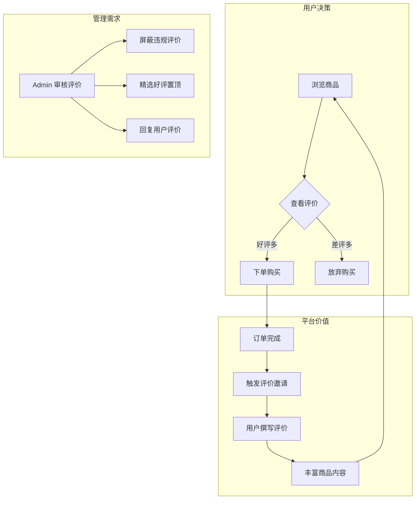
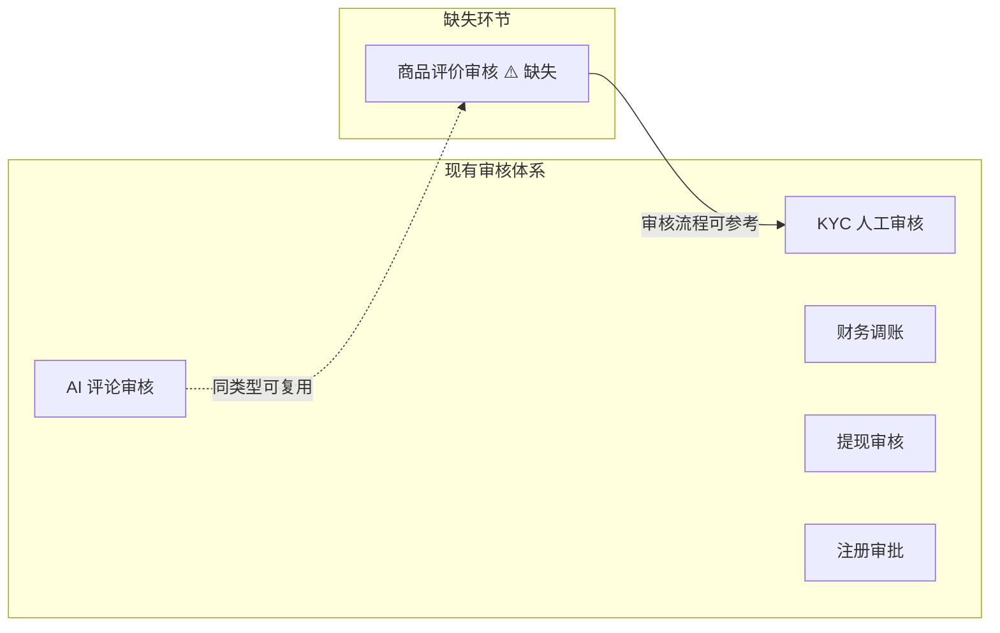

# 电商商品评价功能缺失分析

> 分析日期: 2026-06-24

---

## 核心结论：**项目缺少电商商品评价系统**

当前项目虽然有 **博客评论** (`BlogComment`)，但 **完全没有电商商品评价（Product Review / Rating）功能**。这是电商平台从 MVP 到生产级的核心缺失能力。

---

## 一、现有"评论"相关功能 vs 电商商品评价

### 1.1 已有的博客评论系统
| 维度 | 博客评论 `BlogComment` | 电商商品评价（缺失） |
|------|----------------------|-------------------|
| **用途** | 用户对博客文章发表评论 | 买家对已购商品发表评价 |
| **关联** | 关联 `BlogArticle` | 应关联 `Product` + `Order` |
| **评分** | ❌ 无评分 | ⭐ 1-5 星评分（核心） |
| **订单约束** | ❌ 无需购买 | ✅ 必须购买后才能评价 |
| **图片/视频** | ❌ 纯文本 | ✅ 晒图/视频（常见需求） |
| **AI 审核** | ✅ 有 AI 评论审核 | 可复用 |
| **数据模型** | ✅ `BlogComment` + `BlogCommentFlag` | ❌ 不存在 |

### 1.2 项目中存在的"评价"字段（非商品评价）

搜索发现数据库设计文档中有 `rating` 字段，但这些是 **客服满意度评价**，**不是商品评价**：

```sql
-- 客服会话表 customer_service_sessions
rating TINYINT COMMENT '评分（1-5星）'    -- ← 用户对客服的评分
feedback TEXT COMMENT '用户反馈'           -- ← 对客服服务的反馈

-- 工单表 work_orders
rating TINYINT COMMENT '评分（1-5星）'    -- ← 对工单处理的评分
feedback TEXT COMMENT '用户反馈'
```

---

## 二、电商商品评价的核心价值



### 对平台的关键价值

| 角色 | 价值 |
|------|------|
| **用户** | 了解商品真实质量，辅助购买决策 |
| **平台** | UGC 内容提升 SEO、提高转化率、建立信任 |
| **商家** | 收集反馈、回复差评、优化商品 |
| **AI** | 评价数据可用于训练推荐模型、质检模型 |

---

## 三、缺失的具体内容（完整差距分析）

### 3.1 数据层 — 完全缺失

**应新增 Prisma 模型**，建议如下：

```prisma
/// 商品评价
model ProductReview {
  id         String   @id @default(cuid()) @db.VarChar(32)
  
  // 关联
  productId  String   @map("product_id") @db.VarChar(32)
  orderId    String   @map("order_id") @db.VarChar(32)    // 仅已购用户可评
  userId     String   @map("user_id") @db.VarChar(32)
  
  // 评价内容
  rating     Int      // 1-5 星
  content    String?  @db.Text                               // 文字评价
  images     Json?    @map("images")                         // 晒图 URL 数组
  videos     Json?    @map("videos")                         // 视频 URL 数组
  
  // 商品 SKU 信息（可选）
  skuInfo    Json?    @map("sku_info")                       // 如: 颜色/尺码
  
  // 状态
  status     Int      @default(1)    // 1-待审核 2-已通过 3-已拒绝 4-已删除
  isTop      Boolean  @default(false) @map("is_top")  // 精选置顶
  
  // 商家回复
  replyContent String? @map("reply_content") @db.Text
  repliedAt    DateTime? @map("replied_at")
  
  // 有帮助计数
  helpfulCount Int @default(0) @map("helpful_count")
  
  // 时间
  createdAt  DateTime @default(now()) @map("created_at")
  updatedAt  DateTime @updatedAt @map("updated_at")
  auditedAt  DateTime? @map("audited_at")
  auditorId  String?  @map("auditor_id") @db.VarChar(32)
  
  // 关联
  product    Product  @relation(fields: [productId], references: [id])
  order      Order    @relation(fields: [orderId], references: [id])
  user       Users    @relation(fields: [userId], references: [id])

  @@index([productId, status])
  @@index([userId])
  @@index([orderId], unique)
  @@map("product_reviews")
}
```

### 3.2 API 层 — 完全缺失

应有以下端点：

| 方法 | 路径 | 权限 | 说明 |
|------|------|------|------|
| `POST` | `/v1/client/products/:id/reviews` | 用户（已购） | 创建评价 |
| `GET` | `/v1/client/products/:id/reviews` | 公开 | 查看商品评价列表 |
| `GET` | `/v1/client/products/:id/reviews/stats` | 公开 | 评价统计数据（平均分/分布） |
| `PUT` | `/v1/client/reviews/:id/helpful` | 用户 | 标记"有帮助" |
| `POST` | `/v1/admin/product-reviews/:id/audit` | Admin | 审核评价 |
| `POST` | `/v1/admin/product-reviews/:id/reply` | Admin | 商家回复 |
| `PUT` | `/v1/admin/product-reviews/:id/top` | Admin | 置顶/取消置顶 |

### 3.3 Admin 后台 — 完全缺失

- 评价管理列表（筛选/搜索/批量审核）
- 评价审核弹窗（类似 [`KycAuditModal`](apps/admin-next/src/views/kyc/KycAuditModal.tsx)）
- 商家回复编辑
- 评价统计报表

### 3.4 客户端（Flutter）— 完全缺失

- 商品详情页：评价列表 + 评分展示
- 撰写评价页面（下单后入口）
- 晒图/视频上传
- 我的评价列表

### 3.5 AI 审核能力 — 可复用但未集成

项目已有成熟的 AI 评论审核能力（[`blog-ai.processor.ts`](apps/api/src/blog/processors/blog-ai.processor.ts:1006)），可直接复用：

| 现有能力 | 可复用到商品评价 |
|---------|---------------|
| Gemini AI 评分 (0-100) | ✅ 审核评价内容是否违规 |
| 自动通过 (0-30分) | ✅ 低风险评价自动通过 |
| 人工审核队列 (30-70分) | ✅ 复用审核队列 |
| 自动拒绝 (70-100分) | ✅ 违规评价直接屏蔽 |
| 敏感词过滤 | ✅ 复用现有词库 |

---

## 四、与现有人工干预体系的关联



**现有审核体系可直接复用/参考的部分**:
1. **审核流程模式** — 参考 [`KycAuditModal`](apps/admin-next/src/views/kyc/KycAuditModal.tsx:208) 的 APPROVE/REJECT 模式
2. **AI 审核引擎** — 复用 [`blog-ai.processor.ts`](apps/api/src/blog/processors/blog-ai.processor.ts) 的 Gemini 评分
3. **审计追溯** — 复用 `auditorId`/`auditResult`/`auditedAt` 审计字段模式
4. **操作日志** — 评价审核操作写入 [`AdminOperationLog`](apps/api/src/admin/operation-log/operation-log.service.ts)

---

## 五、建议优先级

| 优先级 | 模块 | 工作量 | 依赖 |
|--------|------|--------|------|
| 🔴 P0 | Prisma 模型 + 数据库迁移 | 小 | - |
| 🔴 P0 | 客户端 API（创建/列表/统计） | 中 | 数据模型 |
| 🔴 P0 | 商品详情页展示评价 | 中 | API |
| 🟡 P1 | Admin 评价审核面板 | 中 | API |
| 🟡 P1 | 下单后评价入口（Flutter） | 中 | 订单系统 |
| 🟢 P2 | AI 自动审核集成 | 小 | AI 审核引擎 |
| 🟢 P2 | 晒图/视频评价 | 中 | 媒体上传服务 |
| 🟢 P2 | 商家回复功能 | 小 | Admin 面板 |
| 🔵 P3 | 评价"有帮助"投票 | 小 | - |
| 🔵 P3 | 评价统计报表 | 小 | Admin 面板 |

---

## 六、总结

> **结论**: 电商商品评价功能在当前项目中 **完全缺失**，是电商平台从"能交易"到"能运营"的关键缺失环节。

| 维度 | 状态 |
|------|------|
| 数据模型 (`ProductReview`) | ❌ 不存在 |
| API 端点 | ❌ 不存在 |
| Admin 管理面板 | ❌ 不存在 |
| Flutter 端评价 UI | ❌ 不存在 |
| AI 审核集成 | ⚠️ 引擎存在但未接入 |
| 可复用资产 | ✅ KYC 审核流程、AI 评论审核引擎、审计日志体系 |
