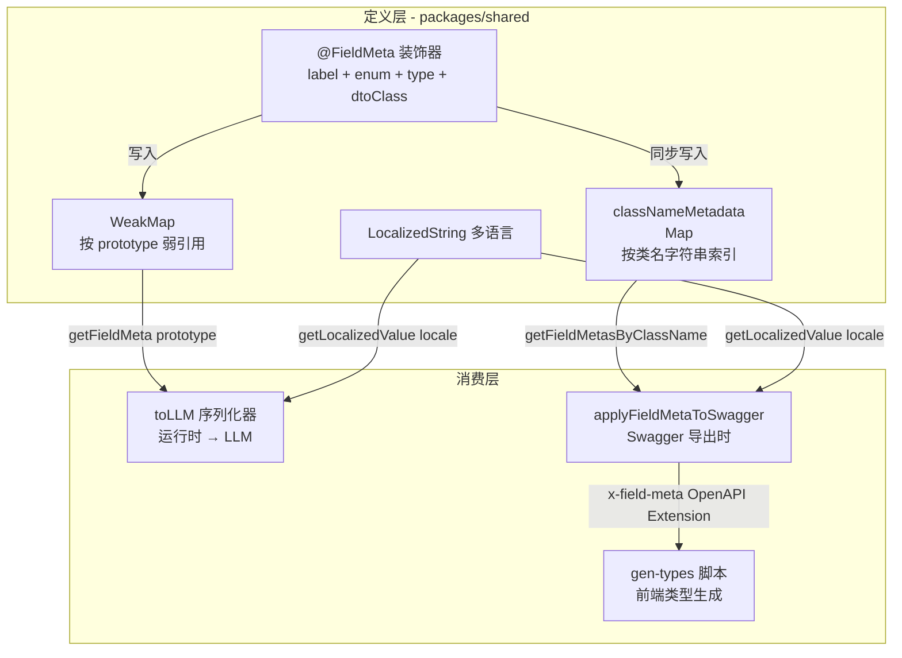
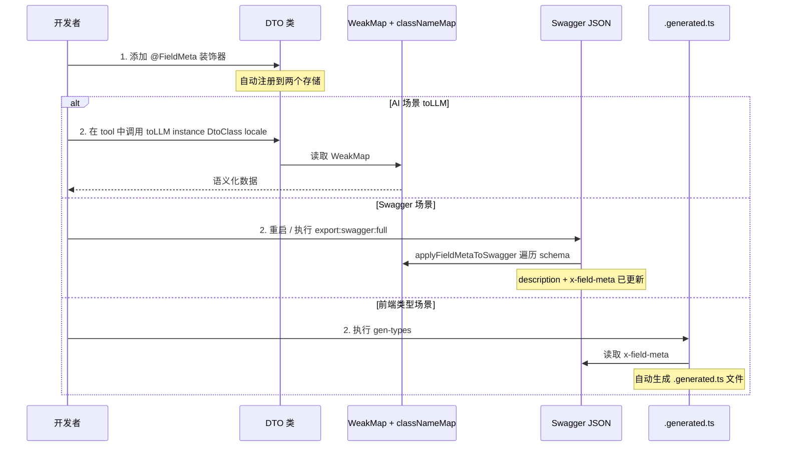
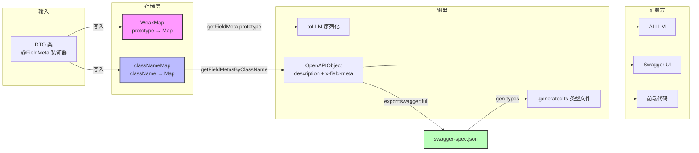

# FieldMeta 元数据体系 — 架构设计

> **架构名称**：Decorator-Based Metadata Mapping — 装饰器元数据映射
> **对应代码**：[`packages/shared/src/decorators/`](packages/shared/src/decorators/)、[`apps/api/src/common/ai/utils/`](apps/api/src/common/ai/utils/)
> **版本**：v2.0
> **最后更新**：2026-06-27

---

## 目录

1. [问题背景](#1-问题背景)
2. [设计原则](#2-设计原则)
3. [架构总览](#3-架构总览)
4. [存储机制](#4-存储机制)
5. [关键类型设计](#5-关键类型设计)
6. [使用示例](#6-使用示例)
7. [Phase 2 — Swagger 元数据注入](#7-phase-2--swagger-元数据注入)
8. [Phase 3 — 前端类型生成](#8-phase-3--前端类型生成)
9. [开发者工作流](#9-开发者工作流)
10. [文件变更清单](#10-文件变更清单)
11. [关键决策](#11-关键决策)
12. [FAQ](#12-faq)
13. [完整数据流全景](#13-完整数据流全景)

---

## 1. 问题背景

### 1.1 痛点分析

当前 AI 客服的 orderAgent 通过 Tool 调用后端接口后，直接 `JSON.stringify(result)` 将数据库原始数据返回给 LLM。
LLM 看到的是这样的数据：

```json
{
  "orderStatus": 2,
  "virtual": 1,
  "finalAmount": "9.98",
  "createdAt": 1704067200000
}
```

LLM 只能 **"猜"** 这些数字的含义。当它看到 `virtual: 1`，结合 Prisma 注释 `/// 1=虚拟 2=实物`，自然会猜 "这是虚拟商品"。
但实际上，Kindle Paperwhite 是实体商品——`virtual` 字段在此场景标记错误，但 LLM 没有业务上下文去判断。

### 1.2 元数据散落现状

```
字段语义散落在四个地方，互不同步：

Prisma schema:  /// 1=虚拟 2=实物          ← 运行时不可读
DTO decorator:  @ApiProperty({ description: 'orderStatus' })  ← 无枚举映射
AI tool:        JSON.stringify(result)      ← LLM 猜数字含义
Frontend:       手动复制 Swagger 类型       ← 繁琐、易错
```

### 1.3 目标

- **Single Source of Truth**：字段元数据只定义一次，AI、Swagger、前端都能消费
- **多语言原生**：复用项目已有的 `LocalizedString<T>` 模式，按 locale 输出对应语言
- **渐进式**：先覆盖 Order 模块验证，再推广到全系统
- **零运行时开销**：WeakMap 在类定义时执行，不影响运行时性能
- **零注册表**：通过 `classNameMetadata` 自动按类名索引，无需手动维护 DTO 注册表

---

## 2. 设计原则

| 原则 | 说明 |
|------|------|
| **Single Source of Truth** | 字段语义只定义在 `@FieldMeta` 装饰器，不重复到 Prisma 注释、Swagger 描述、前端类型 |
| **多语言原生** | 直接使用 `LocalizedString<T>` 对象，不支持 i18n key 模式 `{ zh: "...", en: "..." }` |
| **渐进式** | Phase 1 覆盖 Order 模块，Phase 2 注入 Swagger，Phase 3 生成前端类型 |
| **零运行时开销** | WeakMap 在类定义时执行一次属性注册，后续查询 O(1) |
| **非侵入** | `@FieldMeta` 与 `@ApiProperty` 共存，不替代、不冲突 |
| **可组合** | 嵌套 DTO 通过 `dtoClass` 属性递归序列化 |

---

## 3. 架构总览



### 消费者对比

| 消费者 | 存储源 | 查找方式 | 需要 DTO import? | 执行时机 |
|--------|--------|----------|------------------|----------|
| `toLLM()` | WeakMap `classMetadata` | `getFieldMeta(prototype, key)` | **是**（需要 prototype） | 运行时（每个 AI 请求） |
| `applyFieldMetaToSwagger()` | `classNameMetadata` | `getFieldMetasByClassName("OrderItemDto")` | **否**（按类名字符串） | Swagger 导出时 |
| `gen-types` | Swagger JSON `x-field-meta` | 读取 JSON 文件 | **否**（无任何 import） | 独立脚本执行 |

---

## 4. 存储机制

### 4.1 为什么不用 `Reflect.metadata`？

TypeScript 内置的 `Reflect.metadata` 设计上存在一个关键缺陷：

```typescript
// ❌ 问题：Reflect.metadata 只接受单一值
Reflect.defineMetadata(FIELD_META_KEY, options, target, key);
// 如果 key 不存在，Reflect.getMetadata 返回 undefined

// 需要遍历所有 key 时，Reflect 本身不提供存储 key 列表的能力
// 必须额外维护 Set<string> 来记录哪些 key 注册了
```

改用 **WeakMap + classNameMap 双存储** 解决了：

| 问题 | `Reflect.metadata` | WeakMap + classNameMap |
|------|-------------------|----------------------|
| 遍历所有注册的 key | ❌ 需要额外 Set | ✅ Map.keys() 直接返回 |
| 内存泄漏 | ❌ 元数据跟随对象永久存在 | ✅ WeakMap 允许 GC（但 DTO 是全局单例，实际无差） |
| 按类名字符串查询 | ❌ 需要 DTO class | ✅ classNameMetadata 直接支持 |
| 原型链继承支持 | ✅ 原生支持 | ✅ 手动实现 prototype 链遍历 |

### 4.2 WeakMap 存储（用于 `toLLM` 运行时）

```typescript
// packages/shared/src/decorators/field-meta.ts

/** 每个类的属性级元数据（按 prototype 弱引用） */
const classMetadata = new WeakMap<object, Map<string, FieldMetaOptions>>();

function getOrCreateMetadataMap(target: object): Map<string, FieldMetaOptions> {
  let map = classMetadata.get(target);
  if (!map) {
    map = new Map();
    classMetadata.set(target, map);
  }
  return map;
}
```

**查询时支持 prototype 链遍历**（继承兼容）：

```typescript
export function getFieldMeta(
  target: object,       // dtoClass.prototype
  propertyKey: string,
): FieldMetaOptions | undefined {
  let proto: object | null = target;
  while (proto) {
    const map = classMetadata.get(proto);
    if (map?.has(propertyKey)) return map.get(propertyKey);
    proto = Object.getPrototypeOf(proto);
    if (proto === Object.prototype) break;
  }
  return undefined;
}
```

### 4.3 classNameMap 存储（用于 Swagger / gen-types）

```typescript
/** 类名 → 元数据 映射（强引用，用于按类名字符串查询） */
const classNameMetadata = new Map<string, Map<string, FieldMetaOptions>>();
```

DTO 是应用生命周期对象，不存在内存泄漏风险。

### 4.4 双存储写入

在 `FieldMeta()` 装饰器中 **同步写入两个存储**：

```typescript
export function FieldMeta(options: FieldMetaOptions): PropertyDecorator {
  return (target: object, propertyKey: string | symbol) => {
    const key = String(propertyKey);

    // 1. 按 prototype 注册（WeakMap，用于 toLLM 运行时）
    const map = getOrCreateMetadataMap(target);
    map.set(key, options);

    // 2. 按类名注册（classNameMap，用于 Swagger/gen-types）
    const className = (target as any)?.constructor?.name;
    if (className && className !== 'Object') {
      let classMap = classNameMetadata.get(className);
      if (!classMap) {
        classMap = new Map();
        classNameMetadata.set(className, classMap);
      }
      classMap.set(key, options);
    }
  };
}
```

两个存储共享同一份 `FieldMetaOptions` 对象引用，内存不重复。

---

## 5. 关键类型设计

### 5.1 `FieldMetaOptions` 配置类型

位于 [`packages/shared/src/decorators/field-meta.ts`](packages/shared/src/decorators/field-meta.ts)：

```typescript
import { LocalizedString } from '../types/localized-string';

export interface FieldEnumMap {
  [value: number]: LocalizedString<string>;
}

export interface FieldMetaOptions {
  /** 字段标签（多语言） */
  label: LocalizedString<string>;

  /** 枚举值映射（可选） */
  enum?: FieldEnumMap;

  /** 语义类型（可选，用于自动格式化） */
  type?: 'string' | 'number' | 'date' | 'amount';

  /** 示例值（可选） */
  example?: unknown;

  /**
   * 嵌套 DTO 类（可选）
   * 设置后 `toLLM()` 会递归序列化该字段
   */
  dtoClass?: new (...args: any[]) => any;
}
```

### 5.2 `toLLM` 通用序列化器

位于 [`apps/api/src/common/ai/utils/to-llm.ts`](apps/api/src/common/ai/utils/to-llm.ts)：

```typescript
import { getFieldMeta, getLocalizedValue, type Locale } from '@lucky/shared';
import dayjs from 'dayjs';

export function toLLM<T extends object>(
  instance: T,
  dtoClass: new (...args: any[]) => T,
  locale: Locale = 'zh',
  options?: {
    arrayItemClass?: new (...args: any[]) => any;
  },
): Record<string, any> {
  const result: Record<string, any> = {};
  const prototype = dtoClass.prototype;

  // 处理数组类型
  if (Array.isArray(instance) && options?.arrayItemClass) {
    return (instance as any[]).map((item) =>
      toLLM(item, options.arrayItemClass!, locale),
    );
  }

  for (const key of Object.keys(instance as any)) {
    const meta = getFieldMeta(prototype, key);
    if (!meta) continue;

    const rawValue = (instance as any)[key];
    const fieldLabel = getLocalizedValue(meta.label, locale) ?? key;

    // 处理嵌套 DTO
    if (meta.dtoClass && rawValue && typeof rawValue === 'object') {
      if (Array.isArray(rawValue)) {
        result[fieldLabel] = rawValue.map((item: any) =>
          toLLM(item, meta.dtoClass!, locale),
        );
      } else {
        result[fieldLabel] = toLLM(rawValue, meta.dtoClass, locale);
      }
      continue;
    }

    // 处理枚举映射
    if (meta.enum && rawValue !== null && rawValue !== undefined) {
      const enumLabels = meta.enum[rawValue];
      if (enumLabels) {
        result[fieldLabel] = getLocalizedValue(enumLabels, locale) ?? rawValue;
        continue;
      }
    }

    // 按语义类型自动格式化
    switch (meta.type) {
      case 'date':
        result[fieldLabel] = dayjs(rawValue).isValid()
          ? dayjs(rawValue).format('YYYY/M/D HH:mm')
          : rawValue;
        break;
      case 'amount':
        result[fieldLabel] = `¥${rawValue}`;
        break;
      default:
        result[fieldLabel] = rawValue;
    }
  }

  return result;
}
```

**注意**：`toLLM()` 需要 DTO class import，因为它需要通过 `dtoClass.prototype` 访问 WeakMap 中的元数据。这是运行时约束，不是设计缺陷。

---

## 6. 使用示例

### 6.1 在 DTO 上使用

位于 [`apps/api/src/client/orders/dto/order-item.dto.ts`](apps/api/src/client/orders/dto/order-item.dto.ts)：

```typescript
import { FieldMeta } from '@lucky/shared';

// 嵌套 DTO
class TreasureDTo {
  @FieldMeta({
    label: { zh: '商品名称', en: 'Product Name' },
  })
  @ApiProperty({ description: 'treasureName', example: 'Kindle Paperwhite', type: String })
  treasureName!: string;

  @FieldMeta({
    label: { zh: '商品类型', en: 'Product Type' },
    enum: {
      1: { zh: '虚拟商品', en: 'Virtual Product' },
      2: { zh: '实体商品', en: 'Physical Product' },
    },
  })
  @ApiProperty({ description: 'isVirtual', example: 1, type: Number })
  virtual!: number;
}
```

### 6.2 在 Tool 中使用

位于 [`apps/api/src/client/ai-customer/graph/tools/order-tools.ts`](apps/api/src/client/ai-customer/graph/tools/order-tools.ts)：

```typescript
import { toLLM } from '@api/common/ai/utils/to-llm';

// getUserOrders tool
const result = await orderService.listOrders(userId, { ... });
return JSON.stringify(toLLM(result, ListOrdersResponseDto, 'zh'));

// getOrderInfo tool
const result = await orderService.getOrderDetail(userId, orderId);
return JSON.stringify(toLLM(result, OrderItemDto, 'zh'));
```

### 6.3 预期输出对比

**之前** — LLM 看到原始数字，靠猜：

```json
{
  "orderStatus": 2,
  "payStatus": 1,
  "finalAmount": "9.98",
  "createdAt": 1704067200000,
  "treasure": { "treasureName": "Kindle Paperwhite", "virtual": 1 }
}
```

**之后** — LLM 看到明确语义：

```json
{
  "订单编号": "202406010001",
  "订单状态": "已支付",
  "支付状态": "已支付",
  "实付金额": "¥9.98",
  "下单时间": "2024/1/1 08:00",
  "商品信息": {
    "商品名称": "Kindle Paperwhite",
    "商品类型": "实体商品"
  }
}
```

---

## 7. Phase 2 — Swagger 元数据注入

### 7.1 概念

`applyFieldMetaToSwagger` 是一个**纯函数**，在 `SwaggerModule.createDocument()` 之后、`SwaggerModule.setup()` 之前执行。
它遍历 OpenAPI 文档的所有 schema，通过 `classNameMetadata` 查找匹配的 `@FieldMeta` 元数据，然后：

1. **自动填充 `description`**：枚举值以 `标签 (1=说明, 2=说明)` 格式追加
2. **注入示例值**：如果 `@FieldMeta` 配置了 `example` 且 schema 没有已有 example
3. **注入 `x-field-meta` OpenAPI Extension**：保留完整结构化元数据供后续消费

### 7.2 核心实现

位于 [`apps/api/src/common/ai/utils/apply-field-meta.ts`](apps/api/src/common/ai/utils/apply-field-meta.ts)：

```typescript
import {
  getFieldMetasByClassName,
  getFieldMetaKeysByClassName,
  getLocalizedValue,
  type Locale,
} from '@lucky/shared';
import type { OpenAPIObject } from '@nestjs/swagger';
import { Logger } from '@nestjs/common';

const logger = new Logger('ApplyFieldMeta');

export function applyFieldMetaToSwagger(
  document: OpenAPIObject,
  locale: Locale = 'zh',
): void {
  const schemas = (document as any).components?.schemas;
  if (!schemas) {
    logger.warn('No schemas found in Swagger document, skipping.');
    return;
  }

  for (const [schemaName, schema] of Object.entries(schemas) as [string, any][]) {
    if (schema.$ref || !schema.properties) continue;

    // ★ 通过 classNameMetadata 直接按类名查找，无需 DTO 注册表
    const fieldMetaMap = getFieldMetasByClassName(schemaName);
    if (!fieldMetaMap) continue;

    let patchedCount = 0;

    for (const [key, meta] of fieldMetaMap) {
      const prop = schema.properties[key];
      if (!prop || typeof prop !== 'object') continue;

      const label = getLocalizedValue(meta.label, locale) ?? key;

      // ★ 1. 构造 description：标签 + 枚举值说明
      if (meta.enum) {
        const enumDescriptions = Object.entries(meta.enum)
          .map(([val, labels]) => `${val}=${getLocalizedValue(labels as any, locale)}`)
          .join(', ');
        prop.description = `${label} (${enumDescriptions})`;
      } else {
        prop.description = label;
      }

      // ★ 2. 注入示例值
      if (meta.example !== undefined && prop.example === undefined) {
        prop.example = meta.example;
      }

      // ★ 3. 注入 x-field-meta OpenAPI Extension
      const xFieldMeta: Record<string, unknown> = { label: meta.label };
      if (meta.type) xFieldMeta.type = meta.type;
      if (meta.enum) xFieldMeta.enum = meta.enum;
      if (meta.example !== undefined) xFieldMeta.example = meta.example;
      prop['x-field-meta'] = xFieldMeta;

      patchedCount++;
    }

    if (patchedCount > 0) {
      logger.log(
        `Schema "${schemaName}": patched ${patchedCount} field(s) from @FieldMeta`,
      );
    }
  }
}
```

### 7.3 什么是 x-field-meta OpenAPI Extension？

OpenAPI 规范允许以 `x-` 前缀的字段作为自定义扩展。这些字段：

- **在 Swagger JSON 中完整保留** → 可以被 `gen-types.ts` 等脚本读取
- **被 Swagger UI 自动忽略** → 不影响 UI 渲染
- **对现有 @ApiProperty 零影响** → 不破坏任何已有功能

Phase 2 注入的 `x-field-meta` 结构：

```json
{
  "orderNo": {
    "type": "string",
    "description": "Order No",
    "x-field-meta": {
      "label": { "zh": "订单编号", "en": "Order No" }
    }
  },
  "orderStatus": {
    "type": "number",
    "description": "订单状态 (1=待支付, 2=已支付...)",
    "x-field-meta": {
      "label": { "zh": "订单状态", "en": "Order Status" },
      "enum": {
        "1": { "zh": "待支付", "en": "Pending Payment" },
        "2": { "zh": "已支付", "en": "Paid" }
      }
    }
  }
}
```

### 7.4 调用时机

在 [`apps/api/src/main.ts`](apps/api/src/main.ts) 和 [`apps/api/scripts/cli/export-swagger.ts`](apps/api/scripts/cli/export-swagger.ts) 中调用：

```typescript
// main.ts - Nest.js 启动时
const doc = SwaggerModule.createDocument(app, config);
applyFieldMetaToSwagger(doc, 'zh');       // ← Phase 2 注入
SwaggerModule.setup('api/docs', app, doc);

// export-swagger.ts - CLI 导出时
const fullDoc = SwaggerModule.createDocument(app, config);
applyFieldMetaToSwagger(fullDoc as any, 'zh');  // ← Phase 2 注入
writeFileSync('swagger-spec.json', JSON.stringify(fullDoc, null, 2));
```

---

## 8. Phase 3 — 前端类型生成

### 8.1 概念

`gen-types.ts` 是一个**独立 CLI 脚本**，不 import 任何 DTO 类。

它读取 Phase 2 导出的 `swagger-spec.json`（含 `x-field-meta`），自动生成 TypeScript 类型文件到 [`packages/shared/src/types/gen/`](packages/shared/src/types/gen/)。

### 8.2 核心实现

位于 [`apps/api/scripts/cli/gen-types.ts`](apps/api/scripts/cli/gen-types.ts)：

```typescript
// Phase 3 Boost: gen-types 从 Swagger JSON x-field-meta 生成前端类型
// 不再 import 任何 DTO 类。
//
// 用法:
//   yarn workspace @lucky/api export:swagger:full   # 先导出含 x-field-meta 的 JSON
//   yarn workspace @lucky/api gen-types              # 再生成类型
//
// 效果:
//   packages/shared/src/types/gen/
//     order-item-dto.generated.ts   — OrderItemDto 字段元数据（自动发现）

function generate() {
  // 1. 读取 Swagger JSON
  const raw = readFileSync(swaggerPath, 'utf-8');
  const doc = JSON.parse(raw);
  const schemas = doc.components?.schemas || {};

  // 2. 遍历每个 schema，找有 x-field-meta 的属性
  for (const [schemaName, schema] of Object.entries(schemas)) {
    if (schema.$ref || !schema.properties) continue;

    const fieldKeys = Object.keys(schema.properties)
      .filter((k) => schema.properties[k]?.['x-field-meta']);
    if (fieldKeys.length === 0) continue;

    // 3. 生成 TypeScript 文件
    const fileName = schemaToFileName(schemaName);       // order-item-dto
    const exportName = schemaToExportName(schemaName);   // ORDER_ITEM_DTO_FIELDS
    // ... 写入文件
  }
}
```

### 8.3 生成的文件

位于 [`packages/shared/src/types/gen/order-item-dto.generated.ts`](packages/shared/src/types/gen/order-item-dto.generated.ts)：

```typescript
// Auto-generated by gen-types. Do not edit manually.

import type { LocalizedString } from '../localized-string';

export interface FieldMetaEntry {
  /** 多语言标签 */
  label: LocalizedString<string>;
  /** 语义类型 */
  type?: 'string' | 'number' | 'date' | 'amount';
  /** 枚举值映射 */
  enum?: Record<number, LocalizedString<string>>;
  /** 示例值 */
  example?: unknown;
}

/** OrderItemDto 字段元数据 */
export const ORDER_ITEM_DTO_FIELDS: Record<string, FieldMetaEntry> = {
  "orderNo": {
    label: { zh: "订单编号", en: "Order No" },
  },
  "orderStatus": {
    label: { zh: "订单状态", en: "Order Status" },
    enum: {
      1: { zh: "待支付", en: "Pending Payment" },
      2: { zh: "已支付", en: "Paid" },
      // ...
    },
  },
  "createdAt": {
    label: { zh: "下单时间", en: "Order Time" },
    type: "date",
  },
  // ... 共 14 个字段
};
```

### 8.4 生成的文件命名规则

| Schema 名 | 文件名 | 导出常量名 |
|-----------|--------|-----------|
| `OrderItemDto` | `order-item-dto.generated.ts` | `ORDER_ITEM_DTO_FIELDS` |
| `TreasureDTo` | `treasure-d-to.generated.ts` | `TREASURE_D_TO_FIELDS` |
| `WalletTransactionDto` | `wallet-transaction-dto.generated.ts` | `WALLET_TRANSACTION_DTO_FIELDS` |

### 8.5 前端如何使用

```typescript
import { ORDER_ITEM_DTO_FIELDS } from '@lucky/shared';
import type { FieldMetaEntry } from '@lucky/shared';

// 遍历所有字段
Object.entries(ORDER_ITEM_DTO_FIELDS).forEach(([key, meta]) => {
  console.log(key, meta.label.zh); // "orderNo", "订单编号"
});

// 获取某个字段的枚举映射
const statusField = ORDER_ITEM_DTO_FIELDS.orderStatus;
if (statusField.enum) {
  // statusField.enum[1].zh → "待支付"
}
```

---

## 9. 开发者工作流

### 9.1 添加一个新的 DTO 字段



### 9.2 开发者只需做一件事

**在 DTO 属性上添加 `@FieldMeta` 装饰器**，其余全部自动完成：

```typescript
// 只需这一步 → 以下全部自动生效：
@FieldMeta({
  label: { zh: '订单状态', en: 'Order Status' },
  enum: {
    1: { zh: '待支付', en: 'Pending Payment' },
    2: { zh: '已支付', en: 'Paid' },
  },
})
orderStatus!: number;

// ✅ toLLM 自动读取 WeakMap → 输出语义数据
// ✅ applyFieldMetaToSwagger 自动匹配 className → 注入 description + x-field-meta
// ✅ gen-types 自动从 swagger-spec.json 读取 → 生成 .generated.ts
```

**不需要**：
- ❌ 不需要维护 `dto-registry.ts`（已删除）
- ❌ 不需要修改 `main.ts`
- ❌ 不需要修改 `export-swagger.ts`
- ❌ 不需要修改 `gen-types.ts`

### 9.3 完整的 CLI 命令

```bash
# 一步到位：导出 Swagger + 生成类型
cd apps/api && yarn export:swagger:full && yarn gen-types

# 单独执行
yarn workspace @lucky/api export:swagger:full   # 导出 swagger-spec.json + 注入 x-field-meta
yarn workspace @lucky/api gen-types              # 从 swagger-spec.json 生成前端类型
```

---

## 10. 文件变更清单

### Phase 1 — 核心装饰器 + toLLM

| 文件 | 操作 | 说明 |
|------|------|------|
| [`packages/shared/src/decorators/field-meta.ts`](packages/shared/src/decorators/field-meta.ts) | 新增 | `@FieldMeta` 装饰器 + `FieldMetaOptions` 类型 + WeakMap/classNameMap 存储 |
| [`packages/shared/src/index.ts`](packages/shared/src/index.ts) | 修改 | 添加 `export * from "./decorators/field-meta"` |
| [`apps/api/src/common/ai/utils/to-llm.ts`](apps/api/src/common/ai/utils/to-llm.ts) | 新增 | `toLLM()` 通用 AI 序列化器 |
| [`apps/api/src/client/orders/dto/order-item.dto.ts`](apps/api/src/client/orders/dto/order-item.dto.ts) | 修改 | 14 个字段加 `@FieldMeta` 装饰器 |
| [`apps/api/src/client/ai-customer/graph/tools/order-tools.ts`](apps/api/src/client/ai-customer/graph/tools/order-tools.ts) | 修改 | 两个 tool 函数改用 `toLLM()` |

### Phase 2 — Swagger 元数据注入

| 文件 | 操作 | 说明 |
|------|------|------|
| [`apps/api/src/common/ai/utils/apply-field-meta.ts`](apps/api/src/common/ai/utils/apply-field-meta.ts) | 新增 | `applyFieldMetaToSwagger()` — 遍历 schema 注入 description + x-field-meta |
| [`apps/api/src/main.ts`](apps/api/src/main.ts) | 修改 | 在 `SwaggerModule.createDocument()` 后调用 `applyFieldMetaToSwagger()` |
| [`apps/api/scripts/cli/export-swagger.ts`](apps/api/scripts/cli/export-swagger.ts) | 修改 | 导出时同样调用 `applyFieldMetaToSwagger()` |

### Phase 3 — 前端类型生成

| 文件 | 操作 | 说明 |
|------|------|------|
| [`apps/api/scripts/cli/gen-types.ts`](apps/api/scripts/cli/gen-types.ts) | 新增 | 从 swagger-spec.json 的 `x-field-meta` 生成 `.generated.ts` |
| [`apps/api/package.json`](apps/api/package.json) | 修改 | 添加 `gen-types` / `gen-types:full` script |
| [`packages/shared/src/types/gen/order-item-dto.generated.ts`](packages/shared/src/types/gen/order-item-dto.generated.ts) | 生成 | 自动生成的 OrderItemDto 字段元数据（14 字段） |

### classNameMap 优化（消除注册表）

| 文件 | 操作 | 说明 |
|------|------|------|
| [`packages/shared/src/decorators/field-meta.ts`](packages/shared/src/decorators/field-meta.ts) | 增强 | 新增 `classNameMetadata` Map + `getFieldMetasByClassName()` / `getFieldMetaKeysByClassName()` |
| [`apps/api/src/common/ai/utils/apply-field-meta.ts`](apps/api/src/common/ai/utils/apply-field-meta.ts) | 简化 | 移除 `dtoMap` 参数，改用 `getFieldMetasByClassName()` |
| [`apps/api/src/main.ts`](apps/api/src/main.ts) | 简化 | 移除 `DTO_MAP` import |
| [`apps/api/scripts/cli/export-swagger.ts`](apps/api/scripts/cli/export-swagger.ts) | 简化 | 移除 `DTO_MAP` import |
| [`apps/api/src/common/dto/dto-registry.ts`](apps/api/src/common/dto/dto-registry.ts) | 删除 | 不再需要 DTO 手动注册 |

---

## 11. 关键决策

| 决策 | 选项 | 选择 | 理由 |
|------|------|------|------|
| 装饰器放哪里 | shared / api / 各自重复 | **shared package** | 前端也能引用；已有 `packages/shared` 基础设施 |
| 多语言方案 | i18n key / `LocalizedString<T>` / 硬编码 | **`LocalizedString<T>`** | 项目已有此完整模式，零额外依赖；支持 6 种语言 |
| 枚举映射方式 | `Record<number, string>` / `Record<number, LocalizedString>` | **`Record<number, LocalizedString>`** | 每个枚举值在每种语言下有不同的标签 |
| 序列化器放哪里 | shared / api common / api ai | **`apps/api/src/common/ai/utils/`** | AI 模块内聚 |
| 嵌套 DTO 处理 | flatten / recursive / manual | **`dtoClass` 属性递归** | 保持数据结构清晰，避免信息丢失 |
| 元数据存储 | Map / WeakMap / Reflect.metadata | **WeakMap + classNameMap** | WeakMap 无内存泄漏 + classNameMap 支持字符串索引 |
| 是否兼容现有 `@ApiProperty` | 替代 / 共存 | **共存** | `@FieldMeta` 补充而非替代 |
| Swagger 注入时机 | NestJS Plugin / 手动遍历 | **手动遍历 OpenAPIObject** | Plugin 会包装 SwaggerExplorer 侵入性强；遍历对象无副作用 |
| 前端类型生成源 | 直接 import DTO / 读 Swagger JSON | **读 Swagger JSON x-field-meta** | 零 DTO import，自动发现所有带 x-field-meta 的 schema |
| DTO 注册方式 | 手动 Map / 自动 className | **自动 classNameMetadata** | 装饰器执行时自动按 `target.constructor.name` 注册，零维护 |

---

## 12. FAQ

### Q: 为什么不用 Prisma schema 的 `///` 注释？

Prisma 的 `///` 注释是设计时文档，运行时不可读。程序无法在运行时获取 `/// 1=虚拟 2=实物` 这段文字。
`@FieldMeta` 通过 WeakMap 存储，运行时可以读取。

### Q: 为什么不用 `Reflect.metadata`？

见 [4.1 为什么不用 Reflect.metadata](#41-为什么不用-reflectmetadata)。核心原因是：
- `Reflect.metadata` 不支持遍历注册的所有 key（需要额外维护 `Set`）
- 按类名字符串查询不方便（需要 DTO class 引用）
- 本项目已有双存储机制（WeakMap + classNameMap），更灵活

### Q: 后端修改了枚举值怎么办？

枚举值在 `@FieldMeta` 的 `enum` 配置中定义。如果后端修改了 Prisma 的枚举定义，只需同步更新 DTO 上的 `@FieldMeta` 配置即可。
更新后重新运行 `export:swagger:full && gen-types`，所有消费方自动同步。

### Q: 添加了 `@FieldMeta` 会影响 Swagger 吗？

不会。`@FieldMeta` 和 `@ApiProperty` 是独立的装饰器，互不冲突。
Phase 2 反过来用 `@FieldMeta` **补充** `@ApiProperty` 的 `description`，不会覆盖已有值。

### Q: 性能怎么样？

| 操作 | 时间复杂度 | 执行时机 |
|------|-----------|----------|
| `@FieldMeta()` 装饰器 | O(1) 每次属性 | 类定义时（一次） |
| `getFieldMeta()` | O(prototype chain length) | `toLLM()` 每次字段 |
| `getFieldMetasByClassName()` | O(1) Map lookup | `applyFieldMetaToSwagger()` 每个 schema |
| `applyFieldMetaToSwagger()` | O(total fields) | Swagger 导出时（非请求链路） |
| `gen-types` | O(total fields) | CLI 脚本（非请求链路） |

所有操作均不在请求热路径上。`toLLM()` 只在 AI Tool 调用时执行，每个请求一次。

### Q: 为什么选择装饰器而不是配置文件？

- 装饰器紧挨字段定义，一目了然
- 修改字段时不会忘记同步更新
- TypeScript 原生支持，无需额外编译步骤
- 类型安全，IDE 自动补全

### Q: 前端也能用吗？

是的。`@FieldMeta` 定义在 `packages/shared`，前端可以引用生成的 `.generated.ts` 文件：

```typescript
import { ORDER_ITEM_DTO_FIELDS } from '@lucky/shared';

// 自动生成表单
const fields = Object.entries(ORDER_ITEM_DTO_FIELDS).map(([key, meta]) => ({
  name: key,
  label: meta.label.zh,
  type: meta.type ?? 'string',
  enum: meta.enum,
}));
```

### Q: `toLLM` 为什么还需要 import DTO class？不能也像 Swagger 那样读取？

`toLLM` 是**运行时序列化器**，它需要：
1. 接收一个 **DTO 实例**（从数据库/Service 返回的对象）
2. 读取该实例的 prototype 上的 WeakMap 元数据
3. 访问 prototype 需要 DTO class 引用

而 `applyFieldMetaToSwagger` 和 `gen-types` 是**构建时/导出时**工具，只需要类名字符串即可查表。
这是两种不同的场景，设计上无法统一。

### Q: 什么是 `x-field-meta`？为什么用 `x-` 前缀？

`x-field-meta` 是 OpenAPI Extension 字段。OpenAPI 规范规定：
- 以 `x-` 开头的字段是自定义扩展
- Swagger UI 会自动忽略它们（不影响渲染）
- 它们在 JSON 文件中完整保留（可以被 `gen-types` 等脚本读取）

所以 `x-field-meta` 是 Phase 2 和 Phase 3 之间的 **数据桥梁**。

---

## 13. 完整数据流全景



### 数据流分三步

| 步骤 | 动作 | 涉及文件 | 结果 |
|------|------|---------|------|
| **1. 定义** | 在 DTO 上加 `@FieldMeta` | [`order-item.dto.ts`](apps/api/src/client/orders/dto/order-item.dto.ts) | 自动写入 WeakMap + classNameMap |
| **2. 导出** | 执行 `export:swagger:full` | [`apply-field-meta.ts`](apps/api/src/common/ai/utils/apply-field-meta.ts) + [`export-swagger.ts`](apps/api/scripts/cli/export-swagger.ts) | Swagger JSON 含 `x-field-meta` |
| **3. 生成** | 执行 `gen-types` | [`gen-types.ts`](apps/api/scripts/cli/gen-types.ts) | `.generated.ts` 文件输出到 shared package |

---

> **下一步**：推广到其他模块（KYC、Wallet、Treasure）—— 参见 [PROGRESS.md](PROGRESS.md)
