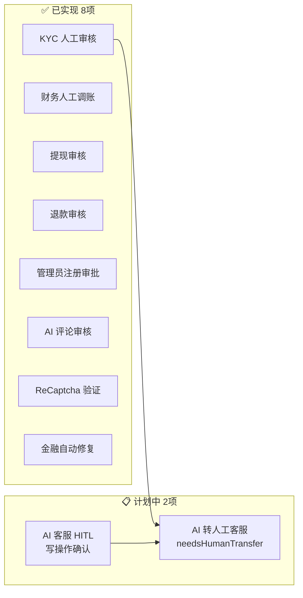

# JoyMini Nest Monorepo — 人工干预功能分析报告

> **分析日期**: 2026-06-24
> **分析范围**: 全项目代码 + 计划文档

---

## 总览

当前项目共有 **8 个已实现** 的人工干预功能点，以及 **2 个计划中** 的功能。



---

## 一、✅ 已实现的人工干预功能

### 1. KYC 人工审核 — 最完整的审核流程

| 维度 | 详情 |
|------|------|
| **后端** | [`apps/api/src/admin/kyc/kyc.service.ts`](apps/api/src/admin/kyc/kyc.service.ts:148) → `auditKyc()` |
| **前端** | [`apps/admin-next/src/views/kyc/KycAuditModal.tsx`](apps/admin-next/src/views/kyc/KycAuditModal.tsx:208) |
| **API** | `POST /v1/admin/kyc/:id/audit` |
| **权限** | `USER:KYC_AUDIT` |
| **审核动作** | `APPROVE` / `REJECT` / `NEED_MORE`（三档） |
| **审核内容** | 身份证正面/反面/活体照片 + OCR 数据对比 + 活体分数 |
| **审计字段** | `auditorId`, `auditResult`, `auditedAt`, `rejectReason` |
| **自动降级** | AI OCR/活体识别失败时，`createFallbackResult()` 返回人工审核路径 |
| **安全** | Prisma 事务 + `updateMany` 原子 claim，防并发复用 session |

**关键流程**:
```
用户提交 → AI OCR + 活体检测 → REVIEWING 状态
  ├─ AI 自动通过 (REVIEWING → APPROVED)
  ├─ AI 自动拒绝 (REVIEWING → REJECTED)
  └─ 进入人工审核队列 → Admin 人工审核
       ├─ APPROVE → KYC 通过
       ├─ REJECT → 72h 冷却期（连续拒绝 ≥2 次则 7 天冷却）
       └─ NEED_MORE → 用户补充材料
```

**额外功能**:
- Admin 手动创建 KYC 记录（直接 APPROVED）: [`kyc.service.ts`](apps/api/src/admin/kyc/kyc.service.ts:274) → `manualCreate()`
- Admin 手动更新 KYC 信息: [`kyc.service.ts`](apps/api/src/admin/kyc/kyc.service.ts:388)
- Admin 手动驳回用户所有 KYC: [`kyc.service.ts`](apps/api/src/admin/kyc/kyc.service.ts:436)

---

### 2. 财务人工调账 (Manual Adjust)

| 维度 | 详情 |
|------|------|
| **后端** | [`apps/api/src/admin/finance/finance.service.ts`](apps/api/src/admin/finance/finance.service.ts:99) → `manualAdjust()` |
| **前端** | [`apps/admin-next/src/views/finance/ManualAdjustModal.tsx`](apps/admin-next/src/views/finance/ManualAdjustModal.tsx) |
| **API** | `POST /v1/admin/finance/adjust` |
| **权限** | `FINANCE:manual_adjust`（高危操作） |
| **安全措施** | 分布式锁 `manual_adjust_lock:{userId}` + 必填 `reason` + `AdminOperationLog` 自动记录 |

**可调整项**:
- 余额类型: 现金余额(`CASH`) / 金币(`COIN`)
- 操作类型: 增加(`INCOME`) / 扣除(`EXPENDITURE`)
- 必须填写操作原因

---

### 3. 提现审核 (Withdrawal Audit)

| 维度 | 详情 |
|------|------|
| **后端** | [`apps/api/src/admin/finance/finance.service.ts`](apps/api/src/admin/finance/finance.service.ts:309) → `auditWithdraw()` |
| **前端** | [`apps/admin-next/src/views/finance/WithdrawAuditModal.tsx`](apps/admin-next/src/views/finance/WithdrawAuditModal.tsx) |
| **API** | `POST /v1/admin/finance/withdrawals/audit` |
| **权限** | `FINANCE:WITHDRAW_AUDIT` |
| **安全** | 分布式锁 `withdraw_audit_lock:{withdrawId}` |
| **审计字段** | `auditorId`, `auditResult`, `auditedAt`, `rejectReason` |

**审核流程**:
```
PENDING → ADMIN 审核
  ├─ APPROVE(SUCCESS) → 调用 Xendit 打款 → PROCESSING → SUCCESS
  ├─ REJECT → 退回冻结金额到可用余额 → REJECTED
  └─ Payout 失败 → FAILED（保留审计记录）
```

---

### 4. 退款审核 (Refund Audit)

| 维度 | 详情 |
|------|------|
| **后端** | [`apps/api/src/admin/order/order.controller.ts`](apps/api/src/admin/order/order.controller.ts:31) → `RefundAuditDto` |
| **前端** | [`apps/admin-next/src/views/OrderManagement.tsx`](apps/admin-next/src/views/OrderManagement.tsx) |
| **API** | `POST /v1/admin/orders/refund/audit` |

---

### 5. 管理员注册审批 (Admin Register Application)

| 维度 | 详情 |
|------|------|
| **后端** | [`apps/api/src/admin/register-application/register-application.service.ts`](apps/api/src/admin/register-application/register-application.service.ts:209) |
| **前端** | [`apps/admin-next/src/views/admin/ApplicationsManagement.tsx`](apps/admin-next/src/views/admin/ApplicationsManagement.tsx) |
| **API** | `POST /v1/admin/register-application/:id/approve` / `reject` |
| **流程** | `pending` → `approved` / `rejected` |
| **通知** | ✅ 邮件通知（fire-and-forget） |
| **审计** | `reviewedBy`, `reviewNote`, `reviewedAt` |

**安全设计**:
- 创建时检查用户名/邮箱是否已被使用
- 审批时再次检查用户名是否已被占用（防止并发冲突）
- 已审批的申请不可重复操作
- 自动创建 `AdminUser`（最小权限 `VIEWER` 角色）+ Prisma 事务

---

### 6. AI 评论审核 (AI Comment Moderation)

| 维度 | 详情 |
|------|------|
| **后端** | [`apps/api/src/blog/blog.service.ts`](apps/api/src/blog/blog.service.ts) → AI 审核评分 |
| **Processor** | [`apps/api/src/blog/processors/blog-ai.processor.ts`](apps/api/src/blog/processors/blog-ai.processor.ts:1006) |
| **AI 审核分数** | Gemini AI 评分 (0-100) |

**评分策略**:
| 分数区间 | 动作 | 说明 |
|----------|------|------|
| **0 - 30** | ✅ 自动通过 + AI 智能自动回复 | 低风险，完全自动化 |
| **30 - 70** | ⏳ 进入人工审核队列 | 中风险，需要人工判断 |
| **70 - 100** | ❌ 自动拒绝屏蔽 | 高风险，直接拦截 |

**额外审核机制**:
- 敏感词过滤: [`apps/api/src/common/ai`](apps/api/src/common/ai) 多层防线（敏感词 + AI 审核 + 人工审核）
- 评论标记功能: 用户可标记评论供审核 -> [`blog.service.ts`](apps/api/src/blog/blog.service.ts:2283)

---

### 7. ReCaptcha 验证 (Needs Review)

| 维度 | 详情 |
|------|------|
| **文件** | [`apps/api/src/common/recaptcha/recaptcha.service.ts`](apps/api/src/common/recaptcha/recaptcha.service.ts:79) |
| **方法** | `needsReview(score: number)` |

**策略**:
| 分值范围 | 判定 | 动作 |
|----------|------|------|
| ≥ 0.7 | ✅ 正常用户 | 直接通过 |
| 0.5 - 0.7 | ⚠️ 可疑 | 进入人工审核队列 |
| 0.3 - 0.5 | 🔍 需要人工审核 (`needsReview`) | 人工判断 |
| < 0.3 | 🚫 机器人 | 拒绝访问 |

---

### 8. 金融自动修复 + 人工介入 (Finance Auto-Fix)

| 维度 | 详情 |
|------|------|
| **文件** | [`apps/api/src/admin/finance/finance.task.ts`](apps/api/src/admin/finance/finance.task.ts:140) |
| **机制** | Cron 任务自动修复 Xendit 掉单 |

**三种修复场景**:
| 场景 | Xendit 状态 | 自动动作 | 是否需要人工 |
|------|-------------|----------|------------|
| Ghost Order（Xendit 无此单） | 不存在 | 标记 FAILED | ⚠️ 需要人工处理退款 |
| 已打款但本地未更新 | SUCCEEDED | 自动标记 SUCCESS | ❌ 无需人工 |
| Xendit 打款失败 | FAILED | 自动标记 FAILED | ❌ 无需人工 |

**金额不匹配场景**（[`finance.service.ts`](apps/api/src/admin/finance/finance.service.ts)）:
- `CRITICAL` 日志记录 + 强制扣减
- ⚠️ 运维人工对账

---

## 二、📋 计划中（未实现）的人工干预功能

### 9. AI 客服 HITL (Human-in-the-Loop)

| 维度 | 详情 |
|------|------|
| **计划文档** | [`plans/joymini-nest-monorepo/19-MultiAgentSupervisor与HITL.md`](plans/joymini-nest-monorepo/19-MultiAgentSupervisor与HITL.md) |
| **实现状态** | ❌ 未实现（`apps/api/src/client/ai-customer/` 目录不存在） |
| **技术方案** | LangGraph `interrupt()` + `Command` resume |

**需要用户确认的写操作**:
1. 退款申请 (`applyRefund`)
2. 提现申请 (`applyWithdraw`)
3. 领取优惠券 (`claimCoupon`)
4. 抽奖 (`draw`)
5. 发红包 (`sendRedPacket`)

**预期流程**:
```
用户发送消息 → Agent 执行 → HITL 节点判断
  ├─ 写操作 → interrupt() 暂停 → 等待用户"确认/取消"
  └─ 读操作 → 直接继续
```

---

### 10. AI 转人工客服 (AI-to-Human Transfer)

| 维度 | 详情 |
|------|------|
| **计划文档** | [`plans/joymini-nest-monorepo/20-Flutter-AI-人工融合方案.md`](plans/joymini-nest-monorepo/20-Flutter-AI-人工融合方案.md) |
| **实现状态** | ❌ 未实现 |
| **技术方案** | LangGraph Agent `needsHumanTransfer` + Socket 双通道 |

**5 种转人工触发条件**:
| # | 条件 | 判断来源 |
|---|------|----------|
| 1 | 意图无法识别 | `intentRouter` → `intent: UNKNOWN` |
| 2 | Agent 工具调用失败 | ReAct Agent tool 返回错误/超时 |
| 3 | LLM 自判无法处理 | `answerSynthesizer` 输出 `needsHumanTransfer` |
| 4 | 用户明确要求转人工 | `intentRouter` → `intent: HUMAN_SERVICE` |
| 5 | 敏感操作需人工确认 | 继承 HITL 模式 → 大额退款/账户注销 |

---

## 三、对比总结

| # | 功能 | 审核主体 | 审核动作 | 状态 | 优先级 |
|---|------|---------|---------|------|--------|
| 1 | KYC 身份认证 | Admin | APPROVE/REJECT/NEED_MORE | ✅ 生产 | 🔴 高 |
| 2 | 财务人工调账 | Admin | 增加/扣除余额 | ✅ 生产 | 🔴 高 |
| 3 | 提现审核 | Admin | 通过/拒绝 | ✅ 生产 | 🔴 高 |
| 4 | 退款审核 | Admin | 通过/拒绝 | ✅ 生产 | 🔴 高 |
| 5 | 管理员注册审批 | Super Admin | 批准/拒绝+邮件 | ✅ 生产 | 🟡 中 |
| 6 | AI 评论审核 | AI+Admin | 自动/人工队列 | ✅ 生产 | 🟡 中 |
| 7 | ReCaptcha 验证 | AI | 自动/人工队列 | ✅ 生产 | 🟡 中 |
| 8 | 金融自动修复 | AI+Cron | 自动修复+人工兜底 | ✅ 生产 | 🟡 中 |
| 9 | AI 客服 HITL | 用户确认 | 确认/取消 | 📋 计划 | 🟢 Phase 5 |
| 10 | AI 转人工客服 | AI+Admin | AI 判断+人工接起 | 📋 计划 | 🟢 Phase 6 |

---

## 四、关键观察

1. **审核体系完整**: 从身份认证(KYC) → 金融(调账/提现) → 订单(退款) → 注册(审批) → 内容(评论) → 安全(ReCaptcha)，覆盖了电商平台核心业务的所有审核环节。

2. **AI + 人工双重防御**: 评论审核和 KYC 都采用了 AI 自动处理 + 人工兜底的分层策略，类似多层防御架构。

3. **审计追溯性强**: 所有人工操作都记录了 `auditorId`(审核人)、`auditResult`(审核结果)、`auditedAt`(审核时间)，财务操作还有分布式锁防并发。

4. **AI 客服 HITL 是下一步重点**: AI 客服的 HITL（`interrupt()` 模式）和转人工（Socket 双通道）是当前计划中最后两块未实现的人工干预功能，也是 AI 客服系统从 MVP 到生产级的关键能力。
