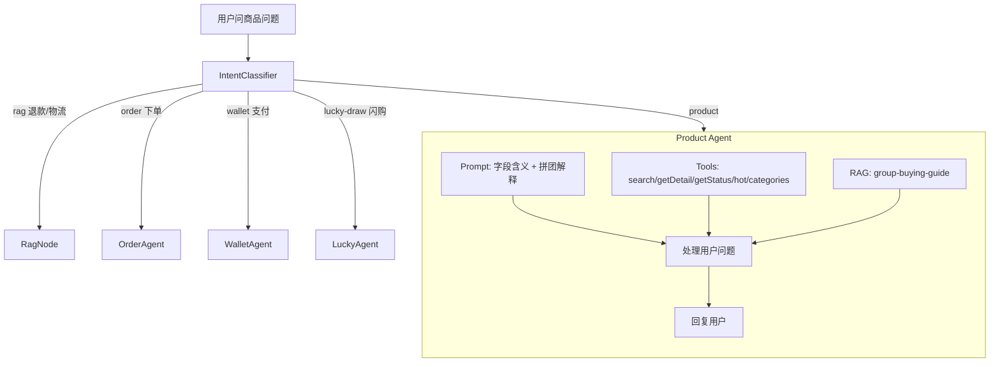

# Product Domain 完整架构分析

> 文档编号: Product Domain 架构分析
> 参考: Amazon, Shopee/Lazada, Pinduoduo (拼多多)
> 创建日期: 2026-07-06

---

## 1. 当前架构

### 现有 Tool (5 个)

| Tool | 职责 | DTO | toLLM |
|:-----|:-----|:----|:-----:|
| `searchProducts` | 搜索/浏览商品 | `TreasureResponseDto` 22字段 | ✅ |
| `getProductDetail` | 商品详情 | `TreasureResponseDto` 22字段 | ✅ |
| `getProductStatus` | 实时库存/价格 | `TreasureStatusDto` 9字段 | ✅ |
| `getHotProducts` | 热门商品 | `HotGroupItemDto` 12字段 | ✅ |
| `getProductCategories` | 分类列表 | 纯 `{id,name}` | ✅ |

### 现有 Prompt

[`product-prompt.ts`](/apps/api/src/client/ai-customer/graph/agents/prompts/product-prompt.ts:64) 已覆盖：
- 所有字段含义（165行完整 prompt）
- 用户意图解释（"cheap→unitAmount升序"）
- Tool 使用说明
- Scope 限制（只读，不能下单）

---

## 2. 参考大型电商分析

### Amazon 的 AI 能处理的商品知识

| 能力 | 实现方式 | JoyMini 状态 |
|:-----|:---------|:------------|
| 商品搜索 | API | ✅ `searchProducts` |
| 商品详情/规格 | API | ✅ `getProductDetail` |
| 实时库存 | API | ✅ `getProductStatus` |
| 热门/推荐 | API+算法 | ✅ `getHotProducts` |
| 分类导航 | API | ✅ `getProductCategories` |
| 退货政策 | RAG | ✅ `rag` domain (规划中) |
| 发货政策 | RAG | ✅ `rag` domain (规划中) |
| 尺寸指南 | RAG | ❌ 缺失 |
| 正品保障 | RAG | ❌ 缺失 |
| 保修政策 | RAG | ❌ 缺失 |

### Shopee/Lazada (东南亚) 额外需要

| 能力 | 实现方式 | JoyMini 状态 |
|:-----|:---------|:------------|
| COD 说明 | RAG | ✅ `rag` domain (规划中) |
| 闪购规则 | Tool/RAG | ✅ `lucky-draw` domain |
| 优惠券使用 | Tool/RAG | ✅ `coupon` domain |

### Pinduoduo (拼多多 — 模式最接近 JoyMini)

| 能力 | 实现方式 | JoyMini 状态 |
|:-----|:---------|:------------|
| 拼团玩法说明 | RAG | ❌ 完全缺失 ⚠️ |
| 拼团价格解释 | Prompt/RAG | ❌ 缺失 ⚠️ |
| 拼团失败处理 | RAG+DB | ❌ 缺失 ⚠️ |
| 物流拼团区别 | RAG | ❌ 缺失 |

---

## 3. 修正后的结论：Product Domain 需要 3 个 RAG 文档

之前的分析说 product ≈ 0 不准确。参考大型电商后，产品域实际需要：

### P0 — 核心业务说明（必须）

#### 文档 1: `knowledge/product/group-buying-guide.en.md`

**覆盖的问题：**
- "拼团怎么玩？" / "How does group buying work?"
- "成团需要几个人？" / "How many people needed for a group?"
- "拼团失败会怎么样？" / "What happens if group doesn't fill?"
- "我是团长有什么好处？" / "What are leader benefits?"
- "多久要成团？" / "What's the time limit?"
- "为什么会显示 XX 人已买？" / "Are these sales numbers real?"

**数据来源：**
- `ruleContent` (DB, HTML) → RAG 文档内容
- `groupSize` (DB) → Tool 已有
- `groupTimeLimit` (DB) → **需加到 DTO**
- `groupMaxNum` (DB) → **需加到 DTO**
- `leaderBonusType` (DB) → Tool 已有
- `fakeSalesCount` (DB) → **需加到 DTO** — 重要！解释销量显示
- `robotDelay` + `enableRobot` (DB) → **需加到 DTO**

**为什么走 RAG 而不是 Prompt？** 拼团机制说明需要一整页的篇幅，写在 prompt 里会让 prompt 膨胀。RAG 文档可以在需要时才加载。

### P1 — 信任与安全（高优）

#### 文档 2: `knowledge/product/product-authenticity.en.md`

**覆盖的问题：**
- "商品是正品吗？" / "Are products genuine?"
- "JoyMini 怎么保证品质？" / "How does JoyMini ensure quality?"
- "买到假货怎么办？" / "What if I receive counterfeit goods?"
- "有商家资质审核吗？" / "Are sellers verified?"

### P2 — 补充指南（中优）

#### 文档 3: `knowledge/product/size-guide.en.md`

**覆盖的问题：**
- "怎么选尺码？" / "How to choose the right size?"
- "衣服尺码偏大还是偏小？" / "Do clothes run big or small?"

---

## 4. 同时需要做的增强

### 4.1 DTO 增强 — 加 4 个 DB 字段

在 [`TreasureResponseDto`](/apps/api/src/client/treasure/dto/treasure-response-dto.ts) 中添加：

| 字段 | 类型 | 说明 |
|:-----|:-----|:-----|
| `groupTimeLimit` | number | 成团时限(秒)，86400=24h |
| `groupMaxNum` | number | 最大参团人数 |
| `fakeSalesCount` | number | 虚拟销量基数（AI 需要知道这个才能解释"为什么显示 1000+ 已买"） |
| `ruleContent` | string | 规则说明 HTML（含拼团、发货等说明） |

同时在 [`HotGroupItemDto`](/apps/api/src/client/treasure/dto/hot_croup_item.dto.ts) 中也加上 `fakeSalesCount`。

### 4.2 Prompt 增强 — 加 domainRules

在 [`product-prompt.ts`](/apps/api/src/client/ai-customer/graph/agents/prompts/product-prompt.ts:83) 的 `domainRules` 中添加：

```typescript
### 拼团机制说明
JoyMini 采用社交电商拼团模式：
- 每个商品有**三种价格**：
  - `unitAmount`: 拼团价（最低，需要成团）
  - `soloAmount`: 单独购买价（不需要成团，稍贵）
  - `marketAmount`: 市场划线价（展示折扣用）
- 用户可以选择"自己开团"或"参团"
- 成团需要 `groupSize` 人
- 成团时限 `groupTimeLimit` 秒
- 如果时限内未成团，系统会自动处理退款
- 显示的销量 = 真实销量 + `fakeSalesCount`（基础销量）
```

### 4.3 Intent 例句修正

在 [`intent-examples/product.ts`](/apps/api/src/client/ai-customer/graph/agents/prompts/intent-examples/product.ts) 中：
- "Can I return this product?" → 这条应该移到 `rag.ts` 的 intent examples（退款政策）
- "How does group buying work?" → 加一条到 product examples（路由到 product agent，然后查 RAG）

---

## 5. 完整架构图



---

## 6. 实施步骤

| # | 步骤 | 文件 | 难度 |
|:-:|:-----|:-----|:----:|
| 1 | 加 4 个 DB 字段到 `TreasureResponseDto` | `treasure-response-dto.ts` | ⭐ |
| 2 | 加 `fakeSalesCount` 到 `HotGroupItemDto` | `hot_croup_item.dto.ts` | ⭐ |
| 3 | 在 prompt 加拼团机制 domainRules | `product-prompt.ts` | ⭐ |
| 4 | 修正 intent 例句 | `intent-examples/product.ts`, `rag.ts` | ⭐ |
| 5 | 创建 P0 RAG 文档: `group-buying-guide.en.md` | `knowledge/product/` | ⭐⭐ |
| 6 | 创建 P1 RAG 文档: `product-authenticity.en.md` | `knowledge/product/` | ⭐⭐ |
| 7 | 创建 P2 RAG 文档: `size-guide.en.md` | `knowledge/product/` | ⭐⭐ |
| 8 | 更新 RAG 架构文档（修正之前的结论） | `RAG/12-知识文档RAG架构分析.md` | ⭐ |
| 9 | 验证: 拼团问题能正确回答 | curl test | ⭐ |
