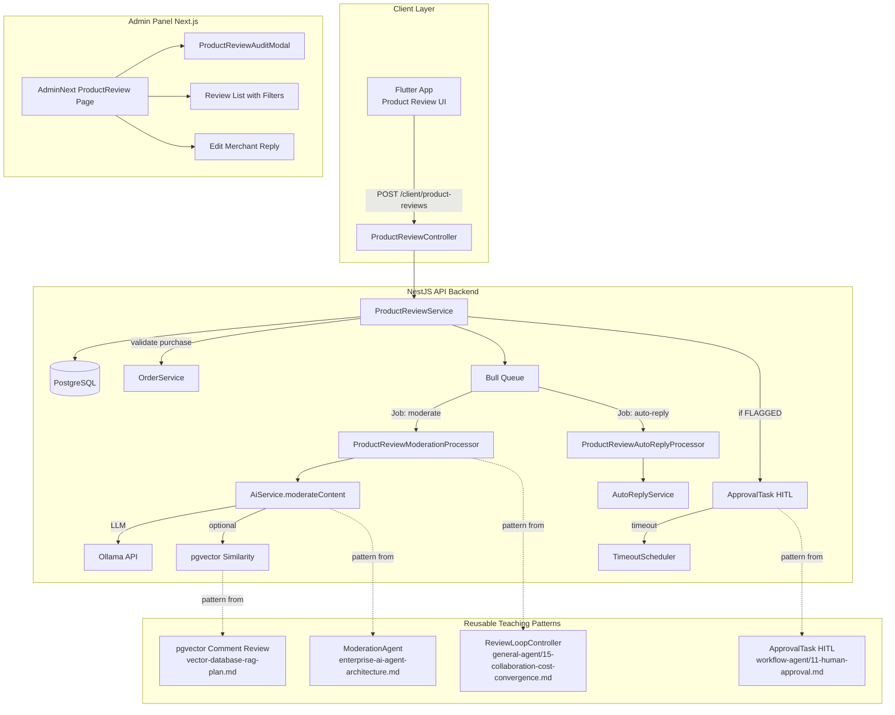

# Product Review + AI Agent — Full Implementation Plan

> **Context**: JoyMini e-commerce project is missing a product review/rating feature.
> The six teaching projects in `study/` contain patterns for AI-powered comment moderation.
>
> **Previous Reports**:
> - [`ecommerce-review-gap-analysis.md`](ecommerce-review-gap-analysis.md) — Gap analysis confirming no `ProductReview` model
> - [`human-intervention-analysis.md`](human-intervention-analysis.md) — All human intervention features across the project

---

## Table of Contents

1. [AI Agent Features Overview](#1-ai-agent-features-overview)
2. [Architecture Diagram](#2-architecture-diagram)
3. [Data Model](#3-data-model)
4. [API Design](#4-api-design)
5. [Implementation Steps: Backend + Frontend](#5-implementation-steps-backend--frontend)
   - [Phase 1: Data Layer P0](#phase-1-data-layer-p0)
   - [Phase 2: Client API P0](#phase-2-client-api-p0)
   - [Phase 3: AI Moderation Agent P0](#phase-3-ai-moderation-agent-p0)
   - [Phase 4: Admin Panel + HITL P1](#phase-4-admin-panel--hitl-p1)
   - [Phase 5: Flutter Client UI P2](#phase-5-flutter-client-ui-p2)
   - [Phase 6: Analytics & Enhancement P2](#phase-6-analytics--enhancement-p2)
6. [Existing Assets to Reuse](#6-existing-assets-to-reuse)
7. [Architecture Consistency Check](#7-architecture-consistency-check)

---

## 1. AI Agent Features Overview

### Feature 1: Auto Content Moderation P0

**What it does**:
When a user submits a product review, an AI Agent automatically scores and classifies the content:

```
User submits review → AI Agent moderates → Three-tier decision
                                           ├─ Score 0-30  → ✅ Auto-approve (review published immediately)
                                           ├─ Score 30-70 → ⚠️ Flagged for human review
                                           └─ Score 70-100→ ❌ Auto-reject with reason
```

**AI checks performed**:
| Check | Detection Method | Source Pattern |
|-------|-----------------|----------------|
| Spam / Advertising | LLM content scoring | [`AiService.moderateComment()`](../../apps/api/src/blog/processors/blog-ai.processor.ts#L963) |
| Profanity / Abuse | LLM classification | [`ModerationAgent.llmModerate()`](../../study/llm-app-dev/enterprise-ai-agent-architecture.md#L420) |
| Off-topic content | LLM relevance check | Same as above |
| Duplicate reviews | pgvector similarity search | [`vectorSimilarityCheck()`](../../study/llm-app-dev/vector-database-rag-plan.md#L581) |
| Review images | Image URL validation + link check | New implementation |

**Backend**: Bull Queue `moderate-product-review` + `AiService.moderateContent()` (generalized from existing)
**Frontend**: No direct UI (runs async in background)

---

### Feature 2: Fake Review Detection P0

**What it does**:
Before publishing, the AI Agent verifies the reviewer's authenticity:

| Detection | Method | Action |
|-----------|--------|--------|
| No purchase record | Check `Order` table for productId + userId match | ❌ Reject with "Buy first to review" |
| Too many reviews in short time | Count reviews by userId + time window | ⚠️ Flag for human review |
| Similar content across users | pgvector similarity search against existing reviews | ⚠️ Flag + merge investigation |
| Rating-content mismatch | Sentiment analysis: 5-star + negative text | ⚠️ Flag for human review |
| Same IP / device fingerprint | Check review session metadata | ⚠️ Flag for investigation |

**Backend**: `ProductReviewService` with fraud detection pipeline
**Frontend**: No direct UI (runs before review is published)

---

### Feature 3: Auto Reply to Reviews P1

**What it does**:
After a review is approved, AI generates an appropriate merchant reply:

| Rating | AI Reply Strategy | Source Pattern |
|--------|-------------------|----------------|
| 4-5 stars | Thank + encourage repurchase | [`AutoReplyService`](../../apps/api/src/common/ai/auto-reply/interfaces/auto-reply.types.ts) |
| 3 stars | Acknowledge + ask for more details | Same pattern, extended prompt |
| 1-2 stars | Apologize + offer solution + guide to customer service | Same pattern, extended prompt |

**Backend**: Bull Queue `product-review-auto-reply` (reuse existing auto-reply infrastructure)
**Frontend** Admin: Merchant can edit AI-generated reply before publishing

---

### Feature 4: Review Quality Scoring & Sorting P1

**What it does**:
AI Agent assigns a quality score to each approved review for smart sorting:

| Criterion | Weight | Scoring Logic |
|-----------|--------|---------------|
| Content length | 20% | >100 chars = high, <20 chars = low |
| Has images | 30% | 1+ images = high |
| Has verified purchase | 30% | Linked to completed `Order` = high |
| Helpful votes | 20% | `helpfulCount` from other users |

**Sorting on product detail page**:
1. High-quality reviews first (score > 70)
2. Most recent reviews
3. Highest rated reviews

**Backend**: `computeReviewQuality()` in service layer + cached on `Treasure.averageRating`
**Frontend Client**: "Most helpful" / "Newest" / "Highest rated" sort tabs

---

### Feature 5: Human-in-the-Loop Review P1

**What it does**:
Flagged reviews enter an admin review queue with timeout handling:

```
Review FLAGGED → Create ApprovalTask → Admin Panel
                                       ├─ Approve → Publish + auto-reply
                                       ├─ Reject → Notify user with reason
                                       ├─ Need More Info → Request user revision
                                       └─ Timeout (24h) → Auto-approve (configurable)
```

**Backend**: [`ApprovalTask`](../../study/LLM/workflow-agent/11-human-approval.md#L113) model + timeout cron + SSE notifications
**Frontend Admin**: [`KycAuditModal`](../../apps/admin-next/src/views/kyc/KycAuditModal.tsx) pattern — three-action approve/reject/need-more

---

## 2. Architecture Diagram



---

## 3. Data Model

```prisma
/// 产品评价表 Product Review
model ProductReview {
  id          String          @id @default(cuid()) @db.VarChar(32)
  productId   String          @db.VarChar(32)
  product     Treasure        @relation(fields: [productId], references: [treasureId], onDelete: Cascade)
  orderId     String?         @db.VarChar(32)
  order       Order?          @relation(fields: [orderId], references: [id])
  userId      String          @db.VarChar(32)
  user        User            @relation(fields: [userId], references: [id], onDelete: Cascade)

  /// 评价内容
  rating      Int             // 1-5 星
  content     String          @db.Text
  images      Json?           // ["url1","url2"]

  /// 状态
  status      ProductReviewStatus  @default(PENDING)

  /// AI审核
  aiModerationScore      Int?       @map("ai_moderation_score") @db.SmallInt
  aiModerationReason     String?    @map("ai_moderation_reason") @db.Text
  aiModerationCategories String?    @map("ai_moderation_categories") @db.VarChar(255)
  aiModeratedAt          DateTime?  @map("ai_moderated_at")

  /// AI质量评分 Feature 4
  aiQualityScore         Int?       @map("ai_quality_score") @db.SmallInt

  /// 管理员审核
  reviewedBy  String?     @db.VarChar(32)
  reviewNote  String?     @db.Text
  reviewedAt  DateTime?

  /// 商家回复 Feature 3
  replyContent String?    @map("reply_content") @db.Text
  repliedAt    DateTime?

  /// 有帮助计数
  helpfulCount Int        @default(0) @map("helpful_count")
  
  /// 追加评价
  supplement  String?     @db.Text
  supplementedAt DateTime?

  createdAt   DateTime    @default(now()) @map("created_at")
  updatedAt   DateTime    @updatedAt @map("updated_at")

  @@index([productId, status])
  @@index([userId])
  @@index([rating])
  @@index([aiModerationScore])
  @@index([aiQualityScore])
  @@map("product_reviews")
}

enum ProductReviewStatus {
  PENDING     // 待AI审核
  APPROVED    // 已通过
  REJECTED    // 已拒绝
  FLAGGED     // 标记待人工审核
}
```

> **Note**: `aiQualityScore` is new — added for Feature 4 Review Quality Scoring.
> The model has already been added to [`apps/api/prisma/schema.prisma`](../../apps/api/prisma/schema.prisma) during analysis.

---

## 4. API Design

### Client Endpoints 7 endpoints

| Method | Path | Description | AI Agent Feature |
|--------|------|-------------|------------------|
| `POST` | `/client/product-reviews` | Create review | Triggers Feature 1 + 2 |
| `GET` | `/client/product-reviews/:productId` | List reviews sorted by quality | Feature 4 |
| `GET` | `/client/product-reviews/:id` | Review detail | — |
| `GET` | `/client/product-reviews/my` | My reviews | — |
| `PUT` | `/client/product-reviews/:id` | Update review | Re-triggers Feature 1 |
| `PUT` | `/client/product-reviews/:id/supplement` | Add supplement | Re-triggers Feature 1 |
| `POST` | `/client/product-reviews/:id/helpful` | Mark helpful | Feature 4 data source |
| `DELETE` | `/client/product-reviews/:id` | Delete review | — |

### Admin Endpoints 4 endpoints

| Method | Path | Description | AI Agent Feature |
|--------|------|-------------|------------------|
| `GET` | `/admin/product-reviews` | List all with filters | Feature 5 queue |
| `GET` | `/admin/product-reviews/:id` | Review detail + AI report | Feature 1 reason |
| `PUT` | `/admin/product-reviews/:id/audit` | Audit approve/reject/flag | Feature 5 HITL |
| `PUT` | `/admin/product-reviews/:id/reply` | Merchant reply | Feature 3 |

**Total: 12 endpoints** (8 client + 4 admin)

---

## 5. Implementation Steps: Backend + Frontend

---

### Phase 1: Data Layer P0

Goal: Create database model + migration. No frontend involvement.

#### Step 1.1 — Prisma Schema

```yaml
Backend:
  - Confirm ProductReview model + ProductReviewStatus enum in schema.prisma
  - Add aiQualityScore field to ProductReview
  - Run `yarn workspace @lucky/api prisma:migrate` to create migration
  - Run `yarn workspace @lucky/api prisma:generate`

Frontend:
  - None
```

**Files to modify**:
- [`apps/api/prisma/schema.prisma`](../../apps/api/prisma/schema.prisma) — Add `ProductReviewStatus` enum + `ProductReview` model
- Migrations auto-generated by Prisma

---

### Phase 2: Client API P0

Goal: CRUD endpoints for product reviews. Frontend: admin can see data; Flutter planned later.

#### Step 2.1 — Create Backend Module

```yaml
Backend:
  - Create apps/api/src/client/product-review/ directory:
    - product-review.module.ts
    - product-review.controller.ts
    - product-review.service.ts
    - dto/create-review.dto.ts
    - dto/update-review.dto.ts
    - dto/review-response.dto.ts
    - dto/query-review.dto.ts
  - Implement POST /client/product-reviews:
    - Validate rating 1-5
    - Optional orderId to verify purchase
    - Save with status PENDING
    - Enqueue Bull job moderate-product-review
  - Implement GET /client/product-reviews/:productId:
    - Public endpoint no auth
    - Pagination support
    - Only return APPROVED reviews to public
    - Sort by quality score desc then date desc
  - Implement GET /client/product-reviews/my:
    - JWT required
    - Return all user's reviews including PENDING
  - Implement PUT /client/product-reviews/:id:
    - Only owner can edit within 24h
    - Reset status to PENDING re-trigger moderation
  - Implement supplement PUT /client/product-reviews/:id/supplement:
    - Append text no overwrite
  - Implement helpful POST /client/product-reviews/:id/helpful:
    - Toggle helpful count one user one vote
  - Implement DELETE /client/product-reviews/:id:
    - Soft delete or hard delete

Frontend:
  - None yet Flutter is Phase 5
```

**Key validation logic**:
```
CreateReview flow:
  1. Validate rating 1-5 content not empty
  2. If orderId provided → verify Order belongs to userId + contains productId
  3. Check user hasn't already reviewed this product optional
  4. Save ProductReview with status PENDING
  5. Emit event or enqueue Bull job for AI moderation
  6. Return created review
```

**Files to create**:
- [`apps/api/src/client/product-review/`](../../apps/api/src/client/product-review/) — Full module 7 files
- [`apps/api/src/client/client.module.ts`](../../apps/api/src/client/client.module.ts) — Register `ProductReviewModule`

---

### Phase 3: AI Moderation Agent P0

Goal: AI Agent auto-moderates all new reviews. Backend only.

#### Step 3.1 — Generalize AiService

```yaml
Backend:
  - Extract generalize AiService.moderateComment:
    - Rename to AiService.moderateContent
    - Accept generic subjectType blog/product
    - Return same AiModerationResult interface
  - Keep backward compatibility: moderateComment calls moderateContent

Reference:
  - Current code: blog-ai.processor.ts L993-L1010
  - ModerationAgent pattern: enterprise-ai-agent-architecture.md L405-L458
```

#### Step 3.2 — Create Moderation Queue Processor

```yaml
Backend:
  - Create apps/api/src/client/product-review/processors/:
    - product-review-moderation.processor.ts
  - Bull Queue name: product-review-moderation
  - Processor logic:
    1. Receive job with reviewId
    2. Call AiService.moderateContent with review content product title
    3. Call vectorSimilarityCheck optional if pgvector enabled
    4. Apply three-tier decision:
       - Score 0-30  → status APPROVED + trigger auto-reply job
       - Score 30-70 → status FLAGGED + create ApprovalTask
       - Score 70-100→ status REJECTED + prepare rejection reason
    5. Save moderation result to ProductReview
    6. Emit SSE event for real-time status updates

Source pattern:
  - blog-ai.processor.ts L993-L1010 — existing moderation flow
  - enterprise-ai-agent-architecture.md L420-L458 — ModerationAgent
  - vector-database-rag-plan.md L558-L613 — pgvector similarity
```

#### Step 3.3 — Fake Review Detection

```yaml
Backend:
  - Add to ProductReviewService before creating review:
    1. Check orderId validation Feature 2
    2. Check recent review count same userId last hour
    3. Optional: pgvector similarity against existing reviews
  - If any check fails → save with status FLAGGED + aiModerationReason

Source pattern:
  - vector-database-rag-plan.md L568-L613 — similarity search
```

#### Step 3.4 — Auto Reply Feature 3

```yaml
Backend:
  - Create apps/api/src/client/product-review/processors/:
    - product-review-auto-reply.processor.ts
  - Bull Queue name: product-review-auto-reply
  - Processor logic:
    1. Receive job with approved reviewId
    2. Call AutoReplyService.generateReply with review content rating
    3. Save replyContent to ProductReview
    4. Optionally notify merchant to review/edit

Source pattern:
  - auto-reply.types.ts — CommentType PromptTemplate
  - blog-ai.processor.ts L1096-L1160 — existing auto-reply flow
```

**Files to create**:
- [`apps/api/src/client/product-review/processors/product-review-moderation.processor.ts`](../../apps/api/src/client/product-review/processors/)
- [`apps/api/src/client/product-review/processors/product-review-auto-reply.processor.ts`](../../apps/api/src/client/product-review/processors/)

**Files to modify**:
- [`apps/api/src/common/ai/`](../../apps/api/src/common/ai/) — Generalize `AiService`
- [`apps/api/src/common/ai/auto-reply/interfaces/auto-reply.types.ts`](../../apps/api/src/common/ai/auto-reply/interfaces/auto-reply.types.ts) — Add `CommentType.PRODUCT_REVIEW`

---

### Phase 4: Admin Panel + HITL P1

Goal: Admin can view filter audit and reply to reviews. Frontend + Backend.

#### Step 4.1 — Admin Backend API

```yaml
Backend:
  - Create apps/api/src/admin/product-review/ directory:
    - product-review.controller.ts
    - product-review.service.ts
    - dto/audit-review.dto.ts
    - dto/reply-review.dto.ts
    - dto/list-review.dto.ts
  - Implement GET /admin/product-reviews:
    - Filters: status rating dateRange productId
    - Pagination
    - Include user info product info AI report
  - Implement GET /admin/product-reviews/:id:
    - Full detail including AI moderation report images
  - Implement PUT /admin/product-reviews/:id/audit:
    - Body: action APPROVE|REJECT|NEED_MORE note
    - Set reviewedBy reviewedAt reviewNote
    - If APPROVE: set status APPROVED trigger auto-reply
    - If REJECT: set status REJECTED notify user
    - If NEED_MORE: set status FLAGGED update note
  - Implement PUT /admin/product-reviews/:id/reply:
    - Body: content
    - Save replyContent repliedAt

Source pattern:
  - KYC admin controller: register-application.service.ts L209-L281
  - ApprovalTask: workflow-agent/11-human-approval.md L113-L172
```

#### Step 4.2 — Admin Frontend List Page

```yaml
Frontend Admin Next.js:
  - Create apps/admin-next/src/views/product-review/ directory:
    - ProductReviewList.tsx
    - ProductReviewAuditModal.tsx
    - ProductReviewDetail.tsx
  - ProductReviewList.tsx:
    - Table with columns: product rating content user date status
    - Filter bar: status dropdown rating range date picker product search
    - Click row → open detail modal
    - Status badges: color-coded PENDING/APPROVED/REJECTED/FLAGGED
    - Source pattern: KYC listing pattern

Source pattern:
  - Existing admin views: apps/admin-next/src/views/kyc/
  - Table layout: finance/WithdrawalList.tsx
```

#### Step 4.3 — Admin Audit Modal

```yaml
Frontend Admin Next.js:
  - ProductReviewAuditModal.tsx:
    - Shows: review content images rating user info AI score AI reason
    - Three-action buttons:
      - ✅ Approve green
      - ❌ Reject red
      - ⚠️ Need More Info yellow
    - Textarea for review note
    - Confirmation dialog before submit
    - Source pattern: KycAuditModal.tsx

Source pattern:
  - KycAuditModal.tsx — three-action audit with image preview
  - WithdrawAuditModal.tsx — financial audit pattern
```

#### Step 4.4 — Admin Merchant Reply

```yaml
Frontend Admin Next.js:
  - ProductReviewDetail.tsx:
    - Review info display
    - AI auto-generated reply preview if exists
    - Editable textarea for merchant to modify
    - Save button -> PUT /admin/product-reviews/:id/reply
```

**Files to create**:
- [`apps/api/src/admin/product-review/`](../../apps/api/src/admin/product-review/) — 5 files
- [`apps/admin-next/src/views/product-review/`](../../apps/admin-next/src/views/product-review/) — 3 React components
- [`apps/admin-next/src/router.tsx`](../../apps/admin-next/src/router.tsx) or equivalent — Add route

**Files to modify**:
- [`apps/api/src/admin/admin.module.ts`](../../apps/api/src/admin/admin.module.ts) — Register `ProductReviewAdminModule`

---

### Phase 5: Flutter Client UI P2

Goal: Mobile product review UI. Flutter is in a separate repository.

#### Step 5.1 — Review List Widget

```yaml
Frontend Flutter:
  - ReviewListView widget:
    - Display approved reviews with pagination
    - Each item: user avatar nickname rating stars date content images
    - Sort tabs: Most Helpful | Newest | Highest Rated
    - Helpful button with count
    - Pull-to-refresh
    - Image gallery carousel
    - Loading skeleton
```

#### Step 5.2 — Review Submission Form

```yaml
Frontend Flutter:
  - ReviewForm widget:
    - Star rating selector 1-5 tap interaction
    - Text area for review content
    - Optional image upload up to 5 images
    - Submit button
    - Validation: rating required content min 10 chars
    - Success: show "Review submitted awaiting moderation" toast
```

#### Step 5.3 — Integrate with Product Detail Page

```yaml
Frontend Flutter:
  - Add review section to product detail screen:
    - Average rating display e.g., "4.5 ⭐ 128 reviews"
    - Rating distribution bar chart optional
    - "Write a Review" button -> ReviewForm
    - Review list with horizontal scroll or expandable section
    - "View All Reviews" link -> full review list page
```

**Note**: Flutter repo is separate from this monorepo. API calls use existing HTTP client.

---

### Phase 6: Analytics & Enhancement P2

Goal: Product rating stats and moderation quality monitoring.

#### Step 6.1 — Treasure Denormalized Fields

```yaml
Backend:
  - Add fields to Treasure model:
    averageRating   Float?   @default(0)
    reviewCount     Int      @default(0)
  - Update on review create/update/delete:
    - Compute from ProductReview where status = APPROVED
    - Use Prisma aggregation or trigger

Frontend:
  - Display averageRating + reviewCount on product cards
```

#### Step 6.2 — Admin Analytics

```yaml
Backend:
  - GET /admin/product-reviews/stats:
    - Total reviews by status count
    - Average rating by product/by category
    - AI moderation pass/flag/reject rate
    - Daily/weekly review submission trend
    - Most helpful reviews top 10

Frontend Admin Next.js:
  - Add analytics section to product-review page:
    - Summary cards
    - Trend chart optional
```

#### Step 6.3 — Moderation Quality Control

```yaml
Backend:
  - Optional: Implement ReviewLoopController pattern:
    - Track admin overrides of AI decisions
    - If admin consistently reverses AI decisions → retrain
    - Source: general-agent/15-collaboration-cost-convergence.md L170-L382

Source pattern:
  - ReviewLoopController: general-agent/15-collaboration-cost-convergence.md L383-L560
```

---

## 6. Existing Assets to Reuse

| Existing Asset | Location | How to Reuse |
|---------------|----------|-------------|
| `AiService.moderateComment()` | [`apps/api/src/blog/`](../../apps/api/src/blog/) | Generalize to `moderateContent()` |
| Bull Queue pattern | [`apps/api/src/blog/processors/`](../../apps/api/src/blog/processors/) | Copy queue config for moderation |
| BlogComment AI fields | [`schema.prisma:1607`](../../apps/api/prisma/schema.prisma) | Replicate on ProductReview |
| `KycAuditModal.tsx` | [`apps/admin-next/src/views/kyc/`](../../apps/admin-next/src/views/kyc/KycAuditModal.tsx) | Copy 3-action audit pattern |
| `WithdrawAuditModal.tsx` | [`apps/admin-next/src/views/finance/`](../../apps/admin-next/src/views/finance/WithdrawAuditModal.tsx) | Alternative audit UI pattern |
| `AutoReplyService` | [`apps/api/src/common/ai/auto-reply/`](../../apps/api/src/common/ai/auto-reply/) | Generate merchant reply |
| `CommentType` enum | [`apps/api/src/common/ai/auto-reply/interfaces/auto-reply.types.ts`](../../apps/api/src/common/ai/auto-reply/interfaces/auto-reply.types.ts) | Add `PRODUCT_REVIEW` type |
| `ReCaptchaService.needsReview()` | [`apps/api/src/common/recaptcha/recaptcha.service.ts:79`](../../apps/api/src/common/recaptcha/recaptcha.service.ts) | Score-based flagging pattern |
| `ApprovalTask` model | [`study/LLM/workflow-agent/11-human-approval.md`](../../study/LLM/workflow-agent/11-human-approval.md) | HITL review workflow |
| `ModerationAgent` | [`study/llm-app-dev/enterprise-ai-agent-architecture.md`](../../study/llm-app-dev/enterprise-ai-agent-architecture.md) | Content scoring pipeline |
| pgvector similarity | [`study/llm-app-dev/vector-database-rag-plan.md`](../../study/llm-app-dev/vector-database-rag-plan.md) | Duplicate/spam detection |
| `ReviewLoopController` | [`study/LLM/general-agent/15-collaboration-cost-convergence.md`](../../study/LLM/general-agent/15-collaboration-cost-convergence.md) | Moderation quality control |

---

## 7. Architecture Consistency Check

### 7.1 i18n Compliance
- Review content is user-generated → no translation needed
- Admin audit UI → `useTranslations('product-review')`
- API error messages → existing `I18nService`
- AI moderation reasons → store in English, translate on display if needed

### 7.2 Auth & Guards
- Client endpoints: `JwtAuthGuard` + `@CurrentUser()` decorator
- Admin endpoints: `AdminJwtAuthGuard` + `RolesGuard`
- Public endpoints: `GET /client/product-reviews/:productId` — no auth

### 7.3 Queue Pattern
- Reuse existing Bull queue infrastructure
- Queue names: `product-review-moderation`, `product-review-auto-reply`
- Async processing: review saved immediately with `PENDING` status

### 7.4 Hydration Safety Client
- Review list uses standard REST API calls — no SSR hydration issues
- Star rating component uses `useIsClient` if animated

### 7.5 Summary

| Aspect | Current State | Target State |
|--------|--------------|-------------|
| Database | No `ProductReview` model | New model with AI fields |
| Client API | No review endpoints | 8 REST endpoints |
| Admin API | No review management | 4 admin endpoints |
| AI Agent | BlogComment only | Shared `moderateContent()` + 5 AI features |
| Admin UI | No review panel | List + AuditModal + Detail |
| Flutter UI | No review UI | Review list + submission form |
| Analytics | No review stats | Avg rating + moderation metrics |
