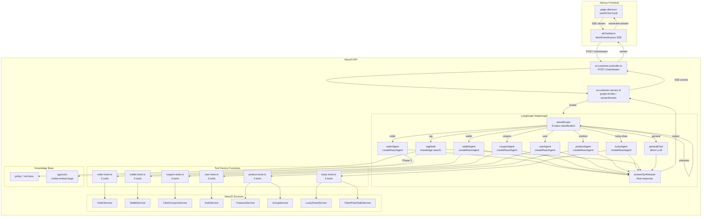
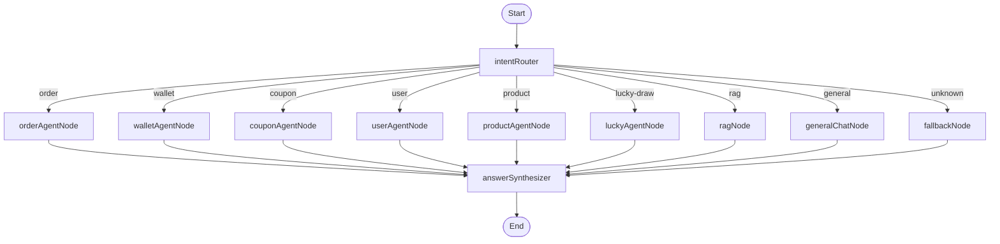
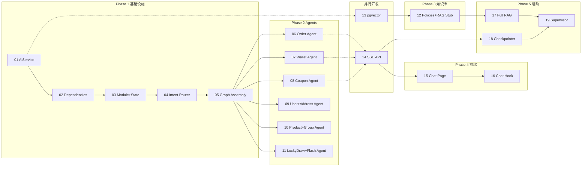
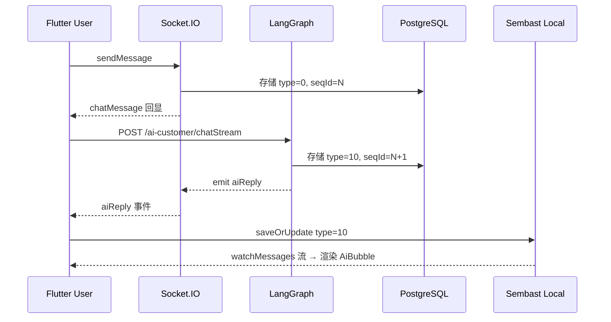

# JoyMini AI 客服助手 — Spec-Coding 深度分析

> 基于全量代码审查的完整架构分析与设计决策记录

---

## 一、全量 Service 调查清单

### 1.0 KYC 实名认证 KycService

**文件**: [`apps/api/src/client/kyc/kyc.service.ts`](apps/api/src/client/kyc/kyc.service.ts)
**Module**: [`kyc.module.ts`](apps/api/src/client/kyc/kyc.module.ts) — 当前 `exports: []`，需要改为 `exports: [KycService]`

| 方法 | 行号 | 参数 | 返回 | 说明 |
|------|------|------|------|------|
| `getMyKyc` | 186 | `userId: string` | KYC 记录或默认空状态 | 查询最新 KYC 认证记录，含 kycStatus/审核原因 |
| `getIdTypes` | 208 | 无 | ID 类型列表 | 返回支持的证件类型（Passport/PH Driver License/UMID 等） |
| `createSession` | 50 | `userId: string` | Session 信息 | 创建活体检测 session（含每日限次/冷却/复用策略） |
| `scanIdCard` | 242 | `buffer: Buffer` | OCR 结果 | 扫描证件图片（仅限 Flutter App 通过文件上传调用） |
| `submitKyc` | 265 | userId/dto/frontFile/backFile/device | KYC Record | 完整 KYC 提交（需文件上传 — AI 不可调用） |

**AI 可安全调用**: `getMyKyc` (只读), `getIdTypes` (只读), `createSession` (有状态但幂等)
**AI 不可调用**: `scanIdCard` (需要 Buffer), `submitKyc` (需要 multipart 文件上传)

**Module 导出修复**: [`kyc.module.ts`](apps/api/src/client/kyc/kyc.module.ts:12) 需要从 `exports: []` 改为 `exports: [KycService]`

**Prisma KYC 模型**:
| 模型 | 说明 | 关键字段 |
|------|------|---------|
| `KycRecord` | KYC 认证记录 | kycStatus(0=Draft/1=Reviewing/2=Rejected/3=NeedMore/4=Approved), rejectReason, sessionId |
| `KycIdType` | 支持的证件类型 | name, status, sortOrder |
| `KycLivenessSession` | 活体检测会话 | userId, sessionId, usedAt, createdAt |
| `KycLivenessAttempt` | 活体检测尝试 | sessionId, passed, expiresAt |

### 1.1 订单 OrderService

**文件**: [`apps/api/src/client/orders/order.service.ts`](apps/api/src/client/orders/order.service.ts)
**Module**: [`order.module.ts`](apps/api/src/client/orders/order.module.ts) — 当前 `exports: []`，需要改为 `exports: [OrderService]`

| 方法 | 行号 | 参数 | 返回 | 说明 |
|------|------|------|------|------|
| `listOrders` | 532 | `userId: string, q: ListOrdersDto` | 分页订单列表 | 支持 status 过滤：paid/unpaid/refunded |
| `getOrderDetail` | 609 | `userId: string, orderId: string` | 订单详情 + 交易记录 | 包含商品快照、物流信息 |
| `applyRefund` | 484 | `userId: string, dto: RefundApplyDto` | 退款申请结果 | 需要 `orderId`, `reason`, `items` |

### 1.2 钱包 WalletService + ClientWalletService

**文件**: [`apps/api/src/client/wallet/wallet.service.ts`](apps/api/src/client/wallet/wallet.service.ts), [`client-wallet.service.ts`](apps/api/src/client/wallet/client-wallet.service.ts)
**Module**: [`wallet.module.ts`](apps/api/src/client/wallet/wallet.module.ts) — 已正确 `exports: [WalletService, ClientWalletService]`

| 方法 | 文件 | 行号 | 参数 | 说明 |
|------|------|------|------|------|
| `balance` | wallet.service.ts | 75 | `userId: string` | 返回 realBalance, coinBalance, frozenBalance 等 |
| `applyWithdraw` | wallet.service.ts | 93 | `userId: string, dto` | 提现申请（写操作，需确认提示） |
| `getRechargeHistory` | client-wallet.service.ts | ~580 | `userId, dto` | 充值/交易记录分页查询 |

### 1.3 优惠券 ClientCouponService

**文件**: [`apps/api/src/client/coupon/coupon.service.ts`](apps/api/src/client/coupon/coupon.service.ts)
**Module**: [`coupon.module.ts`](apps/api/src/client/coupon/coupon.module.ts) — 当前 `exports: []`，需要改为 `exports: [ClientCouponService]`

| 方法 | 行号 | 参数 | 说明 |
|------|------|------|------|
| `getMyCoupons` | 13 | `userId: string, dto: QueryMyCouponsDto` | 用户优惠券列表，自动清理过期券 |
| `claimCoupon` | 71 | `userId: string, dto` | 领取优惠券（含事务） |
| `getClaimableCoupons` | 173 | `userId: string` | 可领取的优惠券模板列表（排除已领过的） |

### 1.4 用户信息 AuthService

**文件**: [`apps/api/src/client/auth/auth.service.ts`](apps/api/src/client/auth/auth.service.ts)
**Module**: `auth.module.ts`

| 方法 | 行号 | 参数 | 说明 |
|------|------|------|------|
| `profile` | 510 | `userId: string` | 返回 id, nickname, avatar, phone, inviteCode, vipLevel, kycStatus, selfExclusionExpireAt |

**注意**: `profile()` 在 `AuthService` 中，AiCustomerModule 需要导入 `AuthModule` 或通过 ClientModule 共享。

### 1.5 地址 AddressService

**文件**: [`apps/api/src/client/address/address.service.ts`](apps/api/src/client/address/address.service.ts)
**Module**: `address.module.ts`

| 方法 | 行号 | 参数 | 说明 |
|------|------|------|------|
| `list` | 177 | `userId: string, dto: QueryAddressListDto` | 地址列表（分页，默认排前） |
| `detail` | 226 | `userId: string, addressId: string` | 单个地址完整信息 |

### 1.6 商品 TreasureService

**文件**: [`apps/api/src/client/treasure/treasure.service.ts`](apps/api/src/client/treasure/treasure.service.ts)
**Module**: [`treasure.module.ts`](apps/api/src/client/treasure/treasure.module.ts) — 当前无 `exports`，需要改为 `exports: [TreasureService]`

| 方法 | 行号 | 参数 | 说明 |
|------|------|------|------|
| `list` | 30 | `query: TreasureQueryDto` | 商品列表，支持 keyword/category/预售/在售筛选 |
| `detail` | 159 | `id: string` | 商品详情，含 ruleContent, desc, shippingType 等 |

### 1.7 拼团 GroupService

**文件**: [`apps/api/src/common/group/group.service.ts`](apps/api/src/common/group/group.service.ts)
**Module**: `GroupModule` in `@api/common/group`

| 方法 | 行号 | 参数 | 说明 |
|------|------|------|------|
| `listGroupForTreasure` | ~ | `userId?, dto` | 商品团列表（进行中） |
| `getGroupDetail` | ~ | `groupId: string` | 团详情 + 成员信息 |

### 1.8 抽奖 LuckyDrawService

**文件**: [`apps/api/src/common/lucky-draw/lucky-draw.service.ts`](apps/api/src/common/lucky-draw/lucky-draw.service.ts)
**Module**: `LuckyDrawModule` in `@api/common/lucky-draw`

| 方法 | 行号 | 参数 | 说明 |
|------|------|------|------|
| `listTickets` | 108 | `userId, opts: {page, pageSize, unusedOnly?}` | 我的抽奖券列表 |
| `listResults` | 167 | `userId, opts` | 中奖历史记录 |
| `draw` | 204 | `userId, ticketId` | **写操作** — 执行抽奖，原子扣减库存 |

### 1.9 闪购 ClientFlashSaleService

**文件**: [`apps/api/src/client/flash-sale/flash-sale.service.ts`](apps/api/src/client/flash-sale/flash-sale.service.ts)
**Module**: `flash-sale.module.ts`

| 方法 | 行号 | 参数 | 说明 |
|------|------|------|------|
| `getActiveSessions` | 38 | 无 | 当前进行中的闪购场次 |
| `getSessionProducts` | 61 | `sessionId: string` | 闪购场次商品列表 |
| `getProductDetail` | 124 | `productId: string` | 闪购商品详情 |

---

## 二、Module Exports 修复清单

| 文件 | 当前 | 需要改为 | 原因 |
|------|------|---------|------|
| [`order.module.ts`](apps/api/src/client/orders/order.module.ts:14) | `exports: []` | `exports: [OrderService]` | AiCustomerModule 需要注入 OrderService |
| [`coupon.module.ts`](apps/api/src/client/coupon/coupon.module.ts:10) | `exports: []` | `exports: [ClientCouponService]` | AiCustomerModule 需要注入 ClientCouponService |
| [`treasure.module.ts`](apps/api/src/client/treasure/treasure.module.ts:12) | 无 exports | `exports: [TreasureService]` | AiCustomerModule 需要注入 TreasureService |
| [`wallet.module.ts`](apps/api/src/client/wallet/wallet.module.ts:11) | ✅ 已正确 `exports: [WalletService, ClientWalletService]` | 无需修改 | - |
| [`address.module.ts`](apps/api/src/client/address/address.module.ts) | 需检查 | 需要 `exports: [AddressService]` | AiCustomerModule 需要注入 |
| [`flash-sale.module.ts`](apps/api/src/client/flash-sale/flash-sale.module.ts) | 需检查 | 需要 `exports: [ClientFlashSaleService]` | AiCustomerModule 需要注入 |

---

## 三、架构设计

### 3.1 整体架构



### 3.2 意图路由设计（10 分类，含 KYC）

```typescript
// intent-router.node.ts
const INTENT_PROMPT = ChatPromptTemplate.fromMessages([
  ['system', `你是一个电商客服意图分类器。请将用户输入分类为以下之一：

- order: 订单查询、退款相关
- wallet: 钱包余额、交易记录、提现
- coupon: 优惠券查询、领取
- user: 个人信息、账户资料
- product: 商品搜索、商品详情、拼团信息
- lucky-draw: 抽奖券、中奖记录、执行抽奖
- kyc: 实名认证、KYC 状态查询、认证流程咨询、证件类型、活体检测
- rag: 退货政策、发货政策、规则咨询
- general: 问候、道谢、闲聊等一般对话
- unknown: 无法确定意图时

只输出分类名称，不要其他内容。`],
  ['human', '{input}'],
]);

const intentChain = INTENT_PROMPT.pipe(model).pipe(new StringOutputParser());
```

### 3.3 State 定义

```typescript
// graph/state.ts
import { Annotation, MessagesAnnotation } from '@langchain/langgraph';

export const AgentState = Annotation.Root({
  ...MessagesAnnotation.spec,  // messages[] with addMessages reducer
  intent: Annotation<string>(),
  agentOutput: Annotation<string>(),
  intermediateSteps: Annotation<StreamEvent[]>({
    reducer: (a, b) => a.concat(b),
    default: () => [],
  }),
});
```

### 3.4 Tool 工厂函数模式

关键设计决策：LangChain 的 `tool()` 需要纯函数回调，但 NestJS Service 通过 DI 在构造函数中注入。解决方案——**工厂函数**：

```typescript
// graph/tools/order-tools.ts
import { tool } from '@langchain/core/tools';
import { z } from 'zod';
import { OrderService } from '@api/client/orders/order.service';

export function createOrderTools(orderService: OrderService) {
  const orderListTool = tool(
    async ({ status, page, pageSize }) => {
      const result = await orderService.listOrders('userId', { status, page, pageSize });
      return JSON.stringify(result);
    },
    {
      name: 'order_list',
      description: '查询当前用户的订单列表，可按状态筛选',
      schema: z.object({
        status: z.enum(['paid', 'unpaid', 'refunded']).optional().describe('订单状态筛选'),
        page: z.number().optional().default(1),
        pageSize: z.number().optional().default(10),
      }),
    },
  );
  
  // ... more tools
  
  return [orderListTool, orderDetailTool, refundApplyTool];
}
```

### 3.5 Agent Node 工厂

```typescript
// graph/nodes/order-agent.node.ts
import { createReactAgent } from '@langchain/langgraph/prebuilt';

export function createOrderAgentNode(
  llm: BaseChatModel,
  tools: ReturnType<typeof createOrderTools>,
) {
  const agent = createReactAgent({ llm, tools });
  
  return async (state: typeof AgentState.State) => {
    const result = await agent.invoke({ messages: state.messages });
    return { messages: result.messages, agentOutput: 'order' };
  };
}
```

---

## 四、Graph 结构

### 4.1 完整节点连接



### 4.2 Customer Graph 组装

```typescript
// graph/customer.graph.ts
import { StateGraph } from '@langchain/langgraph';

export function buildCustomerGraph(params: {
  llm: BaseChatModel;
  intentRouter: Runnable;
  orderAgentNode: Function;
  walletAgentNode: Function;
  couponAgentNode: Function;
  userAgentNode: Function;
  productAgentNode: Function;
  luckyAgentNode: Function;
  ragNode: Function;
  generalChatNode: Function;
  fallbackNode: Function;
  answerSynthesizer: Function;
}) {
  const workflow = new StateGraph(AgentState)
    .addNode('intentRouter', params.intentRouter)
    .addNode('orderAgent', params.orderAgentNode)
    .addNode('walletAgent', params.walletAgentNode)
    .addNode('couponAgent', params.couponAgentNode)
    .addNode('userAgent', params.userAgentNode)
    .addNode('productAgent', params.productAgentNode)
    .addNode('luckyAgent', params.luckyAgentNode)
    .addNode('ragNode', params.ragNode)
    .addNode('generalChat', params.generalChatNode)
    .addNode('fallback', params.fallbackNode)
    .addNode('answerSynthesizer', params.answerSynthesizer)
    .addEdge('__start__', 'intentRouter')
    .addConditionalEdges('intentRouter', (state) => state.intent, {
      order: 'orderAgent',
      wallet: 'walletAgent',
      coupon: 'couponAgent',
      user: 'userAgent',
      product: 'productAgent',
      'lucky-draw': 'luckyAgent',
      rag: 'ragNode',
      general: 'generalChat',
      unknown: 'fallback',
    })
    .addEdge('orderAgent', 'answerSynthesizer')
    .addEdge('walletAgent', 'answerSynthesizer')
    .addEdge('couponAgent', 'answerSynthesizer')
    .addEdge('userAgent', 'answerSynthesizer')
    .addEdge('productAgent', 'answerSynthesizer')
    .addEdge('luckyAgent', 'answerSynthesizer')
    .addEdge('ragNode', 'answerSynthesizer')
    .addEdge('generalChat', 'answerSynthesizer')
    .addEdge('fallback', 'answerSynthesizer')
    .addEdge('answerSynthesizer', '__end__');

  return workflow.compile();
}
```

---

## 五、每个文档的 Spec-Code 概要

### 02 — 安装依赖 + Module Exports 修复

**背景**: 项目尚未安装 `@langchain/core` 和 `@langchain/langgraph`，且 3 个 Module 缺少 exports。

**关键代码变更**:

```diff
// package.json
+ "@langchain/core": "^0.3.x",
+ "@langchain/langgraph": "^0.2.x",

// order.module.ts
- exports: []
+ exports: [OrderService]

// coupon.module.ts  
- exports: []
+ exports: [ClientCouponService]

// treasure.module.ts
+ exports: [TreasureService]
```

### 03 — AiCustomerModule + State

**文件**: `apps/api/src/client/ai-customer/`
**关键代码**: `ai-customer.module.ts`, `graph/state.ts`

```typescript
// ai-customer.module.ts
@Module({
  imports: [
    OrderModule, WalletModule, CouponModule,
    forwardRef(() => AuthModule),
    AddressModule, TreasureModule, FlashSaleModule,
    GroupModule, LuckyDrawModule,
  ],
  controllers: [AiCustomerController],
  providers: [AiCustomerService, ...graphProviders],
})
export class AiCustomerModule {}
```

### 04 — 9-Intent 路由节点

**文件**: `graph/nodes/intent-router.node.ts`
**核心**: ChatPromptTemplate + ChatOllama + StringOutputParser → 9 分类输出

### 05 — Answer Synthesizer + Graph 组装

**文件**: `graph/nodes/answer-synthesizer.node.ts`, `graph/customer.graph.ts`
**核心**: 将 Agent/RAG/General 输出整合为最终回答

### 06-11 — 6 个 ReAct Agent

每个 Agent 文档包含：
1. **Service 导入** — 需要哪个 Service
2. **Module 依赖** — 需要哪些 Module exports
3. **Tool 工厂函数** — 每个 tool 的 schema + 回调 + name/description
4. **Agent Node** — createReactAgent + invoke
5. **注册到 Graph** — 添加到 customer.graph.ts

### 12 — 政策知识文档 + RAG Stub

**新建知识文档**（参考 `study/LLM/project/jisu-ai-customer/server/src/data/knowledge/policies.md`）:

| 文档 | 内容 |
|------|------|
| `knowledge/refund-policy.md` | 退货/退款政策 |
| `knowledge/shipping-policy.md` | 发货/物流政策 |
| `knowledge/coupon-rules.md` | 优惠券使用规则 |
| `knowledge/group-rules.md` | 拼团规则 |
| `knowledge/lucky-draw-rules.md` | 抽奖规则 |
| `knowledge/kyc-rules.md` | KYC 认证规则 |
| `knowledge/vip-benefits.md` | VIP 会员权益 |
| `knowledge/privacy-policy.md` | 隐私政策 |

**RAG Stub**: Phase 1 用 static context loading，Phase 3 替换为 pgvector 向量检索

### 13 — Prisma Knowledge 模型 + pgvector

```prisma
model KnowledgeDocument {
  id        String   @id @default(cuid())
  title     String
  content   String   @db.Text
  category  String   // policy | product | faq
  createdAt DateTime @default(now())
  updatedAt DateTime @updatedAt
}

model KnowledgeEmbedding {
  id         String   @id @default(cuid())
  documentId String
  document   KnowledgeDocument @relation(fields: [documentId], references: [id])
  embedding  Unsupported("vector(768)")
  createdAt  DateTime @default(now())
}
```

### 14-16 — 前端聊天 UI

**SSE Streaming**: `ai-customer.controller.ts` 使用 `@Res() res: Response` 输出 SSE，前端使用 `fetchEventSource` 接收。

### 17-19 — 进阶功能

- **17**: Full RAG — pgvector similaritySearch + 自定义 prompt
- **18**: Checkpointer — `PostgresCheckpointer` for conversation memory
- **19**: Supervisor — Multi-Agent supervisor pattern + HITL approval

---

## 六、关键设计决策

| 决策 | 选项 | 选择 | 理由 |
|------|------|------|------|
| Agent 数量 | 3 / 6 / 8+ | 6 个 ReAct Agent | 覆盖全部业务域，每 Agent 3-5 个工具，准确率与覆盖率的平衡 |
| Tool 模式 | 类方法 / 工厂函数 | 工厂函数 | LangChain tool() 需要纯函数，NestJS DI 提供实例，工厂函数桥接两者 |
| 意图路由 | 正则 / LLM / 两者 | LLM 分类 | 9 分类规则复杂，LLM 更灵活准确 |
| 状态管理 | useState / Annotation | Annotation.Root | LangGraph v0.2+ 推荐方式 |
| 流式传输 | WebSocket / SSE | SSE | SSE 前端兼容性好，fetchEventSource 自带重连 |
| RAG Phase 1 | 空 / Stub / 静态加载 | 静态加载 | 8 个政策文档作为静态 context，Phase 3 才做向量检索 |
| Ollama 部署 | 原生 / Docker / 两个 | 两个方式 | compose.ollama.yml 独立 + compose.yml/prod.yml 注释选项 |
| Embedding 模型 | nomic-embed-text / mxbai-embed-large | mxbai-embed-large | 768 维匹配 pgvector 配置，已在 compose.ollama.yml 中配置 |

---

## 七、依赖关系图



---

## 八、相关参考文件

| 参考 | 路径 | 用途 |
|------|------|------|
| 模板格式 | [`study/LLM/spec-coding/21-step-by-step-guide-template.md`](study/LLM/spec-coding/21-step-by-step-guide-template.md) | 每个文档的格式参考 |
| 参考项目 policies | [`study/LLM/project/jisu-ai-customer/server/src/data/knowledge/policies.md`](study/LLM/project/jisu-ai-customer/server/src/data/knowledge/policies.md) | 政策知识文档格式参考 |
| 参考项目 products | [`study/LLM/project/jisu-ai-customer/server/src/data/knowledge/products.md`](study/LLM/project/jisu-ai-customer/server/src/data/knowledge/products.md) | 产品知识文档格式参考 |
| 参考项目 order-tools | [`study/LLM/project/jisu-ai-customer/server/src/tools/order-tools.js`](study/LLM/project/jisu-ai-customer/server/src/tools/order-tools.js) | Tool 实现参考 |
| 参考项目 intent-router | [`study/LLM/project/jisu-ai-customer/server/src/graphs/nodes/intent-router.js`](study/LLM/project/jisu-ai-customer/server/src/graphs/nodes/intent-router.js) | 意图路由实现参考 |
| 参考项目 customer-graph | [`study/LLM/project/jisu-ai-customer/server/src/graphs/customer-graph.js`](study/LLM/project/jisu-ai-customer/server/src/graphs/customer-graph.js) | Graph 组装参考 |
| 参考项目 order-agent | [`study/LLM/project/jisu-ai-customer/server/src/graphs/nodes/order-agent.js`](study/LLM/project/jisu-ai-customer/server/src/graphs/nodes/order-agent.js) | Agent Node 实现参考 |
| 参考项目 answer-synth | [`study/LLM/project/jisu-ai-customer/server/src/graphs/nodes/answer-synthesizer.js`](study/LLM/project/jisu-ai-customer/server/src/graphs/nodes/answer-synthesizer.js) | 回答合成参考 |
| SDD 规格文档 | [`plans/joymini-nest-monorepo/ai-customer-sdd.md`](plans/joymini-nest-monorepo/ai-customer-sdd.md) | 完整功能规格 |
| Ollama 配置指南 | [`docs/ollama-setup-guide.md`](docs/ollama-setup-guide.md) | Ollama 详细配置参考 |
| Document 01 | [`plans/joymini-nest-monorepo/01-配置-AiService与Ollama集成.md`](plans/joymini-nest-monorepo/01-配置-AiService与Ollama集成.md) | 已完成的基础配置 |

---

## 九、注意事项

1. **`userId` 参数问题**: Tool 函数回调中没有 `userId`，需要在 Agent Node 层注入。方案：在 `createReactAgent` 之前，从 state 中提取用户 ID 并绑定到 tool 调用上下文。

2. **写操作安全**: `applyRefund`, `applyWithdraw`, `claimCoupon`, `draw` 是写操作，需要在 tool description 中明确提示用户确认，并且在 AI 回复中要求用户二次确认。

3. **闪购时间敏感**: `getActiveSessions` 返回仅当前激活的场次，如果用户问"明天的闪购"，Agent 需要回复"目前只能查询当前进行中的场次"。

4. **抽奖幂等性**: LuckyDraw `draw()` 方法使用 `$executeRaw` 原子更新 + `ConflictException`，天然防止并发重复抽奖，Tool 层无需额外处理。

5. **GroupModule 位置**: GroupService 在 `@api/common/group`，不是 client 模块。AiCustomerModule 需要导入 `GroupModule` from `@api/common/group/group.module`。

6. **闪购阈值**: FlashSaleService 中的 `flashStock <= 0` 判断为售罄，Agent 在回复中应据此告知用户。

7. **Ollama 模型限制**: qwen3.5:0.8b 用于开发测试，生产环境应使用更大模型如 qwen2.5:7b 或 llama3.2:3b 以提高意图分类和 Agent 推理准确率。

---

## 十、数据层融合分析（AI 消息 + 聊天历史同一张表）

> 对应问题："聊天历史如何跟 Ai 聊天这些融合呢？都是同一个表？"

### 10.1 核心结论：零新表、零 Schema 变更

| 层 | 技术栈 | 结论 |
|---|---|---|
| 服务端 | PostgreSQL `ChatMessage` | `type: Int` + `meta: Json?` — **直接兼容** |
| 传输层 | Socket.IO JSON | 新增 `aiReply` / `aiTransfer` 事件即可 |
| 客户端 | Sembast（NoSQL 文档） | **无需迁移**，直接存 JSON |

### 10.2 Prisma ChatMessage 逐字段兼容性

```prisma
model ChatMessage {
  id             String   @id @default(cuid())
  conversationId String
  senderId       String?  // null = AI 消息（系统消息模式）
  type           Int      @default(0)  // 10=AI, 11=转人工通知
  content        String   // AI 回复文本
  meta           Json?    // {steps, intent, transferReason, ...}
  seqId          Int      // 统一排序（与人工消息共用发号器）
  clientTempId   String?  // AI 消息不需要
  isRecalled     Boolean  @default(false)
  createdAt      DateTime @default(now())
  @@index([conversationId, seqId])
}
```

**现有字段零改动，只需在代码层定义新常量：**

```typescript
// apps/api/src/client/ai-customer/constants.ts
export const AI_MESSAGE_TYPE = 10;
export const AI_TRANSFER_TYPE = 11;
```

### 10.3 Flutter ChatUiModel 兼容性

```dart
enum MessageType {
  text(0), image(1), audio(2), video(3),
  recalled(4), file(5), location(6),
  ai(10),       // [新增] AI 客服回复
  aiTransfer(11), // [新增] 转人工通知
  system(99);
}
```

`ChatUiModel.meta` 字段（`Map<String, dynamic>?`）已存在，直接存 LLM 推理元数据。

### 10.4 Flutter 本地存储（Sembast）无需迁移

Sembast 是 NoSQL 文档型存储，消息以 JSON 格式存储。`type: 10` 作为 int 值直接序列化，`meta` 作为 Map 自动 JSON 序列化。

### 10.5 增量同步算法自然兼容

ChatViewModel 的 gap detection 算法基于 `seqId` 排序，AI 消息的 seqId 与人工消息共用全局发号器，AI 消息自动融入现有同步流程：

```
performIncrementalSync()
  → 获取本地 max seqId
  → 从服务器拉取最新消息（包含 type=0 和 type=10）
  → gap detection 跨类型工作
  → _recursiveSyncGap() 填充缺失消息
  → _saveApiMessages() → ChatUiModelMapper.fromApiModel() → saveBatch()
```

### 10.6 完整数据流



### 10.7 需要修改的文件清单

**Flutter 端（5 处）：**
| 文件 | 修改 |
|---|---|
| `chat_ui_model.dart` | `MessageType` 新增 `ai(10)`, `aiTransfer(11)` |
| `chat_event_handler.dart` | 新增 `_handleAiReply`, `_handleAiTransfer` |
| `ai_bubble.dart`（新建） | AI 消息气泡组件 |
| `chat_page.dart` | 按 `type` 分支渲染 |
| `modern_chat_input_bar.dart` | AI 状态指示器 |

**服务端（3 处）：**
| 文件 | 修改 |
|---|---|
| `ai-customer.service.ts` | post-graph 转人工检查 |
| `chat.gateway.ts` | 新增 `emitAiReply` |
| 新建 `POST /ai-customer/transfer` | 用户主动请求转人工 |

### 10.8 边界情况

| 场景 | 处理方式 |
|---|---|
| AI 回复延迟 > 用户第二条消息 | seqId 乱序，gap detection 自动修复 |
| 同时手动+AI 转人工 | 服务端幂等检查 |
| AI 流式回复 | 不直接推 Flutter，等完整结果后 Socket 推送 |
| AI 消息已读 | `isMe=false`，会计入未读计数 |
