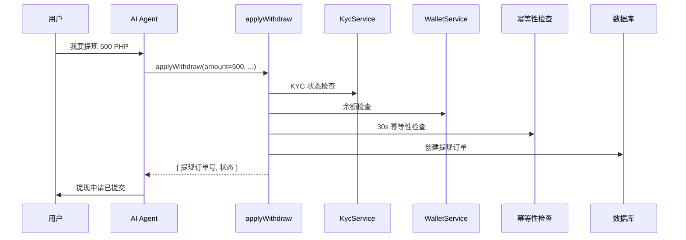
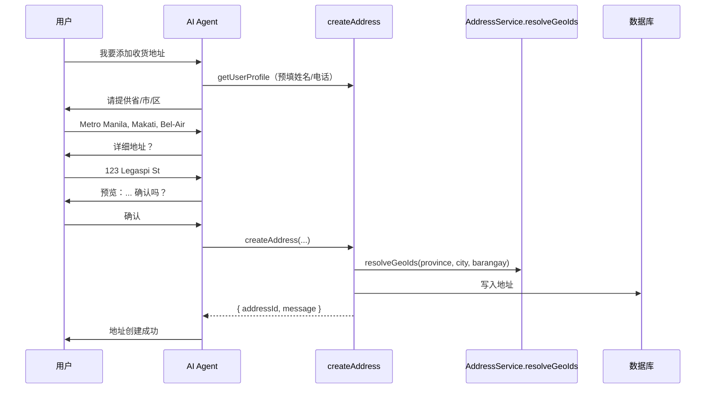

# AI Tool 参考文档 — 完整功能解析

> 本文档集中描述所有 ReAct Agent 可用的 Tool（工具），包括功能说明、参数列表、返回格式、数据流及安全约束。
>
> 共 **21 个 Tool**，分布在 5 个 Tag 组中。

---

## 目录

- [一、架构总览](#一架构总览)
  - [TaggedTool 体系](#taggedtool-体系)
  - [注册流程](#注册流程)
  - [统一返回格式](#统一返回格式)
  - [Tag ↔ Agent 映射表](#tag--agent-映射表)
- [二、Wallet Tools（钱包）](#二wallet-tools钱包)
  - [getWalletBalance](#getwalletbalance)
  - [requestWithdrawOtp](#requestwithdrawotp)
  - [verifyWithdrawOtp](#verifywithdrawotp)
  - [getWalletTransactions](#getwallettransactions)
  - [getKycStatus](#getkycstatus)
  - [getPaymentChannels](#getpaymentchannels)
  - [applyWithdraw](#applywithdraw)
- [三、Coupon Tools（优惠券）](#三coupon-tools优惠券)
  - [getUserCoupons](#getusercoupons)
  - [claimCoupon](#claimcoupon)
  - [redeemCouponCode](#redeemcouponcode)
  - [getClaimableCoupons](#getclaimablecoupons)
- [四、Order Tools（订单）](#四order-tools订单)
  - [getUserOrders](#getuserorders)
  - [getOrderInfo](#getorderinfo)
- [五、User Tools（用户）](#五user-tools用户)
  - [getUserProfile](#getuserprofile)
  - [listAddresses](#listaddresses)
  - [getAddressDetail](#getaddressdetail)
  - [createAddress](#createaddress)
  - [updateAddress](#updateaddress)
  - [deleteAddress](#deleteaddress)
- [六、Flow Tools（流程）](#六flow-tools流程)
  - [updateFlowData](#updateflowdata)
  - [updateFlowStatus](#updateflowstatus)
- [七、安全与约束汇总](#七安全与约束汇总)
- [八、附录：工具速查表](#八附录工具速查表)

---

## 一、架构总览

### TaggedTool 体系

每个 Tool 被包装为 [`TaggedTool`](apps/api/src/client/ai-customer/graph/tools/tool-registry.service.ts:4) 接口：

```typescript
export interface TaggedTool {
  tool: DynamicStructuredTool;  // LangChain 标准工具
  tags: string[];               // 标签，决定哪些 Agent 可以使用
}
```

- `tool` — LangChain 的 [`DynamicStructuredTool`](https://v03.api.js.langchain.com/classes/langchain_tools.DynamicStructuredTool.html)，包含 `name`、`description`、Zod `schema` 和 async `handler`
- `tags` — 标签数组，如 `['wallet']`、`['coupon']`。一个工具可以有多个标签

### 注册流程

```
OnApplicationBootstrap
  └─ ToolRegistryService.registerMany(createXxxTools(...))
       └─ 去重（按 tool.name 判重）
            └─ 存入 allTaggedTools[]
```

各 Domain Module 在 [`OnApplicationBootstrap`](https://docs.nestjs.com/fundamentals/lifecycle-events) 时自行注册工具：

| Module | 注册的工具 | 文件 |
|--------|-----------|------|
| [`WalletModule`](apps/api/src/client/wallet/wallet.module.ts) | `createWalletTools()` | [`wallet-tools.ts`](apps/api/src/client/ai-customer/graph/tools/wallet-tools.ts) |
| [`ClientCouponModule`](apps/api/src/client/coupon/coupon.module.ts) | `createCouponTools()` | [`coupon-tools.ts`](apps/api/src/client/ai-customer/graph/tools/coupon-tools.ts) |
| [`AiCustomerModule`](apps/api/src/client/ai-customer/ai-customer.module.ts) | `createOrderTools()` + `createUserTools()` + `createFlowTools()` | 各 tools 文件 |
| [`AddressModule`](apps/api/src/client/address/address.module.ts) | （通过 UserTools 间接注册） | — |

注册完成后，[`AiCustomerModule.onApplicationBootstrap()`](apps/api/src/client/ai-customer/ai-customer.module.ts:49) 调用 [`validateRegistration()`](apps/api/src/client/ai-customer/graph/tools/tool-registry.service.ts:30) 校验所有预期的 Tag 都已注册。

### 统一返回格式

所有 Tool 的 handler 必须返回 JSON 字符串，格式由 [`toolSuccess()` / `toolFailure()`](apps/api/src/client/ai-customer/graph/tools/tool-result.ts:18) 构建：

```typescript
// 成功
{ "ok": true, "data": { ... } }

// 失败
{ "ok": false, "error": "错误描述" }
```

LLM 端看到的内容经过 [`stripToolResult()`](apps/api/src/client/ai-customer/graph/tools/tool-result.ts:49) 剥离包装：
- **成功** → 只返回 `data` 部分的 JSON
- **失败** → 返回 `Error: 错误描述` 文本
- **无法解析** → 原样返回

### Tag ↔ Agent 映射表

| Tag | Agent | 工具数 | 写操作 |
|-----|-------|--------|--------|
| `wallet` | walletAgent | 7 | `applyWithdraw` |
| `coupon` | couponAgent | 4 | `claimCoupon`, `redeemCouponCode` |
| `order` | orderAgent | 2 | — |
| `user` | userAgent | 6 | `createAddress`, `updateAddress`, `deleteAddress` |
| `flow` | 所有 Agent | 2 | `updateFlowData`, `updateFlowStatus` |

---

## 二、Wallet Tools（钱包）

工厂函数：[`createWalletTools()`](apps/api/src/client/ai-customer/graph/tools/wallet-tools.ts:81)
依赖注入：`WalletService`, `ClientWalletService`, `KycService`, `PaymentChannelService`, `OtpService`

---

### `getWalletBalance`

| 属性 | 值 |
|------|-----|
| **Tag** | `wallet` |
| **操作类型** | 读操作 |
| **所属 Agent** | walletAgent |

**功能**: 查询当前用户的钱包余额，包含 5 个维度：

| 字段 | 中文 | 说明 |
|------|------|------|
| `realBalance` | 现金余额 | 可提现余额 |
| `coinBalance` | 虚拟币余额 | 不可提现 |
| `frozenBalance` | 冻结金额 | 提现中暂扣 |
| `totalRecharge` | 累计充值 | 历史充值总额 |
| `totalWithdraw` | 累计提现 | 历史提现总额 |

**参数**:

| 参数 | 类型 | 必填 | 说明 |
|------|------|------|------|
| `userId` | `string` | ✅ | 当前用户 ID，由 LLM 自动传递 |

**返回示例**:

```json
{
  "ok": true,
  "data": {
    "realBalance": "PHP 1,250.00",
    "coinBalance": "PHP 500.00",
    "frozenBalance": "PHP 0.00",
    "totalRecharge": "PHP 10,000.00",
    "totalWithdraw": "PHP 8,750.00"
  }
}
```

**数据流**: `LLM` → `getWalletBalance` → [`walletService.balance()`](apps/api/src/client/wallet/wallet.service.ts) → [`WalletBalanceResponseDto`](apps/api/src/client/wallet/dto/wallet-balance.response.dto.ts) → [`toLLM()`](packages/shared/src/decorators/field-meta.ts) → LLM 可读格式

**注意事项**: 无

---

### `requestWithdrawOtp`

| 属性 | 值 |
|------|-----|
| **Tag** | `wallet` |
| **操作类型** | 写操作（发送短信） |
| **所属 Agent** | walletAgent |

**功能**: 向用户手机发送提现授权 OTP 验证码。

**参数**:

| 参数 | 类型 | 必填 | 说明 |
|------|------|------|------|
| `userId` | `string` | ✅ | 当前用户 ID |
| `phone` | `string` | ✅ | 用户手机号，用于接收 SMS |

**返回示例**:

```json
{
  "ok": true,
  "data": {
    "message": "OTP sent successfully to 0917XXXXXXX. Please check your phone for the verification code."
  }
}
```

**数据流**: `LLM` → `requestWithdrawOtp` → [`otpService.request()`](apps/api/src/client/otp/otp.service.ts) → SMS 发送

**注意事项**:
- 仅在用户确认提现详情后调用（两阶段确认）
- 必须先调用此工具，再调用 `verifyWithdrawOtp`

---

### `verifyWithdrawOtp`

| 属性 | 值 |
|------|-----|
| **Tag** | `wallet` |
| **操作类型** | 写操作（验证码验证） |
| **所属 Agent** | walletAgent |

**功能**: 验证用户输入的提现 OTP 验证码。

**参数**:

| 参数 | 类型 | 必填 | 说明 |
|------|------|------|------|
| `userId` | `string` | ✅ | 当前用户 ID |
| `phone` | `string` | ✅ | 用户手机号 |
| `code` | `string` | ✅ | 6 位 OTP 验证码 |

**返回示例**:

```json
{
  "ok": true,
  "data": {
    "verified": true,
    "message": "OTP verified successfully for 0917XXXXXXX. You can now proceed with the withdrawal."
  }
}
```

**数据流**: `LLM` → `verifyWithdrawOtp` → [`otpService.verify()`](apps/api/src/client/otp/otp.service.ts) → 验证结果

**注意事项**:
- 必须在 `requestWithdrawOtp` 之后调用
- OTP 有有效期限制（由 OTP Service 控制）

---

### `getWalletTransactions`

| 属性 | 值 |
|------|-----|
| **Tag** | `wallet` |
| **操作类型** | 读操作 |
| **所属 Agent** | walletAgent |

**功能**: 查询钱包充值/提现记录，支持按类型过滤。

**参数**:

| 参数 | 类型 | 必填 | 默认 | 说明 |
|------|------|------|------|------|
| `userId` | `string` | ✅ | — | 当前用户 ID |
| `type` | `'recharge' \| 'withdrawal' \| 'all'` | ❌ | `'all'` | 交易类型过滤 |
| `page` | `number` | ❌ | `1` | 分页页码 |
| `pageSize` | `number` | ❌ | `10` | 每页数量 |

**返回示例**:

```json
{
  "ok": true,
  "data": {
    "recharges": [
      { "充值金额": "PHP 500.00", "充值时间": "2026-06-15 14:30", "状态": "成功" }
    ],
    "withdrawals": [
      { "提现金额": "PHP 200.00", "提现时间": "2026-06-20 10:00", "状态": "已完成" }
    ],
    "rechargeTotal": 1,
    "withdrawTotal": 1,
    "page": 1,
    "pageSize": 10
  }
}
```

**数据流**: `LLM` → `getWalletTransactions` → [`clientWalletService.getRechargeHistory()`](apps/api/src/client/wallet/client-wallet.service.ts) + [`getWithdrawalHistory()`](apps/api/src/client/wallet/client-wallet.service.ts) → [`RechargeHistoryItemDto`](apps/api/src/client/wallet/dto/recharge.dto.ts) + [`WithdrawalItemResponseDto`](apps/api/src/client/wallet/dto/withdrawal-item-response.dto.ts) → `toLLM()`

**注意事项**: 无

---

### `getKycStatus`

| 属性 | 值 |
|------|-----|
| **Tag** | `wallet` |
| **操作类型** | 读操作 |
| **所属 Agent** | walletAgent |

**功能**: 查询用户 KYC（实名认证）状态。

**参数**:

| 参数 | 类型 | 必填 | 说明 |
|------|------|------|------|
| `userId` | `string` | ✅ | 当前用户 ID |

**返回示例**:

```json
{
  "ok": true,
  "data": {
    "实名认证状态": "已通过",
    "已提交文件": ["身份证正面", "身份证反面"],
    "风险等级": "低风险"
  }
}
```

**数据流**: `LLM` → `getKycStatus` → [`kycService.getMyKyc()`](apps/api/src/client/kyc/kyc.service.ts) → [`KycResponseDto`](apps/api/src/client/kyc/dto/kyc.response.dto.ts) → `toLLM()`

**注意事项**: 提现操作的前置检查，如 KYC 未通过则 `applyWithdraw` 会失败。

---

### `getPaymentChannels`

| 属性 | 值 |
|------|-----|
| **Tag** | `wallet` |
| **操作类型** | 读操作 |
| **所属 Agent** | walletAgent |

**功能**: 查询可用提现渠道（如 GCash、PayMaya、银行转账），支持按金额过滤。

**参数**:

| 参数 | 类型 | 必填 | 默认 | 说明 |
|------|------|------|------|------|
| `userId` | `string` | ✅ | — | 当前用户 ID |
| `amount` | `number` | ❌ | 不过滤 | 按提现金额过滤渠道（只返回支持该金额的渠道） |

**返回示例**:

```json
{
  "ok": true,
  "data": [
    {
      "渠道名称": "GCash",
      "最小金额": "PHP 50.00",
      "最大金额": "PHP 50,000.00",
      "手续费率": "2.00%",
      "固定手续费": "PHP 0.00",
      "渠道描述": "提现到 GCash 钱包"
    }
  ]
}
```

**数据流**: `LLM` → `getPaymentChannels` → [`paymentChannelService.getClientConfig()`](apps/api/src/common/payment-channel/payment-channel.service.ts) → [`PaymentConfigItemDto`](apps/api/src/client/payment-channel/dto/payment-channel.dto.ts) → `toLLM()`

**注意事项**:
- `fixedAmounts` 字段被显式删除（`delete (llmResult as any).fixedAmounts`），防止 LLM 金额幻觉
- 建议在调用 `applyWithdraw` 前先调用此工具让用户选择渠道

---

### `applyWithdraw`

| 属性 | 值 |
|------|-----|
| **Tag** | `wallet` |
| **操作类型** | ⚠️ **写操作（关键）** |
| **所属 Agent** | walletAgent |
| **安全等级** | 🔴 高（涉及资金操作） |

**功能**: 提交提现申请。包含多层前置检查：

1. **KYC 检查** — 必须已通过实名认证
2. **余额检查** — 现金余额必须足够
3. **幂等性检查** — 30 秒内相同提现参数拒绝重复提交

**参数**:

| 参数 | 类型 | 必填 | 说明 |
|------|------|------|------|
| `userId` | `string` | ✅ | 当前用户 ID |
| `amount` | `number` | ✅ | 提现金额（PHP），必须为正数 |
| `channelId` | `number` | ✅ | 提现渠道 ID（从 `getPaymentChannels` 获取） |
| `account` | `string` | ✅ | 提现账户号码（如 GCash 手机号） |
| `accountName` | `string` | ✅ | 账户持有人姓名 |

**返回示例**:

```json
{
  "ok": true,
  "data": {
    "提现订单号": "W20260620123456",
    "提现金额": "PHP 500.00",
    "状态": "待处理",
    "预计到账时间": "1-2 个工作日"
  }
}
```

**数据流**:



**注意事项**:
- ⚠️ **必须两阶段确认**：先展示预览（金额、手续费、渠道、到账时间）→ 用户确认 → 再调用
- 调用前应先调 `getPaymentChannels` 让用户选择渠道
- KYC 未通过时返回 `toolFailure`，提示用户先完成实名认证
- 余额不足时返回 `toolFailure`，提示可用余额
- 30 秒内相同 `userId:amount:channelId:account` 的请求会被幂等拦截

---

## 三、Coupon Tools（优惠券）

工厂函数：[`createCouponTools()`](apps/api/src/client/ai-customer/graph/tools/coupon-tools.ts:21)
依赖注入：`ClientCouponService`

---

### `getUserCoupons`

| 属性 | 值 |
|------|-----|
| **Tag** | `coupon` |
| **操作类型** | 读操作 |
| **所属 Agent** | couponAgent |

**功能**: 获取当前用户的优惠券列表，可按状态过滤。

**参数**:

| 参数 | 类型 | 必填 | 默认 | 说明 |
|------|------|------|------|------|
| `userId` | `string` | ✅ | — | 当前用户 ID |
| `status` | `number` | ❌ | 不限 | 0=未使用, 1=已使用, 2=已过期 |
| `page` | `number` | ❌ | `1` | 分页页码 |
| `pageSize` | `number` | ❌ | `10` | 每页数量 |

**返回示例**:

```json
{
  "ok": true,
  "data": {
    "total": 5,
    "page": 1,
    "pageSize": 10,
    "coupons": [
      {
        "优惠券实例 ID": "C123",
        "状态": "未使用",
        "有效开始时间": "2026-06-01",
        "有效结束时间": "2026-07-01",
        "优惠券名称": "新用户满减券",
        "优惠券类型": "满减券",
        "优惠面值": "PHP 100.00",
        "最低消费门槛": "PHP 500.00",
        "使用规则": "限首单使用"
      }
    ]
  }
}
```

**数据流**: `LLM` → `getUserCoupons` → [`couponService.getMyCoupons()`](apps/api/src/client/coupon/coupon.service.ts) → [`MyCouponResponseDto`](apps/api/src/client/coupon/dto/my-coupon-response-dto.ts) → `toLLM()`

**注意事项**: 无

---

### `claimCoupon`

| 属性 | 值 |
|------|-----|
| **Tag** | `coupon` |
| **操作类型** | ⚠️ **写操作** |
| **所属 Agent** | couponAgent |
| **安全等级** | 🟡 中（涉及资源领取） |

**功能**: 领取/申领一张优惠券。

**参数**:

| 参数 | 类型 | 必填 | 说明 |
|------|------|------|------|
| `userId` | `string` | ✅ | 当前用户 ID |
| `couponId` | `string` | ✅ | 优惠券模板 ID |

**返回示例**:

```json
{
  "ok": true,
  "data": {
    "userCouponId": "C123",
    "status": 0,
    "message": "Successfully claimed the coupon"
  }
}
```

**数据流**: `LLM` → `claimCoupon` → [`couponService.claimCoupon(userId, couponId, 2)`](apps/api/src/client/coupon/coupon.service.ts) → DB 写入

**注意事项**:
- 只能在可领取的优惠券列表中领取（先调 `getClaimableCoupons`）
- 领取方式固定为 `2`（手动领取）
- 建议先展示优惠券详情给用户确认后再调用

---

### `redeemCouponCode`

| 属性 | 值 |
|------|-----|
| **Tag** | `coupon` |
| **操作类型** | ⚠️ **写操作** |
| **所属 Agent** | couponAgent |

**功能**: 使用兑换码兑换优惠券。

**参数**:

| 参数 | 类型 | 必填 | 说明 |
|------|------|------|------|
| `userId` | `string` | ✅ | 当前用户 ID |
| `code` | `string` | ✅ | 兑换码（不区分大小写） |

**返回示例**:

```json
{
  "ok": true,
  "data": {
    "success": true,
    "message": "Successfully redeemed the coupon code"
  }
}
```

**数据流**: `LLM` → `redeemCouponCode` → [`couponService.redeemCode()`](apps/api/src/client/coupon/coupon.service.ts) → DB 写入

**注意事项**: 无

---

### `getClaimableCoupons`

| 属性 | 值 |
|------|-----|
| **Tag** | `coupon` |
| **操作类型** | 读操作 |
| **所属 Agent** | couponAgent |

**功能**: 获取可领取的优惠券列表（领券中心）。只返回状态为启用 (`status=1`) 的优惠券模板。

**参数**:

| 参数 | 类型 | 必填 | 说明 |
|------|------|------|------|
| `userId` | `string` | ✅ | 当前用户 ID |

**返回示例**:

```json
{
  "ok": true,
  "data": {
    "coupons": [
      {
        "优惠券模板 ID": "T1",
        "优惠券名称": "新人专享券",
        "优惠券类型": "满减券",
        "优惠面值": "PHP 50.00",
        "最低消费门槛": "PHP 200.00",
        "发行总量": 1000,
        "已发放数量": 342,
        "领取进度": "34%",
        "可领取": true
      }
    ],
    "total": 1
  }
}
```

**数据流**: `LLM` → `getClaimableCoupons` → [`couponService.getClaimableCoupons()`](apps/api/src/client/coupon/coupon.service.ts) → [`ClaimableCouponResponseDto`](apps/api/src/client/coupon/dto/claimable-coupon-response.dto.ts) → `toLLM()`

**注意事项**: 在调用 `claimCoupon` 前推荐先调用此工具，向用户展示可领取的优惠券。

---

## 四、Order Tools（订单）

工厂函数：[`createOrderTools()`](apps/api/src/client/ai-customer/graph/tools/order-tools.ts:22)
依赖注入：`IOrderService`

---

### `getUserOrders`

| 属性 | 值 |
|------|-----|
| **Tag** | `order` |
| **操作类型** | 读操作 |
| **所属 Agent** | orderAgent |

**功能**: 获取当前用户的订单列表，支持按状态过滤。

**参数**:

| 参数 | 类型 | 必填 | 默认 | 说明 |
|------|------|------|------|------|
| `userId` | `string` | ✅ | — | 当前用户 ID |
| `status` | `'all' \| 'paid' \| 'unpaid' \| 'refunded' \| 'cancelled'` | ❌ | `'all'` | 订单状态过滤 |
| `page` | `number` | ❌ | `1` | 分页页码 |
| `pageSize` | `number` | ❌ | `10` | 每页数量 |

**返回示例**:

```json
{
  "ok": true,
  "data": {
    "total": 3,
    "page": 1,
    "pageSize": 10,
    "orders": [
      {
        "订单号": "ORD202606201234",
        "商品名称": "Premium Widget",
        "订单金额": "PHP 999.00",
        "订单状态": "已支付",
        "下单时间": "2026-06-20 10:30:00"
      }
    ]
  }
}
```

**数据流**: `LLM` → `getUserOrders` → [`orderService.listOrders()`](apps/api/src/client/orders/order.service.ts) → [`OrderItemDto`](apps/api/src/client/orders/dto/order-item.dto.ts) → `toLLM()`

**注意事项**: 无

---

### `getOrderInfo`

| 属性 | 值 |
|------|-----|
| **Tag** | `order` |
| **操作类型** | 读操作 |
| **所属 Agent** | orderAgent |

**功能**: 获取指定订单的详细信息。

**参数**:

| 参数 | 类型 | 必填 | 说明 |
|------|------|------|------|
| `userId` | `string` | ✅ | 当前用户 ID |
| `orderId` | `string` | ✅ | 订单 ID |

**返回示例**:

```json
{
  "ok": true,
  "data": {
    "订单号": "ORD202606201234",
    "商品名称": "Premium Widget",
    "商品数量": 1,
    "订单金额": "PHP 999.00",
    "运费": "PHP 50.00",
    "订单状态": "已支付",
    "收货地址": "123 Main St, Makati",
    "下单时间": "2026-06-20 10:30:00",
    "支付时间": "2026-06-20 10:31:00"
  }
}
```

**数据流**: `LLM` → `getOrderInfo` → [`orderService.getOrderDetail()`](apps/api/src/client/orders/order.service.ts) → [`OrderItemDto`](apps/api/src/client/orders/dto/order-item.dto.ts) → `toLLM()`

**注意事项**:
- 订单不存在或不属于当前用户时，返回友好的错误信息（不暴露具体原因，防止信息泄露）

---

## 五、User Tools（用户）

工厂函数：[`createUserTools()`](apps/api/src/client/ai-customer/graph/tools/user-tools.ts:40)
依赖注入：`AuthService`, `AddressService`

> 注意：User Tools 使用了 [`toResult()`](apps/api/src/client/ai-customer/graph/tools/user-tools.ts:29) helper 来替代传统的 `try-catch`，通过 `.then().catch()` 链式处理异步结果。

---

### `getUserProfile`

| 属性 | 值 |
|------|-----|
| **Tag** | `user` |
| **操作类型** | 读操作 |
| **所属 Agent** | userAgent |

**功能**: 获取当前用户的个人信息。

**参数**:

| 参数 | 类型 | 必填 | 说明 |
|------|------|------|------|
| `userId` | `string` | ✅ | 当前用户 ID |

**返回示例**:

```json
{
  "ok": true,
  "data": {
    "profile": {
      "用户 ID": "U123",
      "手机号": "0917*******",
      "昵称": "John Doe",
      "邀请码": "ABC123",
      "VIP 等级": "黄金会员",
      "KYC 状态": "已通过",
      "最后登录": "2026-06-20 10:30"
    }
  }
}
```

**数据流**: `LLM` → `getUserProfile` → [`authService.profile()`](apps/api/src/client/auth/auth.service.ts) → [`UserProfileResponseDto`](apps/api/src/client/auth/dto/user-profile.response.dto.ts) → `toLLM()`

**注意事项**:
- 可用于预填写地址创建时的联系人姓名和电话
- 手机号可能部分脱敏（取决于 DTO 配置）

---

### `listAddresses`

| 属性 | 值 |
|------|-----|
| **Tag** | `user` |
| **操作类型** | 读操作 |
| **所属 Agent** | userAgent |

**功能**: 列出当前用户的收货地址列表（分页）。

**参数**:

| 参数 | 类型 | 必填 | 默认 | 说明 |
|------|------|------|------|------|
| `userId` | `string` | ✅ | — | 当前用户 ID |
| `page` | `number` | ❌ | `1` | 分页页码 |
| `pageSize` | `number` | ❌ | `10` | 每页数量 |

**返回示例**:

```json
{
  "ok": true,
  "data": {
    "total": 2,
    "page": 1,
    "pageSize": 10,
    "addresses": [
      {
        "地址 ID": "A1",
        "联系人": "John Doe",
        "省/区": "Metro Manila",
        "市": "Makati",
        "区/村": "Bel-Air",
        "详细地址": "123 Legaspi St",
        "联系电话": "0917XXXXXXX",
        "地址标签": "Home"
      }
    ]
  }
}
```

**数据流**: `LLM` → `listAddresses` → [`addressService.list()`](apps/api/src/client/address/address.service.ts) → [`AddressResponseDto`](apps/api/src/client/address/dto/address.dto.ts) → `toLLM()`

**注意事项**: 无

---

### `getAddressDetail`

| 属性 | 值 |
|------|-----|
| **Tag** | `user` |
| **操作类型** | 读操作 |
| **所属 Agent** | userAgent |

**功能**: 查看单个地址的详细信息。

**参数**:

| 参数 | 类型 | 必填 | 说明 |
|------|------|------|------|
| `userId` | `string` | ✅ | 当前用户 ID |
| `addressId` | `string` | ✅ | 地址 ID |

**返回示例**: 同 `listAddresses` 中单个地址格式。

**数据流**: `LLM` → `getAddressDetail` → [`addressService.detail()`](apps/api/src/client/address/address.service.ts) → [`AddressResponseDto`](apps/api/src/client/address/dto/address.dto.ts) → `toLLM()`

**注意事项**: 无

---

### `createAddress`

| 属性 | 值 |
|------|-----|
| **Tag** | `user` |
| **操作类型** | ⚠️ **写操作** |
| **所属 Agent** | userAgent |
| **安全等级** | 🟡 中（涉及用户数据修改） |

**功能**: 新增收货地址。支持文本形式的省/市/区名称（自动解析为 ID）。

**参数**:

| 参数 | 类型 | 必填 | 说明 |
|------|------|------|------|
| `userId` | `string` | ✅ | 当前用户 ID |
| `contactName` | `string` | ✅ | 联系人姓名（可从 `getUserProfile` 预填） |
| `phone` | `string` | ✅ | 联系电话（可从 `getUserProfile` 预填） |
| `province` | `string` | ✅ | 省/区名称（文本，非 ID） |
| `city` | `string` | ✅ | 市名称（文本，非 ID） |
| `barangay` | `string` | ✅ | 区/村名称（文本，非 ID） |
| `fullAddress` | `string` | ✅ | 详细地址（街道、楼栋、地标） |
| `label` | `string` | ❌ | 地址标签（如 Home, Office） |
| `isDefault` | `boolean` | ❌ | 是否设为默认地址 |

**返回示例**:

```json
{
  "ok": true,
  "data": {
    "addressId": "A123",
    "message": "Address created successfully"
  }
}
```

**数据流**:



**注意事项**:
- ⚠️ **必须两阶段确认**：先展示完整预览 → 用户确认 → 再调用
- 省/市/区使用 **文本名称**（如 "Metro Manila"），系统自动解析为数字 ID
- 建议先调 `getUserProfile` 预填联系人姓名和电话
- 逐个询问地址信息（类似填表流程），不要一次问完

---

### `updateAddress`

| 属性 | 值 |
|------|-----|
| **Tag** | `user` |
| **操作类型** | ⚠️ **写操作** |
| **所属 Agent** | userAgent |

**功能**: 修改已有的收货地址。所有字段可选，只更新提供的字段（部分更新）。

**参数**:

| 参数 | 类型 | 必填 | 说明 |
|------|------|------|------|
| `userId` | `string` | ✅ | 当前用户 ID |
| `addressId` | `string` | ✅ | 要修改的地址 ID |
| `contactName` | `string` | ❌ | 新联系人姓名 |
| `phone` | `string` | ❌ | 新联系电话 |
| `province` | `string` | ❌ | 新省/区名称（文本） |
| `city` | `string` | ❌ | 新市名称（文本） |
| `barangay` | `string` | ❌ |新区/村名称（文本） |
| `fullAddress` | `string` | ❌ | 新详细地址 |
| `label` | `string` | ❌ | 新地址标签 |
| `isDefault` | `boolean` | ❌ | 是否设为默认地址 |

**返回示例**:

```json
{
  "ok": true,
  "data": {
    "addressId": "A123",
    "message": "Address updated successfully"
  }
}
```

**数据流**: `LLM` → `updateAddress` → [`addressService.resolveGeoIds()`](apps/api/src/client/address/address.service.ts)（如有新地址）→ [`addressService.update()`](apps/api/src/client/address/address.service.ts) → DB 更新

**注意事项**:
- ⚠️ **必须两阶段确认**：展示变更预览 → 用户确认 → 再调用
- 部分更新：只有提供的字段会被修改
- 省/市/区必须同时提供（三个一起），否则不解析

---

### `deleteAddress`

| 属性 | 值 |
|------|-----|
| **Tag** | `user` |
| **操作类型** | ⚠️ **写操作** |
| **所属 Agent** | userAgent |

**功能**: 删除指定的收货地址。

**参数**:

| 参数 | 类型 | 必填 | 说明 |
|------|------|------|------|
| `userId` | `string` | ✅ | 当前用户 ID |
| `addressId` | `string` | ✅ | 要删除的地址 ID |

**返回示例**:

```json
{
  "ok": true,
  "data": {
    "success": true,
    "message": "Address deleted successfully"
  }
}
```

**数据流**: `LLM` → `deleteAddress` → [`addressService.delete()`](apps/api/src/client/address/address.service.ts) → DB 删除

**注意事项**:
- ⚠️ **必须两阶段确认**：先展示地址详情 → 用户确认 → 再调用
- 删除后不可撤销

---

## 六、Flow Tools（流程）

工厂函数：[`createFlowTools()`](apps/api/src/client/ai-customer/graph/tools/flow-tools.ts:26)
依赖注入：无（纯内存操作）

> Flow Tools 是跨 Agent 的通用工具，被注入到每个 Agent 的工具列表中（通过 `tags: ['flow']`）。它们不依赖外部服务，完全基于 LangGraph state 操作。

---

### `updateFlowData`

| 属性 | 值 |
|------|-----|
| **Tag** | `flow` |
| **操作类型** | 写操作（内存状态） |
| **所属 Agent** | 所有 Agent |

**功能**: 更新流程数据（Slot Filling）。在表单填写流程中，将收集到的用户信息逐项写入 `flowData`。

**参数**:

| 参数 | 类型 | 必填 | 说明 |
|------|------|------|------|
| `data` | `Record<string, any>` | ✅ | 要合并的键值对 |

**调用示例**:

```json
{
  "data": {
    "amount": "500",
    "account": "GCash",
    "accountName": "John Doe"
  }
}
```

**返回示例**:

```json
{
  "ok": true,
  "data": {
    "ok": true,
    "message": "flowData updated with keys: amount, account, accountName",
    "keys": ["amount", "account", "accountName"]
  }
}
```

**数据流**: `LLM` → `updateFlowData({...})` → 返回确认 → `flowData` 在 Agent node 中通过 state 持久化

**注意事项**:
- 这是一个**声明式**工具：它只通知系统"用户提供了什么值"，实际数据由 Agent node 写入 state
- 用于表单填写流程（如提现时逐项收集金额、账户等信息）

---

### `updateFlowStatus`

| 属性 | 值 |
|------|-----|
| **Tag** | `flow` |
| **操作类型** | 写操作（内存状态） |
| **所属 Agent** | 所有 Agent |

**功能**: 更新流程状态。推进工作流状态机（如 `FILLING → CONFIRMING → COMPLETED`）。

**参数**:

| 参数 | 类型 | 必填 | 说明 |
|------|------|------|------|
| `flowType` | `string` | ✅ | 当前流程类型（如 `WITHDRAWAL`, `DEPOSIT`） |
| `flowStatus` | `string` | ✅ | 目标流程状态（如 `FILLING`, `CONFIRMING`） |

**合法的 FlowType**:

| FlowType | 说明 |
|----------|------|
| `WITHDRAWAL` | 提现流程 |
| `DEPOSIT` | 充值流程 |
| `COUPON_CLAIM` | 领券流程 |
| `BALANCE_QUERY` | 余额查询 |
| `ORDER_QUERY` | 订单查询 |
| `COUPON_QUERY` | 优惠券查询 |
| `POLICY` | 政策咨询 |
| `GENERAL` | 通用对话 |

**合法的 FlowStatus 转换**（由 [`isValidFlowStatus()`](apps/api/src/client/ai-customer/graph/types/flow-types.ts:162) 运行时校验）：

```
IDLE → FILLING → CONFIRMING → QUERYING → COMPLETED
                                                 ↓
                                              FAILED
```

**返回示例**:

```json
{
  "ok": true,
  "data": {
    "ok": true,
    "message": "Flow status updated to CONFIRMING (type: WITHDRAWAL)",
    "flowType": "WITHDRAWAL",
    "flowStatus": "CONFIRMING"
  }
}
```

**数据流**: `LLM` → `updateFlowStatus(flowType, flowStatus)` → [`isValidFlowStatus()`](apps/api/src/client/ai-customer/graph/types/flow-types.ts:162) 校验 → 返回确认

**注意事项**:
- 运行时校验状态转换的合法性，非法转换会被拒绝
- 必须配合 `flowType` 使用，不同 flowType 可能有不同的 allowedStatuses

---

## 七、安全与约束汇总

| 工具 | 安全/前置条件 | 幂等性 | 两阶段确认 | 风险等级 |
|------|-------------|--------|-----------|---------|
| `getWalletBalance` | 无 | — | — | 🟢 低 |
| `requestWithdrawOtp` | 无 | — | — | 🟢 低 |
| `verifyWithdrawOtp` | 需先调用 `requestWithdrawOtp` | — | — | 🟢 低 |
| `getWalletTransactions` | 无 | — | — | 🟢 低 |
| `getKycStatus` | 无 | — | — | 🟢 低 |
| `getPaymentChannels` | 无 | — | — | 🟢 低 |
| **`applyWithdraw`** | KYC 已通过 + 余额充足 | ✅ 30s 同参数去重 | ✅ **必须** | 🔴 高 |
| `getUserCoupons` | 无 | — | — | 🟢 低 |
| **`claimCoupon`** | 必须在可领取列表中 | — | ⚠️ 建议 | 🟡 中 |
| `redeemCouponCode` | 无 | — | — | 🟡 中 |
| `getClaimableCoupons` | 无 | — | — | 🟢 低 |
| `getUserOrders` | 无 | — | — | 🟢 低 |
| `getOrderInfo` | 无（越权访问返回友好错误） | — | — | 🟢 低 |
| `getUserProfile` | 无 | — | — | 🟢 低 |
| `listAddresses` | 无 | — | — | 🟢 低 |
| `getAddressDetail` | 无 | — | — | 🟢 低 |
| **`createAddress`** | 无 | — | ✅ **必须** | 🟡 中 |
| **`updateAddress`** | 无 | — | ✅ **必须** | 🟡 中 |
| **`deleteAddress`** | 无 | — | ✅ **必须** | 🟡 中 |
| `updateFlowData` | 无 | — | — | 🟢 低 |
| `updateFlowStatus` | 运行时校验合法状态转换 | — | — | 🟢 低 |

### 安全原则

1. **两阶段确认**：所有写操作（资金/地址）必须先展示预览，用户明确确认后才执行
2. **最小数据暴露**：`getOrderInfo` 在不属于当前用户的订单上返回模糊错误，防止信息泄露
3. **金额幻觉防护**：`getPaymentChannels` 显式删除 `fixedAmounts` 字段，防止 LLM 错误猜测金额
4. **运行时校验**：`updateFlowStatus` 使用 [`isValidFlowStatus()`](apps/api/src/client/ai-customer/graph/types/flow-types.ts:162) 校验状态转换合法性
5. **幂等性**：`applyWithdraw` 使用 30 秒内存冷却防止重复提交

---

## 八、附录：工具速查表

| # | 工具名称 | Tag | 读/写 | 文件 |
|---|---------|-----|-------|------|
| 1 | `getWalletBalance` | `wallet` | 读 | [`wallet-tools.ts`](apps/api/src/client/ai-customer/graph/tools/wallet-tools.ts) |
| 2 | `requestWithdrawOtp` | `wallet` | 写 | [`wallet-tools.ts`](apps/api/src/client/ai-customer/graph/tools/wallet-tools.ts) |
| 3 | `verifyWithdrawOtp` | `wallet` | 写 | [`wallet-tools.ts`](apps/api/src/client/ai-customer/graph/tools/wallet-tools.ts) |
| 4 | `getWalletTransactions` | `wallet` | 读 | [`wallet-tools.ts`](apps/api/src/client/ai-customer/graph/tools/wallet-tools.ts) |
| 5 | `getKycStatus` | `wallet` | 读 | [`wallet-tools.ts`](apps/api/src/client/ai-customer/graph/tools/wallet-tools.ts) |
| 6 | `getPaymentChannels` | `wallet` | 读 | [`wallet-tools.ts`](apps/api/src/client/ai-customer/graph/tools/wallet-tools.ts) |
| 7 | `applyWithdraw` | `wallet` | 写 | [`wallet-tools.ts`](apps/api/src/client/ai-customer/graph/tools/wallet-tools.ts) |
| 8 | `getUserCoupons` | `coupon` | 读 | [`coupon-tools.ts`](apps/api/src/client/ai-customer/graph/tools/coupon-tools.ts) |
| 9 | `claimCoupon` | `coupon` | 写 | [`coupon-tools.ts`](apps/api/src/client/ai-customer/graph/tools/coupon-tools.ts) |
| 10 | `redeemCouponCode` | `coupon` | 写 | [`coupon-tools.ts`](apps/api/src/client/ai-customer/graph/tools/coupon-tools.ts) |
| 11 | `getClaimableCoupons` | `coupon` | 读 | [`coupon-tools.ts`](apps/api/src/client/ai-customer/graph/tools/coupon-tools.ts) |
| 12 | `getUserOrders` | `order` | 读 | [`order-tools.ts`](apps/api/src/client/ai-customer/graph/tools/order-tools.ts) |
| 13 | `getOrderInfo` | `order` | 读 | [`order-tools.ts`](apps/api/src/client/ai-customer/graph/tools/order-tools.ts) |
| 14 | `getUserProfile` | `user` | 读 | [`user-tools.ts`](apps/api/src/client/ai-customer/graph/tools/user-tools.ts) |
| 15 | `listAddresses` | `user` | 读 | [`user-tools.ts`](apps/api/src/client/ai-customer/graph/tools/user-tools.ts) |
| 16 | `getAddressDetail` | `user` | 读 | [`user-tools.ts`](apps/api/src/client/ai-customer/graph/tools/user-tools.ts) |
| 17 | `createAddress` | `user` | 写 | [`user-tools.ts`](apps/api/src/client/ai-customer/graph/tools/user-tools.ts) |
| 18 | `updateAddress` | `user` | 写 | [`user-tools.ts`](apps/api/src/client/ai-customer/graph/tools/user-tools.ts) |
| 19 | `deleteAddress` | `user` | 写 | [`user-tools.ts`](apps/api/src/client/ai-customer/graph/tools/user-tools.ts) |
| 20 | `updateFlowData` | `flow` | 写 | [`flow-tools.ts`](apps/api/src/client/ai-customer/graph/tools/flow-tools.ts) |
| 21 | `updateFlowStatus` | `flow` | 写 | [`flow-tools.ts`](apps/api/src/client/ai-customer/graph/tools/flow-tools.ts) |

---

> **维护指南**：
> - 新增 Tool 时，在此文档添加对应的工具卡片
> - 修改 Tool 参数/行为时，同步更新卡片内容
> - 新增 Tag 时，更新 Tag ↔ Agent 映射表和安全汇总表
