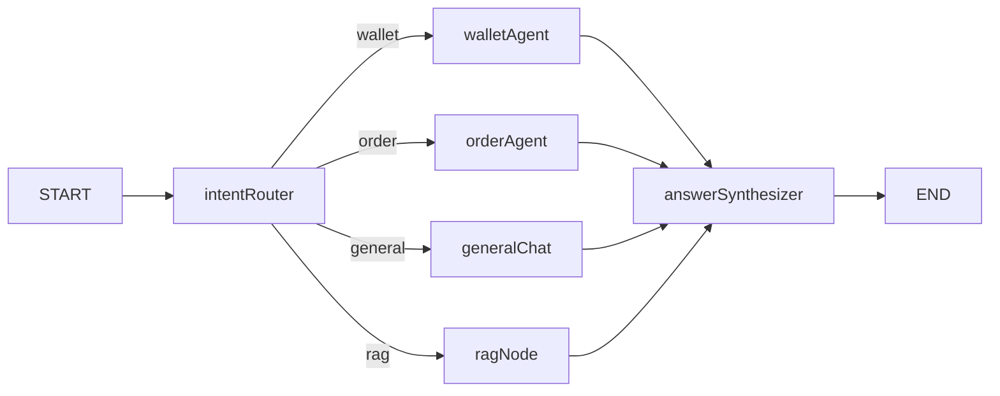
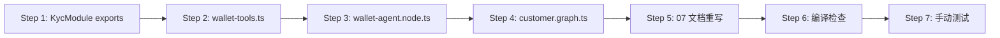

# Wallet Agent 集成 — Spec-Coding 规划

> **基于文档**: `docs/AI-joymini/07-WalletAgent与Tools.md`
> **当前代码库模式**: ToolRegistry + OnApplicationBootstrap 编程式注册 + TaggedTool + manual agent loop
> **架构师**: 对 07 文档做 spec-coding 对齐，使其匹配已生产验证的 OrderAgent 模式

---

## 一、核心问题：文档与代码库的 5 项偏差

| # | 07 文档写法 | 当前代码库实际模式 | 影响 |
|---|------------|-------------------|------|
| 1 | `createReactAgent` from `@langchain/langgraph/prebuilt` | `llm.bindTools(tools)` + 手动 `while` 循环 (`MAX_ITERATIONS=3`) | Agent 无法被 `ToolRegistry` 管理，脱离现有架构 |
| 2 | `new ChatOllama({ model, temperature })` 硬编码 | `createLLM(llmConfig, { temperature })` 工厂函数 | 无法根据 `AI_LLM_PROVIDER` 切换 DeepSeek/Ollama |
| 3 | 返回 `[tool1, tool2, ...]` 纯数组 | `TaggedTool[]` 带标签（`['wallet']`） | 无法被 ToolRegistry 自动发现和按标签注入 |
| 4 | `applyWithdraw` 归属 `WalletService` | 实际在 `ClientWalletService.applyWithdraw()` 第 424 行 | 编译错误 |
| 5 | 4 个工具包含 `wallet_apply_withdraw`（写操作） | Phase 1 应只包含 3 个查询工具，提现延期 | 提现需多字段收集（amount, channelId, account, accountName），LLM 单次难以完成 |

---

## 二、Phase 1 范围定义

### 2.1 包含：3 个查询工具

| 工具名 | 后端方法 | 返回值 DTO | 标签 |
|--------|---------|-----------|------|
| `wallet_balance` | [`WalletService.balance(userId)`](apps/api/src/client/wallet/wallet.service.ts:75) | [`WalletBalanceResponseDto`](apps/api/src/client/wallet/dto/wallet-balance.response.dto.ts) | `['wallet']` |
| `wallet_transactions` | [`ClientWalletService.getRechargeHistory(userId, dto)`](apps/api/src/client/wallet/client-wallet.service.ts:580) | [`TransactionListResponseDto`](apps/api/src/client/wallet/dto/transaction-list-response.dto.ts) | `['wallet']` |
| `kyc_status` | [`KycService.getMyKyc(userId)`](apps/api/src/client/kyc/kyc.service.ts:186) | `KycResponseDto` | `['wallet']` |

### 2.2 不包含（Phase 2）：`wallet_apply_withdraw`

**延期原因**：

`ApplyWithdrawDto` 需要 4 个字段：`amount`, `channelId`, `account`, `accountName`。在纯文本对话中，LLM 需要多轮才能收齐这些信息。当前 Architecture 尚未设计「多轮表单填写」模式，强行实现会导致：

- 提现参数不全 → LLM 胡乱猜测
- 用户信息错误 → 风控拦截/资金损失
- 代码复杂度飙升 → 远超现有 Agent 的单轮模式

**Phase 2 前提**：Agent 框架支持「多轮对话状态持久化」（如 Agent 内存中的暂存表单状态）。

---

## 三、DI 链设计

### 3.1 需要修改的 Module

#### [`KycModule`](apps/api/src/client/kyc/kyc.module.ts) — 修复 exports

```typescript
// 当前（行 13）：
exports: [],

// 改为：
exports: [KycService],
```

**原因**：Wallet Tools 工厂函数需要注入 `KycService`，但 `KycModule` 未导出它。

#### [`WalletModule`](apps/api/src/client/wallet/wallet.module.ts) — 添加 `OnApplicationBootstrap` 注册

```typescript
// 当前（行 11）：
exports: [WalletService, ClientWalletService],

// 改为：
import { Module, OnApplicationBootstrap } from '@nestjs/common';
import { ToolRegistryService } from '@api/client/ai-customer/graph/tools/tool-registry.service';
import { createWalletTools } from '@api/client/ai-customer/graph/tools/wallet-tools';

@Module({
  imports: [KycModule],
  providers: [WalletService, ClientWalletService],
  exports: [WalletService, ClientWalletService],
})
export class WalletModule implements OnApplicationBootstrap {
  constructor(
    private readonly toolRegistry: ToolRegistryService,
    private readonly walletService: WalletService,
    private readonly clientWalletService: ClientWalletService,
  ) {}

  onApplicationBootstrap() {
    this.toolRegistry.registerMany(
      createWalletTools(this.walletService, this.clientWalletService),
    );
  }
}
```

**注意**：`KycService` 不在此处注入，因为在 `WalletModule` 中无法从 `KycModule` 获取。KYC 检查由 LLM 通过 System Prompt 约束实现（见下文 5.2）。采用 `OnApplicationBootstrap` 而非 `multi: true` DI，以规避钻石依赖下的作用域隔离问题。

### 3.2 DI 链完整蓝图

```mermaid
flowchart LR
    subgraph Modules
        WalletModule[WalletModule\nimplements OnApplicationBootstrap]
        KycModule[KycModule]
        AiCustomerModule[AiCustomerModule]
        TRM[ToolRegistryModule\n@Global]
    end

    subgraph WalletModule_Providers
        WS[WalletService]
        CWS[ClientWalletService]
    end

    subgraph KycModule_Providers
        KS[KycService]
    end

    subgraph ToolRegistryModule_Providers
        TR[ToolRegistryService]
    end

    subgraph AiCustomerModule_Providers
        AG[Wallet Agent Node\n系统提示约束 KYC]
    end

    WalletModule -- imports --> KycModule
    TRM -- @Global 提供 --> WalletModule
    TRM -- @Global 提供 --> AiCustomerModule

    WS -- onApplicationBootstrap\nregisterMany() --> TR
    CWS -- onApplicationBootstrap\nregisterMany() --> TR
    TR -- getToolsByTag wallet --> AG
```

### 3.3 为什么不直接注入 KycService 到 WalletModule？

`WalletModule` 没有 `imports: [KycModule]`，也不应该引入这种跨域依赖。替代方案：

> **方案**：Wallet Agent 的 System Prompt 中加入 KYC 规则（"提现前必须询问用户是否已完成实名认证"），LLM 自行决定是否调用 `kyc_status` 工具。

`kyc_status` 工具的 KycService 注入由谁提供？

**答案**：`AiCustomerModule` 自身可以通过 `OnApplicationBootstrap` + `registerMany()` 模式注册 KYC 工具，类似 WalletModule 的做法。

实际上，更干净的架构是：

- `WalletModule` 的 `createWalletTools` 只负责 wallet 相关的工具（balance, transactions）
- `kyc_status` 作为一个独立工具，在 `AiCustomerModule` 级别注入 `KycService` 创建

```typescript
// AiCustomerModule 实现 OnApplicationBootstrap 注册 kyc_status 工具：
@Module({
  imports: [KycModule],
  providers: [AiCustomerService],
})
export class AiCustomerModule implements OnApplicationBootstrap {
  constructor(
    private readonly toolRegistry: ToolRegistryService,
    private readonly kycService: KycService,
  ) {}

  onApplicationBootstrap() {
    this.toolRegistry.registerMany(createKycTool(this.kycService));
  }
}
```

这样每个 Module 通过 `registerMany()` 注册自己的工具，完全规避 DI 作用域问题。

---

## 四、wallet-tools.ts — 文件规约

### 4.1 工具工厂函数签名

```typescript
// apps/api/src/client/ai-customer/graph/tools/wallet-tools.ts

import { tool } from '@langchain/core/tools';
import { z } from 'zod';
import { WalletService } from '@api/client/wallet/wallet.service';
import { ClientWalletService } from '@api/client/wallet/client-wallet.service';
import { TaggedTool } from '@api/client/ai-customer/graph/tools/tool-registry.service';

export const createWalletTools = (
  walletService: WalletService,
  clientWalletService: ClientWalletService,
): TaggedTool[] => {
  // ... 返回 TaggedTool[] 数组
};
```

### 4.2 与 Order Tools 模式完全一致

参考 [`order-tools.ts`](apps/api/src/client/ai-customer/graph/tools/order-tools.ts) 的 TaggedTool 模式：

```typescript
// 每个工具包裹在 { tool, tags: ['wallet'] } 中
return [
  {
    tool: tool(
      async ({ userId }) => {
        // walletService.balance(userId)
      },
      {
        name: 'wallet_balance',
        schema: z.object({ userId: z.string() }),
        description: '...',
      },
    ),
    tags: ['wallet'],
  },
  // ...
];
```

### 4.3 Phase 1 工具详细设计

| 工具 | schema | 描述关键词 |
|------|--------|-----------|
| `wallet_balance` | `{ userId }` | 余额, 真实货币, 平台币, 冻结 |
| `wallet_transactions` | `{ userId, page?, pageSize? }` | 交易记录, 充值记录, 分页 |
| `kyc_status` | `{ userId }` | 实名认证, KYC, 状态码 0-4 |

**注意**：`wallet_transactions` 使用 `getRechargeHistory`（充值记录），如果要展示更全面的交易流水（含消费、提现），可后续扩展为 `getTransactionHistory` 或使用 `TransactionResponseDto` 查询。

---

## 五、wallet-agent.node.ts — 文件规约

### 5.1 节点工厂函数签名

```typescript
// apps/api/src/client/ai-customer/graph/nodes/wallet-agent.node.ts

import { createLLM } from '@api/client/ai-customer/graph/llm-factory';
import { LlmProviderConfig } from '@api/client/ai-customer/graph/llm-factory';
import { ToolRegistryService } from '@api/client/ai-customer/graph/tools/tool-registry.service';
import { AgentState } from '@api/client/ai-customer/graph/state';

export const createWalletAgentNode = (
  llmConfig: LlmProviderConfig,
  registry: ToolRegistryService,
) => {
  return async (state: typeof AgentState.State) => {
    const userId = state.userId;
    const tools = registry.getToolsByTag('wallet');
    const llm = createLLM(llmConfig, { temperature: 0 });
    const llmWithTools = llm.bindTools(tools);

    let currentMessages = [
      { role: 'system', content: buildWalletPrompt(userId) },
      ...state.messages.slice(-6),
    ];

    let iterations = 0;
    const MAX_ITERATIONS = 3;
    while (iterations < MAX_ITERATIONS) {
      const response = await llmWithTools.invoke(currentMessages);
      currentMessages = [...currentMessages, response];
      if (!response.tool_calls || response.tool_calls.length === 0) break;
      for (const toolCall of response.tool_calls) {
        const selectedTool = tools.find((t) => t.name === toolCall.name);
        if (!selectedTool) continue;
        const result = await selectedTool.invoke({ ...toolCall.args, userId });
        currentMessages.push({ role: 'tool', content: result, tool_call_id: toolCall.id! });
      }
      iterations++;
    }

    return {
      agentOutput: currentMessages[currentMessages.length - 1].content,
      messages: state.messages,
      agentSteps: [],
    };
  };
};
```

### 5.2 System Prompt 设计（含 KYC 规则）

```typescript
const buildWalletPrompt = (userId: string) =>
  `你是 JoyMini 的钱包助手。当前用户 ID: ${userId}\n\n` +
  `你可以：\n` +
  `1. 查询用户钱包余额（wallet_balance）\n` +
  `2. 查询交易/充值记录（wallet_transactions）\n` +
  `3. 查询 KYC 实名认证状态（kyc_status）\n\n` +
  `⚠️ 重要规则：\n` +
  `- 提现功能暂不支持，如用户要求提现，请告知"提现功能正在开发中，请稍后再试"\n` +
  `- KYC 状态码: 0=未开始 1=审核中 2=已驳回 3=需补充 4=已通过\n` +
  `- 如果用户询问实名认证相关问题，使用 kyc_status 查询后如实告知用户\n` +
  `- 所有查询只能查询当前登录用户的数据`;
```

### 5.3 与 OrderAgent 节点的差异

| 维度 | OrderAgent | WalletAgent |
|------|-----------|-------------|
| 标签 | `['order']` | `['wallet']` |
| 工具数 | 3 | 3（Phase 1） |
| 写操作 | 无 | 无（Phase 1） |
| KYC 交互 | 无 | 有（检查认证状态） |
| System Prompt | 订单查询规则 | 钱包+提现规则+暂不支持提现 |

---

## 六、Graph 集成

### 6.1 customer.graph.ts 修改

```typescript
// 在 imports 中添加：
import { createWalletAgentNode } from './nodes/wallet-agent.node';

// 在 .addNode 链中添加（行 38 之后）：
.addNode('walletAgent', createWalletAgentNode(llmConfig, registry))

// 在 .addConditionalEdges 的 routeMap 中添加（行 51-55 区域）：
// 改为：
.addConditionalEdges('intentRouter', routerByIntent, {
  ragNode: 'ragNode',
  generalChat: 'generalChat',
  orderAgent: 'orderAgent',
  walletAgent: 'walletAgent',        // 新增
})

// 在 edges 部分添加（行 59 之后）：
.addEdge('walletAgent', 'answerSynthesizer')
```

### 6.2 intentRouter 的 routeMap 验证

当前 [`intent-router.node.ts`](apps/api/src/client/ai-customer/graph/nodes/intent-router.node.ts) 中 `routerByIntent()` 的 routeMap 已包含 wallet 映射（第 192-204 行）：

```typescript
const routeMap: Record<string, string> = {
  order: 'orderAgent',
  wallet: 'walletAgent',       // ✅ 已存在，但 walletAgent 节点不存在
  coupon: 'couponAgent',       // ❌ 不存在
  user: 'userAgent',           // ❌ 不存在
  product: 'productAgent',     // ❌ 不存在（用户已验证的崩溃）
  'lucky-draw': 'luckyAgent',  // ❌ 不存在
  rag: 'ragNode',
  general: 'generalChat',
};
```

**只需添加 walletAgent 节点**，routeMap 中的 `wallet: 'walletAgent'` 即可正常路由。

### 6.3 最终 Graph 结构



---

## 七、需要修改的文件清单

| # | 文件 | 操作 | 影响 |
|---|------|------|------|
| 1 | [`apps/api/src/client/kyc/kyc.module.ts`](apps/api/src/client/kyc/kyc.module.ts) | `exports: []` → `exports: [KycService]` | 低风险，仅暴露 Service |
| 2 | [`apps/api/src/client/ai-customer/graph/tools/wallet-tools.ts`](apps/api/src/client/ai-customer/graph/tools/wallet-tools.ts) | **新建** — 3 个 TaggedTool 工厂函数 | 参照 order-tools.ts 模式 |
| 3 | [`apps/api/src/client/ai-customer/graph/nodes/wallet-agent.node.ts`](apps/api/src/client/ai-customer/graph/nodes/wallet-agent.node.ts) | **新建** — wallet agent 节点 | 参照 order-agent.node.ts 模式 |
| 4 | [`apps/api/src/client/ai-customer/graph/customer.graph.ts`](apps/api/src/client/ai-customer/graph/customer.graph.ts) | 添加 import + .addNode + .addEdge + routeMap 条目 | 低风险，Graph 扩展 |
| 5 | [`docs/AI-joymini/07-WalletAgent与Tools.md`](docs/AI-joymini/07-WalletAgent与Tools.md) | **重写** — 对齐当前代码库模式 | 仅文档变更 |

---

## 八、实施顺序



### Step-by-Step

1. **KycModule exports 修复** — 最小改动，一行代码
2. **创建 wallet-tools.ts** — 3 个工具，TaggedTool[] 模式，参照 order-tools.ts
3. **创建 wallet-agent.node.ts** — 手动 agent loop + createLLM + registry.getToolsByTag('wallet')
4. **customer.graph.ts 集成** — import → addNode → addEdge
5. **07 文档重写** — 替换 createReactAgent → manual loop, ChatOllama → createLLM, array → TaggedTool[], 4 tools → 3 tools
6. **编译检查** — `yarn workspace @lucky/api build`
7. **手动测试** — 验证 "查余额"、"查交易记录"、"查 KYC 状态" 三条路径

---

## 九、验证步骤

| 测试场景 | 用户输入 | 预期行为 | 验证工具调用 |
|---------|---------|---------|-------------|
| 余额查询 | "我的钱包余额是多少？" | intentRouter → walletAgent → wallet_balance → answerSynthesizer | 返回 WalletBalanceResponseDto |
| 交易记录 | "最近一笔充值记录" | intentRouter → walletAgent → wallet_transactions → answerSynthesizer | 返回 TransactionListResponseDto |
| KYC 状态 | "我的实名认证状态" | intentRouter → walletAgent → kyc_status → answerSynthesizer | 返回 KYC 状态信息 |
| 提现请求 | "我要提现 50 美元" | intentRouter → walletAgent → LLM response "提现功能暂不支持" | 不调用任何工具 |

---

## 十、07 文档重写要点（精确替换清单）

| 文档位置 | 原内容 | 替换为 |
|---------|-------|-------|
| Step 1 函数签名 | `function createWalletTools(...)` | `export const createWalletTools = (...): TaggedTool[]` |
| Step 1 返回值 | `return [balanceTool, transactionsTool, applyWithdrawTool, kycStatusTool]` | `return [{ tool: balanceTool, tags: ['wallet'] }, ...]` (3 个工具) |
| Step 1 内容 | 包含 applyWithdrawTool | 删除 applyWithdrawTool 代码块 |
| Step 2 imports | `createReactAgent`, `ChatOllama` | 使用 `createLLM`, `ToolRegistryService`, `AgentState` |
| Step 2 Agent 构建 | `createReactAgent({ llm, tools, messageModifier })` | `llm.bindTools(tools)` + `while` 循环 |
| Step 2 工厂函数参数 | `(walletService, clientWalletService, kycService)` | `(llmConfig, registry)` |
| 技术要点 | 提现写操作保护、KYC 检查 | Phase 1 仅查询、KYC 由 System Prompt 约束、提现延期说明 |

---

## 附：决策记录

### ADR-001: Phase 1 不做提现

- **上下文**：07 文档设计了 `wallet_apply_withdraw` 工具
- **决策**：延期到 Phase 2
- **理由**：`ApplyWithdrawDto` 需要 amount, channelId, account, accountName 四个字段，LLM 单轮无法收齐；Agent 框架尚不支持多轮表单填写模式
- **状态**：已确认

### ADR-002: KYC 检查通过 System Prompt 实现

- **上下文**：Wallet Agent 需要检查用户是否完成实名认证
- **决策**：不直接注入 KycService，而是在 System Prompt 中约束 LLM 行为
- **理由**：避免 WalletModule 对 KycModule 的跨域依赖；LLM 自然语言推理可以更好地处理"未认证 → 引导用户"的场景
- **状态**：已确认

### ADR-003: Wallet Tools 通过 OnApplicationBootstrap 编程式注册

- **上下文**：Wallet Tools 需要 WalletService 和 ClientWalletService；NestJS `multi: true` DI 在钻石依赖下存在作用域隔离缺陷
- **决策**：在 WalletModule 中实现 `OnApplicationBootstrap` 生命周期钩子，调用 `toolRegistry.registerMany()` 编程式注册
- **理由**：
  - 遵循"谁提供 Service，谁注册 Tool"原则，与 OrderModule 注册 order-tools 的模式一致
  - 规避 NestJS `multi: true` 在钻石依赖（WalletModule 被 OrderModule 和 AiCustomerModule 同时导入）下的作用域隔离 bug
  - `@Global ToolRegistryModule` 提供 `ToolRegistryService`，无需在模块间传递 provider
- **状态**：已确认
