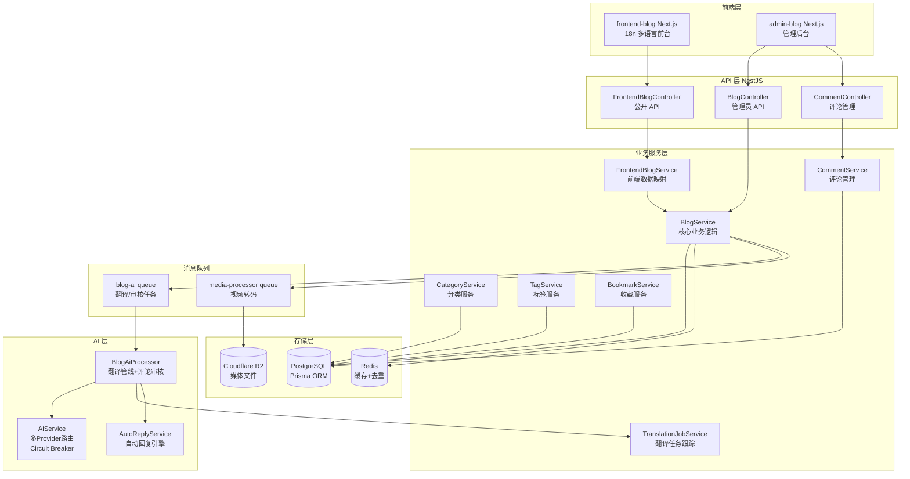
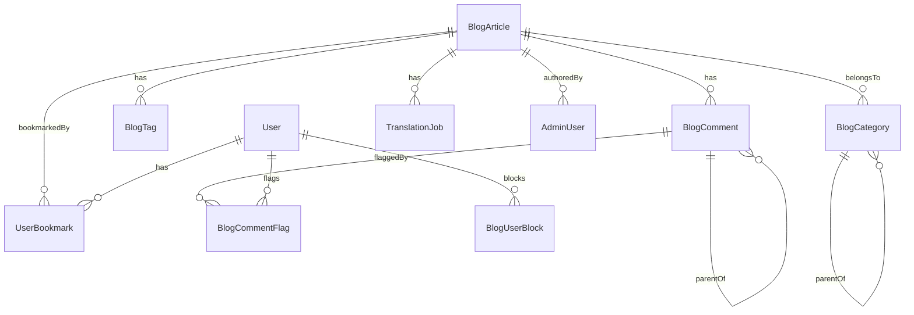
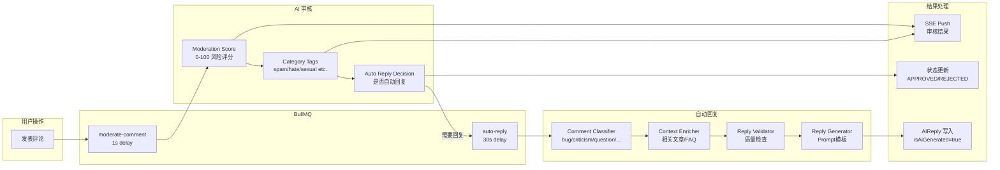
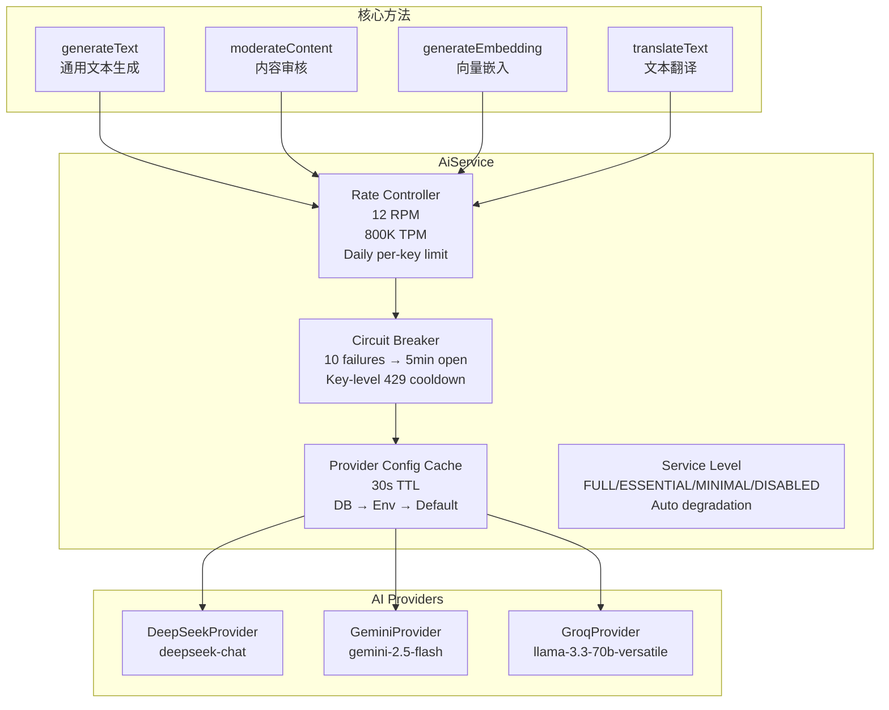

# 00. 博客系统架构分析

## 🎯 本分析目标

全面剖析 JoyMini 博客系统的架构设计、数据模型、业务逻辑和 AI 管线，为后续 AI Agent 架构的设计与实现提供基准参考。

---

## 一、系统总览

JoyMini 博客采用 **Monorepo** 架构，核心技术栈为 **Next.js + NestJS + Prisma + PostgreSQL + Redis + BullMQ**。

### 1.1 整体架构



### 1.2 目录结构

| 目录 | 用途 |
|------|------|
| `apps/api/src/blog/` | 博客 API 后端（NestJS Module） |
| `apps/frontend-blog/` | 博客前台（Next.js，支持 6 种语言） |
| `apps/admin-blog/` | 博客管理后台（Next.js） |
| `packages/shared/` | 共享类型和工具（i18n、枚举、DTO） |
| `packages/ui/` | UI 组件库（Shadcn/ui 封装） |

---

## 二、数据模型分析

### 2.1 核心模型关系



### 2.2 关键模型详解

#### BlogArticle（文章）
| 字段 | 类型 | 说明 |
|------|------|------|
| `title` / `slug` | String | 中文标题/唯一 Slug |
| `titleLocalized` / `contentLocalized` | Json | **多语言内容核心** — JSONB `{en: "...", ja: "..."}` |
| `contentMdLocalized` | Json | Markdown 版多语言内容 |
| `excerptLocalized` / `coverImageLocalized` | Json | 摘要和封面图的多语言版本 |
| `translationStatus` | Enum | `PENDING \| TRANSLATING \| COMPLETED \| COMPLETED_WITH_WARNINGS \| MANUAL \| FAILED` |
| `status` | Enum | `DRAFT \| PUBLISHED \| ARCHIVED` |
| `featured` | Boolean | 精选文章（首页 Hero 用） |
| `meta` | Json | 扩展信息（视频元数据等） |
| `titleEn` / `contentEn` | String | **已废弃**的旧版英文字段（向后兼容） |

**设计要点**：
- 多语言采用 **JSONB** 字段而非独立翻译表，减少 JOIN 开销
- 新旧两种格式并存：`titleLocalized.en` 新格式 vs `titleEn` 旧格式
- 内容同时存储 HTML（`contentLocalized`）和 Markdown（`contentMdLocalized`）两个版本
- `select: { returnType: 'object' }` 确保 Prisma 返回对象而非字符串

#### BlogComment（评论）
| 字段 | 类型 | 说明 |
|------|------|------|
| `author` / `email` / `content` | String | 评论者信息 |
| `status` | Enum | `PENDING \| APPROVED \| REJECTED` |
| `parentId` | String? | 父评论 ID（树形结构） |
| `aiModerationScore` | Float? | AI 审核评分 0-100 |
| `aiModerationReason` | String? | AI 审核原因 |
| `aiModerationCategories` | Json[] | AI 分类标签 |
| `isAiGenerated` | Boolean | 是否为 AI 自动回复 |
| `reply` | Json | 管理员回复（多语言 JSON） |

**设计要点**：
- 树形评论结构通过 `parentId` 自引用实现
- AI 审核结果直接存储在评论记录中，无需额外 JOIN
- 自动回复由 "Porter" 机器人生成，通过 SSE 实时推送

#### TranslationJob（翻译任务）
| 字段 | 类型 | 说明 |
|------|------|------|
| `type` | Enum | `article \| category \| tag` |
| `targetId` | String | 关联对象 ID |
| `targetLang` | String | 目标语言代码 |
| `status` | Enum | `QUEUED \| PROCESSING \| COMPLETED \| FAILED \| CANCELLED` |
| `progress` | Int | 0-100 进度百分比 |

### 2.3 多语言内容系统（核心设计）

```
LocalizedField 格式:
{
  "zh": "中文内容",
  "en": "English Content",
  "ja": "日本語の内容",
  "ko": "한국어 콘텐츠",
  "fr": "Contenu français",
  "de": "Deutscher Inhalt"
}

向后兼容:
- 新代码优先读取 titleLocalized/en
- 如果不存在，回退到 titleEn（旧字段）
- 如果都不存在，回退到 zh
```

**解决的问题**：
1. 旧数据只有 `titleEn` / `contentEn` 独立字段
2. 新系统设计了 `titleLocalized` JSONB 字段
3. 迁移策略：`mapArticleToLocalized()` 方法同时兼容两种格式
4. 验证逻辑：`isArticleTranslated()` 同时检查新老格式

---

## 三、后端 API 架构

### 3.1 模块化设计

```
BlogModule
├── Controllers
│   ├── BlogController          # 管理员 API (RBAC)
│   ├── FrontendBlogController  # 公开 API (缓存)
│   ├── BookmarkController      # 收藏 API (JWT)
│   └── CommentController       # 评论管理 (RBAC)
│
├── Services
│   ├── BlogService             # 核心业务 (4247行)
│   ├── FrontendBlogService     # 前端数据映射
│   ├── BookmarkService         # 收藏逻辑
│   ├── CommentService          # 评论 CRUD
│   ├── CategoryService         # 分类 CRUD
│   ├── TagService              # 标签 CRUD
│   └── TranslationJobService   # 翻译任务持久化
│
├── Processors
│   ├── BlogAiProcessor         # AI 翻译+审核 (BullMQ)
│
├── Guards
│   ├── LikeDeduplicationGuard  # Redis 指纹去重
│   └── RecaptchaGuard          # 验证码校验
│
└── DTOs
    ├── CreateArticleDto
    ├── UpdateArticleDto
    ├── CreateCommentDto
    ├── BatchImportDto
    └── CommentResponseDto
```

### 3.2 缓存策略

| 数据 | 缓存 TTL | 缓存位置 |
|------|----------|----------|
| 文章列表 | 5 分钟 | NestJS @CacheTTL |
| 文章详情 | 10 分钟 | NestJS @CacheTTL |
| 分类/标签/统计 | 1 小时 | NestJS @CacheTTL |
| 文章归档 | 30 分钟 | NestJS @CacheTTL |
| Like 去重 | 24 小时 | Redis Key |
| 翻译缓存 | 1 小时 | 内存 Map |
| AI Provider 配置 | 30 秒 | 内存缓存 |

### 3.3 SSE 实时推送

```
FrontendBlogController 提供 /comments/stream SSE 端点:

接入方式: 前端通过 EventSource 连接
推送内容:
  - 评论回复事件 (reply_to_{commentId})
  - 审核结果事件 (moderated_{commentId})
  - 自动回复事件

生命周期:
  1. 用户发布评论
  2. 评论进入 PENDING 状态
  3. SSE 推送审核结果
  4. AI 生成回复后推送回复事件
```

### 3.4 权限体系

```
管理员 API:
  - AdminJwtAuthGuard (认证)
  - PermissionsGuard (授权)
  - @RequirePermission('blog.article.create') 细粒度权限

公开 API:
  - OptionalJwtAuthGuard (可选认证，评论列表)
  - JwtAuthGuard (强制认证，发表评论/收藏)
  - LikeDeduplicationGuard (IP+UA 指纹，独立守卫)
```

---

## 四、AI 管线深度分析

### 4.1 AI 翻译管线

```mermaid
flowchart LR
    subgraph Trigger["触发方式"]
        T1["创建/编辑文章<br/>（自动触发）"]
        T2["管理员手动触发<br/>翻译按钮"]
        T3["批量修复<br/>质量检测后"]
        T4["初始化语言<br/>全量翻译"]
    end

    subgraph Queue["BullMQ blog-ai 队列"]
        Q1["translate-article<br/>并发5，限速100/60s"]
        Q2["translate-category"]
        Q3["translate-tag"]
    end

    subgraph Process["BlogAiProcessor"]
        P1["Media Preservation<br/>视频/图片占位符替换"]
        P2["Batch Translation<br/>单次API调用三段内容<br/>标题/摘要/内容"]
        P3["Quality Validation<br/>长度/结构/字符检测"]
        P4["Fallback Strategy<br/>失败逐字段重试"]
        P5["Cache Update<br/>1h TTL + content hash"]
    end

    subgraph Providers["AI Providers"]
        G["Gemini 2.5 Flash<br/>默认 Provider"]
        D["DeepSeek Chat<br/>高优先级"]
        GR["Groq Llama 3.3<br/>备选"]
    end

    Trigger --> Queue
    Queue --> Process
    Process --> Providers
```



#### 4.1.1 翻译流程关键步骤

1. **Media Placeholder Injection**：
   - 从 `contentMdLocalized` 中提取 `<video>` / `` 标签
   - 替换为 Unicode 占位符（⚠️VIDEO_0⚠️、⚠️IMAGE_0⚠️）
   - AI 翻译后，删除被 AI 丢弃的占位符，恢复保留的媒体标签

2. **Batch Translation**：
   - 单次 API 调用翻译标题+摘要+内容
   - 使用分隔符解析：`---TITLE---` / `---EXCERPT---` / `---CONTENT---`
   - 最大内容长度 50K 字符

3. **Quality Validation**：
   - 检查标题/内容是否与源语言相同（数据损坏检测）
   - 检查是否仍包含大量中文字符
   - 验证长度比率在合理范围内

4. **Fallback Strategy**：
   - 批处理失败 → 逐字段重试
   - 特定字段失败 → Markdown 内容退化到 HTML 内容重试
   - 全部失败 → 设置 `COMPLETED_WITH_WARNINGS` 状态

#### 4.1.2 翻译质量检测

`detectTranslationQuality()` 方法实施**多维度质量检测**：

| 检测维度 | 检测内容 | 严重程度 |
|----------|----------|----------|
| 长度比率 | 翻译后长度在源语言 0.3x~10x 范围内 | 中等 |
| 标题结构 | Markdown 标题数量不低于源文 30% | 高 |
| 代码块 | 代码块数量不低于源文 40% | 中等 |
| 表格结构 | 表格行数不低于源文 40% | 中等 |
| 列表项 | 列表项数量不低于源文 40% | 中等 |
| 中文字符残留 | 非中文语言中仍含 >50 中文字符且比例 >30% | 高 |
| 完全一致 | 翻译结果与原文完全相同 | 严重 |

### 4.2 评论审核管线



#### 4.2.1 审核评分体系

| 分数范围 | 风险等级 | 处理方式 |
|----------|----------|----------|
| 0-30 | 安全 | 自动通过 |
| 30-60 | 需审核 | 标记 PENDING，人工复查 |
| 60-100 | 高风险 | 自动拒绝 + 日志告警 |

#### 4.2.2 自动回复分类

评论分类引擎（`CommentClassifier`）将用户评论分为 6 类：

| 类别 | 回复策略 | Prompt 模板 |
|------|----------|-------------|
| 问题 | 提供详细解答 | `prompts/question.ts` |
| 建议 | 感谢 + 说明已记录 | `prompts/suggestion.ts` |
| 批评 | 致歉 + 改进说明 | `prompts/criticism.ts` |
| Bug 报告 | 感谢 + 修复时间线 | `prompts/bug-report.ts` |
| 赞美 | 感谢 + 适度引导 | `prompts/praise.ts` |
| 其他 | 通用友好回复 | `prompts/common.ts` |

### 4.3 AI Service 核心架构



**设计决策**：
1. **Provider 优先级**：DeepSeek > Groq > Gemini（基于稳定性和付费等级）
2. **配置层级**：DB 显式配置 > 环境变量自动检测 > 默认 Gemini
3. **容错机制**：Rate limit → Key 级别冷却 → Circuit Breaker → Service Level 降级
4. **预算控制**：每日每 Key 800K token 上限，超限自动降级

---

## 五、前台架构分析

### 5.1 frontend-blog（Next.js）

**多语言路由**：
```
/[locale]/articles/[slug]     # 文章详情
/[locale]/categories/[slug]   # 分类列表
/[locale]/tags/[slug]         # 标签列表
/[locale]/search              # 搜索
/[locale]/bookmarks           # 收藏（需登录）
/[locale]/login               # 登录
/[locale]/about               # 关于
/[locale]/privacy             # 隐私政策
```

支持语言：`zh` / `en` / `ja` / `ko` / `fr` / `de`

**核心 Hooks**：
- `useAuth` — 认证状态管理
- `useBookmarks` — 收藏 CRUD
- `useComments` — 评论提交 + SSE 订阅
- `useSSE` — SSE 连接管理
- `useArticles` — 文章列表/详情
- `usePWA` — 渐进式 Web App

**数据流**：
```
FrontendBlogService.mapArticleForFrontend()
  → getLocalizedString(entity, field, locale)
    → 1. 检查 field 本身是否为 Localized 对象
    → 2. 检查 fieldLocalized (新格式)
    → 3. 检查 fieldEn (旧格式向后兼容)
    → 4. 回退到中文
```

**视频注入逻辑**（`injectVideosIntoMarkdown`）：
```
1. 从 contentMd 移除已有视频标签（防重复）
2. 从 content HTML 提取视频块及其在 HTML 中的位置
3. 查找视频前最近的 HTML 标题
4. 在 Markdown 中找到匹配的标题行
5. 在标题行后插入视频标签
6. 替换 MP4 src 为 HLS URL
```

### 5.2 admin-blog（管理后台）

**关键视图**：
```
blog/
├── articles/                    # 文章管理
│   ├── create/                  # 创建文章 (RichTextEditor)
│   └── [slug]/                  # 编辑文章 (LocalizedFieldEditor)
├── categories/                  # 分类管理
├── tags/                        # 标签管理
├── comments/                    # 评论审核
├── import/                      # 批量导入 Markdown
├── translation-progress/        # 翻译进度仪表盘
└── translation-quality/         # 翻译质量检测 (SSE 流式)
    └── translation-quality-stream/  # SSE 流式检测
```

**核心组件**：
- `RichTextEditor` — Quill 富文本编辑器（视频嵌入支持）
- `LocalizedFieldEditor` — 多语言字段编辑器
- `LocalizedText` — 多语言文本渲染组件
- `LanguageSwitch` — 语言切换器
- `TranslationProgressCard` — 翻译进度卡片

---

## 六、业务逻辑梳理

### 6.1 核心业务流程

#### 文章生命周期
```
DRAFT → PUBLISHED → ARCHIVED
  │         │
  └─ 自动触发翻译 ──→ TRANSLATING → COMPLETED / FAILED
       (创建/编辑时)                    │
                                       └─ 质量检测 → 修复/重译
```

#### 评论生命周期
```
CREATED → PENDING → APPROVED / REJECTED
  │                    │
  └─ AI 审核 ────→ SSE 推送结果
  └─ 自动回复 ──→ SSE 推送自动回复
```

#### 翻译任务流程
```
触发方式:
  1. 创建/编辑文章（自动）
  2. 管理员手动触发
  3. 批量修复（fixTranslationIssuesBatch）
  4. 初始化语言（initializeLanguageTranslations）
  5. 全量重译（retranslateAllLocales）

处理流程:
  触发 → 投递 BullMQ → BlogAiProcessor 消费
       → Media Preservation → Batch AI Translate
       → Quality Validation → 更新 TranslationJob
       → SSE 推送进度（流式检测时）
```

### 6.2 关键业务规则

| 规则 | 说明 |
|------|------|
| 自动翻译 | 创建/编辑文章时自动投递翻译到所有已启用的非源语言 |
| 翻译防抖 | 内容无变化时不重复翻译（Content Hash 缓存） |
| 视频插入后重译 | `clearArticleTranslationsForLocales` 清除其他语言后重新翻译 |
| Like 去重 | 同一 IP+UA 24 小时内只能点赞一次 |
| 评论脱敏 | 公开 API 返回的评论脱敏显示（`applyCommentMasking`） |
| 评论拉黑 | 用户可以拉黑其他评论者，被拉黑者的评论不可见 |
| 草稿不翻译 | `DRAFT` 状态的文章不计入翻译统计 |
| 批量导入 | 从本地 Markdown 文件批量导入文章 |
| 类别翻译修复 | 检测非 zh 字段中仍含中文的记录并重新翻译 |

### 6.3 已识别的架构问题

| 问题 | 影响 | 建议 |
|------|------|------|
| BlogService 达 4247 行 | 难以维护、单测困难 | 拆分为子 Service（ArticleService、TranslationService、CommentService） |
| 部分翻译逻辑散落在 Service 和 Processor | 职责不清晰 | 将翻译策略抽取为独立 TranslationStrategy |
| `mapArticleToLocalized` 与 `FrontendBlogService.getLocalizedString` 重复 | 两份定位逻辑 | 统一到 `packages/shared` 共享方法 |
| 翻译质量检测阈值为硬编码 | 不同语言表现差异大 | 抽取为可配置的 LanguageQualityProfile |
| SSE 连接没有认证 | 任何人都可以连接 | 添加 Token 验证或连接时效 |
| TranslationJob 状态与 BullMQ Job 状态不同步 | 可能产生脏数据 | 添加状态同步机制或统一状态源 |

---

## 七、现有 AI 基础设施总结

### 7.1 已有能力

| 能力 | 实现方式 | 现有限制 |
|------|----------|----------|
| 文本翻译 | Queue + Batch AI Call | 仅限文章/分类/标签 |
| 评论审核 | Queue + AI Scoring | 非实时（1s 延迟） |
| 自动回复 | Classifier + Generator | 仅限英文 |
| 翻译质量检测 | 正则+统计 | 仅限结构检查，缺乏语义 |
| Provider 容错 | Circuit Breaker | 无 Provider 健康监测 |
| 速率限制 | 内存计数器 | 不跨进程 |

### 7.2 可复用的基础设施

| 组件 | 文件 | 可直接复用 |
|------|------|-----------|
| AiService | `apps/api/src/common/ai/ai.service.ts` | generateText, moderateContent, generateEmbedding |
| AutoReplyService | `apps/api/src/common/ai/auto-reply/` | Comment Classifier, Prompt Templates |
| LanguageService | `apps/api/src/common/services/language.service.ts` | 语言解析、多语言路由 |
| LanguageDetectionService | `apps/api/src/common/services/language-detection.service.ts` | 语言自动检测 |
| BullMQ Queue | `apps/api/src/common/bull/` | 异步任务队列 |
| RedisService | `apps/api/src/common/redis/` | 缓存、去重、会话 |
| SystemConfigService | `apps/api/src/admin/system-config/` | 动态配置管理 |
| LikeDeduplicationGuard | `apps/api/src/blog/guards/` | 指纹去重模式 |

### 7.3 管理员 AI 工具（BlogWritingAgent）

管理后台除了 BlogService 提供的 CRUD 操作外，还可以借助 AI 能力大幅提升编辑效率。

#### 7.3.1 定位

**BlogWritingAgent** 是一个面向**管理员**的 AI 写作助手，独立于面向用户的 MultiAgentSupervisor 体系。它不处理用户请求，而是通过 **Admin API** 直接调用，帮助管理员完成文章创作、编辑和发布全流程。

#### 7.3.2 双模式设计

| 模式 | 特点 | 适用场景 |
|------|------|----------|
| **ReAct Agent（快速模式）** | 单轮对话 + 单工具调用，即时响应 | 补摘要、写标签、翻译片段、查已有文章 |
| **Workflow Graph（结构化模式）** | 多步编排 + HITL 人工审核，可持久化 | 完整创作：规划→研究→草稿→审核→发布 |

#### 7.3.3 写作工具集（9 个 Tool）

| 分类 | 工具名 | 功能 |
|------|--------|------|
| **研究参考** | `search_existing_articles` | 搜索已有文章，避免重复创作 |
| | `get_article` | 获取单篇文章完整内容 |
| | `search_knowledge` | 搜索知识库（政策/FAQ/指南） |
| **写作生成** | `generate_outline` | 根据主题生成文章大纲 |
| | `write_section` | 写文章某一段落 |
| | `write_full_article` | 基于大纲+参考一次性生成全文 |
| | `polish_article` | 润色文章，优化语句和风格 |
| **收尾辅助** | `summarize_to_abstract` | 从正文提取摘要/SEO 描述 |
| | `suggest_tags` | 基于内容推荐标签 |

> 工具内部可直接调用 LLM 生成内容（参考 travel-agent 的 `itineraryTool` 模式），无需额外 Controller。

#### 7.3.4 人机审核（HITL）

- **中断点**：使用 `interrupt()` 在 "草稿完成" 节点暂停
- **审核表**：数据库 `ApprovalTask` 记录待审批项
- **管理员操作**：通过 Admin API 审批/驳回/修改草稿
- **超时处理**：超时自动驳回并通知管理员

#### 7.3.5 SSE 实时推送

写作 Agent 的 Workflow 模式通过 SSE 实时推送进度：

| 事件类型 | 含义 |
|----------|------|
| `token` | LLM 逐 token 生成内容 |
| `step` | 步骤状态变化（pending→running→completed→human_review） |
| `done` | 整体流程完成 |
| `error` | 错误信息 |

> 详细设计参见文档 [10-实现-BlogWritingAgent双模式](ai-blog/10-实现-BlogWritingAgent双模式.md)、[11-实现-写作工具集工厂函数](ai-blog/11-实现-写作工具集工厂函数.md)、[12-实现-人机审核与发布SSE](ai-blog/12-实现-人机审核与发布SSE.md)。

---

## 八、总结

JoyMini 博客是一个**多语言优先**的博客系统，核心特色包括：

1. **JSONB 多语言字段** — 灵活的 LocalizedString 模式，支持 6 种语言
2. **AI 驱动翻译管线** — 基于 BullMQ 的异步 AI 翻译，含媒体占位符保护和质量验证
3. **智能评论审核** — AI 评分 + 自动回复 + SSE 实时推送
4. **渐进增强的 AI 架构** — AiService 多 Provider 路由，Circuit Breaker 容错
5. **完善的缓存策略** — 内存 + Redis 多级缓存
6. **Markdown + Quill 双内容格式** — 兼顾编辑体验和渲染质量

这些基础设施为构建高级 AI Agent 架构提供了坚实基础。接下来的 Spec-Code 系列将在此之上引入 LangGraph 编排、专业 Agent 和 HITL 机制。

---

## 🔜 下一步

继续阅读 [01-配置-BlogAgent基础设施](01-配置-BlogAgent基础设施.md) 开始搭建 AI Agent 架构。
