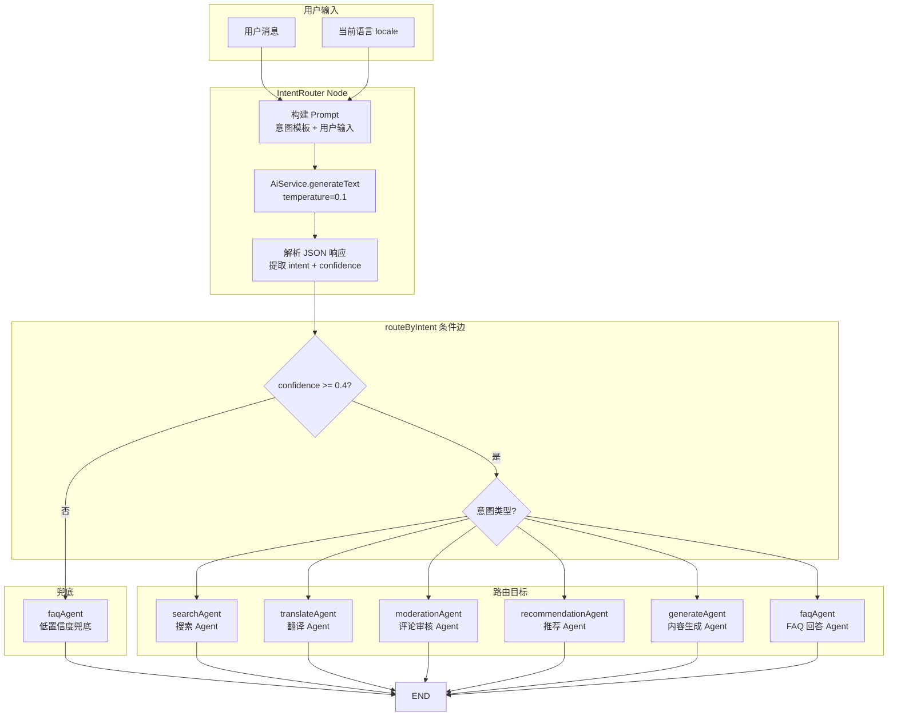

# 03. 实现 BlogIntentRouter 节点

## 🎯 本步骤目标

1. 创建 `intentRouterNode` — 使用 LLM 识别用户意图
2. 定义 6 种博客特定意图：`search` / `translate` / `moderate` / `recommend` / `generate` / `faq`
3. 创建条件路由函数 `routeByIntent` — 根据意图将请求路由到对应 Agent
4. 注册所有 Agent 节点到 Graph（占位过渡）
5. 完成单节点 Graph 验证

---

## 📖 背景说明

### 承上

[01-配置-BlogAgent基础设施](01-配置-BlogAgent基础设施.md) 创建了 BlogAgentModule、GraphState 和 BlogAgentService 骨架；
[02-创建-BlogAgent数据模型](02-创建-BlogAgent数据模型.md) 创建了 KnowledgeDocument 和 AgentInteraction 数据模型。

当前 Graph 只有骨架，还没有任何实际节点和路由逻辑。

### 这一步要解决的问题

| 问题 | 说明 |
|------|------|
| 意图识别缺失 | 现有系统无法区分用户是想搜索文章、翻译内容还是审核评论 |
| 硬编码路由 | BlogAiProcessor 通过 Queue name 分发，缺少智能路由 |
| 多语言意图 | 用户输入可能是任意 6 种语言，意图识别需要多语言兼容 |

### 设计决策

| 决策 | 选项 | 选择 | 理由 |
|------|------|------|------|
| 意图识别方式 | LLM vs 关键词匹配 vs 分类模型 | **LLM** | 多语言支持好、零样本、可扩展新意图 |
| 意图粒度 | 粗粒度vs细粒度 | **6 类** | 覆盖博客系统所有核心场景，不过度分割 |
| 路由策略 | 条件边 vs Agent 内部路由 | **条件边** | LangGraph 原生支持，流程图清晰，扩展性好 |
| LLM 调用方式 | AiService.generateText vs 新 Agent | **AiService.generateText** | 复用 Circuit Breaker、Rate Limit 等基础设施 |

---

## ⚙️ 前置条件

- [x] BlogAgentModule、GraphState、BlogAgentService 骨架已完成
- [x] AiService.generateText 方法可用
- [x] LangGraph 依赖已安装：`@langchain/langgraph`、`@langchain/core`

---

## 📝 实现步骤

### Step 1: 实现 IntentRouter Node

**文件**: `apps/api/src/blog/agent/nodes/intent-router.node.ts`

创建意图识别节点，使用 AiService 对用户输入进行意图分类：

```typescript
import { Logger } from '@nestjs/common';
import { AiService } from '@api/common/ai/ai.service';
import { BlogAgentState } from '../graph/state';

const INTENT_PROMPT_TEMPLATE = `你是一个博客 AI Agent 的意图识别器。请分析用户输入并识别其意图。

支持的意图：
- search: 用户想搜索文章、查找信息、询问博客内容相关的问题
- translate: 用户想翻译文章内容、询问翻译状态、触发翻译任务
- moderate: 用户想审核评论、查看评论状态、处理评论举报
- recommend: 用户想获得文章推荐、个性化内容建议、热门文章
- generate: 用户想生成内容、撰写草稿、创建/编辑文章
- faq: 用户询问博客使用问题、政策咨询、功能说明

用户输入语言可能是：zh/en/ja/ko/fr/de 中的任意一种。

请以 JSON 格式返回：
{
  "intent": "search|translate|moderate|recommend|generate|faq",
  "confidence": 0.0-1.0,
  "reason": "判断理由（用用户输入的语言）"
}

用户输入：{input}`;

export function createIntentRouterNode(aiService: AiService) {
  return async (state: typeof BlogAgentState.State) => {
    const logger = new Logger('IntentRouterNode');
    const { input, locale } = state;

    const prompt = INTENT_PROMPT_TEMPLATE.replace('{input}', input);
    const systemPrompt = `你是一个多语言意图识别器。当前用户语言：${locale}`;

    try {
      const response = await aiService.generateText(prompt, {
        systemPrompt,
        temperature: 0.1, // 低温度保证一致性
      });

      // 解析 JSON 响应
      const jsonMatch = response.match(/\{[\s\S]*\}/);
      if (!jsonMatch) {
        throw new Error('无法解析意图识别结果');
      }

      const parsed = JSON.parse(jsonMatch[0]);
      const intent = parsed.intent || 'faq';
      const confidence = parsed.confidence || 0.5;

      logger.log(`意图识别: ${intent} (置信度: ${confidence}) - ${parsed.reason || ''}`);

      return {
        intent,
        intentConfidence: confidence,
        activeAgent: intent,
        visitedAgents: [intent],
        messages: [
          {
            type: 'ai',
            content: `[IntentRouter] 检测到意图: ${intent} (置信度: ${confidence})`,
          },
        ],
      };
    } catch (error) {
      logger.error(`意图识别失败: ${error.message}`);
      // 降级：默认 faq 意图
      return {
        intent: 'faq',
        intentConfidence: 0,
        activeAgent: 'faq',
        visitedAgents: ['faq'],
        messages: [],
      };
    }
  };
}
```

**设计要点**：
- 低温度 `temperature: 0.1` 保证意图识别一致性
- JSON 格式输出便于解析，正则提取兼容 ````json` 包裹的情况
- 识别失败降级到 `faq` 意图，确保系统不中断
- 使用 `visitedAgents` 记录访问链路，防止循环

### Step 2: 实现意图路由函数

**文件**: `apps/api/src/blog/agent/graph/routes.ts`

定义基于意图的条件路由逻辑：

```typescript
import { Logger } from '@nestjs/common';

export type BlogAgentRoute = '__end__' | 'searchAgent' | 'translateAgent'
  | 'moderationAgent' | 'recommendationAgent' | 'generateAgent' | 'faqAgent';

/**
 * 基于意图的条件路由
 * 低置信度时路由到 faqAgent 而不是冒险路由
 */
export function routeByIntent(
  state: { intent: string; intentConfidence: number; visitedAgents: string[] },
): BlogAgentRoute {
  const logger = new Logger('IntentRouter');

  const ROUTE_MAP: Record<string, BlogAgentRoute> = {
    search: 'searchAgent',
    translate: 'translateAgent',
    moderate: 'moderationAgent',
    recommend: 'recommendationAgent',
    generate: 'generateAgent',
    faq: 'faqAgent',
  };

  // 低置信度 → 兜底到 faqAgent
  if (state.intentConfidence < 0.4) {
    logger.warn(`意图置信度低 ${state.intentConfidence}，降级到 faq`);
    return 'faqAgent';
  }

  const route = ROUTE_MAP[state.intent];
  if (!route) {
    logger.warn(`未知意图 ${state.intent}，降级到 faq`);
    return 'faqAgent';
  }

  logger.log(`路由: ${state.intent} → ${route}`);
  return route;
}
```

**路由决策表**：

| 置信度 | 意图 | 路由目标 | 说明 |
|--------|------|----------|------|
| >= 0.7 | search | searchAgent | 高置信度搜索 |
| >= 0.7 | translate | translateAgent | 高置信度翻译 |
| >= 0.7 | moderate | moderationAgent | 高置信度审核 |
| >= 0.7 | recommend | recommendationAgent | 高置信度推荐 |
| >= 0.7 | generate | generateAgent | 高置信度生成 |
| >= 0.4 | 任意 | 对应 Agent | 中等置信度仍路由 |
| < 0.4 | 任意 | faqAgent | 低置信度兜底 |

### Step 3: 注册节点和路由到 Graph

**文件**: `apps/api/src/blog/agent/blog-agent.service.ts`

更新 `initializeGraph` 方法，注册 IntentRouter 和所有 Agent 节点：

```typescript
import { END } from '@langchain/langgraph';
import { createIntentRouterNode } from './nodes/intent-router.node';
import { routeByIntent } from './graph/routes';

// 在 BlogAgentService 中添加：
private intentRouterNode: ReturnType<typeof createIntentRouterNode>;

constructor(
  private readonly aiService: AiService,
  private readonly blogService: BlogService,
) {
  // 创建节点函数（注入 AI Service）
  this.intentRouterNode = createIntentRouterNode(this.aiService);
}

async initializeGraph(): Promise<void> {
  const workflow = new StateGraph(BlogAgentState);

  // 1. 注册 IntentRouter
  workflow.addNode('intentRouter', this.intentRouterNode);

  // 2. 注册各 Agent 节点（占位，后续步骤实现）
  workflow.addNode('searchAgent', async (state) => state);
  workflow.addNode('translateAgent', async (state) => state);
  workflow.addNode('moderationAgent', async (state) => state);
  workflow.addNode('recommendationAgent', async (state) => state);
  workflow.addNode('generateAgent', async (state) => state);
  workflow.addNode('faqAgent', async (state) => state);

  // 3. 设置入口
  workflow.setEntryPoint('intentRouter');

  // 4. 条件边：IntentRouter → 各 Agent
  workflow.addConditionalEdges('intentRouter', routeByIntent, {
    searchAgent: 'searchAgent',
    translateAgent: 'translateAgent',
    moderationAgent: 'moderationAgent',
    recommendationAgent: 'recommendationAgent',
    generateAgent: 'generateAgent',
    faqAgent: 'faqAgent',
  });

  // 5. 所有 Agent 最终回到结束
  workflow.addEdge('searchAgent', END);
  workflow.addEdge('translateAgent', END);
  workflow.addEdge('moderationAgent', END);
  workflow.addEdge('recommendationAgent', END);
  workflow.addEdge('generateAgent', END);
  workflow.addEdge('faqAgent', END);

  this.graph = workflow.compile();
  this.logger.log('Blog Agent Graph initialized with IntentRouter');
}
```

### Step 4: 意图识别流程总览



---

## ✅ 验收方式

### 手动验证

1. **搜索意图测试**
   - 输入：`如何配置博客多语言？`
   - 预期：intent = search，confidence >= 0.7

2. **翻译意图测试**
   - 输入：`把这篇文章翻译成英文`
   - 预期：intent = translate，confidence >= 0.7

3. **审核意图测试**
   - 输入：`查看最近的评论审核状态`
   - 预期：intent = moderate，confidence >= 0.7

4. **低置信度降级测试**
   - 输入：`你好`
   - 预期：confidence < 0.4，路由到 faqAgent

### 自动化测试

```typescript
describe('IntentRouter', () => {
  it('should route search intent correctly', async () => {
    const result = await service.process({ text: '如何配置博客多语言？' });
    expect(result.intent).toBe('search');
    expect(result.intentConfidence).toBeGreaterThanOrEqual(0.7);
  });

  it('should fallback to faq on low confidence', async () => {
    const mockAiService = { generateText: jest.fn().mockResolvedValue('{"intent":"unknown","confidence":0.1}') };
    const node = createIntentRouterNode(mockAiService as any);
    const result = await node({ input: 'hi', locale: 'en' });
    expect(result.intent).toBe('faq');
  });
});
```

---

## 🔜 下一步预告

下一步 [04-创建-BlogSearchAgent与RAG工具](04-创建-BlogSearchAgent与RAG工具.md) 将：
- 实现 BlogSearchAgent — 使用 ReAct 模式的搜索 Agent
- 创建知识库检索工具（向量搜索 + 关键词搜索）
- 实现文章 Q&A 能力
- 集成 LangChain Tool 调用机制
