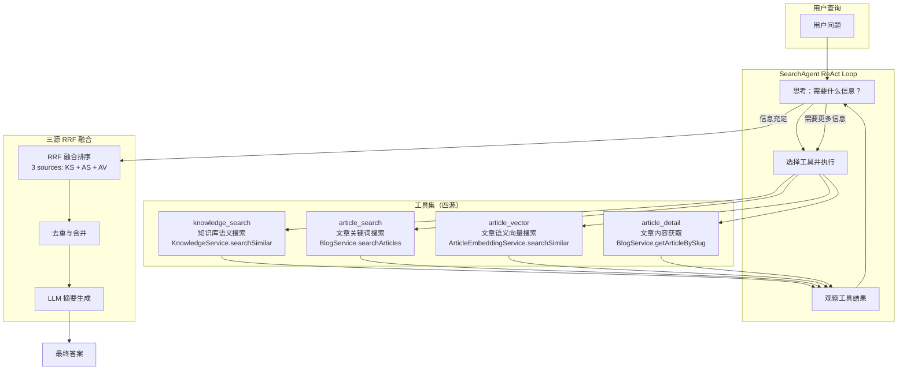

# 04. 创建 BlogSearchAgent 与 RAG 工具

## 🎯 本步骤目标

1. 创建 `searchAgentNode` — ReAct 模式的搜索 Agent
2. 创建知识库检索 Tool — 向量搜索 + 关键词搜索
3. 创建文章搜索 Tool — 对接现有 BlogService 搜索能力
4. 创建文章语义向量搜索 Tool — 基于 pgvector 语义搜索文章内容
5. 创建文章 Q&A Tool — 基于 RAG 的语义问答
6. 集成三源 RRF 混合排序（知识库向量 + 文章关键词 + 文章语义向量）
7. 集成 LangChain Tool 调用机制

---

## 📖 背景说明

### 承上

[03-实现-BlogIntentRouter节点](03-实现-BlogIntentRouter节点.md) 完成了意图识别和路由。当 IntentRouter 识别到 `search` 意图时，请求将被路由到 SearchAgent。

现有 BlogService 已提供 `searchArticles()` 方法（关键词搜索），但缺少语义理解和知识库检索能力。

### 这一步要解决的问题

| 问题 | 当前 | 目标 |
|------|------|------|
| 搜索方式 | 仅关键词模糊搜索 | 向量语义搜索 + 关键词混合 |
| 知识来源 | 仅文章内容 | 文章 + 知识库文档 + FAQ |
| 多轮交互 | 无状态单次查询 | 支持上下文追问 |
| 结果呈现 | 原始数据列表 | 智能摘要 + 问答 |

### 设计决策

| 决策 | 选项 | 选择 | 理由 |
|------|------|------|------|
| Agent 模式 | ReAct vs Plan-and-Execute | **ReAct** | 搜索场景 Tool 调用直接，ReAct 模式更高效 |
| 搜索工具数量 | 单一 vs 多个专业工具 | **4 个专业工具** | 职责分离、文章语义搜索独立于知识库搜索 |
| 知识库检索 | 仅向量 vs 混合搜索 | **向量 + 关键词召回** | 向量搜索泛化好但精确匹配弱，互补使用 |
| 结果排序 | LLM vs 固定公式 | **RRF 融合排序** | Reciprocal Rank Fusion 简单有效 |

---

## ⚙️ 前置条件

- [x] BlogService.searchArticles / getArticleBySlug 可用
- [x] KnowledgeService.searchSimilar 可用
- [x] AiService.generateText / generateEmbedding 可用
- [x] LangChain `@langchain/core/tools` 和 `@langchain/langgraph/prebuilt` 可用

---

## 📝 实现步骤

### Step 1: 创建搜索工具集

**文件**: `apps/api/src/blog/agent/tools/search.tools.ts`

创建 4 个搜索相关 Tool，采用工厂函数模式（与 [plans/joymini-nest-monorepo/06-OrderAgent与Tools.md] 一致）：

```typescript
import { DynamicStructuredTool } from '@langchain/core/tools';
import { z } from 'zod';
import { BlogService } from '../../blog.service';
import { KnowledgeService } from '../services/knowledge.service';
import { ArticleEmbeddingService } from '../services/article-embedding.service';

/**
 * Tool 1: 知识库向量搜索
 * 从知识库 KnowledgeDocument 中检索语义相关内容
 */
export function createKnowledgeSearchTool(knowledgeService: KnowledgeService) {
  return new DynamicStructuredTool({
    name: 'knowledge_search',
    description: `从博客知识库中搜索信息，包括：博客政策、翻译规范、常见问题、使用指南等。
当用户询问博客功能、翻译规则、使用方式时使用此工具。
输入应为自然语言查询，输出为相关内容列表。`,
    schema: z.object({
      query: z.string().describe('用户的自然语言查询'),
      locale: z.string().optional().describe('语言代码，如 zh/en/ja'),
    }),
    func: async ({ query, locale = 'zh' }) => {
      const results = await knowledgeService.searchSimilar(query, {
        topK: 5,
        locale,
        minScore: 0.6,
      });

      if (results.length === 0) {
        return '知识库中未找到相关内容。';
      }

      return results
        .map((r, i) => `[${i + 1}] ${r.title}\n${r.summary || r.content?.slice(0, 200)}...`)
        .join('\n\n');
    },
  });
}

/**
 * Tool 2: 文章搜索
 * 对接 BlogService.searchArticles，支持多语言关键词搜索
 */
export function createArticleSearchTool(blogService: BlogService) {
  return new DynamicStructuredTool({
    name: 'article_search',
    description: `搜索博客文章。支持按关键词、语言、分类、标签等条件搜索。
当用户想查找博客文章时使用此工具。`,
    schema: z.object({
      query: z.string().describe('搜索关键词'),
      locale: z.string().optional().describe('语言代码'),
      limit: z.number().optional().describe('返回数量，默认 10'),
    }),
    func: async ({ query, locale = 'zh', limit = 10 }) => {
      const articles = await blogService.searchArticles(query, {
        locale,
        page: 1,
        pageSize: limit,
      });

      if (!articles || articles.length === 0) {
        return `未找到与 "${query}" 相关的文章。`;
      }

      return articles
        .map((a, i) => `[${i + 1}] ${a.title} | 分类: ${a.category?.name || '无'} | 日期: ${a.createdAt}`)
        .join('\n');
    },
  });
}

/**
 * Tool 3: 文章内容获取
 * 获取指定文章的详细内容，用于 Deep Q&A
 */
export function createArticleDetailTool(blogService: BlogService) {
  return new DynamicStructuredTool({
    name: 'article_detail',
    description: `获取博客文章的详细内容，包括完整 HTML 内容和元数据。
当用户想了解某篇文章的详细内容时使用此工具。
输入可以是文章 slug 或 ID。`,
    schema: z.object({
      slug: z.string().describe('文章的 slug 或 ID'),
      locale: z.string().optional().describe('语言代码'),
    }),
    func: async ({ slug, locale = 'zh' }) => {
      try {
        const article = await blogService.getArticleBySlug(slug, false, locale);
        if (!article) return '未找到该文章。';

        return `标题: ${article.title}
内容: ${article.content?.slice(0, 2000)}...
标签: ${article.tags?.map((t: any) => t.name).join(', ') || '无'}`;
      } catch {
        return '获取文章详情失败，请确认 slug 是否正确。';
      }
    },
  });
}
}

/**
 * Tool 4: 文章语义向量搜索
 * 基于 ArticleEmbedding 的 pgvector 语义搜索，用于内容级语义匹配
 */
export function createArticleVectorTool(
  articleEmbeddingService: ArticleEmbeddingService,
) {
  return new DynamicStructuredTool({
    name: 'article_vector',
    description: `语义搜索博客文章内容。基于 AI 语义理解而非关键词匹配。
当用户想找"关于某主题的文章"、或者关键词搜索无法找到相关内容时使用此工具。
输入应为自然语言描述的主题，输出为语义相似的文章列表。`,
    schema: z.object({
      query: z.string().describe('自然语言查询，描述想找的文章主题'),
      locale: z.string().optional().describe('语言代码，如 zh/en/ja'),
    }),
    func: async ({ query, locale = 'zh' }) => {
      const results = await articleEmbeddingService.searchSimilar(query, {
        topK: 10,
        locale,
        minScore: 0.6,
      });

      if (results.length === 0) {
        return '未找到语义相关的文章。';
      }

      return results
        .map(
          (r, i) =>
            `[${i + 1}] ${r.title}\n${r.summary ? r.summary.slice(0, 150) : '(无摘要)'}...`,
        )
        .join('\n\n');
    },
  });
}
```

### Step 2: 实现 SearchAgent Node

**文件**: `apps/api/src/blog/agent/nodes/search-agent.node.ts`

创建 ReAct 模式的搜索 Agent 节点：

```typescript
import { Logger } from '@nestjs/common';
import { createReactAgent } from '@langchain/langgraph/prebuilt';
import { ChatPromptTemplate } from '@langchain/core/prompts';
import { AiService } from '@api/common/ai/ai.service';
import { BlogService } from '../../blog.service';
import { KnowledgeService } from '../services/knowledge.service';
import { BlogAgentState } from '../graph/state';
import {
  createKnowledgeSearchTool,
  createArticleSearchTool,
  createArticleDetailTool,
  createArticleVectorTool,
} from '../tools/search.tools';
import { AgentInteractionService } from '../services/interaction.service';
import { ArticleEmbeddingService } from '../services/article-embedding.service';

const SEARCH_AGENT_PROMPT = `你是一个博客搜索助手，使用中文回答问题（除非用户指定其他语言）。

你可以使用以下工具：
1. knowledge_search - 搜索博客知识库（政策、FAQ、规则等）
2. article_search - 搜索博客文章（关键词匹配）
3. article_vector - 语义搜索博客文章（AI 理解内容含义，不依赖关键词）
4. article_detail - 获取文章详细内容

流程：
1. 先尝试 article_search 或 article_vector 搜索文章
2. 关键词明确时优先用 article_search；主题模糊、需要"理解"时用 article_vector
3. 如需要深入内容，用 article_detail 获取详情
4. 如涉及博客功能/政策问题，用 knowledge_search 搜索知识库

当前用户语言：{locale}
用户问题：{input}`;

export function createSearchAgentNode(
  aiService: AiService,
  blogService: BlogService,
  knowledgeService: KnowledgeService,
  articleEmbeddingService: ArticleEmbeddingService,
  interactionService: AgentInteractionService,
) {
  return async (state: typeof BlogAgentState.State) => {
    const logger = new Logger('SearchAgent');
    const startTime = Date.now();

    try {
      // 1. 创建 Tool 列表（四源工具）
      const tools = [
        createKnowledgeSearchTool(knowledgeService),
        createArticleSearchTool(blogService),
        createArticleVectorTool(articleEmbeddingService),
        createArticleDetailTool(blogService),
      ];

      // 2. 创建 React Agent
      const agent = createReactAgent({
        llm: aiService.getLangChainModel(), // AiService 封装 LangChain Model
        tools,
        prompt: ChatPromptTemplate.fromMessages([
          ['system', SEARCH_AGENT_PROMPT],
          ['placeholder', '{messages}'],
        ]),
      });

      // 3. 执行 Agent
      const result = await agent.invoke({
        input: state.input,
        locale: state.locale,
        messages: state.messages,
      });

      // 4. 记录交互日志
      await interactionService.logInteraction({
        sessionId: state.userId || 'anonymous',
        userInput: state.input,
        detectedIntent: 'search',
        agentName: 'SearchAgent',
        agentOutput: result.output,
        processingMs: Date.now() - startTime,
        locale: state.locale,
      });

      return {
        output: result.output,
        activeAgent: 'searchAgent',
      };
    } catch (error) {
      logger.error(`SearchAgent 执行失败: ${error.message}`);
      return {
        output: '抱歉，搜索服务暂时不可用，请稍后重试。',
        needsHumanIntervention: true,
        humanInterventionReason: `SearchAgent error: ${error.message}`,
      };
    }
  };
}
```

### Step 3: 混合搜索策略

SearchAgent 的搜索流程如下：



**RRF 融合公式（三源）**：

```typescript
/**
 * 三源 Reciprocal Rank Fusion 融合排序
 * @param sources - 多个搜索结果数组，每个元素包含 { id, ... }
 * @param k - RRF 常数，默认 60
 * @returns 融合排序后的结果
 */
function reciprocalRankFusion(
  sources: any[][],
  k: number = 60,
): any[] {
  const scoreMap = new Map<string, number>();
  const resultMap = new Map<string, any>();

  sources.forEach((results) => {
    results.forEach((r, i) => {
      const id = r.id || r.articleId;
      const score = 1 / (k + i + 1);
      scoreMap.set(id, (scoreMap.get(id) || 0) + score);
      if (!resultMap.has(id)) {
        resultMap.set(id, r);
      }
    });
  });

  return [...scoreMap.entries()]
    .sort((a, b) => b[1] - a[1])
    .slice(0, 10)
    .map(([id]) => resultMap.get(id));
}
```

**三源 RRF 工作原理**：
- `knowledge_search` 返回知识库文档 -> RRF 排名得分
- `article_search` 返回关键词匹配文章 -> RRF 排名得分
- `article_vector` 返回语义相似文章 -> RRF 排名得分
- 三者得分相加，按总分降序取 Top-10
- 得分相同按 weight/similarity 加权

### Step 4: 注册 SearchAgent 到 Graph

**文件**: `apps/api/src/blog/agent/blog-agent.service.ts`

```typescript
// 在 BlogAgentService 中注入 KnowledgeService、ArticleEmbeddingService 和 AgentInteractionService
constructor(
  private readonly aiService: AiService,
  private readonly blogService: BlogService,
  private readonly knowledgeService: KnowledgeService,
  private readonly articleEmbeddingService: ArticleEmbeddingService,
  private readonly interactionService: AgentInteractionService,
) {
  this.intentRouterNode = createIntentRouterNode(this.aiService);
  this.searchAgentNode = createSearchAgentNode(
    this.aiService,
    this.blogService,
    this.knowledgeService,
    this.articleEmbeddingService,
    this.interactionService,
  );
}

async initializeGraph(): Promise<void> {
  const workflow = new StateGraph(BlogAgentState);

  workflow.addNode('intentRouter', this.intentRouterNode);

  // 注册 SearchAgent（替换占位节点）
  workflow.addNode('searchAgent', this.searchAgentNode);

  // 其他 Agent 继续使用占位...
  workflow.addNode('translateAgent', async (state) => state);
  // ...

  workflow.setEntryPoint('intentRouter');
  workflow.addConditionalEdges('intentRouter', routeByIntent, { /* ... */ });
  workflow.addEdge('searchAgent', END);
  // ...
}
```

### Step 5: AiService LangChain 模型适配

**文件**: `apps/api/src/common/ai/ai.service.ts`（扩展）

在 AiService 中添加 `getLangChainModel()` 方法，使 Agent 可以复用 AiService 的基础设施：

```typescript
import { ChatOpenAI } from '@langchain/openai';

// 在 AiService 中添加：
getLangChainModel(): BaseChatModel {
  // 根据当前 Provider 配置创建对应的 LangChain Model
  // 包装 AiService 的 Circuit Breaker、Rate Limit 等逻辑
  const config = this.getCurrentProviderConfig();

  return new ChatOpenAI({
    modelName: config.model,
    temperature: 0.7,
    maxRetries: 2,
    // 通过自定义 HTTP Client 路由到 AiService
    // 确保复用 Circuit Breaker 和 Rate Limit
  });
}
```

---

## ✅ 验收方式

### 手动验证

1. **知识库搜索**
   - 输入：`博客支持哪些语言？`
   - 预期：调用 knowledge_search，返回语言配置信息

2. **文章搜索**
   - 输入：`找一下关于 NestJS 的文章`
   - 预期：调用 article_search，返回相关文章列表

3. **文章语义搜索**
   - 输入：`推荐一些关于性能优化的文章`
   - 预期：调用 article_vector，基于语义相似度返回文章

4. **三源混合搜索**
   - 输入：`多语言配置的步骤是什么？`
   - 预期：同时调用 knowledge_search、article_search 和 article_vector，三源 RRF 融合结果

5. **文章详情问答**
   - 输入：`那篇文章的主要内容是什么？`（追问）
   - 预期：调用 article_detail 获取文章内容并回答

### 自动化测试

```typescript
describe('SearchAgent', () => {
  it('should create search tools', () => {
    const tool = createKnowledgeSearchTool(mockKnowledgeService);
    expect(tool.name).toBe('knowledge_search');
    expect(tool.schema).toBeDefined();
  });

  it('should handle empty search results', async () => {
    mockKnowledgeService.searchSimilar.mockResolvedValue([]);
    const tool = createKnowledgeSearchTool(mockKnowledgeService);
    const result = await tool.func({ query: 'nonexistent' });
    expect(result).toContain('未找到');
  });
});
```

---

## 🔜 下一步预告

下一步 [05-实现-CommentModerationAgent](05-实现-CommentModerationAgent.md) 将：
- 实现 CommentModerationAgent — 增强的评论审核 Agent
- 创建多维度评论审核工具（内容分析、用户画像、历史行为）
- 实现自动回复决策引擎
- 集成 HITL 人工审核回退机制
