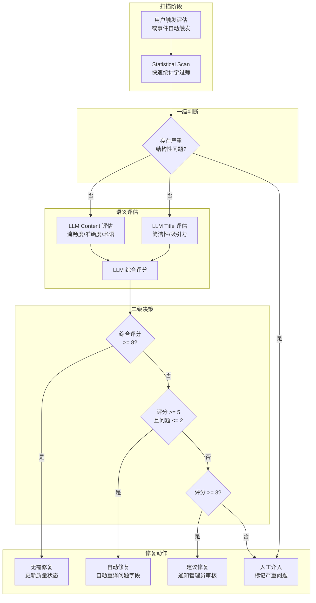

# 06. 创建 TranslationQualityAgent

## 🎯 本步骤目标

1. 创建 `translationQualityAgentNode` — AI 驱动的翻译质量保障 Agent
2. 引入 LLM 语义质量评估（超越现有正则+统计检测）
3. 创建智能修复决策引擎（自动修复 vs 建议修复 vs 人工介入）
4. 实现全自动 → 半自动 → 人工三级修复策略
5. 与现有 BlogAiProcessor 翻译管线和 TranslationJobService 集成

---

## 📖 背景说明

### 承上

现有翻译质量检测（[`apps/api/src/blog/blog.service.ts`](apps/api/src/blog/blog.service.ts:3341) `detectTranslationQuality`）实现了 7 维度的结构检测：

| 维度 | 检测方式 | 限制 |
|------|----------|------|
| 长度比率 | 正则计算 | 不同语言自然长度比不同 |
| 标题结构 | 正则统计 | 无法判断标题语义是否匹配 |
| 代码块/表格/列表 | 正则统计 | 无法判断代码注释是否被翻译 |
| 中文字符残留 | 字符检测 | 无法判断专业术语翻译 |
| 完全一致 | === 比较 | 无法检测"机械翻译"问题 |

### 这一步要解决的问题

| 问题 | 当前 | 目标 |
|------|------|------|
| 语义质量 | 未检测 | LLM 语义评估：流畅度、准确度、术语一致性 |
| 修复策略 | 仅批量重译 | 三级修复：自动/半自动/人工 |
| 术语一致性 | 未检测 | 自动校验关键术语翻译 |
| 多语言适配 | 硬编码阈值 | 语言特性感知的评估标准 |
| 反馈闭环 | 无 | 人工修复结果反馈改善未来检测 |

### 设计决策

| 决策 | 选项 | 选择 | 理由 |
|------|------|------|------|
| 质量评估方式 | 纯 LLM vs 混合 | **统计学 + LLM 混合** | 统计学低成本过筛，LLM 深层次评估 |
| 评估粒度 | 整篇 vs 段落 | **段落级评估** | 定位准确、修复成本低 |
| 触发方式 | 定时 vs 按需 vs 事件 | **事件驱动 + 定时巡检** | 翻译完成后自动触发，定时批量扫描 |
| 修复策略 | 全自动 vs 三级策略 | **三级策略** | 低风险自动、中风险建议、高风险人工 |

---

## ⚙️ 前置条件

- [x] BlogService.detectTranslationQuality — 现有统计学检测
- [x] BlogService.detectTranslationIssues — 现有分类/标签检测
- [x] BlogService.fixTranslationIssuesBatch — 现有批量修复
- [x] AiService.translateText / translateMarkdown — 翻译能力
- [x] TranslationJobService — 翻译任务追踪

---

## 📝 实现步骤

### Step 1: 创建翻译质量工具集

**文件**: `apps/api/src/blog/agent/tools/translation-quality.tools.ts`

```typescript
import { DynamicStructuredTool } from '@langchain/core/tools';
import { z } from 'zod';
import { AiService } from '@api/common/ai/ai.service';
import { BlogService } from '../../blog.service';

/**
 * Tool 1: LLM 语义质量评估
 * 超越现有统计检测，评估语义级翻译质量
 */
export function createSemanticQualityTool(aiService: AiService) {
  return new DynamicStructuredTool({
    name: 'semantic_quality_assessment',
    description: `使用 LLM 评估翻译的语义质量，包括：流畅度、准确度、术语一致性、风格匹配。
返回 JSON 格式的各维度评分和改进建议。`,
    schema: z.object({
      sourceText: z.string().describe('源语言文本'),
      translatedText: z.string().describe('翻译后的文本'),
      sourceLang: z.string().describe('源语言代码'),
      targetLang: z.string().describe('目标语言代码'),
      fieldType: z.enum(['title', 'content', 'excerpt']).describe('字段类型'),
    }),
    func: async ({ sourceText, translatedText, sourceLang, targetLang, fieldType }) => {
      const prompt = `你是一个专业翻译质量评估师。请评估以下翻译的质量。

源语言: ${sourceLang}
目标语言: ${targetLang}
字段类型: ${fieldType}

原文:
${sourceText.slice(0, 2000)}

译文:
${translatedText.slice(0, 2000)}

请从以下维度评估，返回 JSON：
{
  "fluency": 1-10,
  "fluencyReason": "流畅度评价",
  "accuracy": 1-10,
  "accuracyReason": "准确度评价（是否有漏译/误译）",
  "terminologyConsistency": 1-10,
  "terminologyReason": "术语一致性评价",
  "styleMatch": 1-10,
  "styleReason": "风格匹配度评价",
  "overallScore": 1-10,
  "majorIssues": ["主要问题列表"],
  "improvementSuggestions": ["改进建议列表"]
}

注意：对于标题 fieldType，重点评估简洁性和吸引力；
对于内容，重点评估完整性和流畅度；
对于摘要，重点评估信息密度和吸引力。`;

      const response = await aiService.generateText(prompt, {
        temperature: 0.2,
        systemPrompt: '你是一个专业的翻译质量评估专家，输出必须为 JSON 格式。',
      });

      const jsonMatch = response.match(/\{[\s\S]*\}/);
      return jsonMatch ? jsonMatch[0] : JSON.stringify({
        overallScore: 5,
        majorIssues: ['无法解析评估结果'],
        improvementSuggestions: [],
      });
    },
  });
}

/**
 * Tool 2: 统计学质量扫描
 * 复用现有 detectTranslationQuality 逻辑
 */
export function createStatisticalScanTool(blogService: BlogService) {
  return new DynamicStructuredTool({
    name: 'statistical_quality_scan',
    description: `使用统计学方法扫描翻译质量，检测结构性问题。
包括：长度比率、标题结构、代码块、表格、列表、中文字符残留、完全一致。
返回问题列表和严重程度。`,
    schema: z.object({
      articleId: z.string().describe('文章 ID'),
      targetLang: z.string().describe('目标语言代码'),
    }),
    func: async ({ articleId, targetLang }) => {
      // 复用 BlogService 的质量检测逻辑
      const article = await blogService.getArticle(articleId, false, targetLang);
      if (!article) return '文章不存在';

      const sourceLang = 'zh';
      const qualityResult = (blogService as any).detectTranslationQuality(
        article,
        sourceLang,
        targetLang,
      );

      return JSON.stringify(qualityResult);
    },
  });
}

/**
 * Tool 3: 修复方案推荐
 * 基于质量评估结果推荐修复策略
 */
export function createRepairPlannerTool(aiService: AiService) {
  return new DynamicStructuredTool({
    name: 'repair_planner',
    description: `基于质量评估结果，推荐最优的修复方案。
返回修复策略：自动修复、建议修复、或人工介入。`,
    schema: z.object({
      qualityReport: z.string().describe('质量评估报告的 JSON 字符串'),
      fieldType: z.enum(['title', 'excerpt', 'content']),
      targetLang: z.string().describe('目标语言'),
    }),
    func: async ({ qualityReport, fieldType, targetLang }) => {
      const report = JSON.parse(qualityReport);
      const overallScore = report.overallScore || 5;
      const majorIssues = report.majorIssues || [];

      // 三级修复策略决策
      if (overallScore >= 8) {
        return JSON.stringify({
          action: 'none',
          reason: '质量良好，无需修复',
          confidence: 0.9,
        });
      }

      if (overallScore >= 5 && majorIssues.length <= 2) {
        return JSON.stringify({
          action: 'auto_repair',
          reason: `存在 ${majorIssues.length} 个问题，可自动修复`,
          confidence: 0.8,
          repairStrategy: 'retranslate_field',
          fields: [fieldType],
        });
      }

      if (overallScore >= 3) {
        return JSON.stringify({
          action: 'suggest_repair',
          reason: `存在 ${majorIssues.length} 个问题，建议管理员审核后修复`,
          confidence: 0.6,
          issues: majorIssues,
          suggestions: report.improvementSuggestions || [],
        });
      }

      return JSON.stringify({
        action: 'human_intervention',
        reason: '质量问题严重，需要人工介入',
        confidence: 0.9,
        issues: majorIssues,
        details: report,
      });
    },
  });
}
```

### Step 2: 实现 TranslationQualityAgent Node

**文件**: `apps/api/src/blog/agent/nodes/translation-quality-agent.node.ts`

```typescript
import { Logger } from '@nestjs/common';
import { AiService } from '@api/common/ai/ai.service';
import { BlogService } from '../../blog.service';
import { BlogAgentState } from '../graph/state';
import {
  createSemanticQualityTool,
  createStatisticalScanTool,
  createRepairPlannerTool,
} from '../tools/translation-quality.tools';
import { AgentInteractionService } from '../services/interaction.service';

export function createTranslationQualityAgentNode(
  aiService: AiService,
  blogService: BlogService,
  interactionService: AgentInteractionService,
) {
  return async (state: typeof BlogAgentState.State) => {
    const logger = new Logger('TranslationQualityAgent');
    const startTime = Date.now();

    try {
      // 解析输入：提取 articleId 和 targetLang
      const inputMatch = state.input.match(
        /(?:检查|评估|扫描)(?:文章|翻译).*(?:质量|问题)[：:]\s*(.+?)(?:[,，]\s*目标语言[：:]\s*(.+?))?$/,
      );

      const articleSlug = inputMatch?.[1] || state.currentArticleSlug || '';
      const targetLang = inputMatch?.[2] || 'en';

      if (!articleSlug) {
        return {
          output: '请指定要检查的文章或 Slug。',
          activeAgent: 'translationQualityAgent',
        };
      }

      // 1. 获取文章
      const article = await blogService.getArticleBySlug(articleSlug, false, targetLang);
      if (!article) {
        return {
          output: `未找到文章: ${articleSlug}`,
          activeAgent: 'translationQualityAgent',
        };
      }

      // 2. 统计学扫描（快速过筛）
      const statResult = JSON.parse(
        await (await createStatisticalScanTool(blogService).func({
          articleId: article.id,
          targetLang,
        })),
      );

      // 3. 如果统计检测发现严重问题，跳过 LLM 评估
      if (statResult.issues?.some((i: any) => i.severity === 'critical')) {
        return {
          output: JSON.stringify({
            quality: 'poor',
            method: 'statistical',
            issues: statResult.issues,
            recommendation: 'human_intervention',
            details: '发现严重的结构性问题，建议人工检查',
          }),
          activeAgent: 'translationQualityAgent',
          needsHumanIntervention: true,
          humanInterventionReason: `翻译质量严重问题：${statResult.issues
            .filter((i: any) => i.severity === 'critical')
            .map((i: any) => i.type)
            .join(', ')}`,
        };
      }

      // 4. LLM 语义评估（精细检测）
      const titleQuality = await (await createSemanticQualityTool(aiService).func({
        sourceText: article.titleLocalized?.zh || article.titleEn || article.title,
        translatedText: article.titleLocalized?.[targetLang] || '',
        sourceLang: 'zh',
        targetLang,
        fieldType: 'title',
      }));

      const contentQuality = await (await createSemanticQualityTool(aiService).func({
        sourceText: article.contentLocalized?.zh || article.contentEn || article.content?.slice(0, 3000),
        translatedText: article.contentLocalized?.[targetLang] || '',
        sourceLang: 'zh',
        targetLang,
        fieldType: 'content',
      }));

      // 5. 综合修复方案
      const repairPlan = JSON.parse(
        await (await createRepairPlannerTool(aiService).func({
          qualityReport: contentQuality,
          fieldType: 'content',
          targetLang,
        })),
      );

      // 6. 记录交互
      await interactionService.logInteraction({
        sessionId: `quality_${article.id}`,
        userInput: state.input,
        detectedIntent: 'translate',
        agentName: 'TranslationQualityAgent',
        agentThoughts: [{ statResult, titleQuality, contentQuality, repairPlan }],
        toolsCalled: ['statistical_quality_scan', 'semantic_quality_assessment', 'repair_planner'],
        agentOutput: JSON.stringify(repairPlan),
        processingMs: Date.now() - startTime,
        locale: state.locale,
      });

      return {
        output: JSON.stringify({
          overallTitleScore: JSON.parse(titleQuality).overallScore,
          overallContentScore: JSON.parse(contentQuality).overallScore,
          issues: [...(statResult.issues || []), ...JSON.parse(contentQuality).majorIssues],
          recommendation: repairPlan.action,
          repairPlan,
        }),
        activeAgent: 'translationQualityAgent',
        needsHumanIntervention: repairPlan.action === 'human_intervention',
        humanInterventionReason:
          repairPlan.action === 'human_intervention'
            ? repairPlan.reason
            : null,
      };
    } catch (error) {
      logger.error(`TranslationQualityAgent 执行失败: ${error.message}`);
      return {
        output: JSON.stringify({
          error: '质量评估服务暂时不可用',
          fallback: true,
        }),
        needsHumanIntervention: true,
        humanInterventionReason: `TranslationQualityAgent error: ${error.message}`,
      };
    }
  };
}
```

### Step 3: 三级修复策略决策流程



### Step 4: 与现有翻译管线集成

TranslationQualityAgent 作为现有翻译管线的增强层：

| 触发时机 | 操作 | 说明 |
|----------|------|------|
| 翻译完成后 | 自动触发质量评估 | BlogAiProcessor 完成后调用 Agent |
| 定时巡检 | 批量扫描全部已翻译文章 | 使用 detectIncompleteTranslationsStream |
| 管理员手动 | 指定文章/分类/标签检查 | 通过 IntentRouter 到达 |
| 批量修复 | 按条件批量执行修复 | 自动/半自动/人工 |

```typescript
// 在 BlogAiProcessor 翻译完成后触发：
async afterTranslation(articleId: string, targetLang: string) {
  // 投递质量评估任务
  await this.bullQueue.add('quality-assessment', {
    articleId,
    targetLang,
    trigger: 'translation_completed',
  });
}

// 质量评估 Processor（可选）：
@Processor('blog-ai')
async processQualityAssessment(job: Job) {
  const { articleId, targetLang } = job.data;
  const agent = this.blogAgentService.getAgent('translationQuality');
  const result = await agent.process({
    text: `检查文章翻译质量问题: ${articleId}, 目标语言: ${targetLang}`,
  });
  // 根据 result 决定下一步行动
}
```

---

## ✅ 验收方式

### 手动验证

1. **全文质量评估**
   - 输入：`检查文章翻译质量问题: my-article, 目标语言: en`
   - 预期：返回标题评分、内容评分、问题列表、修复建议

2. **严重问题检测**
   - 准备一篇翻译内容为空的文章
   - 预期：检测到 critical 问题，推荐人工介入

3. **自动修复触发**
   - 准备一篇有小问题的翻译
   - 预期：推荐 auto_repair，自动重译问题字段

4. **定时巡检集成**
   - 验证 detectIncompleteTranslationsStream 与 Agent 联动
   - 预期：SSE 流式质量报告

### 自动化测试

```typescript
describe('TranslationQualityAgent', () => {
  it('should detect quality issues', async () => {
    const result = await agent({
      input: '检查文章翻译质量问题: test-article, 目标语言: en',
      currentArticleSlug: 'test-article',
      locale: 'zh',
    });
    const output = JSON.parse(result.output);
    expect(output).toHaveProperty('overallContentScore');
    expect(output).toHaveProperty('recommendation');
  });

  it('should escalate critical issues', async () => {
    const result = await agent({ /* critical case */ });
    expect(result.needsHumanIntervention).toBe(true);
  });
});
```

---

## 🔜 下一步预告

下一步 [07-实现-ContentRecommendationAgent](07-实现-ContentRecommendationAgent.md) 将：
- 实现 ContentRecommendationAgent — 个性化内容推荐 Agent
- 创建用户画像工具（阅读历史、偏好分析）
- 实现混合推荐策略（协同过滤 + 内容匹配 + 上下文感知）
- 集成 A/B 测试和推荐效果追踪
