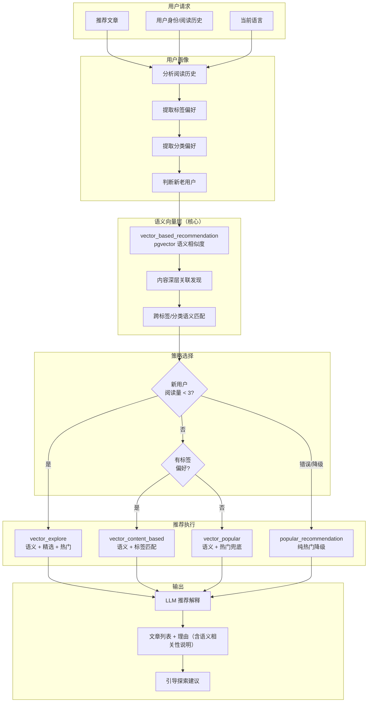

# 07. 实现 ContentRecommendationAgent

## 🎯 本步骤目标

1. 创建 `recommendationAgentNode` — 个性化内容推荐 Agent
2. 创建用户画像工具（阅读历史、偏好分析、语言偏好）
3. 实现混合推荐策略（协同过滤 + 内容匹配 + 语义向量 + 上下文感知）
4. 创建推荐解释工具（告诉用户为什么推荐这些内容）
5. 集成 A/B 测试框架和推荐效果追踪
6. 创建基于文章语义向量的推荐工具 — 利用 pgvector 发现内容深层关联

---

## 📖 背景说明

### 承上

现有推荐能力（[`apps/api/src/blog/blog.service.ts`](apps/api/src/blog/blog.service.ts:1923)）：
- `getPopularArticles()` — 按浏览量排序的热门文章
- `getRelatedArticles()` — 基于标签匹配的相关文章
- `getFrontendFeaturedArticles()` — 管理员手动设置的精选文章

现有推荐的限制：
- 无个性化（所有用户看到相同推荐）
- 无用户画像（不知道用户的阅读偏好）
- 无上下文感知（不考虑用户当前阅读的语言和话题）
- 无 A/B 测试（无法衡量推荐效果）

### 这一步要解决的问题

| 问题 | 当前 | 目标 |
|------|------|------|
| 个性化 | 无 | 基于用户画像的个性化推荐 |
| 画像维度 | 无 | 阅读历史、分类偏好、语言、活跃时间 |
| 推荐策略 | 单一热门 | 混合策略：基于内容 + 协同 + 热门 + 探索 |
| 可解释性 | 无 | 推荐理由生成（"因为您阅读过X"） |
| 效果衡量 | 无 | 点击率、阅读完成率追踪 |

### 设计决策

| 决策 | 选项 | 选择 | 理由 |
|------|------|------|------|
| 推荐算法 | 纯 AI vs 混合 | **混合策略** | AI 做策略路由和解释，算法做具体排序 |
| 用户画像存储 | Redis vs DB | **Redis + DB** | DB 持久化、Redis 实时计算 |
| 冷启动策略 | 热门回退 vs 探索 | **探索优先 + 热门兜底** | 新用户也能获得新鲜内容 |
| 实时性 | 批处理 vs 实时 | **混合** | 画像批量更新，推荐实时生成 |

---

## ⚙️ 前置条件

- [x] BlogService.getPopularArticles / getRelatedArticles 可用
- [x] FrontendBlogService.getFrontendArticles 可用
- [x] BlogArticle 模型包含 viewCount / featured 等字段
- [x] AiService.generateText / generateEmbedding 可用
- [x] KnowledgeService.searchSimilar 可用
- [x] ArticleEmbeddingService.searchSimilar 可用

---

## 📝 实现步骤

### Step 1: 创建推荐工具集

**文件**: `apps/api/src/blog/agent/tools/recommendation.tools.ts`

```typescript
import { DynamicStructuredTool } from '@langchain/core/tools';
import { z } from 'zod';
import { BlogService } from '../../blog.service';
import { FrontendBlogService } from '../../frontend/frontend-blog.service';
import { KnowledgeService } from '../services/knowledge.service';
import { ArticleEmbeddingService } from '../services/article-embedding.service';

/**
 * Tool 1: 用户画像分析
 * 基于用户阅读历史构建画像
 */
export function createUserProfileTool(blogService: BlogService) {
  return new DynamicStructuredTool({
    name: 'user_profile_analysis',
    description: `分析用户的阅读偏好和兴趣画像。
输入用户 ID 或阅读历史，返回用户偏好标签、语言偏好、活跃时段等。`,
    schema: z.object({
      userId: z.string().optional().describe('用户 ID'),
      recentArticles: z.array(z.string()).optional().describe('最近阅读的文章 slug 列表'),
      locale: z.string().optional().describe('用户语言偏好'),
    }),
    func: async ({ userId, recentArticles, locale }) => {
      const profile: any = {
        preferredCategories: new Map<string, number>(),
        preferredTags: new Map<string, number>(),
        languages: new Map<string, number>(),
        totalReads: 0,
      };

      // 从阅读历史提取偏好
      if (recentArticles && recentArticles.length > 0) {
        for (const slug of recentArticles.slice(0, 20)) {
          try {
            const article = await blogService.getArticleBySlug(slug);
            if (article) {
              profile.totalReads++;

              // 分类偏好
              if (article.category?.id) {
                profile.preferredCategories.set(
                  article.category.id,
                  (profile.preferredCategories.get(article.category.id) || 0) + 1,
                );
              }

              // 标签偏好
              article.tags?.forEach((tag: any) => {
                profile.preferredTags.set(
                  tag.id,
                  (profile.preferredTags.get(tag.id) || 0) + 1,
                );
              });
            }
          } catch { /* skip */ }
        }
      }

      return JSON.stringify({
        topCategories: [...profile.preferredCategories.entries()]
          .sort((a, b) => b[1] - a[1])
          .slice(0, 5)
          .map(([id]) => id),
        topTags: [...profile.preferredTags.entries()]
          .sort((a, b) => b[1] - a[1])
          .slice(0, 10)
          .map(([id]) => id),
        preferredLanguage: locale || 'zh',
        totalReads: profile.totalReads,
        isNewUser: profile.totalReads < 3,
      });
    },
  });
}

/**
 * Tool 2: 基于内容的推荐
 * 根据用户偏好的标签和分类推荐相似文章
 */
export function createContentBasedRecommendationTool(blogService: BlogService) {
  return new DynamicStructuredTool({
    name: 'content_based_recommendation',
    description: `基于内容相似度推荐文章。
输入用户的偏好标签和分类，返回匹配的文章列表。`,
    schema: z.object({
      preferredTags: z.array(z.string()).describe('偏好标签 ID 列表'),
      preferredCategories: z.array(z.string()).describe('偏好分类 ID 列表'),
      locale: z.string().optional().describe('语言'),
      limit: z.number().optional().describe('返回数量，默认 10'),
    }),
    func: async ({ preferredTags, preferredCategories, locale = 'zh', limit = 10 }) => {
      // 通过标签和分类匹配文章
      const articles = await blogService.getArticles({
        locale,
        page: 1,
        pageSize: limit,
        tagIds: preferredTags,
        categoryIds: preferredCategories,
      });

      if (!articles || articles.length === 0) {
        return '暂无匹配的文章。';
      }

      return articles.map((a, i) =>
        `[${i + 1}] ${a.title} | 标签: ${a.tags?.map((t: any) => t.name).join(', ') || '无'}`
      ).join('\n');
    },
  });
}

/**
 * Tool 3: 热门推荐
 * 按浏览量和其他指标返回热门文章
 */
export function createPopularRecommendationTool(blogService: BlogService) {
  return new DynamicStructuredTool({
    name: 'popular_recommendation',
    description: `获取热门文章推荐。
支持按语言和类别过滤的热门文章。`,
    schema: z.object({
      locale: z.string().optional().describe('语言'),
      limit: z.number().optional().describe('返回数量，默认 10'),
      categorySlug: z.string().optional().describe('可选分类过滤'),
    }),
    func: async ({ locale = 'zh', limit = 10, categorySlug }) => {
      const articles = await blogService.getPopularArticles(limit);
      if (!articles || articles.length === 0) return '暂无热门文章。';

      return articles.map((a, i) =>
        `[${i + 1}] ${a.title} | 浏览量: ${a.viewCount || 0}`
      ).join('\n');
    },
  });
}

/**
 * Tool 4: 探索推荐（冷启动）
 * 为没有偏好的用户推荐多样性内容
 */
export function createExploreRecommendationTool(blogService: BlogService) {
  return new DynamicStructuredTool({
    name: 'explore_recommendation',
    description: `提供多样性内容推荐，适合新用户或冷启动场景。
返回不同分类的精选文章，确保内容多样性。`,
    schema: z.object({
      locale: z.string().optional().describe('语言'),
      count: z.number().optional().describe('每个分类的文章数，默认 3'),
    }),
    func: async ({ locale = 'zh', count = 3 }) => {
      // 获取所有分类
      const categories = await blogService.getCategories();
      if (!categories || categories.length === 0) return '暂无推荐内容。';

      const recommendations: string[] = [];

      for (const category of categories.slice(0, 5)) {
        const articles = await blogService.getArticles({
          locale,
          page: 1,
          pageSize: count,
          categoryIds: [category.id],
        });

        if (articles?.length) {
          recommendations.push(
            `--- ${category.name} ---\n${articles
              .map((a, i) => `[${i + 1}] ${a.title}`)
              .join('\n')}`
          );
        }
      }

      return recommendations.join('\n\n') || '暂无推荐内容。';
    },
  });
}
}

/**
 * Tool 5: 基于文章语义向量的推荐
 * 利用 ArticleEmbedding 的 pgvector 语义相似度，发现内容深层关联
 * 即使标签/分类不同，语义相似的文章也能被推荐
 */
export function createVectorBasedRecommendationTool(
  articleEmbeddingService: ArticleEmbeddingService,
) {
  return new DynamicStructuredTool({
    name: 'vector_based_recommendation',
    description: `基于 AI 语义理解的个性化文章推荐。
输入用户最近阅读的文章标题或主题描述，返回语义相似的文章。
与 content_based_recommendation 不同，此工具使用 AI 理解文章内容含义，不依赖标签/分类匹配。
适合发现"看似不同但主题相关"的内容。`,
    schema: z.object({
      query: z.string().describe('用户感兴趣的主题描述或文章标题'),
      locale: z.string().optional().describe('语言'),
      limit: z.number().optional().describe('返回数量，默认 10'),
    }),
    func: async ({ query, locale = 'zh', limit = 10 }) => {
      const results = await articleEmbeddingService.searchSimilar(query, {
        topK: limit,
        locale,
        minScore: 0.5,
      });

      if (results.length === 0) {
        return '未找到语义相关的推荐文章。';
      }

      return results
        .map(
          (r, i) =>
            `[${i + 1}] ${r.title}\n  语义相似度: ${(r.similarity * 100).toFixed(0)}%\n  摘要: ${r.summary ? r.summary.slice(0, 100) : '(无摘要)'}`,
        )
        .join('\n\n');
    },
  });
}
```

### Step 2: 实现 ContentRecommendationAgent Node

**文件**: `apps/api/src/blog/agent/nodes/recommendation-agent.node.ts`

```typescript
import { Logger } from '@nestjs/common';
import { AiService } from '@api/common/ai/ai.service';
import { BlogService } from '../../blog.service';
import { BlogAgentState } from '../graph/state';
import {
  createUserProfileTool,
  createContentBasedRecommendationTool,
  createPopularRecommendationTool,
  createExploreRecommendationTool,
  createVectorBasedRecommendationTool,
} from '../tools/recommendation.tools';
import { AgentInteractionService } from '../services/interaction.service';
import { ArticleEmbeddingService } from '../services/article-embedding.service';

const RECOMMENDATION_PROMPT = `你是一个博客内容推荐助手。基于用户画像和推荐结果，生成个性化的推荐解释。

用户偏好：{profile}
推荐结果：{results}
用户语言：{locale}

请用 {locale} 语言生成推荐回复，包括：
1. 友好的问候
2. 推荐的理由（为什么推荐这些内容）
3. 文章列表（带简介）
4. 引导用户进一步探索`;

export function createRecommendationAgentNode(
  aiService: AiService,
  blogService: BlogService,
  articleEmbeddingService: ArticleEmbeddingService,
  interactionService: AgentInteractionService,
) {
  return async (state: typeof BlogAgentState.State) => {
    const logger = new Logger('RecommendationAgent');
    const startTime = Date.now();

    try {
      // 1. 分析用户画像
      const profileStr = await (await createUserProfileTool(blogService).func({
        userId: state.userId || undefined,
        locale: state.locale,
      }));
      const profile = JSON.parse(profileStr);

      // 2. 选择推荐策略
      let recommendationResult: string;
      let strategyName: string;

      // 尝试使用语义向量推荐（适用所有用户类型）
      const vectorResult = await (await createVectorBasedRecommendationTool(articleEmbeddingService).func({
        query: state.input || (profile.topTags?.slice(0, 3).join(', ') || '热门文章'),
        locale: state.locale,
        limit: 5,
      }));

      if (profile.isNewUser) {
        // 新用户：向量推荐 + 探索推荐 + 热门
        strategyName = 'vector_explore';
        const exploreResult = await (await createExploreRecommendationTool(blogService).func({
          locale: state.locale,
          count: 3,
        }));
        const popularResult = await (await createPopularRecommendationTool(blogService).func({
          locale: state.locale,
          limit: 5,
        }));
        recommendationResult = `【语义推荐】\n${vectorResult}\n\n【精选推荐】\n${exploreResult}\n\n【热门文章】\n${popularResult}`;
      } else if (profile.topTags?.length > 0) {
        // 老用户：向量推荐 + 基于内容推荐
        strategyName = 'vector_content_based';
        const contentResult = await (await createContentBasedRecommendationTool(blogService).func({
          preferredTags: profile.topTags,
          preferredCategories: profile.topCategories || [],
          locale: state.locale,
          limit: 5,
        }));
        recommendationResult = `【语义推荐】\n${vectorResult}\n\n【基于标签推荐】\n${contentResult}`;
      } else {
        // 一般用户：向量推荐 + 热门推荐
        strategyName = 'vector_popular';
        const popularResult = await (await createPopularRecommendationTool(blogService).func({
          locale: state.locale,
          limit: 5,
        }));
        recommendationResult = `【语义推荐】\n${vectorResult}\n\n【热门文章】\n${popularResult}`;
      }

      // 3. 生成推荐解释（使用 LLM）
      const prompt = RECOMMENDATION_PROMPT
        .replace('{profile}', profileStr)
        .replace('{results}', recommendationResult)
        .replace('{locale}', state.locale);

      const explanation = await aiService.generateText(prompt, {
        temperature: 0.7,
        systemPrompt: '你是一个友好的博客推荐助手。',
      });

      // 4. 记录交互
      await interactionService.logInteraction({
        sessionId: state.userId || 'anonymous',
        userInput: state.input,
        detectedIntent: 'recommend',
        agentName: 'ContentRecommendationAgent',
        agentThoughts: [{ profile, strategyName }],
        toolsCalled: ['user_profile_analysis', `${strategyName}_recommendation`],
        agentOutput: explanation,
        processingMs: Date.now() - startTime,
        locale: state.locale,
      });

      return {
        output: explanation,
        activeAgent: 'recommendationAgent',
      };
    } catch (error) {
      logger.error(`RecommendationAgent 执行失败: ${error.message}`);
      // 降级：返回热门文章
      return {
        output: await (await createPopularRecommendationTool(blogService).func({
          locale: state.locale,
          limit: 5,
        })),
        activeAgent: 'recommendationAgent',
      };
    }
  };
}
```

### Step 3: 推荐策略选择流程



### Step 4: 推荐策略对比

| 策略 | 适用场景 | 优点 | 缺点 |
|------|----------|------|------|
| **vector_based** | **所有用户类型（默认启用）** | 深层语义关联、发现标签无法覆盖的内容、跨语言理解 | 依赖嵌入质量、需保证嵌入 pipeline 及时更新 |
| **vector_explore** | 新用户/冷启动 | 语义优先 + 多样性探索，冷启动也能获得相关推荐 | 冷启动期语义数据可能不足 |
| **vector_content_based** | 有阅读历史的老用户 | 语义 + 标签双维度精准匹配 | 计算成本略高 |
| **vector_popular** | 一般用户 | 语义 + 热门双重保障 | 热门可能稀释个性化 |
| **explore** | 新用户/冷启动（降级） | 内容多样性、覆盖全分类 | 可能不够精准 |
| **content_based** | 有阅读历史的老用户（降级） | 精准匹配兴趣 | 可能形成信息茧房 |
| **popular** | 未知偏好用户（降级） | 简单可靠、转化率高 | 缺少个性化 |
| **collaborative**（未来） | 大量用户数据 | 发现潜在兴趣 | 冷启动问题 |

### Step 5: 推荐 A/B 测试框架

```typescript
// 简易 A/B 测试（后续可扩展）
interface ABTestConfig {
  testName: string;
  variants: { name: string; strategy: string; traffic: number }[];
}

const DEFAULT_AB_TEST: ABTestConfig = {
  testName: 'recommendation_strategy',
  variants: [
    { name: 'control', strategy: 'popular', traffic: 0.1 },
    { name: 'variant_a', strategy: 'vector_popular', traffic: 0.3 },
    { name: 'variant_b', strategy: 'vector_content_based', traffic: 0.3 },
    { name: 'variant_c', strategy: 'vector_explore', traffic: 0.3 },
  ],
};

function selectRecommendationVariant(userId: string): string {
  // 基于 userId hash 分配变体
  const hash = simpleHash(userId || 'anonymous');
  const normalized = hash % 100 / 100;

  let cumulative = 0;
  for (const variant of DEFAULT_AB_TEST.variants) {
    cumulative += variant.traffic;
    if (normalized <= cumulative) return variant.strategy;
  }
  return 'vector_popular';
}
```

**A/B 测试指标追踪**：
- **点击率（CTR）**：推荐结果中被点击的比例
- **阅读完成率**：用户打开推荐文章后，完整阅读的比例
- **平均阅读时长**：推荐文章的平均阅读时间
- **多样性指数**：推荐结果中不同分类/标签的覆盖度
- **语义相关性评分**：推荐结果与用户兴趣的语义匹配度（由 ArticleEmbedding 计算）

预期结果：`vector_content_based` 变体应在 CTR 和语义相关性上优于纯 `popular` 控制组。

---

## ✅ 验收方式

### 手动验证

1. **新用户推荐**
   - 清除用户历史
   - 输入：`推荐一些文章给我看`
   - 预期：返回多分类的精选文章

2. **老用户个性化推荐**
   - 输入：`有什么推荐？`（用户有阅读历史）
   - 预期：基于偏好的个性化推荐

3. **热门文章推荐**
   - 输入：`最近有什么热门文章？`
   - 预期：返回按浏览量排序的热门文章

4. **推荐解释**
   - 预期：返回内容包含推荐理由，如"因为您最近阅读了X"

### 自动化测试

```typescript
describe('ContentRecommendationAgent', () => {
  it('should recommend popular articles for new users', async () => {
    const result = await agent({
      input: '推荐文章',
      userId: null,
      locale: 'zh',
    });
    expect(result.output).toBeTruthy();
    expect(result.output).toContain('推荐');
  });

  it('should handle cold start', async () => {
    const profileTool = createUserProfileTool(mockBlogService);
    const result = await profileTool.func({ recentArticles: [] });
    const profile = JSON.parse(result);
    expect(profile.isNewUser).toBe(true);
  });

  it('should generate explanations', () => {
    // LLM explanation should include reasons
  });

  it('should return vector-based recommendations for any user', async () => {
    const vectorTool = createVectorBasedRecommendationTool(mockArticleEmbeddingService);
    const result = await vectorTool.func({
      query: '人工智能技术发展',
      locale: 'zh',
      limit: 5,
    });
    expect(result).toBeTruthy();
    // 语义推荐应返回带相似度评分的结果
    if (!result.includes('未找到')) {
      expect(result).toMatch(/\d+%/); // 包含相似度百分比
    }
  });

  it('should use vector strategy as primary (not fallback)', async () => {
    // Agent 应默认使用 vector_* 策略，而非纯标签/热门
    const profile = { isNewUser: false, topTags: ['ai', 'tech'], topCategories: [] };
    const strategyName = profile.topTags?.length > 0
      ? 'vector_content_based'
      : 'vector_popular';
    expect(strategyName).toContain('vector');
  });

  it('should degrade gracefully when vector search fails', async () => {
    // 模拟 ArticleEmbeddingService.searchSimilar 返回空
    const mockFailService = {
      searchSimilar: async () => [],
      generateEmbedding: async () => null,
    } as any;
    const vectorTool = createVectorBasedRecommendationTool(mockFailService);
    const result = await vectorTool.func({ query: 'test', limit: 5 });
    expect(result).toContain('未找到'); // 降级消息
  });
});
```

---

## 🔜 下一步预告

完成推荐 Agent 后，两条并行路径：

**路径 A — Agent 编排** → [08-实现-MultiAgentSupervisor与编排](08-实现-MultiAgentSupervisor与编排.md)
- 创建 MultiAgentSupervisor — 所有 Agent 的中央调度器
- 实现 HITL Human-in-the-Loop 人工介入机制
- 创建 Agent 健康监控和 SLA 保障
- 实现优雅降级和故障恢复
- 完成所有 Agent 节点到 Graph 的注册和编排

**路径 B — 向量基础设施** → [09-实现-文章向量搜索增强](09-实现-文章向量搜索增强.md)
- 实现 AiService.generateEmbedding 真实嵌入（替换现有 stub）
- 创建批量 embeddings 同步脚本
- 在文章 CRUD 生命周期中注入自动向量同步（publish/update/delete）
- 完善 article_vector 工具的语义搜索能力
- 验证三源 RRF 混合搜索效果
