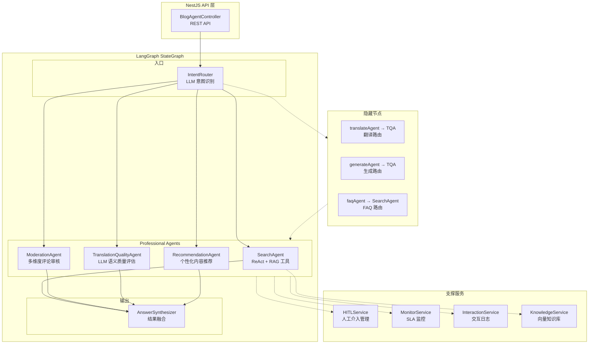

# 08. 实现 MultiAgentSupervisor 与编排

## 🎯 本步骤目标

1. 创建 MultiAgentSupervisor — 所有 Agent 的中央调度器
2. 实现 AnswerSynthesizer 节点 — 多 Agent 结果融合输出
3. 实现 HITL Human-in-the-Loop 人工介入机制
4. 创建 Agent 健康监控和 SLA 保障
5. 完成所有 Agent 节点到 Graph 的完整注册和编排
6. 创建 REST API 端点暴露 Agent 能力

---

## 📖 背景说明

### 承上

前面 7 个文档完成了：
| 文档 | 内容 |
|------|------|
| 00 | 现有系统架构分析 |
| 01 | BlogAgentModule + GraphState + 骨架 |
| 02 | KnowledgeDocument + AgentInteraction 数据模型 |
| 03 | IntentRouter 意图识别和条件路由 |
| 04 | SearchAgent + RAG 搜索工具 |
| 05 | CommentModerationAgent + 多维度审核 |
| 06 | TranslationQualityAgent + LLM 语义评估 |
| 07 | ContentRecommendationAgent + 个性化推荐 |

各 Agent 已独立实现，但缺乏统一的编排、监控和容错机制。

### 这一步要解决的问题

| 问题 | 说明 |
|------|------|
| 缺少 Central Supervisor | 各 Agent 独立路由，无统一调度 |
| 无答案合成 | 多 Agent 协作时，结果需要融合 |
| 无 HITL | 关键决策无人工确认机制 |
| 无监控 | 无 Agent 健康检查和 SLA |
| 无统一 API | 无 REST 端点暴露 Agent 能力 |

### 设计决策

| 决策 | 选项 | 选择 | 理由 |
|------|------|------|------|
| Supervisor 模式 | LangGraph Supervisor vs 自定义 | **LangGraph + 自定义混合** | LangGraph 做流程编排，自定义做监控/HITL |
| HITL 实现 | 异步回调 vs 同步等待 | **异步回调 + 轮询** | 不阻塞 Graph 执行，管理员通过 API 确认 |
| 结果合成 | LLM vs 规则 | **LLM 合成 + 规则兜底** | 灵活且可解释 |
| 监控存储 | 内存 vs Redis vs DB | **Redis + DB 双写** | Redis 实时监控，DB 历史分析 |

---

## ⚙️ 前置条件

- [x] 所有 Agent Node 已完成和测试
- [x] BlogAgentState 定义完善
- [x] AiService 可用
- [x] AgentInteractionService 可用（日志）
- [x] RedisService 可用（HITL 消息传递）

---

## 📝 实现步骤

### Step 1: 实现 AnswerSynthesizer Node

**文件**: `apps/api/src/blog/agent/nodes/answer-synthesizer.node.ts`

当多个 Agent 协作时，AnswerSynthesizer 负责将多 Agent 结果融合为统一的回答。

```typescript
import { Logger } from '@nestjs/common';
import { AiService } from '@api/common/ai/ai.service';
import { BlogAgentState } from '../graph/state';

const SYNTHESIS_PROMPT = `你是一个博客助手的结果合成器。基于以下信息生成最终回答。

用户原始输入: {input}
当前语言: {locale}

Agent 处理记录：
{agentTraces}

各 Agent 结果：
{agentOutputs}

请生成一个连贯、完整的最终回答。要求：
1. 使用 {locale} 语言
2. 融合各 Agent 的结果
3. 保持回答的结构化和可读性
4. 如果某个 Agent 失败，忽略其输出
5. 不要提到 "Agent" 或内部处理细节`;

export function createAnswerSynthesizerNode(aiService: AiService) {
  return async (state: typeof BlogAgentState.State) => {
    const logger = new Logger('AnswerSynthesizer');

    // 如果只有单个 Agent 执行且输出已经可用，直接返回
    if (state.visitedAgents.length <= 2 && state.output) {
      logger.log('单 Agent 结果，直接输出');
      return { output: state.output };
    }

    try {
      // 多 Agent 协作：需要合成
      const agentTraces = state.visitedAgents
        .filter((a) => a !== state.intent)
        .map((a) => `- ${a}`)
        .join('\n');

      // 从 messages 中提取各 Agent 的输出
      const agentOutputs = state.messages
        .filter((m: any) => m.type === 'ai')
        .map((m: any) => m.content)
        .join('\n\n');

      const prompt = SYNTHESIS_PROMPT
        .replace('{input}', state.input)
        .replace('{locale}', state.locale)
        .replace('{agentTraces}', agentTraces)
        .replace('{agentOutputs}', agentOutputs || state.output || '');

      const synthesized = await aiService.generateText(prompt, {
        temperature: 0.5,
        systemPrompt: '你是一个专业的博客助手。',
      });

      return { output: synthesized };
    } catch (error) {
      logger.error(`AnswerSynthesizer 失败: ${error.message}`);
      // 降级：返回原始输出
      return { output: state.output || '抱歉，无法生成回答。' };
    }
  };
}
```

### Step 2: 实现 HITL 人工介入机制

**文件**: `apps/api/src/blog/agent/services/hitl.service.ts`

HITL 机制允许 Agent 在关键决策点暂停并等待人工确认。

```typescript
import { Injectable, Logger } from '@nestjs/common';
import { RedisService } from '@api/common/redis/redis.service';

interface HITLRequest {
  id: string;
  sessionId: string;
  agentName: string;
  reason: string;
  context: any;
  proposedAction: string;
  options?: string[];
  status: 'pending' | 'approved' | 'rejected';
  createdAt: Date;
  resolvedAt?: Date;
  resolvedBy?: string;
  adminNote?: string;
}

@Injectable()
export class HITLService {
  private readonly logger = new Logger(HITLService.name);
  private readonly HITL_PREFIX = 'hitl:';
  private readonly HITL_TTL = 3600; // 1 hour

  constructor(private readonly redisService: RedisService) {}

  /**
   * 创建 HITL 请求
   */
  async createRequest(request: Omit<HITLRequest, 'id' | 'status' | 'createdAt'>): Promise<string> {
    const id = `hitl_${Date.now()}_${Math.random().toString(36).slice(2, 8)}`;
    const hitlRequest: HITLRequest = {
      ...request,
      id,
      status: 'pending',
      createdAt: new Date(),
    };

    await this.redisService.set(
      `${this.HITL_PREFIX}${id}`,
      JSON.stringify(hitlRequest),
      this.HITL_TTL,
    );

    // 推送到待处理列表
    await this.redisService.lPush(
      `${this.HITL_PREFIX}pending`,
      id,
    );

    this.logger.log(`HITL 请求创建: ${id} - ${request.reason}`);
    return id;
  }

  /**
   * 获取待处理 HITL 请求列表
   */
  async getPendingRequests(): Promise<HITLRequest[]> {
    const ids = await this.redisService.lRange(`${this.HITL_PREFIX}pending`, 0, -1);
    const requests: HITLRequest[] = [];

    for (const id of ids) {
      const data = await this.redisService.get(`${this.HITL_PREFIX}${id}`);
      if (data) {
        const req = JSON.parse(data);
        if (req.status === 'pending') {
          requests.push(req);
        }
      }
    }

    return requests;
  }

  /**
   * 审批 HITL 请求
   */
  async resolveRequest(
    id: string,
    decision: 'approved' | 'rejected',
    adminId: string,
    note?: string,
  ): Promise<void> {
    const data = await this.redisService.get(`${this.HITL_PREFIX}${id}`);
    if (!data) {
      throw new Error(`HITL 请求不存在: ${id}`);
    }

    const request = JSON.parse(data);
    request.status = decision;
    request.resolvedAt = new Date();
    request.resolvedBy = adminId;
    request.adminNote = note;

    await this.redisService.set(
      `${this.HITL_PREFIX}${id}`,
      JSON.stringify(request),
      this.HITL_TTL,
    );

    // 从待处理列表移除
    await this.redisService.lRem(`${this.HITL_PREFIX}pending`, 1, id);

    this.logger.log(`HITL 请求已${decision === 'approved' ? '批准' : '拒绝'}: ${id}`);
  }

  /**
   * 等待 HITL 请求结果（轮询方式）
   */
  async waitForResolution(
    hitlId: string,
    timeoutMs: number = 300000, // 5 分钟超时
    pollIntervalMs: number = 5000, // 5 秒轮询
  ): Promise<{ decision: 'approved' | 'rejected'; adminNote?: string }> {
    const startTime = Date.now();

    while (Date.now() - startTime < timeoutMs) {
      const data = await this.redisService.get(`${this.HITL_PREFIX}${hitlId}`);
      if (data) {
        const request = JSON.parse(data);
        if (request.status !== 'pending') {
          return {
            decision: request.status,
            adminNote: request.adminNote,
          };
        }
      }
      await new Promise((resolve) => setTimeout(resolve, pollIntervalMs));
    }

    // 超时：自动拒绝
    return { decision: 'rejected', adminNote: 'HITL 超时' };
  }
}
```

### Step 3: 实现 Agent 监控服务

**文件**: `apps/api/src/blog/agent/services/agent-monitor.service.ts`

```typescript
import { Injectable, Logger } from '@nestjs/common';
import { RedisService } from '@api/common/redis/redis.service';

interface AgentHealth {
  agentName: string;
  status: 'healthy' | 'degraded' | 'down';
  lastCheckIn: Date;
  totalCalls: number;
  successRate: number;
  avgResponseTime: number;
  lastError?: string;
}

interface SLARule {
  agentName: string;
  maxResponseTime: number; // ms
  minSuccessRate: number; // 0-1
  action: 'warn' | 'degrade' | 'fallback';
}

@Injectable()
export class AgentMonitorService {
  private readonly logger = new Logger(AgentMonitorService.name);
  private readonly metrics = new Map<string, {
    totalCalls: number;
    successCalls: number;
    totalTime: number;
    lastError?: string;
  }>();

  // SLA 规则配置
  private readonly slaRules: SLARule[] = [
    { agentName: 'searchAgent', maxResponseTime: 5000, minSuccessRate: 0.9, action: 'fallback' },
    { agentName: 'moderationAgent', maxResponseTime: 8000, minSuccessRate: 0.85, action: 'degrade' },
    { agentName: 'translationQualityAgent', maxResponseTime: 15000, minSuccessRate: 0.8, action: 'warn' },
    { agentName: 'recommendationAgent', maxResponseTime: 5000, minSuccessRate: 0.9, action: 'fallback' },
  ];

  /**
   * 记录 Agent 调用
   */
  recordCall(agentName: string, durationMs: number, success: boolean, error?: string) {
    const metric = this.metrics.get(agentName) || {
      totalCalls: 0,
      successCalls: 0,
      totalTime: 0,
    };

    metric.totalCalls++;
    if (success) metric.successCalls++;
    metric.totalTime += durationMs;
    if (error) metric.lastError = error;

    this.metrics.set(agentName, metric);

    // 检查 SLA
    this.checkSLA(agentName);
  }

  /**
   * 检查 SLA 规则
   */
  private checkSLA(agentName: string) {
    const metric = this.metrics.get(agentName);
    if (!metric || metric.totalCalls < 5) return; // 样本不足

    const rule = this.slaRules.find((r) => r.agentName === agentName);
    if (!rule) return;

    const avgResponseTime = metric.totalTime / metric.totalCalls;
    const successRate = metric.successCalls / metric.totalCalls;

    if (avgResponseTime > rule.maxResponseTime || successRate < rule.minSuccessRate) {
      this.logger.warn(
        `SLA 违规: ${agentName} | 平均响应 ${avgResponseTime}ms | 成功率 ${successRate}`,
      );

      switch (rule.action) {
        case 'warn':
          this.logger.warn(`SLA 警告: ${agentName} 性能下降`);
          break;
        case 'degrade':
          this.logger.warn(`SLA 降级: ${agentName} 使用简化模式`);
          break;
        case 'fallback':
          this.logger.warn(`SLA 回退: ${agentName} 将使用现有 Processor`);
          break;
      }
    }
  }

  /**
   * 获取 Agent 健康状态
   */
  getHealthStatus(): AgentHealth[] {
    return Array.from(this.metrics.entries()).map(([agentName, metric]) => {
      const avgResponseTime = metric.totalTime / metric.totalCalls;
      const successRate = metric.successCalls / metric.totalCalls;

      let status: AgentHealth['status'] = 'healthy';
      if (successRate < 0.7) status = 'down';
      else if (successRate < 0.85 || avgResponseTime > 10000) status = 'degraded';

      return {
        agentName,
        status,
        lastCheckIn: new Date(),
        totalCalls: metric.totalCalls,
        successRate,
        avgResponseTime,
        lastError: metric.lastError,
      };
    });
  }

  /**
   * 判断 Agent 是否可用
   */
  isAgentAvailable(agentName: string): boolean {
    const metric = this.metrics.get(agentName);
    if (!metric || metric.totalCalls < 3) return true; // 默认可用

    const successRate = metric.successCalls / metric.totalCalls;
    return successRate >= 0.7;
  }
}
```

### Step 4: 整合所有 Agent 到完整 Graph

**文件**: `apps/api/src/blog/agent/blog-agent.service.ts`

将所有 Agent 节点和路由整合到完整的 LangGraph 中：

```typescript
import { END } from '@langchain/langgraph';
import { Injectable, Logger, OnModuleInit } from '@nestjs/common';
import { StateGraph, CompiledStateGraph } from '@langchain/langgraph';
import { AiService } from '@api/common/ai/ai.service';
import { BlogService } from '../blog.service';
import { BlogAgentState } from './graph/state';
import { routeByIntent } from './graph/routes';
import { createIntentRouterNode } from './nodes/intent-router.node';
import { createSearchAgentNode } from './nodes/search-agent.node';
import { createModerationAgentNode } from './nodes/moderation-agent.node';
import { createTranslationQualityAgentNode } from './nodes/translation-quality-agent.node';
import { createRecommendationAgentNode } from './nodes/recommendation-agent.node';
import { createAnswerSynthesizerNode } from './nodes/answer-synthesizer.node';
import { KnowledgeService } from './services/knowledge.service';
import { AgentInteractionService } from './services/interaction.service';
import { HITLService } from './services/hitl.service';
import { AgentMonitorService } from './services/agent-monitor.service';
import { CommentService } from '../comment/comment.service';

@Injectable()
export class BlogAgentService implements OnModuleInit {
  private readonly logger = new Logger(BlogAgentService.name);
  private graph: CompiledStateGraph | null = null;

  // 节点函数
  private intentRouterNode: ReturnType<typeof createIntentRouterNode>;
  private searchAgentNode: ReturnType<typeof createSearchAgentNode>;
  private moderationAgentNode: ReturnType<typeof createModerationAgentNode>;
  private translationQualityNode: ReturnType<typeof createTranslationQualityAgentNode>;
  private recommendationNode: ReturnType<typeof createRecommendationAgentNode>;
  private answerSynthesizerNode: ReturnType<typeof createAnswerSynthesizerNode>;

  constructor(
    private readonly aiService: AiService,
    private readonly blogService: BlogService,
    private readonly commentService: CommentService,
    private readonly knowledgeService: KnowledgeService,
    private readonly interactionService: AgentInteractionService,
    private readonly hitlService: HITLService,
    private readonly monitorService: AgentMonitorService,
  ) {
    this.initializeNodes();
  }

  private initializeNodes() {
    this.intentRouterNode = createIntentRouterNode(this.aiService);
    this.searchAgentNode = createSearchAgentNode(
      this.aiService, this.blogService,
      this.knowledgeService, this.interactionService,
    );
    this.moderationAgentNode = createModerationAgentNode(
      this.aiService, this.commentService,
      this.blogService, this.interactionService,
    );
    this.translationQualityNode = createTranslationQualityAgentNode(
      this.aiService, this.blogService, this.interactionService,
    );
    this.recommendationNode = createRecommendationAgentNode(
      this.aiService, this.blogService, this.interactionService,
    );
    this.answerSynthesizerNode = createAnswerSynthesizerNode(this.aiService);
  }

  async onModuleInit() {
    await this.initializeGraph();
  }

  async initializeGraph(): Promise<void> {
    const workflow = new StateGraph(BlogAgentState);

    // 注册所有节点
    workflow.addNode('intentRouter', this.intentRouterNode);
    workflow.addNode('searchAgent', this.searchAgentNode);
    workflow.addNode('moderationAgent', this.moderationAgentNode);
    workflow.addNode('translationQualityAgent', this.translationQualityNode);
    workflow.addNode('recommendationAgent', this.recommendationNode);
    workflow.addNode('answerSynthesizer', this.answerSynthesizerNode);

    // 入口
    workflow.setEntryPoint('intentRouter');

    // IntentRouter 条件路由
    workflow.addConditionalEdges('intentRouter', routeByIntent, {
      searchAgent: 'searchAgent',
      translateAgent: 'translationQualityAgent', // 翻译路由到质量检测
      moderationAgent: 'moderationAgent',
      recommendationAgent: 'recommendationAgent',
      generateAgent: 'translationQualityAgent',  // 生成后需要质量检测
      faqAgent: 'searchAgent',                    // FAQ 本质是搜索
    });

    // Agent → AnswerSynthesizer → END
    workflow.addEdge('searchAgent', 'answerSynthesizer');
    workflow.addEdge('moderationAgent', 'answerSynthesizer');
    workflow.addEdge('translationQualityAgent', 'answerSynthesizer');
    workflow.addEdge('recommendationAgent', 'answerSynthesizer');
    workflow.addEdge('answerSynthesizer', END);

    this.graph = workflow.compile();
    this.logger.log('Blog Agent Graph compiled with all agents');
  }

  async process(input: {
    text: string;
    locale?: string;
    userId?: string;
    articleSlug?: string;
  }): Promise<{ output: string; needsHumanIntervention: boolean }> {
    const startTime = Date.now();
    const agentName = 'unknown';

    try {
      if (!this.graph) await this.initializeGraph();

      const initialState = {
        input: input.text,
        locale: input.locale || 'zh',
        userId: input.userId || null,
        currentArticleSlug: input.articleSlug || null,
        currentArticleId: null,
        messages: [],
        intent: '',
        intentConfidence: 0,
        activeAgent: null,
        visitedAgents: [],
        output: null,
        needsHumanIntervention: false,
        humanInterventionReason: null,
      };

      const finalState = await this.graph!.invoke(initialState);

      // 如果触发 HITL，创建 HITL 请求
      if (finalState.needsHumanIntervention) {
        await this.hitlService.createRequest({
          sessionId: input.userId || 'anonymous',
          agentName: finalState.activeAgent || 'unknown',
          reason: finalState.humanInterventionReason || '需要人工确认',
          context: { input: input.text, intent: finalState.intent },
          proposedAction: finalState.output || '',
          options: ['approve', 'reject', 'modify'],
        });
      }

      // 记录监控指标
      this.monitorService.recordCall(
        finalState.activeAgent || 'unknown',
        Date.now() - startTime,
        true,
      );

      // 记录交互日志
      await this.interactionService.logInteraction({
        sessionId: input.userId || 'anonymous',
        userInput: input.text,
        detectedIntent: finalState.intent,
        agentName: finalState.activeAgent || 'unknown',
        agentOutput: finalState.output || '',
        success: !finalState.needsHumanIntervention,
        processingMs: Date.now() - startTime,
        locale: input.locale || 'zh',
      });

      return {
        output: finalState.output || '',
        needsHumanIntervention: finalState.needsHumanIntervention,
      };
    } catch (error) {
      this.monitorService.recordCall(agentName, Date.now() - startTime, false, error.message);
      this.logger.error(`Agent 处理失败: ${error.message}`);
      return {
        output: '抱歉，处理您的请求时出现错误，请稍后重试。',
        needsHumanIntervention: true,
      };
    }
  }
}
```

### Step 5: 创建 REST API 端点

**文件**: `apps/api/src/blog/agent/agent.controller.ts`

暴露 Agent 能力给前端和管理员：

```typescript
import { Controller, Post, Get, Body, Param, Query, UseGuards } from '@nestjs/common';
import { ApiTags, ApiOperation } from '@nestjs/swagger';
import { AdminJwtAuthGuard } from '@api/common/guards/admin-jwt.guard';
import { BlogAgentService } from './blog-agent.service';
import { HITLService } from './services/hitl.service';
import { AgentMonitorService } from './services/agent-monitor.service';

@ApiTags('Blog AI Agent')
@Controller('blog-agent')
export class BlogAgentController {
  constructor(
    private readonly agentService: BlogAgentService,
    private readonly hitlService: HITLService,
    private readonly monitorService: AgentMonitorService,
  ) {}

  @Post('process')
  @ApiOperation({ summary: '处理自然语言请求' })
  async processRequest(@Body() body: {
    text: string;
    locale?: string;
    articleSlug?: string;
  }) {
    return this.agentService.process({
      text: body.text,
      locale: body.locale,
      articleSlug: body.articleSlug,
    });
  }

  @Get('healthy')
  @ApiOperation({ summary: 'Agent 健康检查' })
  getHealth() {
    return {
      status: 'ok',
      agents: this.monitorService.getHealthStatus(),
    };
  }

  @UseGuards(AdminJwtAuthGuard)
  @Get('hitl/pending')
  @ApiOperation({ summary: '获取待处理的人工审核请求' })
  async getPendingHITL() {
    return this.hitlService.getPendingRequests();
  }

  @UseGuards(AdminJwtAuthGuard)
  @Post('hitl/:id/resolve')
  @ApiOperation({ summary: '处理人工审核请求' })
  async resolveHITL(
    @Param('id') id: string,
    @Body() body: { decision: 'approved' | 'rejected'; adminId: string; note?: string },
  ) {
    await this.hitlService.resolveRequest(id, body.decision, body.adminId, body.note);
    return { success: true };
  }
}
```

### Step 6: 完整架构总览



### Step 7: 容错与降级策略

| 场景 | 检测方式 | 降级策略 |
|------|----------|----------|
| Agent LLM 超时 | Monitor SLA > maxResponseTime | 回退到现有 Processor/BullMQ |
| Agent 连续失败 | Monitor successRate < 70% | 标记 Agent 不可用，路由到 FAQ |
| HITL 超时 | waitForResolution 超时 | 自动拒绝，记录日志 |
| IntentRouter 置信度低 | Intent confidence < 0.4 | 路由到 FAQ Agent |
| 所有 Agent 不可用 | isAgentAvailable 全 false | 直接返回静态回复 |

---

## ✅ 验收方式

### 手动验证

1. **完整流程测试**
   - 输入：`帮我搜索关于 NestJS 的文章`
   - 预期：IntentRouter → SearchAgent → AnswerSynthesizer → 返回结果

2. **HITL 测试**
   - 输入高风险评论
   - 预期：Agent 标记 needsHumanIntervention，创建 HITL 请求
   - 管理员通过 API 审批 → Agent 继续执行

3. **健康检查**
   - GET `/blog-agent/healthy`
   - 预期：返回各 Agent 健康状态

4. **SLA 降级测试**
   - 模拟 Agent 连续失败
   - 预期：Monitor 标记 Agent 不可用，路由降级

### 自动化测试

```typescript
describe('MultiAgentSupervisor', () => {
  it('should process request end-to-end', async () => {
    const result = await service.process({ text: '推荐技术文章' });
    expect(result.output).toBeTruthy();
  });

  it('should trigger HITL for moderation', async () => {
    const result = await service.process({ text: '审核评论：攻击性内容', locale: 'zh' });
    expect(result.needsHumanIntervention).toBe(true);
  });

  it('should monitor agent health', async () => {
    service['monitorService'].recordCall('searchAgent', 100, true);
    const health = service['monitorService'].getHealthStatus();
    expect(health).toHaveLength(1);
    expect(health[0].status).toBe('healthy');
  });

  it('should degrade on SLA violation', async () => {
    // Simulate 10 failures
    for (let i = 0; i < 10; i++) {
      service['monitorService'].recordCall('searchAgent', 10000, false, 'timeout');
    }
    expect(service['monitorService'].isAgentAvailable('searchAgent')).toBe(false);
  });
});
```

---

## 🔜 后续展望

完成 8 个文档后，Blog AI Agent 架构已完整搭建。后续可继续扩展：

| 方向 | 说明 |
|------|------|
| **PostgreSQL Checkpointer** | 替换内存状态管理，支持会话持久化 |
| **LangSmith 集成** | 端到端 Agent 调试和追踪 |
| **多模态 Agent** | 图片理解/生成能力 |
| **Agent 市场** | 社区贡献的第三方 Agent 插件机制 |
| **Auto Agent** | 自动发现新的意图并创建 Agent |
| **Flutter 集成** | 移动端 Agent 交互界面 |
| **BlogWritingAgent** 🔜 | **独立的管理员写作助手**（不在 MultiAgentSupervisor 框架内）。通过 Admin API 直接调用，提供 ReAct 快速写作 + Workflow 结构化写作双模式，包含 9 个写作工具和 HITL 审核流程。详见 [10-实现-BlogWritingAgent双模式](10-实现-BlogWritingAgent双模式.md)、[11-实现-写作工具集工厂函数](11-实现-写作工具集工厂函数.md)、[12-实现-人机审核与发布SSE](12-实现-人机审核与发布SSE.md)。 |
