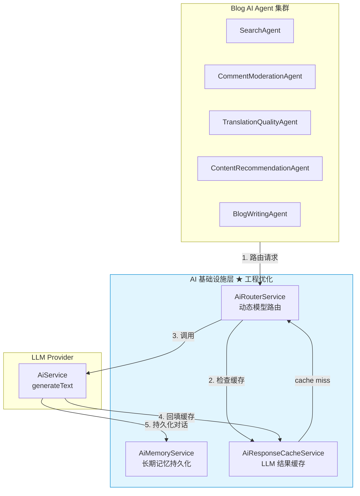
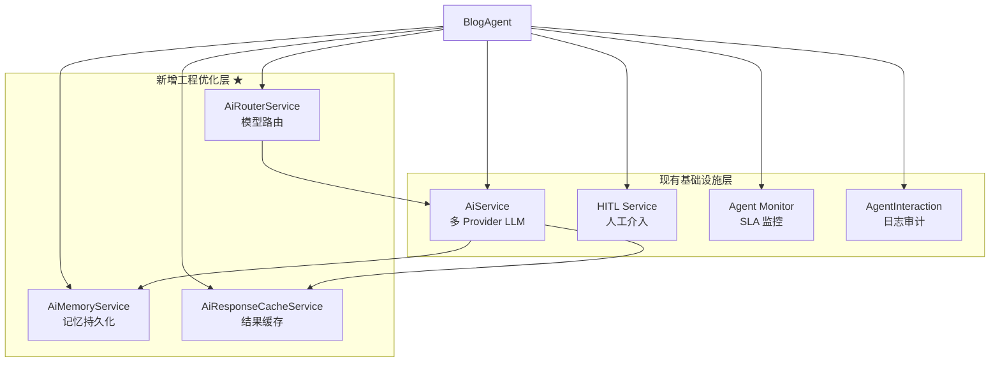

# 13. 实现 AI 基础设施工程优化

> **系列**: Blog AI Agent 功能开发
> **前置步骤**: [01-配置-BlogAgent基础设施](01-配置-BlogAgent基础设施.md)
> **关联 JoyMini 文档**: [Phase 8 工程优化](/docs/AI-joymini/README.md#phase-8-工程优化-engineering-optimization3-文档已完成)
> **对应代码**: `apps/api/src/common/ai/ai-memory.service.ts`, `apps/api/src/common/ai/ai-response-cache.service.ts`, `apps/api/src/common/ai/ai-router.service.ts`

---

## 🎯 本步骤目标

Blog AI Agent 目前处于设计阶段（文档已完成，代码 0% 实现）。在进入编码之前，需要将 JoyMini Phase 8 的三个工程优化能力**融入 Blog Agent 架构**，使得 Blog Agent 从第一天就具备生产级工程能力。

完成本步骤后：

1. **AiMemoryService** 集成到 Blog Agent — 跨会话持久化 Agent 对话历史
2. **AiResponseCacheService** 集成到 Blog Agent — 翻译/审核/搜索结果缓存
3. **AiRouterService** 集成到 Blog Agent — 按任务复杂度自动选择模型
4. Blog Agent 的基础设施层架构图更新

---

## 📖 背景说明

### Blog Agent 的工程优化需求

| 场景 | 问题 | 工程优化方案 |
|------|------|-------------|
| **翻译质量检查** | 相同文章多次触发翻译审查 | AiResponseCacheService 缓存翻译校验结果 (TTL 1h) |
| **评论审核** | 相同评论重复审核 | AiResponseCacheService 缓存审核结果 (TTL 30min) |
| **文章搜索** | 相同搜索词重复查询 | AiResponseCacheService 缓存搜索结果 (TTL 10min) |
| **内容推荐** | 相同用户重复请求推荐 | AiMemoryService 持久化用户偏好 + 结果缓存 |
| **写作 Agent 多轮编辑** | 写作过程中多次调用 LLM | AiRouterService 自动路由：简单润色走 Groq，复杂创作走 Gemini |
| **跨会话上下文** | 用户再次访问时需要记住之前的推荐偏好 | AiMemoryService 按 threadId 持久化 |

### 架构关系



---

## ⚙️ 前置条件

### 承上

[01-配置-BlogAgent基础设施](01-配置-BlogAgent基础设施.md) 搭建了 Blog Agent 的基础骨架：
- `BlogAgentModule` — NestJS 模块
- `GraphState` — 全局 Agent 状态
- LangGraph 编排框架
- 复用 `AiService` 作为 LLM 调用后端

Blog Agent 当前的基础设施层：



### 设计决策

| 决策 | 选项 | 选择 | 理由 |
|------|------|------|------|
| 记忆范围 | 会话级 vs 用户级 | **两者都支持** | AiMemoryService 的 `userId` 字段可选，匿名对话走 threadId，登录用户走 userId |
| 缓存粒度 | Agent 级 vs 全局 | **全局共享** | 所有 Agent 共用 AiResponseCacheService，避免重复缓存 |
| 路由策略 | Agent 自定义 vs 全局 | **Agent 可覆盖** | 默认走 AiRouterService auto 模式，Agent 可指定 `strict: true` 强制模型 |
| 注入方式 | 独立 Module vs AiService 集成 | **Module 注册 + AiService 可选** | AiMemoryService 和 AiResponseCacheService 作为独立 Module 注册，AiService 通过可选注入集成 |

---

## ⚙️ 实现步骤

### Step 1: 更新 BlogAgentModule 导入

在 [`blog-agent.module.ts`](/apps/api/src/blog/agent/blog-agent.module.ts) 中导入新增的 Module：

```typescript
import { Module } from '@nestjs/common'
import { AiMemoryModule } from '../../common/ai/ai-memory.module'
import { AiResponseCacheModule } from '../../common/ai/ai-response-cache.module'
import { AiRouterModule } from '../../common/ai/ai-router.module'
// ... existing imports

@Module({
  imports: [
    AiMemoryModule,
    AiResponseCacheModule,
    AiRouterModule,
    // ... existing imports
  ],
  providers: [
    // ... existing providers
  ],
  exports: [
    // ... existing exports
  ],
})
export class BlogAgentModule {}
```

### Step 2: 为 Blog Agent 配置缓存场景

Blog Agent 的 4 个面向用户的 Agent + 1 个管理员工具，各自有不同的缓存需求：

| Agent | 缓存场景 | Cache Key Pattern | TTL | 理由 |
|-------|---------|-------------------|-----|------|
| **SearchAgent** | RAG 搜索 | `rag:{question_hash}:{topK}` | 10min | 文档未变时相同问题直接返回 |
| **CommentModerationAgent** | 内容审核 | 不缓存 | — | 安全要求，每次实时审核 |
| **TranslationQualityAgent** | 翻译质量 | `translate:{text_hash}:{targetLang}` | 1h | 相同翻译结果不重复 |
| **ContentRecommendationAgent** | 推荐 | `recommend:{userId}:{category}` | 30min | 用户偏好变化较慢 |
| **BlogWritingAgent** | 写作 | 不缓存 | — | 每次需要新鲜创作 |

在 Blog Agent Service 中集成缓存：

```typescript
// blog-agent.service.ts

// 搜索 Agent — 启用缓存
async searchArticles(question: string, topK = 5) {
  return this.aiService.generateText(question, {
    useCache: true,
    cacheScenario: 'rag',
    cacheTTL: 600, // 10 分钟
  })
}

// 翻译质量 — 启用缓存
async checkTranslationQuality(text: string, targetLang: string) {
  return this.aiService.generateText(text, {
    useCache: true,
    cacheScenario: 'translation',
    cacheTTL: 3600, // 1 小时
  })
}

// 评论审核 — 不缓存
async moderateComment(comment: string) {
  return this.aiService.generateText(comment, {
    useCache: false, // 安全要求
  })
}
```

### Step 3: 为 Blog Agent 配置动态模型路由

Blog Agent 的 4 个面向用户的 Agent + 1 个管理员工具，不同的复杂度和模型需求：

| Agent | 典型 Prompt 长度 | 需要工具 | 需要多模态 | 推荐模型 | 路由等级 |
|-------|-----------------|---------|-----------|---------|---------|
| **SearchAgent** | 50-150 tokens | ✅ RAG 检索 | ❌ | DeepSeek | medium |
| **CommentModerationAgent** | 30-80 tokens | ❌ | ❌ | Groq | simple |
| **TranslationQualityAgent** | 100-500 tokens | ❌ | ❌ | Gemini | complex |
| **ContentRecommendationAgent** | 50-200 tokens | ✅ 向量搜索 | ❌ | DeepSeek | medium |
| **BlogWritingAgent** | 500-2000 tokens | ✅ 9 个工具 | ✅ 图片 | Gemini | complex |

在 Blog Agent Service 中使用 AiRouterService：

```typescript
// blog-agent.service.ts 构造器
constructor(
  private readonly aiRouterService: AiRouterService,
  // ... other deps
) {}

// 统一的 AI 调用入口
async generate(prompt: string, agentType: BlogAgentType) {
  const options = this.getAgentOptions(agentType)
  return this.aiRouterService.generateText(prompt, {
    ...options,
    useCache: options.cacheEnabled,
  })
}

// Agent 配置映射
private getAgentOptions(agentType: BlogAgentType): RouterGenerateTextOptions {
  const AGENT_CONFIG: Record<BlogAgentType, RouterGenerateTextOptions> = {
    [BlogAgentType.SEARCH]: {
      strict: false,  // auto 路由
      useCache: true,
      cacheScenario: 'rag',
    },
    [BlogAgentType.MODERATION]: {
      strict: true,   // 强制 Groq（快+便宜）
      provider: 'groq',
      model: 'llama-3.3-70b-versatile',
      useCache: false, // 安全要求
    },
    [BlogAgentType.TRANSLATION]: {
      strict: true,   // 强制 Gemini（翻译质量）
      provider: 'gemini',
      model: 'gemini-2.5-flash',
      useCache: true,
      cacheScenario: 'translation',
    },
    [BlogAgentType.RECOMMENDATION]: {
      strict: false,  // auto 路由
      useCache: true,
      cacheScenario: 'general',
    },
    [BlogAgentType.WRITING]: {
      strict: true,   // 强制 Gemini（长文本+工具）
      provider: 'gemini',
      model: 'gemini-2.5-flash',
      useCache: false,
    },
  }
  return AGENT_CONFIG[agentType]
}
```

### Step 4: 持久化 Blog Agent 对话历史

Blog Agent 目前的服务是无状态的——每次请求独立。通过 AiMemoryService 可以持久化：

1. **用户搜索历史** — 保存用户搜索过的文章
2. **推荐偏好** — 保存用户对不同类别文章的偏好
3. **写作 Agent 编辑历史** — 保存写作过程中的多轮编辑

```typescript
// blog-agent.service.ts

// 搜索后保存上下文
async searchAndSave(threadId: string, userId: string, question: string, answer: string) {
  // 1. 执行搜索
  const result = await this.searchArticles(question)
  
  // 2. 保存到记忆
  await this.aiMemoryService.saveContext(threadId, [
    new HumanMessage(question),
    new AIMessage(result),
  ])
  
  return result
}

// 加载用户偏好
async loadUserPreferences(userId: string) {
  const conversations = await this.aiMemoryService.listConversations(userId)
  // 分析历史对话提取偏好...
}
```

### Step 5: Agent 间共享缓存数据

由于 `AiResponseCacheService` 是全局共享的，不同 Agent 可以读取彼此的缓存结果：

```typescript
// 场景：TranslationQualityAgent 刚校验过的翻译
// SearchAgent 搜索相同内容时可以复用

// TranslationQualityAgent 写入缓存
await this.aiResponseCacheService.set(
  text, result,
  { model: 'gemini-2.5-flash', temperature: 0.3, scenario: 'translation' }
)

// SearchAgent 搜索相同文章时可以读取
const cached = await this.aiResponseCacheService.get(
  text,
  { model: 'gemini-2.5-flash', temperature: 0.3 }
)
// cache hit → 直接返回，无需重复调用 LLM
```

### Step 6: 更新基础设施层架构图

将原始架构图中的基础设施层扩展：

```
原始 Infra ↔ 更新后 Infra

AiService (多 Provider LLM)    →    AiService (多 Provider LLM)
HITL Service                           HITL Service
Agent Monitor                           Agent Monitor
AgentInteraction                         AgentInteraction
                                  +    AiMemoryService ★ NEW
                                  +    AiResponseCacheService ★ NEW
                                  +    AiRouterService ★ NEW
```

---

## 📁 新增/修改文件清单

| 文件 | 变更 | 说明 |
|------|------|------|
| `apps/api/src/blog/agent/blog-agent.module.ts` | 修改 | 导入 AiMemoryModule / AiResponseCacheModule / AiRouterModule |
| `apps/api/src/blog/agent/blog-agent.service.ts` | 修改 | 注入 3 个新 Service，统一 AI 调用入口 |
| `apps/api/src/common/ai/ai-memory.service.ts` | 引用 | JoyMini Phase 8 Doc 30 |
| `apps/api/src/common/ai/ai-response-cache.service.ts` | 引用 | JoyMini Phase 8 Doc 31 |
| `apps/api/src/common/ai/ai-router.service.ts` | 引用 | JoyMini Phase 8 Doc 32 |

## 📊 与现有 Blog Agent 架构的关系

```
输入层 (Controller/SSE)
  └─ BlogAgentService
       ├─ IntentRouter → 分类路由
       ├─ SearchAgent ────→ AiRouterService → AiResponseCache(10min) → AiService
       ├─ ModerationAgent ─→ AiRouterService(strict:groq) → AiService
       ├─ TranslationAgent ─→ AiRouterService(strict:gemini) → AiResponseCache(1h) → AiService
       ├─ RecommendAgent ──→ AiRouterService → AiResponseCache(30min) → AiService → AiMemoryService
       ├─ BlogWritingAgent ─→ AiRouterService(strict:gemini) → AiService → AiMemoryService
       └─ AnswerSynthesizer → 结果合成输出
```

## 🗣️ 面试话术

> **问：Blog AI Agent 的工程优化是怎么做的？**
>
> "Blog Agent 复用了 JoyMini 底层统一的基础设施层。翻译质量检查走 AiRouterService 强制 Gemini（翻译质量优先），结果缓存 1 小时 TTL；评论审核强制走 Groq（快+免费），不缓存（安全要求）；文章搜索 auto 路由，缓存 10 分钟。AiMemoryService 持久化用户的搜索历史和推荐偏好，支持跨会话上下文。所有 Agent 共用同一套缓存 + 路由层，避免重复建设。"

## ✅ 验证清单

- [ ] BlogAgentModule 成功导入 3 个工程优化 Module
- [ ] 翻译质量检查命中缓存（相同文本+相同模型）
- [ ] 评论审核不走缓存（配置 `useCache: false`）
- [ ] 搜索 Agent auto 路由到合适模型
- [ ] 写作 Agent 强制走 Gemini
- [ ] AiMemoryService 持久化搜索历史和推荐偏好
- [ ] 所有 Agent 共用同一套 AiResponseCacheService

---

## 🔜 相关参考

- [JoyMini Phase 8 Doc 30 - AiConversation 长期记忆持久化](/docs/AI-joymini/30-实现-AiConversation长期记忆持久化.md)
- [JoyMini Phase 8 Doc 31 - LLM 结果缓存](/docs/AI-joymini/31-实现-LLM结果缓存.md)
- [JoyMini Phase 8 Doc 32 - 动态模型选择路由](/docs/AI-joymini/32-实现-动态模型选择路由.md)
