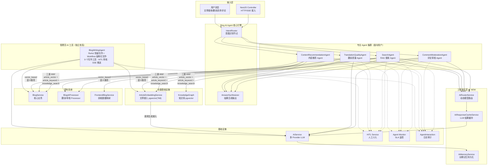

# JoyMini Blog AI Agent — Step-by-Step Spec-Code Guide

## 目录结构

| 文档 | 阶段 | 状态 |
|------|------|------|
| [00-博客系统架构分析](00-博客系统架构分析.md) | 架构分析 | ✅ 已完成 |
| [01-配置-BlogAgent基础设施](01-配置-BlogAgent基础设施.md) | 基础设施 | ✅ 已完成 |
| [02-创建-BlogAgent数据模型](02-创建-BlogAgent数据模型.md) | 数据模型 | ✅ 已完成 |
| [03-实现-BlogIntentRouter节点](03-实现-BlogIntentRouter节点.md) | 核心引擎 | ✅ 已完成 |
| [04-创建-BlogSearchAgent与RAG工具](04-创建-BlogSearchAgent与RAG工具.md) | 专业 Agent | ✅ 已完成 |
| [05-实现-CommentModerationAgent](05-实现-CommentModerationAgent.md) | 专业 Agent | ✅ 已完成 |
| [06-创建-TranslationQualityAgent](06-创建-TranslationQualityAgent.md) | 专业 Agent | ✅ 已完成 |
| [07-实现-ContentRecommendationAgent](07-实现-ContentRecommendationAgent.md) | 专业 Agent | ✅ 已完成 |
| [08-实现-MultiAgentSupervisor与编排](08-实现-MultiAgentSupervisor与编排.md) | 编排层 | ✅ 已完成 |
| [09-实现-文章向量搜索增强](09-实现-文章向量搜索增强.md) | 向量基础设施 | 📝 待实现 |
| [10-实现-BlogWritingAgent双模式](10-实现-BlogWritingAgent双模式.md) | 管理员 AI 工具 | 📝 待实现 |
| [11-实现-写作工具集工厂函数](11-实现-写作工具集工厂函数.md) | 管理员 AI 工具 | 📝 待实现 |
| [12-实现-人机审核与发布SSE](12-实现-人机审核与发布SSE.md) | 管理员 AI 工具 | 📝 待实现 |
| [13-实现-AI基础设施工程优化](13-实现-AI基础设施工程优化.md) | 基础设施工程优化 | ✅ 文档完成 |

---

## 架构总览



---

## 设计目标

| 目标 | 说明 |
|------|------|
| **渐进增强** | 不破坏现有 BlogAiProcessor 逻辑，Agent 层作为上层编排 |
| **可插拔** | 各 Agent 独立 Module，可按需启用/停用 |
| **Human-in-the-Loop** | 关键决策点支持人工介入，避免完全自动化风险 |
| **多语言优先** | 所有 Agent 原生支持 6 种语言 |
| **可观测性** | 完整交互日志 + 决策链路追踪 + SLA 监控 |
| **容错降级** | Agent 不可用时回退到现有 Queue 处理流程 |

## 技术栈

| 组件 | 技术选型 |
|------|----------|
| 编排框架 | LangGraph StateGraph + Conditional Edges |
| Agent 模式 | ReAct Agent + Tool 工厂函数 |
| 向量存储 | pgvector extension |
| 嵌入模型 | AiService.generateEmbedding / mxbai-embed-large |
| LLM 复用 | AiService 多 Provider 路由 |
| 任务队列 | BullMQ blog-ai queue |
| 知识库 | KnowledgeDocument 模型 + 语义搜索 |
| 日志审计 | AgentInteraction 模型 |
| 实时推送 | SSE / EventSource |
| 配置管理 | SystemConfigService |

## 文档结构图

```
apps/api/src/blog/agent/
├── blog-agent.module.ts          # 01 - NestJS Module
├── blog-agent.service.ts         # 01 + 08 - 主编排服务
├── agent.controller.ts           # 08 - REST API
│
├── graph/
│   ├── state.ts                  # 01 - GraphState 定义
│   └── routes.ts                 # 03 - 条件路由函数
│
├── nodes/
│   ├── intent-router.node.ts     # 03 - 意图识别节点
│   ├── search-agent.node.ts      # 04 - 搜索 Agent
│   ├── moderation-agent.node.ts  # 05 - 评论审核 Agent
│   ├── translation-quality-agent.node.ts  # 06 - 翻译质量 Agent
│   ├── recommendation-agent.node.ts       # 07 - 推荐 Agent
│   └── answer-synthesizer.node.ts         # 08 - 结果合成
│
├── tools/
│   ├── search.tools.ts           # 04 - 搜索工具集
│   ├── moderation.tools.ts       # 05 - 审核工具集
│   ├── translation-quality.tools.ts  # 06 - 质量工具集
│   └── recommendation.tools.ts   # 07 - 推荐工具集
│
└── services/
    ├── knowledge.service.ts      # 02 - 知识库服务
    ├── interaction.service.ts    # 02 - 交互日志
    ├── article-embedding.service.ts # 09 - 文章嵌入服务
    ├── hitl.service.ts           # 08 - HITL 服务
    └── agent-monitor.service.ts  # 08 - 监控服务
```

## 学习路径

建议按文档编号顺序阅读：

1. **架构分析** → [`00-博客系统架构分析`](00-博客系统架构分析.md) — 了解现有系统的完整蓝图
2. **基础设施** → [`01-配置-BlogAgent基础设施`](01-配置-BlogAgent基础设施.md) — 搭建 Agent Graph 骨架
3. **数据模型** → [`02-创建-BlogAgent数据模型`](02-创建-BlogAgent数据模型.md) — 知识库、日志模型和文章嵌入
4. **意图路由** → [`03-实现-BlogIntentRouter节点`](03-实现-BlogIntentRouter节点.md) — 智能意图识别与路由
5. **搜索 Agent** → [`04-创建-BlogSearchAgent与RAG工具`](04-创建-BlogSearchAgent与RAG工具.md) — 三源 RRF 语义搜索与 Q&A
6. **评论审核 Agent** → [`05-实现-CommentModerationAgent`](05-实现-CommentModerationAgent.md) — 增强评论审核管线
7. **翻译质量 Agent** → [`06-创建-TranslationQualityAgent`](06-创建-TranslationQualityAgent.md) — AI 驱动翻译质量保障
8. **推荐 Agent** → [`07-实现-ContentRecommendationAgent`](07-实现-ContentRecommendationAgent.md) — 基于语义向量的个性化内容推荐
9. **编排层** → [`08-实现-MultiAgentSupervisor与编排`](08-实现-MultiAgentSupervisor与编排.md) — 多 Agent 编排与 HITL
10. **向量基础设施** → [`09-实现-文章向量搜索增强`](09-实现-文章向量搜索增强.md) — 文章嵌入生成与同步 Pipeline
11. **写作 Agent 双模式** → [`10-实现-BlogWritingAgent双模式`](10-实现-BlogWritingAgent双模式.md) — ReAct 快速模式 + Workflow 结构化模式双设计
12. **写作工具集** → [`11-实现-写作工具集工厂函数`](11-实现-写作工具集工厂函数.md) — 9 个写作工具（研究参考/写作生成/收尾辅助）
13. **人机审核与 SSE** → [`12-实现-人机审核与发布SSE`](12-实现-人机审核与发布SSE.md) — HITL 审批流程 + SSE 实时写作推送
