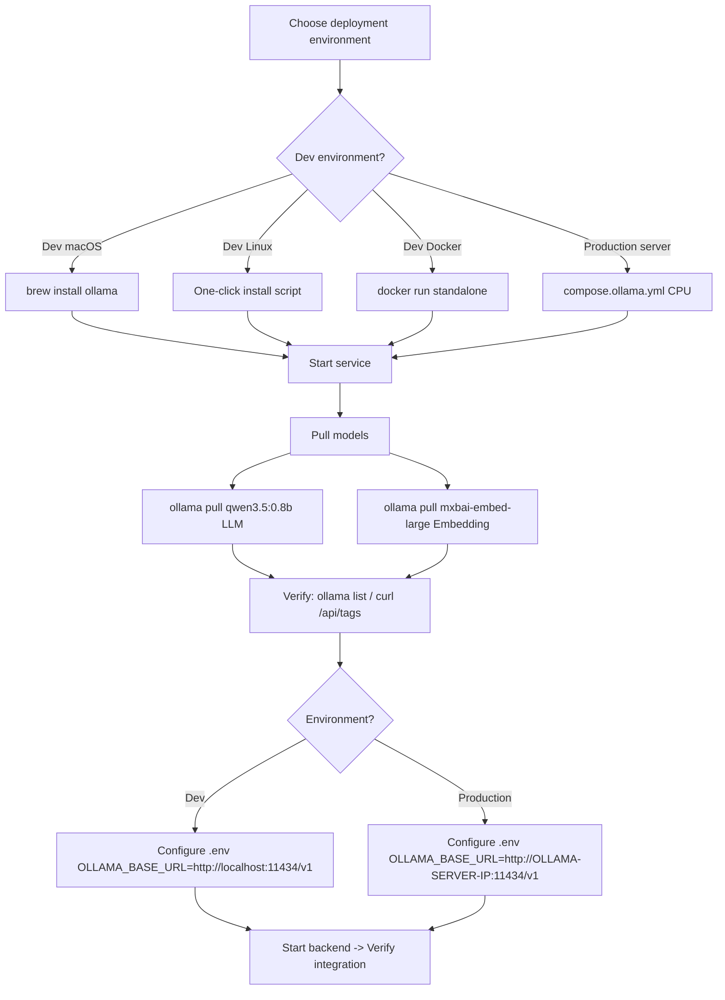

# Ollama Local Model Service — Installation & Configuration Guide

> **Document Type**: Shared Infrastructure Document  
> **Applies To**: JoyMini Nest Monorepo (all services requiring local LLM)  
> **Corresponding Module**: [`apps/api/src/common/ai/`](apps/api/src/common/ai/) — `AiService` Multi-Provider Architecture  
> **Reference Implementation**: [`study/LLM/project/langchain/langgraph-backend/`](study/LLM/project/langchain/langgraph-backend/) — Docker Compose deployment  
> **Last Updated**: 2026-06-24

---

## 1. Overview

### 1.1 What is Ollama

Ollama is a local large language model runner that supports running LLM models directly on local machines (macOS / Linux / Windows / Docker) without internet access, API keys, or costs.

### 1.2 Why JoyMini Needs Ollama

| Scenario | Description | Priority |
|----------|-------------|----------|
| **Local Development** | Develop AI customer service, Agent, RAG features entirely offline without external APIs | P0 |
| **Embedding Generation** | Generate vectors for RAG knowledge base (`mxbai-embed-large` / `nomic-embed-text`) replacing external Embedding APIs | P1 |
| **Fallback Provider** | When DeepSeek / GroQ / Gemini are unavailable, Ollama serves as a local fallback | P1 |
| **Offline Testing** | Run complete Agent flow tests in CI or air-gapped environments | P2 |

### 1.3 Position in AiService

```
                    ┌──────────────────────────────────────┐
                    │          AiService                    │
                    │  (Multi-Provider Abstraction Layer)   │
                    ├──────────────────────────────────────┤
                    │  Provider Priority Chain (auto-detect):│
                    │                                      │
                    │  1. DB config (system_config)        │ ← Highest priority
                    │  2. OLLAMA_BASE_URL exists → Ollama  │ ← Local dev / free
                    │  3. DEEPSEEK_API_KEY → DeepSeek      │ ← Primary production
                    │  4. GROQ_API_KEY → GroQ              │ ← Secondary
                    │  5. GOOGLE_GEMINI_API_KEY → Gemini    │ ← Last resort
                    │                                      │
                    │  Ollama requires no API Key           │
                    │  Only checks if baseUrl is reachable  │
                    └──────────────────────────────────────┘
```

### 1.4 Architecture Positioning: Shared Service vs Project Service

Ollama is an LLM inference server listening on `:11434`, serving via HTTP API. It differs from the database and Redis — **Ollama is optional infrastructure, not a hard project dependency**. AiService automatically falls back to cloud APIs when Ollama is unavailable.

#### Why NOT in `compose.yml`?

| Aspect | `compose.yml` services (db/redis) | Ollama |
|--------|-----------------------------------|--------|
| **Dependency Nature** | ❗ Required — project can't run without them | 🔵 Optional — AiService auto-fallback |
| **Service Scope** | This project only | 🌐 Can be shared across projects |
| **Memory Overhead** | Small (hundreds of MB) | 💰 Large (1.6GB ~ 32GB) |
| **Multiple Instances** | No problem | 🔴 Each instance doubles memory |

#### Three-Layer Architecture

```
                        ┌──────────────────────────────┐
                        │  ③ Cloud Layer                │
                        │  DeepSeek → GroQ → Gemini     │
                        │  Auto-fallback when unavailable│
                        └──────────┬───────────────────┘
                                   │ fallback
                        ┌──────────▼───────────────────┐
                        │  ② Project Layer              │
                        │  JoyMini Monorepo             │
                        │                              │
                        │  compose.yml:                 │
                        │    backend  db  redis  nginx  │
                        │                              │
                        │  .env:                        │
                        │    OLLAMA_BASE_URL=...        │
                        └──────────┬───────────────────┘
                                   │ HTTP :11434
                        ┌──────────▼───────────────────┐
                        │  ① Machine Layer              │
                        │                              │
                        │  brew services / systemd     │
                        │  or docker standalone         │
                        │  Ollama Server :11434         │
                        │  (shared across all projects) │
                        └──────────────────────────────┘
```

#### Environment Installation Overview

| Environment | Installation Method | Recommended Model | Notes |
|-------------|-------------------|-------------------|-------|
| **Dev macOS** | `brew install ollama` | qwen3.5:0.8b + mxbai-embed-large | ⭐ Recommended, fast startup, memory efficient |
| **Dev Linux** | One-click install script | Same | curl install |
| **Dev Docker** | Standalone `docker run` | Same | Version consistency, optional for teams |
| **Production (CPU)** | `compose.ollama.yml` | qwen3.5:0.8b + mxbai-embed-large | No GPU, choose small models |

---

## 2. Goals

### In Scope

- ✅ Install Ollama on local macOS / Linux
- ✅ Integrate with JoyMini dev environment via Docker Compose
- ✅ Pull required models (LLM + Embedding)
- ✅ Configure environment variables for `AiService` integration
- ✅ Verify Ollama works as an AiService Provider

### Out of Scope

- ❌ Ollama cluster / multi-node deployment (consider at production scale)
- ❌ Custom Ollama model fine-tuning (outside project scope)
- ❌ GPU acceleration tuning (default CUDA / Metal is sufficient)

---

## 3. Prerequisites

### 3.1 Hardware Requirements

| Model | Parameters | Min RAM | Recommended RAM | Disk Space | Notes |
|-------|-----------|---------|----------------|------------|-------|
| `qwen3.5:0.8b` | 0.8B | 4GB | 8GB | ~1GB | Dev preferred, runs smoothly on MacBook |
| `qwen2.5:7b` | 7B | 8GB | 16GB | ~4GB | Better quality but higher resource usage |
| `mxbai-embed-large` | 334M | 2GB | 4GB | ~0.7GB | Embedding only |
| `nomic-embed-text` | 137M | 2GB | 4GB | ~0.3GB | Lightweight Embedding |

> **Recommended combo (dev)**: `qwen3.5:0.8b` (LLM) + `mxbai-embed-large` (Embedding)

### 3.2 Software Requirements

| Platform | Installation Method | Prerequisites |
|----------|-------------------|---------------|
| macOS | `brew install ollama` or Docker | Homebrew or Docker Desktop |
| Linux | One-click install script or Docker | curl, Docker (optional) |
| Windows | Installer or WSL2 + Docker | WSL2 or Docker Desktop |
| Team Uniform | Docker Compose | Docker + Docker Compose |

---

## 4. Installation

### 4.1 Flow Overview



### 4.2 Method 1: macOS Local Install (Recommended for Dev)

```bash
# 1. Install Ollama
brew install ollama

# 2. Start Ollama service (auto-start on boot)
brew services start ollama

# 3. Verify service is running
curl http://localhost:11434/api/tags
# Expected: {"models":[]} or containing downloaded model list

# 4. Pull LLM model (dev recommended qwen3.5:0.8b)
ollama pull qwen3.5:0.8b

# 5. Pull Embedding model
ollama pull mxbai-embed-large

# 6. Verify model list
ollama list
# Expected:
# NAME                     ID              SIZE      MODIFIED
# qwen3.5:0.8b            abc123...       1.0 GB    xx minutes ago
# mxbai-embed-large:latest def456...       0.7 GB    xx minutes ago

# 7. Test inference
ollama run qwen3.5:0.8b "Hello, what is 1+1?"
# Expected: returns result (no internet needed)
```

### 4.3 Method 2: Linux Install

```bash
# 1. One-click install
curl -fsSL https://ollama.com/install.sh | sh

# 2. Start Ollama service
sudo systemctl start ollama
sudo systemctl enable ollama   # auto-start on boot

# 3. Subsequent steps same as macOS (pull models, verify, etc.)
```

### 4.4 Method 3: Standalone Docker (Dev Environment)

If you want to run Ollama via Docker without polluting the main `compose.yml`, start a standalone Ollama container shared by all projects.

#### 4.4.1 Create standalone `compose.ollama.yml`

Create [`compose.ollama.yml`](compose.yml) at the project root (not in the main `compose.yml` since Ollama is a shared service):

```yaml
# compose.ollama.yml — Standalone Ollama service (shared across projects)
# Start: docker compose -f compose.ollama.yml up -d
# Stop: docker compose -f compose.ollama.yml down

services:
  # Ollama local model service
  ollama:
    image: ollama/ollama:latest
    container_name: joymini-ollama
    ports:
      - '11434:11434'                          # Direct host access
    volumes:
      - ollama_data:/root/.ollama              # Persistent model files
    healthcheck:
      test: ['CMD', 'curl', '-f', 'http://localhost:11434/api/tags']
      interval: 10s
      timeout: 5s
      retries: 10
      start_period: 30s
    restart: unless-stopped

  # Model initialization (only pulls on first startup)
  ollama-init:
    image: ollama/ollama:latest
    container_name: joymini-ollama-init
    depends_on:
      ollama:
        condition: service_healthy
    entrypoint: >
      sh -c "
        echo '>>> Pulling LLM model: qwen3.5:0.8b ...' &&
        ollama pull qwen3.5:0.8b &&
        echo '>>> Pulling Embedding model: mxbai-embed-large ...' &&
        ollama pull mxbai-embed-large &&
        echo '>>> All models ready!'
      "
    restart: 'no'

volumes:
  ollama_data:
```

Refer to [`study/LLM/project/langchain/langgraph-backend/docker-compose.yml`](study/LLM/project/langchain/langgraph-backend/docker-compose.yml) for the complete pattern.

#### 4.4.2 Startup & Configuration

```bash
# 1. Start standalone Ollama container
docker compose -f compose.ollama.yml up -d

# 2. Confirm models are downloaded
docker exec joymini-ollama ollama list

# 3. Test API connectivity
curl http://localhost:11434/api/tags

# 4. Configure .env (backend inside Docker accesses host via host.docker.internal)
# OLLAMA_BASE_URL=http://host.docker.internal:11434/v1
```

#### 4.4.3 Makefile Shortcuts

Already added to [`Makefile`](Makefile:177):

```bash
make ollama-start        # brew services start ollama
make ollama-pull         # Pull recommended models
make ollama-health       # Verify connectivity
make ollama-test         # Inference test
```

---

### 4.5 Method 4: Production Deployment (CPU Compatible)

> **In production, Ollama is an optional component**, primarily used as a local fallback Provider. Primary inference should still use cloud APIs like DeepSeek / GroQ.
> Only enable when low latency, offline inference, or privacy compliance is required.
>
> ⚠️ **Current server is CPU-only**, no GPU acceleration. Configuration below is adapted for CPU.

> 💡 **Method A (Native Direct Install) is recommended**, see [7.5.2 Method A](docs/ollama-setup-guide.md#752-method-a-recommendednative-direct-install).
> The Docker deployment below (Method B) is an alternative for teams already using Docker for service management.

#### 4.5.1 Architecture

```
┌───────────────────┐     internal network      ┌──────────────────┐
│  API Server        │  ──────────────────────►  │  Ollama Server   │
│  (JoyMini Backend) │   OLLAMA_BASE_URL=        │  (Docker)        │
│  compose.prod.yml  │   http://OLLAMA-IP:11434  │  :11434          │
└───────────────────┘                            │  CPU only        │
                                                  └──────────────────┘
```

> Ollama can be deployed on the **same server** as the API server (localhost) or a **dedicated server**, no GPU required.

#### 4.5.2 Production `compose.ollama.yml`

```yaml
# compose.ollama.yml — Production Ollama (CPU compatible, no GPU needed)
# Start: docker compose -f compose.ollama.yml up -d

services:
  ollama:
    image: ollama/ollama:latest
    container_name: joymini-ollama-prod
    ports:
      - '127.0.0.1:11434:11434'        # Same-server deployment; change to '0.0.0.0:11434:11434' for dedicated server
    volumes:
      - ollama_data:/root/.ollama      # Persistent model files
    environment:
      - OLLAMA_KEEP_ALIVE=5m           # Unload model after 5 min idle
    restart: unless-stopped

volumes:
  ollama_data:
```

> **CPU Notes**:
> - No need to install NVIDIA Container Toolkit or CUDA drivers
> - Choose models under 1.5B params for reasonable inference speed
> - Inference speed approx 10-30 tokens/s (depends on CPU performance and model size)

#### 4.5.3 Security Configuration

Ollama listens on `0.0.0.0:11434` by default — production deployments must restrict access:

```bash
# 1. Firewall: restrict port 11434 (only allow API server)
sudo ufw allow from API_SERVER_IP to any port 11434
sudo ufw deny 11434

# 2. Or use iptables
iptables -A INPUT -p tcp --dport 11434 -s API_SERVER_IP -j ACCEPT
iptables -A INPUT -p tcp --dport 11434 -j DROP

# 3. Recommended: Nginx reverse proxy + Basic Auth
# Configure nginx on the API server to forward to the Ollama server
```

#### 4.5.4 Connection Configuration

API server (JoyMini Backend) `.env` configuration:

```bash
# .env.prod — Production environment
OLLAMA_BASE_URL=http://OLLAMA-SERVER-IP:11434/v1
OLLAMA_MODEL=qwen3.5:0.8b            # CPU-compatible model, ~1GB RAM
OLLAMA_EMBEDDING_MODEL=mxbai-embed-large
```

> `OLLAMA_BASE_URL` should use an internal IP or internal DNS to avoid public exposure. Same-server deployment uses `http://127.0.0.1:11434/v1`.

---

## 5. Model Management

### 5.0 Ollama Command Reference

Complete CLI command reference, categorized by function:

#### 🧠 Model Management

```bash
# ── Pull / Download ───────────────────────────────────────
ollama pull qwen3.5:0.8b         # Pull model (default: latest tag)
ollama pull qwen3.5:0.8b         # Skips if already pulled
ollama pull mxbai-embed-large    # Pull Embedding model

# ── List ───────────────────────────────────────────────────
ollama list                      # List all downloaded models (alias: ollama ls)
ollama ps                        # List models currently loaded in memory

# ── Run / Test ─────────────────────────────────────────────
ollama run qwen3.5:0.8b          # Interactive mode (conversation, Ctrl+D to exit)
ollama run qwen3.5:0.8b "Hello"  # Single inference (non-interactive)
ollama run qwen3.5:0.8b --verbose "1+1="  # Show inference details (tokens/s, timing)

# ── Delete ─────────────────────────────────────────────────
ollama rm qwen3.5:0.8b           # Delete specified model
ollama rm qwen3.5:0.8b mxbai-embed-large  # Delete multiple models

# ── Copy / Tag ────────────────────────────────────────────
ollama cp qwen3.5:0.8b my-custom-name  # Copy model and rename
ollama cp qwen3.5:0.8b my-app:v1       # Create a tagged copy

# ── Show Model Info ───────────────────────────────────────
ollama show qwen3.5:0.8b         # Show model details (architecture, params, template)
ollama show qwen3.5:0.8b --modelfile  # Show Modelfile content
ollama show qwen3.5:0.8b --license    # Show model license

# ── Create Custom Model ───────────────────────────────────
ollama create my-model -f ./Modelfile  # Create custom model from Modelfile
```

#### ⚙️ Service Management

```bash
# ── macOS (brew) ──────────────────────────────────────────
brew services start ollama       # Start Ollama (auto-start on boot)
brew services stop ollama        # Stop Ollama
brew services restart ollama     # Restart Ollama
brew services info ollama        # Check service status

# ── Linux (systemd) ───────────────────────────────────────
sudo systemctl start ollama      # Start
sudo systemctl stop ollama       # Stop
sudo systemctl restart ollama    # Restart
sudo systemctl status ollama     # Check status
sudo systemctl enable ollama     # Enable auto-start on boot
sudo systemctl disable ollama    # Disable auto-start on boot

# ── Foreground Run (view logs) ────────────────────────────
ollama serve                     # Start in foreground (keep terminal open for logs)

# ── Docker Management ────────────────────────────────────
docker compose up -d ollama      # Start Ollama container
docker compose stop ollama       # Stop Ollama container
docker compose restart ollama    # Restart Ollama container
docker compose logs -f ollama    # View Ollama container logs
docker exec joymini-ollama ollama list  # Run Ollama command inside container
```

#### 🌐 REST API Testing

Ollama provides **two API sets**:

| API Category | Base Path | Description | Used in JoyMini |
|-------------|-----------|-------------|-----------------|
| **Native API** | `http://localhost:11434/api/...` | Ollama native interface, for management/debugging | `checkOllamaReachable()` health check (`/api/tags`) |
| **OpenAI Compatible API** | `http://localhost:11434/v1/...` | Compatible with OpenAI format, can use OpenAI SDK directly | `generateText()` / `generateEmbedding()` |

> **Why does `OLLAMA_BASE_URL` use the `/v1` path?**
>
> [`AiService`](apps/api/src/common/ai/ai.service.ts:641) calls Ollama using the OpenAI SDK format (`POST /v1/chat/completions`, `POST /v1/embeddings`),
> so `OLLAMA_BASE_URL=http://localhost:11434/v1`, and the full path is constructed at request time.
> The health check uses the native API (`/api/tags`) instead — the code strips `/v1` first, then appends `/api/...`.

```bash
# ── Native API (admin/debug) ──────────────────────────────
curl http://localhost:11434/api/tags           # List available models
curl http://localhost:11434/api/version         # View Ollama version
curl http://localhost:11434/api/ps              # Check model loading status (equivalent to ollama ps)
curl http://localhost:11434/api/generate \
  -d '{"model": "qwen3.5:0.8b", "prompt": "Hi", "stream": false}'   # Native inference

# ── OpenAI Compatible API (actually used by the project) ──
curl http://localhost:11434/v1/chat/completions \
  -H "Content-Type: application/json" \
  -d '{
    "model": "qwen3.5:0.8b",
    "messages": [{"role": "user", "content": "Hello"}]
  }'                                      # Chat (corresponds to AiService.generateText())

curl http://localhost:11434/v1/embeddings \
  -H "Content-Type: application/json" \
  -d '{
    "model": "mxbai-embed-large",
    "input": "Hello world"
  }'                                      # Embedding (corresponds to AiService.generateEmbedding())

curl http://localhost:11434/v1/models      # List available models (OpenAI compatible)
```

> Full API documentation: [Ollama API Docs](https://github.com/ollama/ollama/blob/main/docs/api.md)

### 5.1 Recommended Models

| Model Name | Purpose | Size | Pull Command |
|-----------|---------|------|-------------|
| `qwen3.5:0.8b` | LLM inference (dev, fast) | ~1GB | `ollama pull qwen3.5:0.8b` |
| `qwen2.5:7b` | LLM inference (better quality) | ~4GB | `ollama pull qwen2.5:7b` |
| `mxbai-embed-large` | Text Embedding (RAG) | ~0.7GB | `ollama pull mxbai-embed-large` |
| `nomic-embed-text` | Text Embedding (lightweight) | ~0.3GB | `ollama pull nomic-embed-text` |

### 5.2 Common Management Commands

```bash
# View downloaded models
ollama list

# Pull model
ollama pull qwen3.5:0.8b

# Delete model
ollama rm qwen3.5:0.8b

# Test run
ollama run qwen3.5:0.8b "Hello, introduce yourself"

# View Ollama service status
ollama ps

# Stop Ollama service
brew services stop ollama        # macOS
sudo systemctl stop ollama       # Linux

# View service logs
journalctl -u ollama -f          # Linux
tail -f ~/.ollama/ollama.log     # macOS (default path)
```

### 5.3 Model Selection Strategy

> ⚠️ **Current production server is CPU-only**, no GPU acceleration. Recommendations below are adapted for CPU.

```
Development:
  LLM: qwen3.5:0.8b    ← Low resource usage, runs smoothly on MacBook 16GB
  Embedding: mxbai-embed-large

Production (optional — CPU architecture):
  LLM: qwen3.5:0.8b    ← CPU compatible, same as dev, ~1GB RAM
  (alternative) qwen2.5:1.5b  ← Slightly better but slower, ~1.5GB RAM
  Embedding: mxbai-embed-large
```

| Model | Parameters | RAM Usage | CPU Inference Speed | Use Case |
|-------|-----------|-----------|-------------------|----------|
| `qwen3.5:0.8b` | 0.8B | ~1GB | 20-30 tokens/s | Dev + production default |
| `qwen2.5:1.5b` | 1.5B | ~1.5GB | 10-20 tokens/s | Production alternative, better quality |
| `qwen2.5:7b` | 7B | ~5GB | ❌ Too slow on CPU | Needs GPU, not applicable for current environment |

> **Recommendation**: Use `qwen3.5:0.8b` in production (consistent with dev). Try `qwen2.5:1.5b` if better quality is needed. 7B models are extremely slow on CPU (< 5 tokens/s), not recommended.

---

## 6. Project Integration

### 6.1 Add Environment Variables

Add to [`apps/api/.env`](.env):

```bash
# ------------------------------------------
# 21. Ollama Local Model (dev / fallback)
# ------------------------------------------
# Ollama service URL (use localhost for macOS/Linux local install)
OLLAMA_BASE_URL=http://localhost:11434/v1
# Ollama model name
OLLAMA_MODEL=qwen3.5:0.8b
# Ollama Embedding model
OLLAMA_EMBEDDING_MODEL=mxbai-embed-large
```

> **Note**: Ollama does not require an API Key. `client.ollama.com` is an optional remote service.
> Use `localhost` for local install, or the container service name `http://ollama:11434/v1` for Docker environments.

### 6.2 AiService Provider Priority Chain

Reference [`apps/api/src/common/ai/ai.service.ts`](apps/api/src/common/ai/ai.service.ts:99)'s `getProviderConfig()` method — add an Ollama branch to the fallback chain:

```typescript
// ai.service.ts — logic to add in getProviderConfig():

private async getProviderConfig(): Promise<{provider: string; model: string; strict: boolean}> {
  // 1. DB config has highest priority (omitted)

  // 2. Ollama detection (new)
  const ollamaBaseUrl = this.configService.get<string>('OLLAMA_BASE_URL');
  if (ollamaBaseUrl) {
    // Check if Ollama service is reachable
    const isReachable = await this.checkOllamaReachable(ollamaBaseUrl);
    if (isReachable) {
      return {
        provider: 'ollama',
        model: this.configService.get<string>('OLLAMA_MODEL', 'qwen3.5:0.8b'),
        strict: false,
      };
    }
  }

  // 3. Subsequent existing logic (DeepSeek → GroQ → Gemini)
  // ...
}

// New health check method
private async checkOllamaReachable(baseUrl: string): Promise<boolean> {
  try {
    const url = baseUrl.replace('/v1', '') + '/api/tags';
    const res = await fetch(url, { signal: AbortSignal.timeout(3000) });
    return res.ok;
  } catch {
    return false;
  }
}
```

### 6.3 Add npm Dependency

```bash
# Run in apps/api directory
yarn workspace @lucky/api add @langchain/ollama
```

All services in [`study/LLM/project/langchain/langgraph-backend/`](study/LLM/project/langchain/langgraph-backend/) use `ChatOllama`:

```typescript
import { ChatOllama } from '@langchain/ollama';

const llm = new ChatOllama({
  model: 'qwen3.5:0.8b',
  baseUrl: 'http://localhost:11434',
  temperature: 0,
});
```

### 6.4 Embedding Integration

Reference [`study/LLM/ai-agent-framework/03-rag-implementation.md`](study/LLM/ai-agent-framework/03-rag-implementation.md) for Ollama Embeddings usage:

```typescript
import { OllamaEmbeddings } from '@langchain/ollama';

// Or via @langchain/community:
// import { OllamaEmbeddings } from '@langchain/community/embeddings/ollama';

const embeddings = new OllamaEmbeddings({
  model: 'mxbai-embed-large',
  baseUrl: 'http://localhost:11434',
});

// Generate vector
const vector = await embeddings.embedQuery('user query text');
// vector: number[] — 768 or 1024 dimensional vector
```

### 6.5 AiService Integration

```typescript
// Add the actual generateEmbedding implementation in ai.service.ts
// Current generateEmbedding returns null — needs to be completed

async generateEmbedding(text: string): Promise<number[] | null> {
  const ollamaBaseUrl = this.configService.get<string>('OLLAMA_BASE_URL');
  if (!ollamaBaseUrl) return null;

  try {
    const response = await fetch(
      `${ollamaBaseUrl.replace('/v1', '')}/api/embeddings`,
      {
        method: 'POST',
        headers: { 'Content-Type': 'application/json' },
        body: JSON.stringify({
          model: this.configService.get<string>('OLLAMA_EMBEDDING_MODEL', 'mxbai-embed-large'),
          prompt: text,
        }),
      },
    );

    if (!response.ok) return null;

    const data = await response.json();
    return data.embedding;  // number[]
  } catch {
    return null;
  }
}
```

---

## 7. Operations Guide

### 7.1 Health Check

```bash
# 1. Check if Ollama service is running
curl http://localhost:11434/api/tags

# 2. Check if specific model exists
curl http://localhost:11434/api/tags | grep -i "qwen3.5"

# 3. Test inference
curl http://localhost:11434/api/generate -d '{
  "model": "qwen3.5:0.8b",
  "prompt": "Hello, respond with just the word OK",
  "stream": false
}'
```

### 7.2 Resource Monitoring

```bash
# View Ollama process resource usage
ps aux | grep ollama

# macOS GPU usage (Metal, only on dev machines with GPU)
sudo powermetrics --samplers gpu_power -i 1000 -n 5

# Linux GPU usage (NVIDIA, only on dev machines with GPU)
nvidia-smi
```

### 7.3 Common Troubleshooting

| Issue | Possible Cause | Solution |
|-------|---------------|----------|
| `curl: (7) Failed to connect` | Ollama not started | `brew services start ollama` |
| `model "qwen3.5:0.8b" not found` | Model not downloaded | `ollama pull qwen3.5:0.8b` |
| `Error: model too large for system` | Out of memory | Switch to smaller model `qwen3.5:0.8b` |
| Very slow inference | Model too large for CPU | Switch to `qwen3.5:0.8b` (CPU recommended) |
| Can't connect inside Docker | Wrong service name/port | Use `http://ollama:11434` inside container |
| `ollama-init` failed | Network issue | Manual `ollama pull` |

### 7.4 Log Viewing

```bash
# Direct startup (foreground logs)
ollama serve

# macOS background logs
tail -f ~/.ollama/ollama.log
# or
brew services logs ollama -f

# Linux
journalctl -u ollama -f -n 100

# Docker
docker logs -f joymini-ollama
```

### 7.5 Production Deployment Guide

> In production, Ollama is an optional component, primarily used as a local fallback Provider.
> Primary inference should still use cloud APIs like DeepSeek / GroQ.

> ⚠️ **CPU Architecture**: Current production server has no GPU. Do NOT install NVIDIA or CUDA components. Ollama runs well on CPU — just choose small models.

**Method A (Native Direct Install) is recommended** — Ollama is a single-process service with no complex dependencies. Direct install is the lightest.
Method B (Docker) is an alternative for teams already using Docker for service management.

#### 7.5.1 Prerequisites

| Item | Requirement |
|------|-------------|
| Server | Any Linux / macOS server, 4GB+ RAM recommended |
| CPU | x86_64 or ARM64, 2+ cores |
| Network | API server must reach port 11434 on the Ollama server (localhost works for same-server) |
| Disk | SSD, 10GB+ reserved for model files (qwen3.5:0.8b ~1GB, mxbai-embed-large ~300MB) |

#### 7.5.2 Method A (Recommended): Native Direct Install

Ollama provides an official one-click install script. systemd manages the service lifecycle automatically.

```bash
# 1. Install Ollama (auto-configures systemd service)
curl -fsSL https://ollama.com/install.sh | sh

# 2. Confirm service is running
systemctl status ollama

# 3. Pull models
ollama pull qwen3.5:0.8b
ollama pull mxbai-embed-large

# 4. Verify API
curl http://127.0.0.1:11434/api/tags
# Expected: returns model list containing qwen3.5:0.8b and mxbai-embed-large
```

Common management commands:

```bash
# View logs
journalctl -u ollama -f -n 100

# Restart
systemctl restart ollama

# Stop
systemctl stop ollama

# Enable auto-start on boot (enabled by default)
systemctl enable ollama

# Check model loading status
ollama ps
```

> **CPU Inference Speed Reference**: `qwen3.5:0.8b` runs at ~20-30 tokens/s on a 4-core CPU, sufficient for customer service conversation latency requirements.

#### 7.5.3 Method B (Alternative): Docker Install

If the server already uses Docker for service management, Ollama can also run via Docker.

```bash
# 1. Upload compose.ollama.yml to server (see section 4.5.2)

# 2. Start container
docker compose -f compose.ollama.yml up -d

# 3. Pull production models
docker exec joymini-ollama-prod ollama pull qwen3.5:0.8b
docker exec joymini-ollama-prod ollama pull mxbai-embed-large

# 4. Verify API
curl http://127.0.0.1:11434/api/tags
# Expected: returns model list containing qwen3.5:0.8b and mxbai-embed-large
```

#### 7.5.4 Security Hardening Checklist

```bash
# 1. Firewall — only allow API server access
sudo ufw default deny incoming
sudo ufw allow from API_SERVER_IP to any port 11434
sudo ufw deny 11434
sudo ufw enable

# 2. Verify port listening (should only show 127.0.0.1:11434 or internal IP)
ss -tlnp | grep 11434

# 3. Periodic update of Ollama
# Method A (Native): re-run the install script to upgrade
curl -fsSL https://ollama.com/install.sh | sh

# Method B (Docker):
# docker pull ollama/ollama:latest
# docker compose -f compose.ollama.yml up -d
```

#### 7.5.5 Monitoring & Alerting

```bash
# Manual check
curl -s http://127.0.0.1:11434/api/tags | jq '.models | length'
# Returns model count — 0 indicates anomaly

# Integrate with Prometheus (via blackbox_exporter)
# prometheus.yml config:
# - job_name: ollama
#   static_configs:
#     - targets: ['OLLAMA-SERVER-IP:11434']

# Key alert metrics
```

| Alert | Threshold | Severity |
|-------|-----------|----------|
| Ollama service down | 3 retry failures | 🔴 Critical |
| CPU usage persistently high | > 90% for 10 minutes | 🟡 Warning |
| Disk space low | < 10GB | 🟡 Warning |
| Inference latency > 5s | Persists for 5 minutes | 🟡 Warning |

#### 7.5.6 Backup & Restore

> Regardless of installation method, model files are stored at `/usr/share/ollama/.ollama/models/` (Native) or `/root/.ollama/models/` (Docker volume).

**Method A (Native):**
```bash
# Backup
sudo tar czf /backup/ollama-models-$(date +%Y%m%d).tar.gz \
  -C /usr/share/ollama/.ollama/models .

# Restore
sudo tar xzf /backup/ollama-models-20260601.tar.gz \
  -C /usr/share/ollama/.ollama/models
sudo systemctl restart ollama
```

**Method B (Docker):**
```bash
# Backup (ollama_data volume content)
docker run --rm -v ollama_data:/data -v /backup:/backup \
  alpine tar czf /backup/ollama-models-$(date +%Y%m%d).tar.gz -C /data .

# Restore
docker run --rm -v ollama_data:/data -v /backup:/backup \
  alpine tar xzf /backup/ollama-models-20260601.tar.gz -C /data
```

#### 7.5.7 Disaster Recovery

**Method A (Native):**
```bash
# 1. Ollama service crashed
sudo systemctl restart ollama

# 2. Model corrupted (re-pull)
ollama rm qwen3.5:0.8b
ollama pull qwen3.5:0.8b

# 3. Check logs for cause
journalctl -u ollama -f -n 100
```

**Method B (Docker):**
```bash
# 1. Ollama container crashed
docker compose -f compose.ollama.yml restart ollama

# 2. Model corrupted (re-pull)
docker exec joymini-ollama-prod ollama rm qwen3.5:0.8b
docker exec joymini-ollama-prod ollama pull qwen3.5:0.8b

# 3. Full rebuild
docker compose -f compose.ollama.yml down -v   # Delete volume (model files)
docker compose -f compose.ollama.yml up -d     # Re-pull everything
```

#### 7.5.8 Integration with Existing Deployment

JoyMini's deployment system is in the [`deploy/`](deploy/) directory. Production Ollama is independent of the main project deployment:

1. Ollama server is maintained independently (can be on the same machine), not part of `deploy/deploy.sh`
2. The API server's `.env.prod` only needs `OLLAMA_BASE_URL` pointing to the Ollama server
3. AiService auto-detects whether Ollama is reachable and falls back to cloud APIs when unavailable (zero impact)

```bash
# API server .env.prod configuration
OLLAMA_BASE_URL=http://OLLAMA-SERVER-IP:11434/v1
OLLAMA_MODEL=qwen3.5:0.8b
# Note: do NOT add Ollama to compose.yml's depends_on — it's an optional dependency
```

---

## 8. Acceptance Criteria

### AC-01: Ollama Service Installation

| Condition | Step | Expected Result |
|-----------|------|----------------|
| macOS | `brew list ollama` | Shows installed |
| Linux | `ollama --version` | Shows version number |
| Docker | `docker ps \| grep ollama` | Container running |

### AC-02: Model Pulled

| Condition | Step | Expected Result |
|-----------|------|----------------|
| LLM model | `ollama list \| grep qwen3.5` | Model exists |
| Embedding | `ollama list \| grep mxbai-embed` | Model exists |
| Inference test | `ollama run qwen3.5:0.8b "1+1="` | Returns `2` |

### AC-03: API Availability

```bash
# 1. REST API health check
curl http://localhost:11434/api/tags
# Expected: {"models": [...]} containing downloaded models

# 2. Embedding API
curl http://localhost:11434/api/embeddings \
  -d '{"model": "mxbai-embed-large", "prompt": "Hello"}'
# Expected: {"embedding": [...]} containing float array
```

### AC-04: Project Integration

| Condition | Step | Expected Result |
|-----------|------|----------------|
| `.env` configured | `grep OLLAMA .env` | Outputs OLLAMA_BASE_URL, OLLAMA_MODEL |
| Provider detection | `curl /api/ai/providers` | ollama in available list |
| Embedding generation | Call `generateEmbedding()` | Returns non-null vector array |

### AC-05: Docker Compose Integration

```bash
# 1. Start all services
docker compose up -d

# 2. Confirm ollama container is running
docker ps --filter "name=joymini-ollama"
# Expected: STATUS healthy

# 3. Confirm models are loaded
docker exec joymini-ollama ollama list
# Expected: qwen3.5:0.8b and mxbai-embed-large both present

# 4. Test connectivity from backend container
docker exec lucky-backend-dev curl -s http://ollama:11434/api/tags
# Expected: returns model list
```

### AC-06: Fallback Chain Verification

```bash
# 1. Only configure OLLAMA_BASE_URL, leave other API Keys blank
# 2. Start backend
# 3. Call AI endpoint
# Expected: auto-uses Ollama as Provider, responses work normally
```

---

## 9. Appendix

### 9.1 Interview Points

If asked about Ollama in an interview, key points:

| Question | Key Points |
|----------|------------|
| **What is Ollama?** | Local LLM runner supporting macOS/Linux/Windows/Docker, zero cost |
| **Why use Ollama?** | Zero cost in dev, offline capability, privacy/security, fallback for cloud APIs |
| **How is Ollama compatible with OpenAI API?** | Ollama provides `/v1/chat/completions` compatible endpoint; `ChatOllama` switches via `baseUrl` |
| **How to embed Ollama in a project?** | As an AiService Provider, controlled via environment variable |
| **Ollama limitations?** | Small models have limited quality (0.8B vs cloud 70B+), large models need GPU, maintenance cost |
| **Multi-Provider fallback strategy?** | Ollama(local) → DeepSeek → GroQ → Gemini, transparent to frontend |

### 9.2 Reference Documentation

- [Ollama Official Docs](https://github.com/ollama/ollama)
- [Ollama API Docs](https://github.com/ollama/ollama/blob/main/docs/api.md)
- [Ollama Model Library](https://ollama.com/library)
- [`@langchain/ollama` ChatOllama Docs](https://js.langchain.com/docs/integrations/chat/ollama/)
- [`@langchain/ollama` OllamaEmbeddings Docs](https://js.langchain.com/docs/integrations/text_embedding/ollama/)

### 9.3 Project Reference Files

| File | Description |
|------|-------------|
| [`apps/api/src/common/ai/ai.service.ts`](apps/api/src/common/ai/ai.service.ts:99) | AiService main file — needs Ollama Provider added |
| [`apps/api/src/common/ai/interfaces/ai-provider.interface.ts`](apps/api/src/common/ai/interfaces/ai-provider.interface.ts) | Provider interface definition |
| [`apps/api/src/common/ai/providers/gemini.provider.ts`](apps/api/src/common/ai/providers/gemini.provider.ts) | Reference Provider implementation |
| [`study/LLM/project/langchain/langgraph-backend/docker-compose.yml`](study/LLM/project/langchain/langgraph-backend/docker-compose.yml) | Docker Compose reference |
| [`study/LLM/ai-agent-framework/03-rag-implementation.md`](study/LLM/ai-agent-framework/03-rag-implementation.md) | Ollama Embeddings reference |
| [`study/LLM/chatbot-context/12-multi-model-degradation.md`](study/LLM/chatbot-context/12-multi-model-degradation.md) | Multi-Provider fallback chain design |

### 9.4 Change Log

| Date | Version | Changes | Author |
|------|---------|---------|--------|
| 2026-06-24 | v1.0 | Initial creation — covers installation, configuration, integration, and operations | — |
