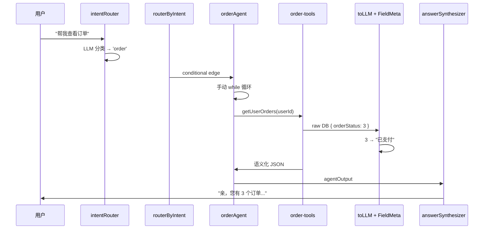
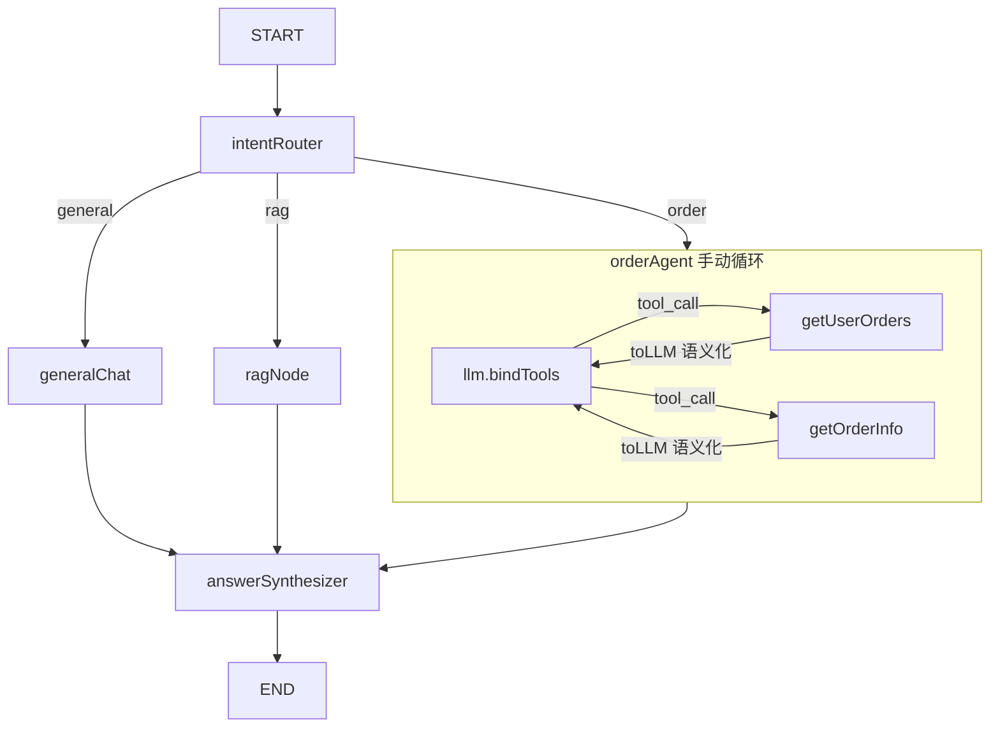

# AI Agent 订单查询系统 — 面试问答

> 基于 NestJS + LangGraph + LLM 的电商客服 Agent 系统
> 对应代码: [`order-agent.node.ts`](../apps/api/src/client/ai-customer/graph/nodes/order-agent.node.ts), [`order-tools.ts`](../apps/api/src/client/ai-customer/graph/tools/order-tools.ts), [`customer.graph.ts`](../apps/api/src/client/ai-customer/graph/customer.graph.ts)

---

## 一、30 秒项目简介

> 我实现了一个基于 **LangGraph StateGraph + LLM** 的电商客服 Agent 系统。采用 **意图驱动流水线架构**：用户输入 → Intent Router 分类 → 路由到对应 Agent → Agent 手动循环调用工具获取数据 → **FieldMeta + toLLM 语义转换层** 将 DB 数字代码映射为自然语言 → Answer Synthesizer 润色后返回用户。

---

## 二、基础问答

### Q1: 这个系统是做什么的？

电商 AI 客服的订单查询模块。用户说「帮我查看订单」→ 系统自动理解意图 → 调用订单查询接口 → 把数据库的状态码（1,2,3）转成自然语言 → 返回给用户。

### Q2: 用了什么技术栈？

| 技术 | 用途 |
|------|------|
| NestJS | 后端框架，DI 注入 OrderService |
| LangGraph (StateGraph) | 多 Agent 状态机编排 |
| LangChain (@langchain/core) | LLM 调用、Tool 绑定、Prompt 模板 |
| Zod | 工具参数校验 |
| DeepSeek / Ollama | LLM Provider（通过环境变量切换） |
| @FieldMeta + toLLM() | DTO 数据语义化转换 |
| Prisma + PostgreSQL | 数据持久化 |

### Q3: 整个流程是什么？



---

## 三、技术深问

### Q4: 为什么用 LangGraph 不用 LangChain Agent 或直接调 API？

**状态驱动编排**是核心原因：

1. **多意图路由**：Intent Router 分类后通过 `addConditionalEdges` 动态路由到不同 Agent（order/wallet/coupon），单 Agent 模式做不到
2. **共享状态**：`AgentState` 用 `Annotation.Root` 管理，`messagesStateReducer` 自动追加消息，各节点共享 `userId`、`intent`、`agentOutput`
3. **可扩展**：新增 Agent 只需加一个 Node + 一条路由规则，不影响现有节点

```typescript
// customer.graph.ts — 核心编排
workflow
  .addNode('intentRouter', createIntentRouterNode(llmConfig))
  .addNode('orderAgent', createOrderAgentNode(llmConfig, orderService))
  .addConditionalEdges('intentRouter', routerByIntent, {
    orderAgent: 'orderAgent',
    generalChat: 'generalChat',
    // 新 Agent 加一行即可
  })
  .addEdge('orderAgent', 'answerSynthesizer');
```

### Q5: Agent 循环为什么手动实现？不用 createAgent / createReactAgent？

**类型安全和 API 废弃问题是关键原因：**

| 方案 | 问题 | 结论 |
|------|------|------|
| `createAgent` (langchain) | `maxIterations` 不存在于类型定义 → TS2769 | ❌ 类型不安全 |
| `createReactAgent` (@langchain/langgraph/prebuilt) | 已标记 `@deprecated` | ❌ 用户说「既然废弃，为什么使用」 |
| **手动 `llm.bindTools(tools)` + while** | 完全可控 | ✅ 最终方案 |

```typescript
// 手动 Agent 循环的核心
const llmWithTools = llm.bindTools(tools);
let iterations = 0;
const MAX_ITERATIONS = 3;

while (iterations < MAX_ITERATIONS) {
  const response = await llmWithTools.invoke(currentMessages);
  currentMessages = [...currentMessages, response];
  if (!response.tool_calls || response.tool_calls.length === 0) break;
  // 执行工具调用
  for (const toolCall of response.tool_calls) { ... }
  iterations++;
}
```

**设计要点：**
- MAX_ITERATIONS=3 防止无限循环
- `state.messages.slice(-6)` 做历史窗口，控制 token 消耗
- 每轮重新构建 `currentMessages`，保证 LLM 看到完整上下文

### Q6: LLM 如何理解状态码 1,2,3？（数据转换层）

通过 **`@FieldMeta` 装饰器 + `toLLM()` 语义转换层**：

```typescript
// DTO 上定义元数据
@FieldMeta({
  label: { zh: '订单状态', en: 'Order Status' },
  enum: {
    1: { zh: '待支付', en: 'Pending Payment' },
    3: { zh: '已支付', en: 'Paid' },
    // ... 共 9 种状态
  },
})
orderStatus!: number;

@FieldMeta({
  label: { zh: '实付金额', en: 'Amount' },
  type: 'amount',  // → 自动加 ¥ 前缀
})
finalAmount!: string;

@FieldMeta({
  label: { zh: '支付时间', en: 'Payment Time' },
  type: 'date',  // → dayjs 格式化
})
paidAt!: number;
```

**转换效果：**
```
raw DB:  { orderStatus: 3, finalAmount: "9.98", paidAt: 1704067200000 }
                                 ↓  toLLM()
语义化:  { "订单状态": "已支付", "实付金额": "¥9.98", "支付时间": "2024/1/1 08:00" }
```

**设计原则：** 面向 LLM 序列化，不是给前端用的，重点是语义化而非性能。支持中英文 locale。

### Q7: 异常处理怎么做？工具调用失败怎么办？

**两层防御：**

1. **工具层**（[`order-tools.ts`](../apps/api/src/client/ai-customer/graph/tools/order-tools.ts)）：
   ```typescript
   try {
     const result = await orderService.getOrderDetail(userId, orderId);
     return JSON.stringify(toLLM(result, OrderItemDto, 'zh'), null, 2);
   } catch (e) {
     return JSON.stringify({
       error: 'Unable to find order information...',
     });
   }
   ```
   捕获 `BizException`，返回错误字符串而非抛出 → LLM 看到错误并友好回复

2. **Agent 层**（[`order-agent.node.ts`](../apps/api/src/client/ai-customer/graph/nodes/order-agent.node.ts:91-98)）：
   ```typescript
   try {
     while (iterations < MAX_ITERATIONS) { ... }
   } catch (error) {
     logger.error(`[order-agent] agent error:`, error);
     return { agentOutput: 'Sorry...', messages: state.messages };
   }
   ```
   兜底返回 fallback 消息

3. **systemPrompt 规则 #7** 明确告诉 LLM：工具返回错误时提示用户检查订单号

### Q8: 有哪些工程化的考量？

| 问题 | 解决方案 |
|------|----------|
| `console.log` 不规范 | 替换为 `Logger` from `@nestjs/common` |
| `BizException` 穿透到全局过滤器 | 工具层 try-catch 捕获 |
| 对话历史无限增长 | `state.messages.slice(-6)` 窗口限制 |
| 重复注释块 | 清理方案 A 注释重复 |
| LLM Provider 切换 | `createLLM()` 工厂模式，`.env` 一行切换 |
| Tool 参数校验 | Zod Schema + LLM 自动传参（方案 A） |

### Q9: Promise.all 可以优化 tool 调用吗？

当前是串行 for 循环。可以改成 `Promise.allSettled` 并行执行：

```typescript
const settled = await Promise.allSettled(
  response.tool_calls.map(async (toolCall) => {
    const foundTool = tools.find((t) => t.name === toolCall.name);
    if (!foundTool) return null;
    const result = await (foundTool as any).invoke(toolCall.args);
    return new ToolMessage(result, toolCall.id ?? '');
  }),
);
const results = settled
  .filter(r => r.status === 'fulfilled')
  .map(r => r.value)
  .filter(Boolean);
currentMessages = [...currentMessages, ...results];
```

**但是当前场景下 LLM 几乎不会一次返回多个 tool_calls**（ReAct 模式是「想一步、做一步、看一步」），所以优化收益不大。作为面试中的「未来优化方向」提出来即可。

---

## 四、架构图



---

## 五、面试加分项 — 体现工程思维

1. **先分析再动手**：写 `plans/order-agent-production-readiness.md` 分析 P0/P1/P2 问题，按优先级逐个修复
2. **类型安全**：`(foundTool as any).invoke()` 是因为 LangChain tool types 不暴露 `.invoke()`，用类型断言 + 注释说明原因
3. **日志规范**：监控 `totalMsgs` 和 `lastToolCall`，方便排查问题
4. **错误隔离**：工具层和 Agent 层两层 try-catch，不会因为一个失败导致整个请求崩溃
5. **不依赖废弃 API**：`createReactAgent` 废弃了就不再用，改用手动循环

---

## 六、参考文件

| 文件 | 内容 |
|------|------|
| [`order-agent.node.ts`](../apps/api/src/client/ai-customer/graph/nodes/order-agent.node.ts) | Agent 节点工厂 + 手动循环 |
| [`order-tools.ts`](../apps/api/src/client/ai-customer/graph/tools/order-tools.ts) | 两个订单查询工具 |
| [`customer.graph.ts`](../apps/api/src/client/ai-customer/graph/customer.graph.ts) | StateGraph 编排 |
| [`to-llm.ts`](../apps/api/src/common/ai/utils/to-llm.ts) | 语义转换层 |
| [`order-item.dto.ts`](../apps/api/src/client/orders/dto/order-item.dto.ts) | DTO + @FieldMeta 装饰器 |
| [`llm-factory.ts`](../apps/api/src/client/ai-customer/graph/llm-factory.ts) | LLM Provider 工厂 |
| [`intent-router.node.ts`](../apps/api/src/client/ai-customer/graph/nodes/intent-router.node.ts) | 意图路由节点 |
| [`answer-synthesizer.node.ts`](../apps/api/src/client/ai-customer/graph/nodes/answer-synthesizer.node.ts) | 回答合成润色 |
| [`PROGRESS.md`](../docs/AI-joymini/PROGRESS.md) | 项目进度总结 |
